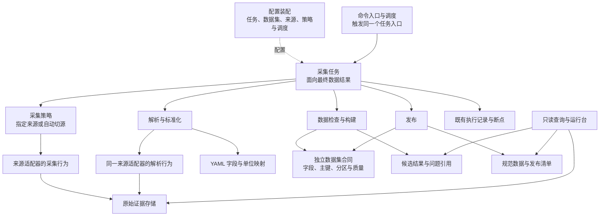
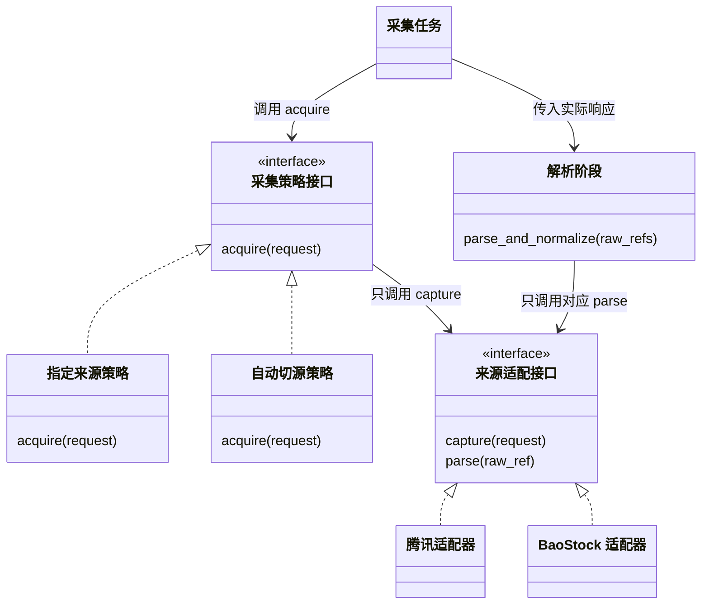

# 市场数据中心总体设计

本文维护产品边界、领域对象、职责依赖和跨模块合同。当前交付范围、未关闭问题及验收证据由[项目进度](PROJECT_PROGRESS.md)维护；历史取舍见[工程决策](docs/engineering-decisions.md)。本文中的目标合同不代表全部功能已实现或可生产。

## 文档与事实的归属

| 内容 | 主要维护位置 | 消费者 |
|---|---|---|
| 当前目标、开发任务、依赖、状态和证据 | PROJECT_PROGRESS.md | 负责人和开发者 |
| 模块、对象、依赖和端到端边界 | 本文 | 设计与实现者 |
| 三口径记录、单位、完整性和消费 | 日线专项设计 | 构建、存储及查询实现者 |
| 来源请求、字段与接入限制 | docs/providers/ | 来源适配器维护者 |
| 任务执行、重做与恢复 | docs/pipeline/collection-tasks.md | 执行与排障人员 |
| 文件、日期、发布与审计引用 | docs/storage/README.md | 存储及运维人员 |
| 验收条件与检查范围 | 验收基线 | 开发者及验收者 |
| 为什么变更及替代关系 | docs/engineering-decisions.md | 后续维护者 |

YAML和可执行代码定义当前运行行为；文档说明其业务合同和限制，不能用历史图或例子推导新权限。每份文件只维护自己的主要事实，其他位置引用。

## 1. 产品定位

市场数据中心的职责只有一句话：

> 把外部不稳定、格式不一致、质量参差的数据源，整理成稳定、统一、可追溯、可重跑的数据产品。

投资业务不直接接触腾讯、AkShare、BaoStock、pytdx 等来源，也不直接读取 Parquet 文件，只通过统一数据接口访问：

```python
market.daily_bars(...)
market.realtime_quotes(...)
market.fundamentals(...)
market.market_snapshot(...)
```

市场数据中心负责：数据源管理、能力路由、失败降级、字段与单位标准化、质量检查、原始数据留存、缺失补数、重跑、版本、发布、查询、运行状态和审计。

---

## 2. 产品总体架构

```text
股票分析工具 V2
│
├── 投资工作台
│   ├── 市场
│   ├── 股票筛选
│   ├── 观察池
│   ├── 研究分析
│   ├── 模拟验证
│   ├── 投资组合
│   └── 投资复盘
│
└── 市场数据中心
    ├── 数据总览
    ├── 数据源管理
    ├── 数据能力与路由
    ├── 数据集管理
    ├── 数据质量
    ├── 任务运行
    └── 数据修复
```

### 2.1 投资工作台负责

- 股票搜索、筛选、观察
- 研究分析、策略、模拟
- 投资组合、收益分析、复盘

### 2.2 市场数据中心负责

- 外部数据接入
- 多来源管理
- 数据标准化
- 数据质量与修复
- 数据持久化与版本
- 数据发布
- 对外数据访问

### 2.3 明确禁止的跨层行为

投资业务禁止：

```python
akshare.stock_zh_a_hist(...)
requests.get("腾讯接口")
pd.read_parquet("/data/...")
```

投资业务只能通过统一市场数据服务读取数据。

---


## 核心对象

### 3.1 核心术语与职责

| 术语 | 含义和边界 |
|---|---|
| 数据集 | 独立的数据合同：记录结构、主键、分区、质量和发布要求，不持有任务状态 |
| 采集任务 | 按日期、证券范围和采集策略生产某数据集结果；不是一次来源调用 |
| 采集策略 | 指定来源，或按顺序在配置允许的采集故障下切源；不接收业务质量结论决定下一来源 |
| 原始响应 | 留存的请求清单和响应字节；SDK不暴露传输字节时明确标记解码载荷，不冒充网络报文 |
| 来源行与标准候选 | 原响应经解析及字段映射后的派生记录，分别保留来源位置和转换依据，不冒充原始响应 |
| 数据结果 | 某数据集、日期和范围的候选或已发布结果，携带覆盖结论、问题引用和来源证据；不依附任务进程存活 |
| 问题明细 | 采集、解析或检查中出现的问题，记录来源、阶段、记录定位、原因及影响；不是新的状态管理系统 |
| 缺失集合 | 目标范围减去检查有效记录，用于完整性报告与发布判断；不驱动本次自动切源 |
| 执行记录 | 内部保存进度、实际来源选择、断点和原始引用；不是用户需要维护的另一套任务对象 |

新任务固定业务日期与范围，历史完整性不能以今天名单代替。候选与已发布数据分开；发布门槛通过与零缺失分开。失败证据及历史文件保留，不因设计调整删除。


## 职责、对象关系与阶段合同

以下图表达已确认的职责与设计，不强制为每个方框建立类、表或服务。当前正式任务只接通证券名单与单日日线；多来源策略和其他数据集须分别完成实现与验收。

### 4.1 逻辑架构框图：表达职责依赖

框代表逻辑模块，箭头代表调用或依赖，不表示执行先后。虚线是配置绑定。采集策略只依赖来源的采集接口；解析与检查没有调用采集策略的依赖。



数据集、来源和任务是核心业务概念；调度、执行记录、存储是支持机制，不为每个概念新增管理器或后台服务。数据检查可以使用既有文件和候选，但不发网络请求。未来本地导入可直接提供符合合同的候选，复用检查和发布，不需要伪造采集任务或来源。

### 4.2 UML 对象关联：数据与任务解耦

类名是拟议合同，不要求每个方框新建一个Python类或数据表。实线箭头是引用，空心菱形是聚合；数据结果不由任务组合拥有，任务结束不销毁数据。基数说明多个任务可以写同一数据集、一个数据集可以有多个日期及范围结果。


`DataRecord`表达具体数据集记录：名单复用 `SecurityRecord`，最终日线由 `DailyRecord` 按第12.12节组合各口径；`BarRecord`继续服务分钟及历史单口径数据，来源候选由标准化行承载。不建立通用巨型记录父类。范围与分区是值，任务ID是执行标识，不能混入数据业务主键。`RawResponse` 可以被回放复用，故执行记录对它是引用；失败发生于收到响应之前时可以没有原响应，仍有采集尝试与错误记录。

### 4.3 设计模式：策略与适配器的组合

策略模式（Strategy）只封装“如何取得响应”；适配器模式（Adapter）封装各来源协议与解析差异。选择策略不改变任务后续流程；同一来源适配器提供分开调用的 `capture` 与 `parse` 行为，不为此创建两套来源实现。



策略调用的是来源合同内的采集行为，不捕获解析异常来尝试下一来源。解析始终使用原响应记录的实际来源及版本，不能套用任务期望来源。字段映射由现有归一化模块处理；业务检查与名单/日线构建通过组合复用，不再为它们预建一层可配置插件或通用父类。

### 4.4 阶段合同与自动切源边界

| 阶段 | 输入 → 输出 | 可以判断 | 不做什么 |
|---|---|---|---|
| 采集 | 请求范围、采集策略 → 实际来源、原响应引用、逐次尝试 | 传输是否完成、响应状态、请求包是否完整取得 | 不检查价格、单位、证券覆盖或内容结构；不把“接收成功”当成可发布 |
| 解析与标准化 | 已保存原响应 → 来源行、标准候选、解析问题 | 格式/字段/类型/日期与映射能否解释 | 不自动换源或联网补数 |
| 数据检查与构建 | 标准候选、数据集合同 → 有效候选、覆盖和问题明细 | 业务合法性、重复、冲突、缺失及口径 | 不把空返回推断为停牌，不调整采集策略 |
| 发布 | 通过门槛的结果 → 规范分区及发布清单 | 候选完整性、目标分区及恢复标记 | 不降低标准，也不偷偷用其他来源补齐 |

HTTP 200但HTML错误页、无效JSON、空业务数组、重复日期或价格异常都在后续阶段报告，不能作为本次自动切源条件。连接失败、超时及配置列出的HTTP状态可按有界策略重试或切源；未知异常、程序缺陷、无效配置、证据落盘失败直接失败，不能一律归为网络故障。

允许为分页游标、会话控制或SDK调用完成做最低限度的协议处理，但不能借此执行业务校验。SDK已解码且无法取得网络字节时保存解码载荷并明确限制；不能宣称SDK内部完全不解析。某适配器无法在不改变既有传输行为的前提下拆分时，应列出差异与迁移验证，不新增隐式回退路径。

切换单位是明确的请求范围：逐证券接口对该证券的请求切源，分批接口对配置确定的批次切源；分页或多请求合成的一个采集包保持同一实际来源，不拼接失败来源半包与另一来源结果。不同已声明的互补来源（如普通ETF和货币ETF）本来就是不同输入，分别采集后合并，不等于“发现缺失后补采”。

乐观接收不是信任业务内容，也不取消证据与发布约束。来源资格在请求前检查；未合格来源不发请求、不因人工指定绕过。已知参数不支持的来源不在可选集合中，不能用它试探后猜接口；指定来源不可用则明确报错。来源健康变化与质量问题可以记录供后续任务判断，但不驱动本轮反向采集。

### 4.5 问题明细与独立数据结果

问题明细由解析/检查者写入既有输入报告或质量结果，任务摘要引用这些结果；运行台复用它们展示，不再维护另一份诊断事实源。采集尝试记录使用同一来源定位，属于不同阶段的执行证据，不冒充数据错误。

| 问题字段 | 含义 |
|---|---|
| `stage`、`code`、`reason` | 哪个阶段、哪类问题、具体原因 |
| `provider`、`input_id`、`endpoint` | 哪个实际来源及接口 |
| `request_scope`、`raw_ref` | 请求日期/窗口/证券与原响应；无响应时 `raw_ref` 为空并明确原因 |
| `record_locator`、`field` | 行号、页面、证券与日期、字段；整份解析失败时可为空 |
| `observed_value`、`rule_ref` | 脱敏且限长的异常值、触发规则及版本；不保存秘密 |
| `impact`、`affected_scope` | 整响应失败、记录拒绝、字段置空或分区缺失等影响与范围 |

例如来源A的HTTP请求成功，但日线中某条收盘价无法转数值：采集记录仍为接收完成；解析记录实际来源、证券、日期、字段、原始行位置及规则；业务检查据此计算有效覆盖，不能伪造一条零价记录，也不会自动请求来源B。全响应无法解析时生成响应级问题；容许部分字段为空沿用已确认单位规则，不新增降质兜底。候选是否允许发布由原数据集合同决定，不因本设计自动放宽门槛。


## 配置职责

### 5.1 规则的唯一归属

| 配置 | 负责什么 |
|---|---|
| `datasets/<数据集>.yaml` | 独立数据对象的字段、主键、分区、质量与发布门槛 |
| `providers.yaml` | 来源输入、接口参数、传输、限速及支持范围；不决定业务任务触发时间 |
| `normalization/<数据集>.yaml` | 来源解析后的字段映射、单位与口径转换合同 |
| `collection.yaml` | 任务目标数据集、证券范围和策略引用；现有 `collection_profiles` 另定义频率、交易日条件及是否调度 |
| `capabilities.yaml` | Provider 能力目录及显式采集策略；当前 `daily_fixed` 只绑定一个正式来源和三种口径参数 |

静态配置与运行状态分开。选择了某来源不等于该来源已获得生产资格；资格依实际接口、参数、配置、时效与业务证据判断，不再比较源码指纹。


日线正式合同由 `config/datasets/daily_bar.yaml` 唯一声明。任务引用采集策略并冻结规则，后续处理使用冻结值；不能在续跑时静默换配置。当前 `daily_fixed` 的具体API参数直接查 `config/capabilities.yaml`，不在本文复制另一份参数表。来源资格仍取决于当前版本、请求范围、时效及健康证据。

## 证券范围与请求窗口

### 证券身份、范围与历史窗口

- `instrument_id` 是稳定身份，来源代码、交易代码及代码迁移通过带有效期的别名历史对应；不能把代码字符串永久等同于证券身份。
- 新上市、退市、更名和 ETF/LOF 分类变化须有证据；单一来源缺失不能直接判退市。历史目标集合按上市、退市有效期计算，资料不足则明确分母不确定，不用今天的名单证明历史完整。
- 指数区分发布日、计算起始日及回溯编制历史。北交所新代码携带的上市前历史须按市场有效期识别；这不自动授予当前接口历史覆盖资格。
- 日线可以面向已支持的全量或筛选范围；分钟首期仅面向观察池（Watchlist）、策略候选或明确证券集合。LOF、指数、可转债等旧设计目标不自动加入当前证券主数据任务。
- 请求区间按交易日历、接口最大天数、最大行数和分页能力拆分；逐单元核对首尾时间及返回行数。达到行数上限而没有分页时只能认证可见窗口，不能声称更早历史完整。
- 同等质量下优先批量能力，但必须符合市场、资产、字段、复权、时间与健康资格。全量接口保存完整原响应，解析和业务范围过滤在后续阶段执行，不以质量缺失触发本轮补采。


## 当前技术与实现边界

| 职责 | 实际承接 |
|---|---|
| 标准对象 | domain中的数据类和枚举；没有以Pydantic替代现有模型 |
| 配置与标准化 | YAML、config/loader.py、quality/normalization.py |
| 任务与构建 | pipeline/inputs.py、pipeline/daily.py；名单、分钟等模块各自承接业务 |
| 持久化 | DuckDB元数据、Parquet正式数据、SQLite分钟热存储、文件原始证据 |
| 查询与观察 | 现有FastAPI只读运行台、规范日线与分钟查询 |
| 调度 | 到期判断与单次触发；配置启用不表示已部署常驻进程 |

源码职责见[代码结构](CODE_STRUCTURE.md)，实际依赖以 `pyproject.toml` 为准，测试解释器以[协作约定](AGENTS.md#项目python环境与测试执行)为准。版本记录、资格、缓存及候选复用的职责见[来源专项设计](provider-capability-verification-and-normalization.md#实现版本记录与验证范围)。源码正确性按实际影响分层测试，不以文件摘要变化判定其他模块失效。

## 后续统一访问目标（未全部实现）

### 数据访问服务

#### Python API

```python
market.daily_bars(
    symbols=["600519"],
    start="2026-01-01",
    end="2026-09-28",
)
```

```python
market.realtime_quotes(
    symbols=["600519", "000001"],
)
```

#### HTTP API

```text
GET /api/market/daily-bars
GET /api/market/quotes
GET /api/market/instruments
GET /api/market/calendar
```

历史接口只读取 Published 数据。实时接口通过实时路由器获取当前合格数据。

---


这些Python/HTTP接口是未来统一服务目标，当前已交付只读接口以[运行台合同](docs/service/read-only-web.md)为准。投资工作台、任务写操作、实时路由和财务等业务接入按确认范围单独交付。

## 验收与演进

阶段和任务维护于项目进度，M1/M2验收条件由[验收基线](stock-data-test-design-acceptance-baseline.md)维护。股票记录结构与适用性由[日线合同](stock-data-design-qfq-history-rebuild.md)维护，多日期重建由[历史重建设计](docs/pipeline/daily-history-rebuild.md)维护。原始响应先留存、候选与正式隔离、质量错误不反向联网、失败不破坏旧发布、范围冻结和可恢复提交是持续约束。

首期保持单机、现有模块及显式流程；微服务、分布式调度、通用工作流和新的管理层不在本次整改范围。开发顺序与退出条件先确认再执行，不把未实现要求从验收范围移除。

历史V1.3完整正文保留于Git提交 `78208bc`；关键取舍及独有内容承接见工程决策。原始证据、旧任务和生产数据不随本文重组删除。
