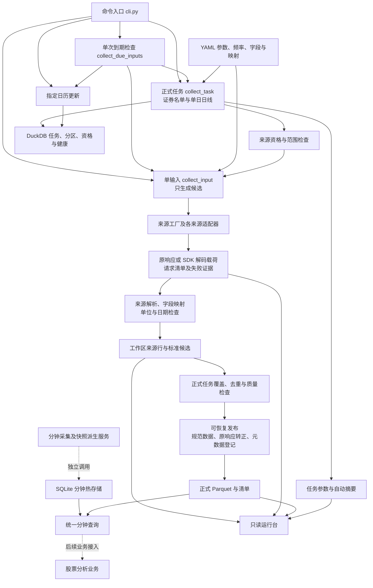
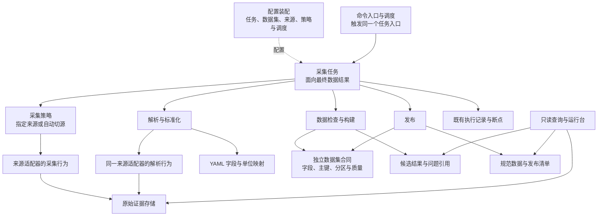
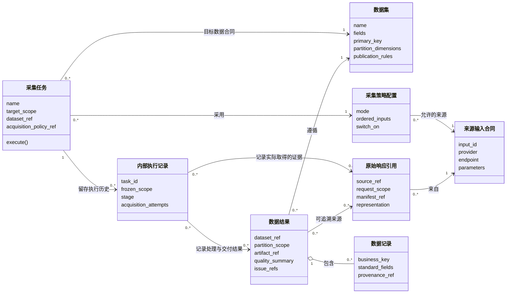
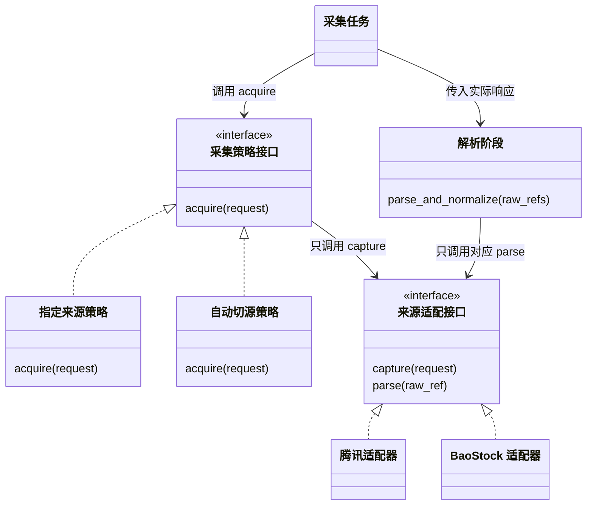

# 股票分析工具 V2：市场数据中心架构设计 V1.3

## 当前实现与优化评审（2026-10-27）

本节供项目维护者评审现状与后续优化；核查基线为提交 `d7dc13f2eafb3145219c47028860dba1257dc836`。依据实际代码、YAML、测试文件和本机已有运行文件整理，未联网采集、未运行业务任务，也未重新执行历史验收。后文编号章节保留总体目标；其中示例接口、统一多来源构建与投资工作台不代表当前已交付。具体任务规则仍由[任务流程](docs/pipeline/collection-tasks.md)维护，文件布局由[存储说明](docs/storage/README.md)维护。

### 是什么、为什么、怎么样

项目已经具备行情数据采集、留证、标准化、检查、发布、恢复和只读观察的基础设施。目前最完整的业务链路是证券名单与单交易日日线。分钟、快照及其他研究数据有不同深度的独立实现，不能合并描述为同一条已投产链路。

本次梳理解决三个问题：从哪个入口生成什么数据；候选数据何时变成可消费的正式数据；为什么配置有能力但任务仍可能无法执行。采用现有总体设计承载功能与模块图，现有任务说明承载流程图，不另建报告体系或运行记录。机器记录仍由任务和存储生成；本文是面向维护者的有日期评审结论，不替代这些记录。

现状分四层判断：**代码实现**表示有可执行路径；**配置启用**表示当前配置允许进入相应计划；**验证范围**表示已有证据实际覆盖的日期、证券和参数；**生产资格**表示当前代码、配置、有效期、范围及来源健康检查均允许正式选用。历史发布也不自动授予当前版本生产资格。

### 当前功能清单

| 功能 | 用户可见行为与实际入口 | 实现边界及验证限制 |
|---|---|---|
| 证券名单 | `collect-task` 构建正式清单；`collect-due-inputs --dataset security_master` 检查或执行当天名单任务 | 合并多来源、身份去重、分类及日期检查、覆盖检查、受约束整份旧名单回退；当前与历史日期选择不同输入。已留存历史发布，不等于任意历史日全市场完成 |
| 交易日历 | `update-trading-calendar` 查询指定日开闭市；证券名单调度执行时按条件补查未知日 | 单日 BaoStock 结果写既有日历表；另有新浪正向交易日期导入能力。未出现在正向列表的日期保持未知；最近提交记录三类日期小样本，本文未复跑 |
| 股票、ETF、指数日线 | `collect-task` 按一天、资产类型和复权口径构建；动态范围支持 `all_stock/all_etf/all_index` | 正式资格检查仅接通腾讯 `ASTOCK-002-daily`；支持不复权、前复权、后复权独立分区，默认不复权；指数只允许不复权资格。配置声明 LOF 不代表动态任务已支持 `all_lof` |
| 通用来源输入 | `collect-input` 按输入编号采集或严格回放，保存来源行、标准化结果、候选 Parquet 和检查报告 | 工厂绑定大量来源，完成状态为 `candidate_complete`，不会因此发布业务分区；直接实时输入采集也不能替代正式任务资格与发布验收 |
| 板块与研究数据 | 行业/概念、成分/权重/估值、资金流、分红与公司事件、财务与股东、龙虎榜与涨跌停、新闻、宏观和交易所统计等候选输入 | 具体支持项以 `providers.yaml`、工厂绑定和映射为准；输入有实现不代表这些数据域已经接通正式多来源构建、查询产品或自动调度 |
| 盘中分钟 | `RealtimeMinuteCollector.collect_cycle()` 按观察池采集已闭合 1 分钟，标准化后写热存储 | 有交易时段、吞吐预算、观察池数量及闭合延迟约束；不是 `collect-task` 支持的数据集，未发现本次启动常驻分钟服务的证据 |
| 快照与派生 | `SnapshotMinuteAggregator` 从累计快照差分生成暂定分钟；收盘快照可生成暂定日线；完整 1 分钟可派生 5 分钟 | 累计值重置、采样不足、交易时段与单位语义有独立规则；派生值保留暂定状态，不能作为原生历史数据的等价证明 |
| 盘后校准 | `MinuteReconciliation`、`DailyReconciliation` 合并历史与暂定值，仲裁冲突、记录完整性 | 已有代码和离线用例；仍需调用方供应记录和运行入口，时间表存在不等于所有处理器已绑定并持续执行 |
| 来源选择与质量 | 能力注册、缺失集合、来源冷却、探针恢复、单位映射、价格及时间校验、冲突仲裁 | `DailyCollectionService` 有独立多来源补缺路径；当前正式日线任务没有自动跨来源补缺。两条路径不能混称为同一业务闭环 |
| 调度与恢复 | 单次到期检查、任务幂等、全量/断点/指定证券重做，`recover` 处理发布中断 | `collection.yaml` 仅名单频率模板启用；腾讯快照/日线/分钟模板关闭；`PhaseOneScheduler` 是可注入处理器的到期计算器，没有据此启动常驻进程 |
| 存储与追溯 | 原始字节/SDK载荷、候选、正式 Parquet、DuckDB 元数据、SQLite 分钟热数据、审计归档 | 清单哈希、锁、临时文件与发布恢复已实现；旧日线混合目录不被新复权读取逻辑自动使用 |
| 查询与运行台 | `stock-data-web` 提供总览、任务、来源行查询、原始证据、发布清单；`MinuteQuery` 合并正式与热分钟 | 网页数据查询主要读取来源行，不能视为规范行情查询接口；网页只读，没有任务启动/重做按钮。Compose 定义只读 Web 部署，不运行采集器 |

输入声明的静态核查结果：`config/providers.yaml` 的 `input_capabilities` 下共 92 项，其中 `implemented_validation_only` 79 项、`blocked` 8 项、`unimplemented` 2 项、`alias` 3 项。这是配置声明数量，不是在线可用接口数、独立 Provider 数或生产资格数量；旧接口说明表中的 64 项属于旧导出范围，不再用作当前总数。实际绑定见[输入工厂](src/routing/factory.py)，详细字段见[来源说明](docs/providers/README.md)。

### 当前模块与消费关系

实线表示当前代码中的调用或读写关系；虚线表示需要调用方接线、独立服务路径或后续目标，不能理解为已经部署。图中的“来源输入”是具体接口合同，例如腾讯单证券日线或上交所 ETF 目录，不是一个新的管理层。



运行台不直接读取运行中的 DuckDB；它从已有文件构建视图，避免与采集任务争用数据库。配置中的 `source_inputs`（任务选用的来源输入清单）决定会实际采集哪些接口：例如默认证券任务选 BaoStock、北交所与上交所 ETF 目录，不会因为另一个目录适配器已经存在就自动调用它。来源资格检查则进一步决定这些接口在当前范围能否执行；没有合格证据时，即使配置选中了接口，也可能拒绝正式采集。

### 数据分层与真实文件的含义

| 层次 | 保存内容 | 生产者与消费者 |
|---|---|---|
| 来源原始证据 `raw/` | 请求/响应清单、精确响应体；SDK 未暴露传输字节时保存明确标识的解码载荷 | 采集层写，回放、来源核验和排障读；正式任务先写 `_tmp`，完成发布后转正 |
| 工作区 `task_workspace/` | 来源行、标准化候选、覆盖结果、任务定义与自动摘要 | 处理与任务流程写，发布器、恢复器和运行台读；来源行已经经过解析，不冒充原始响应 |
| 正式数据 `canonical/` | 通过检查的 Parquet 与分区清单 | 发布器写，规范数据消费者读；单独存在文件不是任务完成证明，还要检查清单与待恢复标记 |
| 元数据 `metadata/` | 任务状态、执行尝试、来源资格、健康、分区与冲突等机器记录 | 调度、路由、任务、恢复器消费，不是供用户直接编辑的配置 |
| 分钟热数据 `hot/` | 盘中暂定分钟与质量信息 | 分钟采集及派生服务写，分钟查询与盘后校准读 |
| 审计归档 `task_archive/` | 重做前内容、稳定证据引用及已核验任务归档 | 既有归档逻辑写，历史追溯与恢复核验读；不自动删除来源证据 |
| 执行日志 | 终端进度、异常与容器日志 | 运行观察使用；不能代替原始证据、任务状态或发布记录 |

日线新分区按 `日期/daily_bar/资产类型/复权口径/` 隔离。具体文件名、历史布局和未落实的可读命名差距以[存储说明](docs/storage/README.md)为准。本机检查仍能看到历史哈希目录与旧混合日线目录；本文不迁移或改写这些内容。

### 本机运行证据抽查

检查时间为 2026-10-27；以下都是历史文件，不是今天新执行的任务。三个 Parquet 文件的 SHA-256 与对应 manifest 的 `content_hash` 一致；未重新解析业务行、核验全部原始响应、复查来源资格有效期或数据库状态，所以不授予新的生产结论。

| 产物 | 本次观察 | 能证明什么 |
|---|---|---|
| [名单任务摘要](data/task_workspace/2026-10-09/security_master/summary.json) | `security-master-history-20261009`，`retained`，`published`，`complete_today=true`，5 个来源单元完成；摘要生成于 10 月 12 日 | 当时任务记录为留存发布完成，不是今天的在线全量验收 |
| [名单发布清单](data/canonical/2026-10-09/security_master/manifest.json) | `row_count=expected_count=7267`，数据文件哈希通过 | 本机保留一份当日历史名单；清单数量相等不独立证明全市场完整 |
| [股票日线旧清单](data/canonical/2026-10-09/daily_bar/stock/manifest.json)与[ETF 日线旧清单](data/canonical/2026-10-09/daily_bar/etf/manifest.json) | 分别 5 条与 3 条，数据文件哈希通过；位于旧混合目录 | 旧样本数据存在；不能作为新复权分区已发布或全量日线完成的证明 |
| [全量股票任务摘要](data/task_workspace/2026-10-09/daily_bar/summary.json) | `daily-full-stock-20261009`，最后生成于 10 月 15 日，`collecting`；5573 单元中候选完成4789、失败14、待处理770；`publication.published=false` | 仅表明最后持久化进度；未检测进程存活，不能声称仍在运行或已全量发布 |

本机 `data/` 实际存在，不能沿用其他部署环境或旧交接中的“目录不存在”描述。生产状态必须带运行根目录与环境说明。此次未在上述抽查路径发现可证明新指数名单正式发布的记录；未穷尽搜索所有历史归档或其他主机，指数资格与最新运行仍待专项核验。

本次读取文件的 SHA-256 保留如下，以区分未来覆盖后的内容；哈希是文件指纹，不是业务字段或执行日志。

| 文件 | SHA-256 |
|---|---|
| 名单摘要 | `5d40d50b1038a7c1faeb7793ae8549a58569c36fae0b415fbff0cc53e3b6b599` |
| 全量股票日线摘要 | `d15ae3c57ce2a182d0df0702f56fe63fe98ae05e47a1bf4427179296cfe6ca82` |
| 名单清单 | `ded0841d3ac928618496168ca703103a59d346fe635b7805d0a73e211b42f70d` |
| 股票旧日线清单 | `12c22f7e277f4e68befdf6ba07138a653f007edbe8adceb2ea35f8ae7f7f1517` |
| ETF 旧日线清单 | `26427a7ef872eb981525a9b6204f7593bf958d50202d1db6d96ab4bac03616bd` |

### 后续优化讨论：必要性与取舍

以下都是建议，未批准为开发范围。优先把现有数据目标验收清楚，再决定需要多少自动化；不据此新建服务、管理层、数据库或任务体系。

| 顺序 | 问题与依据 | 建议的最小方向 | 成本、风险与验证标准 |
|---|---|---|---|
| 1：明确交付目标 | 名单有历史发布，全量日线旧摘要未发布，新口径隔离代码与旧目录并存 | 先确认目标日期、资产范围、复权口径、实际运行根目录；复用现有证据确认指数名单与来源资格，再处理失败/缺失单元 | 旧证据可能因版本或有效期失效；需要实际业务验收，不能仅刷新说明或扩大样本授权 |
| 2：复核执行分支与恢复体验 | 名单调度有未更新日历时访问空更新结果的静态风险；日线恢复会重新展开名单；运行台只展示最后持久化状态，14 个失败单元尚未逐项核验 | 先复现下述分支并讨论最小修复；明确恢复是否应直接使用已冻结定义；利用既有摘要和证据解释失败及最后更新时间 | 尚未执行入口复现或修改代码；验证已知/未知日历、未到期、名单变化、重启与不重复请求，避免改变数据语义 |
| 3：收敛正式生产链路 | `DailyCollectionService` 有多源补缺，`collect_task` 有持久化重做；后者并未直接调用前者 | 先明确正式任务是否确需第二来源，再在现有模块中复用质量与补缺逻辑，保留各来源传输合同 | 这是后续代码改造议题；需比较请求、单位、窗口、仲裁及恢复行为，不能为统一入口直接重写传输层 |
| 4：缩小规则兼容与资格失效范围 | 旧式 `load_normalization_rules()` 把 `parameterized` 转枚举；`collect_input` 对较大固定代码文件列表计算版本 | 先完成参数化规则兼容回归；再讨论资格依赖是否能按真实来源与转换依赖收敛 | 缩小依赖必须保证业务相关变更仍使旧证据失效；不移除四层核验或有效期限制，需变更影响用例 |
| 5：测量后优化性能 | 逐单元预检并在采集前复查资格；工作区总锁覆盖任务；摘要含大量单元；网页查询会遍历报告并核验来源行 | 先测请求等待、资格核验、断点写入、文件扫描各自耗时；优先消除重复读取与计算，保留必要的运行中复查 | 并发会触及限速、SDK会话、DuckDB写入与发布顺序；未经测量不提高并发，不把旧局部提速当作全量保证 |
| 6：在现有页面完成业务闭环 | 当前数据查询是来源行视图，已有正式分区视图但无规范日线序列产品和任务操作 | 先讨论规范日线查询与覆盖质量视图，再评估受约束的任务预览、启动、续跑和指定重做 | 写操作需要任务互斥、资格与权限边界；继续复用现有 Web、任务与存储，不并行建立另一套后端 |
| 7：持续运行与历史重建 | 到期计算器、单日历更新已有；常驻处理器接线及前复权多日期重建尚无完整生产验收 | 单日任务稳定后，再确认常驻触发和日历刷新策略；前复权历史重建按专项设计单独评审 | 常驻运行产生持续外部请求，历史重建涉及多日期发布语义；必须另行确认范围并验证幂等、冷却、停止和恢复 |

建议首先讨论第 1 项的业务目标和第 3 项的链路收敛：前者确定近期实际交付，后者决定后续优化应集中在哪条执行路径。无需先做微服务拆分或引入新的编排框架。

静态待复核项：`pipeline/inputs.py::_collect_due_security_master()` 在从本地日历读取分支将 `update` 初始化为 `None`，只有满足补查条件才赋值，随后 `elif calendar_days is None and execute and update.source_manifest` 直接访问其属性。因此已有日历记录或尚未到期的执行分支存在 `AttributeError` 风险。本次只核对控制流，没有执行正式入口复现；后续应先用现有调度测试覆盖该分支，再决定修复，不把此风险误记成来源拒绝或日历缺数据。

### 核查入口与验证边界

本节结论可沿以下实现复核：[命令入口](src/cli.py)、[输入与正式任务](src/pipeline/inputs.py)、[名单计划](src/worker/scheduler.py)、[日历更新](src/service/calendar_update.py)、[来源资格与工厂](src/routing/factory.py)、[日线构建](src/pipeline/daily.py)、[发布门槛](src/quality/publication.py)、[分钟采集](src/pipeline/minute.py)、[分钟校准](src/pipeline/minute_reconciliation.py)、[分钟查询](src/service/market_data.py)、[运行台](src/service/web.py)、[部署配置](compose.yaml)。

相应用例入口包括 `tests/test_collection_tasks.py`、`test_retained_daily.py`、`test_update_services.py`、`test_retry_security_calendar.py`、`test_daily_collection_e2e.py`、`test_realtime_minute.py`、`test_minute_reconciliation.py`、`test_canonical_recovery.py` 和 `test_web_service.py`。这些是可复现验证入口清单，不表示本次执行通过。此次仅修改文档：28 个新增本地链接及其锚点检查通过，5 个 Mermaid 图块的围栏和流程图声明检查通过，3 个历史 Parquet 文件与发布清单的内容哈希一致，`git diff --check` 通过。未对 Mermaid 做渲染器解析或图片验收，未运行全套 Python 测试、未进行在线能力核验、未修改配置或数据。动态完整性与生产资格仍须在后续确认范围内复核。

---

## 总体目标设计与历史约定

下文保留原目标设计。发生状态冲突时，当前实现以本节链接的代码和 YAML 为准；业务规则变更须另外确认，不从旧示意图推导运行行为。

> 目标：把现有 `stock_data_manage` 收敛为一个简单、可靠、可维护的 A 股市场数据中心，为股票分析工具 V2 提供稳定的数据产品。
>
> V1.3 重点收敛任务与数据流：任务按最终数据分区定义；证券主数据直接读取本地已发布数据；采集按指定或故障切源策略取得响应，之后独立解析与校验，质量问题不反向触发采集；复权口径按数据集与任务合同明确指定，前复权历史重建另见专项设计；支持分红事件批量发现、人工历史重建、全量重做与断点重做；任务成功后归档来源证据，正式数据通过原子发布进入 `data/canonical`。
>
> 本文统一核心术语与模块边界；具体采集、重做和调度见 [任务流程](docs/pipeline/collection-tasks.md)，实际目录与实现差距见 [存储说明](docs/storage/README.md)。
>
> 股票日线的三口径单日聚合已实现。前复权历史变化发现、分红事件批量发现和多日期候选统一切换仍待后续设计与实现，详见[专项设计](stock-data-design-qfq-history-rebuild.md)。
>
> Provider 能力声明、能力探针、证据生命周期、覆盖矩阵和 YAML 归一化规则以 [Provider 能力验证与归一化设计](provider-capability-verification-and-normalization.md) 为准。

> 2026-10-09明确目录边界：`provider_validation/` 只承担正式实现前的来源可行性验证，包含当时的接口原始返回。进入业务开发后，代码、实现测试和说明分别位于 `src/`、`tests/`、`docs/`；业务响应、联调及验收新产物使用 `data/` 或 `tmp/` 下的隔离运行布局。已有验证证据只读引用。raw按“来源＋接口＋数据日期＋请求范围”每天唯一，正常、失败、重做和转正遵循 [任务流程](docs/pipeline/collection-tasks.md) 与 [存储说明](docs/storage/README.md)。这些按日路径和入口校正仍待代码实现；总体设计中的多来源、历史重建及管理能力不能据此视为已经上线。

## 1. 产品定位

市场数据中心的职责只有一句话：

> 把外部不稳定、格式不一致、质量参差的数据源，整理成稳定、统一、可追溯、可重跑的数据产品。

投资业务不直接接触腾讯、AkShare、BaoStock、pytdx 等来源，也不直接读取 Parquet 文件，只通过统一数据接口访问：

```python
market.daily_bars(...)
market.realtime_quotes(...)
market.fundamentals(...)
market.market_snapshot(...)
```

市场数据中心负责：数据源管理、能力路由、失败降级、字段与单位标准化、质量检查、原始数据留存、缺失补数、重跑、版本、发布、查询、运行状态和审计。

---

## 2. 产品总体架构

```text
股票分析工具 V2
│
├── 投资工作台
│   ├── 市场
│   ├── 股票筛选
│   ├── 观察池
│   ├── 研究分析
│   ├── 模拟验证
│   ├── 投资组合
│   └── 投资复盘
│
└── 市场数据中心
    ├── 数据总览
    ├── 数据源管理
    ├── 数据能力与路由
    ├── 数据集管理
    ├── 数据质量
    ├── 任务运行
    └── 数据修复
```

### 2.1 投资工作台负责

- 股票搜索、筛选、观察
- 研究分析、策略、模拟
- 投资组合、收益分析、复盘

### 2.2 市场数据中心负责

- 外部数据接入
- 多来源管理
- 数据标准化
- 数据质量与修复
- 数据持久化与版本
- 数据发布
- 对外数据访问

### 2.3 明确禁止的跨层行为

投资业务禁止：

```python
akshare.stock_zh_a_hist(...)
requests.get("腾讯接口")
pd.read_parquet("/data/...")
```

投资业务只能通过统一市场数据服务读取数据。

---

## 3. 市场数据中心总体结构

2026-10-28已确认的设计边界：任务面向可发布数据结果，数据集独立于任务；指定来源和自动切源都是采集策略。采集先留存响应，不以业务内容决定切源；解析与检查产生数据问题明细，不自动反向调用网络。股票离线流程已完成采集与解析职责拆分；其他资产范围仍受来源证据限制。

```text
任务目标与范围
    ↓
按指定来源或自动切源策略采集，保存原始响应与采集尝试
    ↓
按实际来源解析，再按 YAML 标准化
    ↓
业务检查、合并与问题明细
    ↓
满足数据集发布合同则发布，否则保留结果与问题
```

自动切源只处理明确配置的采集故障；请求已成功接收而结构、字段、价格或覆盖异常，留到后续阶段报告。最终数据缺失不触发本次执行的自动补采循环。来源接口返回过证券，不代表其已经通过质量检查。

### 3.1 核心术语与职责

| 术语 | 含义和边界 |
|---|---|
| 数据集 | 独立的数据合同：记录结构、主键、分区、质量和发布要求，不持有任务状态 |
| 采集任务 | 按日期、证券范围和采集策略生产某数据集结果；不是一次来源调用 |
| 采集策略 | 指定来源，或按顺序在配置允许的采集故障下切源；不接收业务质量结论决定下一来源 |
| 原始响应 | 留存的请求清单和响应字节；SDK不暴露传输字节时明确标记解码载荷，不冒充网络报文 |
| 来源行与标准候选 | 原响应经解析及字段映射后的派生记录，分别保留来源位置和转换依据，不冒充原始响应 |
| 数据结果 | 某数据集、日期和范围的候选或已发布结果，携带覆盖结论、问题引用和来源证据；不依附任务进程存活 |
| 问题明细 | 采集、解析或检查中出现的问题，记录来源、阶段、记录定位、原因及影响；不是新的状态管理系统 |
| 缺失集合 | 目标范围减去检查有效记录，用于完整性报告与发布判断；不驱动本次自动切源 |
| 执行记录 | 内部保存进度、实际来源选择、断点和原始引用；不是用户需要维护的另一套任务对象 |

新任务固定业务日期与范围，历史完整性不能以今天名单代替。候选与已发布数据分开；发布门槛通过与零缺失分开。失败证据及历史文件保留，不因设计调整删除。

## 4. 对象、职责与执行设计（2026-10-28，已确认）

业务目标与对象职责已确认，并已按三口径股票日线范围实施。逻辑结构和对象关联由本章维护；实际范围、验证与限制见[三口径日线实施状态](stock-data-design-qfq-history-rebuild.md#实施现状2026-10-28)和[当前任务流程](docs/pipeline/collection-tasks.md#已确认设计与当前实现2026-10-28)。ETF/LOF/指数复权资格和生产运行尚未验证。

### 4.1 逻辑架构框图：表达职责依赖

框代表逻辑模块，箭头代表调用或依赖，不表示执行先后。虚线是配置绑定。采集策略只依赖来源的采集接口；解析与检查没有调用采集策略的依赖。



数据集、来源和任务是核心业务概念；调度、执行记录、存储是支持机制，不为每个概念新增管理器或后台服务。数据检查可以使用既有文件和候选，但不发网络请求。未来本地导入可直接提供符合合同的候选，复用检查和发布，不需要伪造采集任务或来源。

### 4.2 UML 对象关联：数据与任务解耦

类名是拟议合同，不要求每个方框新建一个Python类或数据表。实线箭头是引用，空心菱形是聚合；数据结果不由任务组合拥有，任务结束不销毁数据。基数说明多个任务可以写同一数据集、一个数据集可以有多个日期及范围结果。



`DataRecord`表达具体数据集记录：名单复用 `SecurityRecord`，最终日线由 `DailyRecord` 按第12.12节组合各口径；`BarRecord`继续服务分钟及历史单口径数据，来源候选由标准化行承载。不建立通用巨型记录父类。范围与分区是值，任务ID是执行标识，不能混入数据业务主键。`RawResponse` 可以被回放复用，故执行记录对它是引用；失败发生于收到响应之前时可以没有原响应，仍有采集尝试与错误记录。

### 4.3 设计模式：策略与适配器的组合

策略模式（Strategy）只封装“如何取得响应”；适配器模式（Adapter）封装各来源协议与解析差异。选择策略不改变任务后续流程；同一来源适配器提供分开调用的 `capture` 与 `parse` 行为，不为此创建两套来源实现。



策略调用的是来源合同内的采集行为，不捕获解析异常来尝试下一来源。解析始终使用原响应记录的实际来源及版本，不能套用任务期望来源。字段映射由现有归一化模块处理；业务检查与名单/日线构建通过组合复用，不再为它们预建一层可配置插件或通用父类。

### 4.4 阶段合同与自动切源边界

| 阶段 | 输入 → 输出 | 可以判断 | 不做什么 |
|---|---|---|---|
| 采集 | 请求范围、采集策略 → 实际来源、原响应引用、逐次尝试 | 传输是否完成、响应状态、请求包是否完整取得 | 不检查价格、单位、证券覆盖或内容结构；不把“接收成功”当成可发布 |
| 解析与标准化 | 已保存原响应 → 来源行、标准候选、解析问题 | 格式/字段/类型/日期与映射能否解释 | 不自动换源或联网补数 |
| 数据检查与构建 | 标准候选、数据集合同 → 有效候选、覆盖和问题明细 | 业务合法性、重复、冲突、缺失及口径 | 不把空返回推断为停牌，不调整采集策略 |
| 发布 | 通过门槛的结果 → 规范分区及发布清单 | 候选完整性、目标分区及恢复标记 | 不降低标准，也不偷偷用其他来源补齐 |

HTTP 200但HTML错误页、无效JSON、空业务数组、重复日期或价格异常都在后续阶段报告，不能作为本次自动切源条件。连接失败、超时及配置列出的HTTP状态可按有界策略重试或切源；未知异常、程序缺陷、无效配置、证据落盘失败直接失败，不能一律归为网络故障。

允许为分页游标、会话控制或SDK调用完成做最低限度的协议处理，但不能借此执行业务校验。SDK已解码且无法取得网络字节时保存解码载荷并明确限制；不能宣称SDK内部完全不解析。某适配器无法在不改变既有传输行为的前提下拆分时，应列出差异与迁移验证，不新增隐式回退路径。

切换单位是明确的请求范围：逐证券接口对该证券的请求切源，分批接口对配置确定的批次切源；分页或多请求合成的一个采集包保持同一实际来源，不拼接失败来源半包与另一来源结果。不同已声明的互补来源（如普通ETF和货币ETF）本来就是不同输入，分别采集后合并，不等于“发现缺失后补采”。

乐观接收不是信任业务内容，也不取消证据与发布约束。来源资格在请求前检查；未合格来源不发请求、不因人工指定绕过。已知参数不支持的来源不在可选集合中，不能用它试探后猜接口；指定来源不可用则明确报错。来源健康变化与质量问题可以记录供后续任务判断，但不驱动本轮反向采集。

### 4.5 问题明细与独立数据结果

问题明细由解析/检查者写入既有输入报告或质量结果，任务摘要引用这些结果；运行台复用它们展示，不再维护另一份诊断事实源。采集尝试记录使用同一来源定位，属于不同阶段的执行证据，不冒充数据错误。

| 问题字段 | 含义 |
|---|---|
| `stage`、`code`、`reason` | 哪个阶段、哪类问题、具体原因 |
| `provider`、`input_id`、`endpoint` | 哪个实际来源及接口 |
| `request_scope`、`raw_ref` | 请求日期/窗口/证券与原响应；无响应时 `raw_ref` 为空并明确原因 |
| `record_locator`、`field` | 行号、页面、证券与日期、字段；整份解析失败时可为空 |
| `observed_value`、`rule_ref` | 脱敏且限长的异常值、触发规则及版本；不保存秘密 |
| `impact`、`affected_scope` | 整响应失败、记录拒绝、字段置空或分区缺失等影响与范围 |

例如来源A的HTTP请求成功，但日线中某条收盘价无法转数值：采集记录仍为接收完成；解析记录实际来源、证券、日期、字段、原始行位置及规则；业务检查据此计算有效覆盖，不能伪造一条零价记录，也不会自动请求来源B。全响应无法解析时生成响应级问题；容许部分字段为空沿用已确认单位规则，不新增降质兜底。候选是否允许发布由原数据集合同决定，不因本设计自动放宽门槛。

### 4.6 轻量执行与现有实现承接

| 设计职责 | 现有模块承接 | 调整边界 |
|---|---|---|
| 数据集、任务及结果合同 | `domain/models.py`、`config/loader.py` | 明确值与引用；不强制每个概念建服务或表 |
| 触发与内部执行记录 | `worker/scheduler.py`、现有任务记录和进度逻辑 | 用户面向任务操作；保留必要断点，不另建运行管理产品 |
| 采集策略 | `routing/retry.py`、`routing/factory.py`、`pipeline/inputs.py` | 复用有界重试/来源绑定，取消任意异常都切源的默认行为 |
| 来源采集与解析 | 现有 `providers/`、`providers/transport.py` | 分开调用并返回明确结果；保留Session、代理、限速、退避与请求合同 |
| 标准化、检查与结果构建 | `quality/`、`pipeline/daily.py`、`service/instruments_update.py` | 从旧编排中归位业务规则，报告问题，不直接联网 |
| 发布与追溯 | 现有 `storage/`、`worker/recovery.py` | 原始字节先落盘、候选和正式结果隔离，保留可恢复提交 |

不提前固定任务执行器必须放进哪个新类或把所有逻辑塞进 `worker/attempts.py`。先按上述输入输出收敛一个正式执行路径，必要新增文件及旧路径删除在实施清单中列明；不能把重构变成移动长函数。

本轮设计不要求新运行编号、退出 `--task-file` 或改变重做的用户操作。前稿这些决定撤回为未确认实现议题；任务日期、范围和实际选择仍需内部保存，以便解释结果。恢复先复用完整原响应或候选；纯解析/质量问题用同一响应重处理或报告阻断，不因 `resume` 自动发起新来源请求。用户明确要求重采时，才按指定策略进入新的采集操作。

首批建议验证名单与单日日线，其他数据集保持原合同。没有合格第二来源时，可以配置指定来源和单候选的自动策略；不能为展示切源功能提前授予第二来源资格。新增类、API与迁移方式待设计评审后确定，本轮不改代码或数据。

## 5. YAML 配置合同（2026-10-28，已确认）

本章说明已落实的配置职责与股票日线合同。任务、来源策略、字段映射和存储仍由现有 YAML 及加载器负责，没有另建配置系统。日线的具体实现范围见[实施现状](stock-data-design-qfq-history-rebuild.md#实施现状2026-10-28)。

### 5.1 规则的唯一归属

| 配置 | 负责什么 |
|---|---|
| `datasets/<数据集>.yaml` | 独立数据对象的字段、主键、分区、质量与发布门槛 |
| `providers.yaml` | 来源输入、接口参数、传输、限速及支持范围；不决定业务任务触发时间 |
| `normalization/<数据集>.yaml` | 来源解析后的字段映射、单位与口径转换合同 |
| `collection.yaml` | 任务目标数据集、证券范围和策略引用；现有 `collection_profiles` 另定义频率、交易日条件及是否调度 |
| `capabilities.yaml` | Provider 能力目录及显式采集策略；当前 `daily_fixed` 只绑定一个正式来源和三种口径参数 |

静态配置与运行状态分开。选择了某来源不等于该来源已获得生产资格；本次配置和代码指纹变化后，原日线资格需要重新核验。

### 5.2 最小配置示例

下面的字段关系已由当前加载器读取。`daily_bar` 声明结果结构与门槛，`stock_daily` 定义目标范围并引用 `daily_fixed`；策略展开三个源头口径。日线调度保持关闭，在线资格仍需重新核验。

```yaml
# collection.yaml：任务以数据结果为目标。
tasks:
  stock_daily:
    dataset: daily_bar
    asset_type: stock
    universe: static
    acquisition_policy: daily_fixed
```

```yaml
# capabilities.yaml：当前已配置的单来源固定策略。
acquisition_policies:
  daily_fixed:
    mode: fixed
    inputs:
      - input_id: ASTOCK-002-daily
        adjustment_requests:
          none: {api: kline, adjust: none}
          forward: {api: newfqkline, adjust: qfq}
          backward: {api: newfqkline, adjust: hfq}
```

股票任务一个任务声明三种来源请求参数映射，不创建三个业务任务；`static` 范围由执行定义显式列出证券单元并冻结，当前没有独立 watchlist 解析入口。正式策略只启用 Tencent 一个来源输入；其他 Provider 虽保留在能力目录，仍是验证来源，不构成日线自动切源候选，也不授予请求资格。ETF、LOF、指数的复权适用性维持未核验。

当前 `daily_fixed` 只执行一个正式输入。Tencent 适配器仅在合同规定的连接、超时或特定 HTTP 服务故障时尝试其主机顺序；成功响应中的解析或业务问题不会触发换源。名单任务仍按预先配置的互补输入采集，不因覆盖不足临时增加来源。

同来源重试次数、退避与共享请求节流继续按现有来源合同定义，不在任务里再抄一套；`switch_on` 只决定哪些已分类的采集失败可以向下一候选推进。HTTP 429是否切源须显式列入，不能用切源规避当前来源的冷却和限速；异常内容不属于采集故障。未知条件或无效来源引用在加载时拒绝。

```yaml
# collection.yaml：频率独立保存在既有 collection_profiles 中，任务声明不自动启用。
collection_profiles:
  tencent_daily:
    mode: after_close
    frequency: {unit: day, interval: 1, at: '16:20'}
    business_day: trading_day
    scheduling_enabled: false
```

单次任务强制指定其他 Provider 或在多个 Provider 间自动切源，目前尚未接通：`daily_fixed` 只有一个具备正式输入实现的来源，不能靠改 `input_id` 绕过来源资格。未来需要新增明确的任务级覆盖字段并保存实际选择；不能修改全局 YAML 来模拟一次性选择，也不能在续跑时替换已取得响应的来源身份。

### 5.3 校验与发布要求

配置加载检查字段类型、引用、允许的资产/复权/日期范围和来源参数；静态校验不联网。请求前按实际范围检查资格、健康、限速，响应取得后才解析与检查。数据集保持唯一发布规则来源；未认证单位仍为空，不猜倍率。接口成功且返回空数组时，由后续解析和数据集规则区分有效空、缺失与异常，采集策略不判断其业务含义。

候选、问题明细和发布结果沿用现有存储；原响应在解析前保存，证据引用可核验。发布恢复仍按原提交标记和清单完成，不增加跨层事务承诺。若全部采集来源失败或后续检查拒绝发布，保留此前正式数据及本轮问题，不伪装成功。

### 5.4 实施与验收边界

股票日线 YAML 合同已实现并完成离线验证；复用现有任务入口与来源输入，保留原始响应及字段映射，正式对象按证券和交易日聚合。具体差异和验证范围见任务流程与聚合设计，旧数据不自动迁移。

关键验收：指定来源失败不切源；自动策略仅在列明采集故障下切源；成功响应即使HTML、无效JSON或业务缺失也不切源；解析/质量阶段没有网络调用；每条问题可定位实际来源与原响应；互补名单输入按预定义采集而非质量触发补采；重处理能复用原响应；质量失败不覆盖原正式数据；程序异常与落盘失败不能伪装成网络问题；原请求头、Session、代理、限速和回放匹配保持合同。

本次实现仅覆盖股票日线三口径离线闭环；没有启用在线采集、增加正式来源、改变发布门槛、实现历史重建或迁移旧数据。不为类图新增框架、状态库或兼容入口。

## 6. 数据源适配器

数据源适配器只做三件事：

1. 调用外部接口
2. 返回原始结果
3. 报告失败原因

数据源本身不决定备用源、不决定发布、不包含投资逻辑。

Provider 适配器只返回来源原始语义和结构化失败信息。字段、单位、时间和复权转换由 YAML 归一化规则驱动，不能在 Pipeline 中通过来源名称写死转换逻辑。

统一接口示例：

```python
class MarketDataProvider:
    def fetch_daily_bars(self, trade_date, symbols=None):
        raise NotImplementedError

    def fetch_realtime_quotes(self, symbols):
        raise NotImplementedError
```

实现：

```python
class TencentProvider(MarketDataProvider): ...
class AkShareProvider(MarketDataProvider): ...
class BaoStockProvider(MarketDataProvider): ...
```

---

## 7. 按“数据能力”管理来源

系统不定义：

```text
主数据源 = 腾讯
备用数据源 = AkShare
```

而定义：

```text
股票日线：
腾讯 → BaoStock → AkShare

实时行情：
pytdx → 新浪 → 腾讯

财务数据：
AkShare → 其他来源

交易日历：
BaoStock → AkShare
```

同一个数据源在不同能力上的可靠性、覆盖度和实时性可能完全不同。

运行时健康状态也按：

```text
数据能力 + 数据源
```

独立计算。

---

## 8. 来源选择与采集策略

来源策略以第4、5章为唯一目标合同：指定来源只用指定输入；自动切源只针对配置允许的采集故障。旧稿“解析校验 → 计算缺失 → 下一来源补数”的循环已被2026-10-28讨论替代，不作为后续实现目标；当前旧代码中的多源补缺属于现状，不代表本次仍要求保留其调度语义。

逐证券、分批、全量或分页是来源请求形态，不是切源条件。策略在请求前检查资格及适用范围，记录实际选择；成功取得原响应后即结束该单元的采集策略。缺失集合只用于后续完整性判断。人工看过问题明细后，可显式选择另一来源重采，不由质量检查自动发起。

## 9. 数据源运行状态

复用 `src/storage/metadata.py` 中 DuckDB 的 `provider_status` 和能力证据记录；不新增 `provider_runtime_state` 表或独立健康管理系统。状态按来源、接口、市场和资产范围记录成功、失败、失败分类、冷却及恢复验证，不让一个接口失败自动禁用其他能力。

同一请求的重试与更换来源分别管理。拒绝、限流、连续传输失败及业务质量问题分别留证；冷却与后续资格仍按既有规则检查，业务质量问题不触发本轮自动切源。来源选择与回退由现有 `routing/`、`pipeline/` 管理，Provider 保留真实请求、响应和失败身份。

---

## 10. 标准数据模型

外部来源最终必须进入统一内部模型。

日线最终对象的逻辑字段示意（详细合同见第12.12节所引专项设计）：

```text
instrument_id + trade_date     最终业务主键
asset_type                     stock / etf / lof / index
value_kind + quote_unit        价格或指数点数及单位
quotes.none                    不复权组及状态、来源
quotes.forward                 前复权组及状态、来源
quotes.backward                后复权组及状态、来源
```

股票三组必需；ETF和指数按已核验适用范围填充，不把“不适用”“未核验”和“应有但缺失”混为一谈。当前 `BarRecord` 是单口径标准记录，适合表示来源候选，不等同于新的最终聚合对象；不改动分钟记录合同。价格组中的OHLC整组来自同一来源记录，不跨组拼接。

必须统一：

- 股票代码
- 日期格式
- 字段名称
- 数据类型
- 成交量单位
- 成交额单位
- 百分比表达
- 空值语义
- 市场标识

如果不同来源单位不同，例如“手”和“股”，内部统一使用一种标准单位。任何不确定单位不能静默猜测。

---

## 11. 数据质量

质量检查分两层。

### 11.1 单来源质量

判断某个来源本次返回是否可用：

- 是否为空
- 必要字段是否存在
- 数据类型是否正确
- 日期是否正确
- 证券代码是否合法
- 数据是否过期
- 价格和数量是否合理
- 单位是否可确定
- 是否返回验证码或风控页面

### 11.2 数据集质量

对最终候选数据检查：

- 覆盖率
- 缺失证券
- 主键唯一性
- 重复数据
- 日期连续性
- 价格异常
- 成交量异常
- 跨来源冲突
- 与历史数据的异常突变

只有通过数据集质量检查，并满足该数据集发布门槛的数据才允许正式发布。股票日线第一版允许最多缺失 1%，且最多缺失 50 只；两个条件必须同时满足。门槛来自 `config/datasets.yaml`，不能写死在采集代码中。

---

## 12. 数据生命周期

市场数据中心不采用一个面向所有场景的复杂 Workflow。第一版按“最终数据目标 + 数据获取形态”驱动。

一个任务目标定义为：

```text
数据集 + 分区
```

例如：

```text
股票日线 / 2026-09-28
```

这个任务的最终目标只有一个：生成一份满足配置发布门槛、质量检查通过、可以正式发布的 `2026-09-28.parquet`。

### 12.1 数据获取形态

不同数据集根据外部接口本身的形态选择最自然的更新策略：

| 获取形态 | 适用数据 | 更新策略 |
|---|---|---|
| 全量 `FULL` | 证券主数据、交易日历、全市场快照 | 临时拉全量，校验后整体替换 |
| 按证券 `SYMBOL` | 股票历史、明确证券范围 | 按任务预定义范围或用户明确重采范围请求 |
| 增量 `APPEND` | 公告、新闻等事件数据 | 按时间窗口追加并按主键去重 |
| 实时 `REALTIME` | 实时行情 | 同步路由、短缓存，不走历史发布流水线 |

不要求所有数据集使用同一套更新算法。

### 12.2 证券主数据是本地基础数据

股票日线任务启动时不触发外部证券主数据采集，而是直接读取本地已发布的 `instruments`。

```text
本地 instruments
      ↓
根据 asset_type / list_date / delist_date 计算目标证券
      ↓
冻结为本次数据构建的目标证券集合
      ↓
开始股票日线采集
```

证券主数据自身是一个独立低频任务：

```text
BaoStock（主）/ AkShare（备）
        ↓
证券全量基础信息
        ↓
任务工作区
        ↓
校验
        ↓
整体更新本地 instruments
```

证券主数据同步失败不会阻塞股票日线任务，后者继续使用当前已发布的本地证券主数据。首次部署、`instruments` 为空时才必须执行初始化同步。

### 12.3 数据构建与执行记录

任务按最终数据目标创建一个数据构建（Build）：

```text
数据构建 #1001
数据集：stock_daily
分区：2026-09-28
目标证券：5421
```

同一个数据构建可以产生多次执行记录（Attempt）：

```text
数据构建 #1001
├── 第一次执行  失败
├── 第二次执行  失败
└── 第三次执行  成功
```

执行记录只是运行历史；目标证券、来源文件、缺失证券和候选数据都属于数据构建工作区。

### 12.4 任务工作区

数据构建开始时创建：

```text
data/
├── raw/_tmp/<数据日期>/<任务ID>/<单元哈希>/
├── raw/<来源>/<接口>/<数据日期>/scope-<范围哈希>/
├── task_workspace/<数据集>/<范围>/<运行ID>/sources/<来源>/<输入ID>/
│   ├── raw_refs.json
│   ├── parsed/
│   └── normalized.parquet
├── task_workspace/_tasks/<任务ID>/{prepared.parquet,coverage.json}
├── task_archive/
├── canonical/<数据集>/<既有业务分区>/
└── metadata/metadata.duckdb
```

其中：

- 原响应只保存在raw及既有稳定证据归档，来源工作区保存引用、解析和映射结果。
- 本次冻结目标、单元状态、缺失原因及提交记录由现有任务定义和元数据库维护，用户不维护来源文件清单。
- 来源工作区的 `normalized.parquet` 是该来源转换及基础校验后的候选数据。
- 任务工作区的 `prepared.parquet`、`coverage.json` 及正式发布清单关联最终构建、检查、数量和来源引用；最终覆盖汇总在发布前生成，中间状态供重做使用。
- 上述按日raw布局是目标，现存暂存和无日期转正路径仍需修正；其他最终数据仍使用既有业务分区，不在本次扩展证券历史服务或通用工作流。

### 12.5 重做与重处理

任务日期、范围与实际来源引用保存在内部执行记录中，用户操作合同不在本次设计中改动。采集未完成时，只按明确的采集故障及配置策略继续；已有完整响应但解析失败时，重新处理该响应或报告原因，不以续跑为名自动切源。用户明确要求重新采集时，才使用指定来源或自动切源策略取得新响应；旧证据按既有审计规则保留。

发布中断直接恢复已准备提交，不重新请求来源。全量重采、指定证券重采对现有结果的替换范围与审计方式在实施清单确认，不能从流程简化推导自动清空文件。

### 12.6 缺失与问题明细

缺失集合是检查输出，不是采集策略输入。例如目标5421只、原响应包含5405只、标准化后5398只有效，则检查报告说明23只缺失，并区分未返回和记录无效；不会自动调用另一来源补23只。

是否允许发布继续按数据集现有缺失比例和数量门槛同时判断；不放宽现有日线1%且50条的门槛。配置权威位置按第5章收敛，问题字段按第4.5节维护，任务摘要只引用结果。用户查看原因后决定修正规则、复用响应重处理，或显式选择其他来源重新采集。

### 12.7 合并与唯一结果

来源候选键包含 `instrument_id + trade_date + adjustment`，以免不同口径互相覆盖；最终日线键为 `instrument_id + trade_date`，将各适用口径聚合在同一条记录内。重复候选仍按明确来源合同、质量和冲突规则处理，不写死全局来源优先级，更不因合并发现缺失自动追加请求。

某组来源、请求日期、证券身份、口径标签必须一致可追溯；不能把不复权、前复权、后复权数值合并成一个OHLC或复制一组补另一组。完整性及证券类型状态由第12.12节所引专项设计维护，最终仅发布通过该合同的完整记录。

### 12.8 发布与任务归档

最终候选通过质量检查后才发布：

```text
candidate/stock_daily.parquet
      ↓
质量 PASS
      ↓
原子发布
      ↓
data/canonical/daily_bar/asset_type=stock/trade_date=2026-09-28/
```

来源证据沿用既有 `data/task_archive/_raw_evidence/` 稳定引用。整份任务归档是后续由已发布任务调用既有归档入口的操作，当前不会随发布自动搬迁报告；目标关系如下：

```text
task_workspace/.../task_1001/sources
manifest.json
quality_report.json
        ↓ move
task_archive/stock_daily/2026-09-28/task_1001/
```

临时计算文件的清理沿用明确的任务范围及审计策略；本次未新增发布后自动删除或整体归档能力。

因此：

```text
task_workspace = 正在采集、转换、补缺和检查的任务目录
task_archive = 已成功发布任务的来源证据和报告
canonical = 业务正式读取的数据
```

失败任务工作区、来源原始响应、来源标准数据和任务归档第一版默认不自动清理。后续再增加人工清理和可配置保留策略；清理能力上线前只统计磁盘占用，不删除数据。

### 12.9 目录结构

```text
data/
├── raw/_tmp/<数据日期>/<任务>/<单元>/
├── raw/<来源>/<接口>/<数据日期>/scope-<范围>/
├── task_workspace/                          # 来源候选、任务及运行报告
├── task_archive/                            # 来源稳定证据及执行追溯
├── canonical/                              # 既有数据集业务分区
└── metadata/metadata.duckdb
```

### 12.10 股票日线协作示例

固定来源A成功留存响应，解析后发现两条记录字段异常：记录实际来源、证券/日期、字段、原因及证据，按数据集合同决定发布或拒绝；本次不会请求来源B。

自动切源策略中A连接超时，满足 `switch_on`，则记录A的传输失败并在配置允许时请求B；B响应保存后，必须用B解析器处理。若B返回HTTP 200的错误页，解析问题归B且本轮结束，不再以内容错误继续切源。用户随后可以指定已合格的其他来源重采，或者修正解析规则后处理原响应。

### 12.11 第一版任务驱动

任务调度器只负责创建“最终数据目标”的 Build，不负责数据逻辑。

```text
Scheduler
    ↓
创建 stock_daily / 2026-09-28 Build
    ↓
Worker
    ↓
按照数据集配置执行 FULL / SYMBOL 路由
    ↓
Publish
```

任务运行中心第一版只需要支持：

- 定时创建 Build
- Worker 执行
- 全量重做
- 断点重做
- 有限网络重试
- 任务运行记录
- 失败任务工作区查看与人工清理入口

第一版“清理”只指人工确认后的清理入口和磁盘占用展示，默认不自动删除任务数据。

### 12.12 多口径日线聚合、历史变化与重建

2026-10-28调整：最终日线面向“同一证券 + 同一交易日”的一条完整记录。股票包含源头取得的不复权、前复权、后复权三组；ETF、指数及其他已支持资产按实际核验的适用口径保存，能取得的都保留。`asset_type`区分证券类型，`value_kind`和单位区分价格与指数点数；不额外建立重复的ETF价格字段，不复制其他口径填空。

来源候选仍按证券、日期、口径区分，在解析和质量阶段按证券与日期聚合。最终主键不含 `adjustment`；三种口径成为同一记录内的固定槽位及其可用状态。股票三组必需，其他资产不能因一次空返回就判断不适用。缺失必需口径的证券不计为完整记录，数据集原发布门槛不放宽。采集策略仍只因明确的传输故障切源，质量缺失不反向采集。

字段结构、各口径状态、价格/点位解释、完整记录覆盖及前台消费，以[三口径日线聚合与历史重建设计](stock-data-design-qfq-history-rebuild.md)为唯一详细合同。股票三口径聚合、统一发布恢复和查询切换已实现并通过离线验收；页面默认不复权，不重新抓取或本地计算复权。旧单口径文件保留原位且不自动迁移或回读。

历史变化事件发现、跨日期候选准备及统一切换的人工重建流程仍未实现。本节只定义后续合同；当前单日聚合发布不自动启动历史重建，也不改变现有历史文件。

第一版仍不自动执行历史重建，不依赖独立因子计算价格，不逐只查询全市场分红，不增加通用工作流引擎。分红接口与行情来源分别配置、验证和健康管理。三口径源头能力及历史窗口必须按实际范围验证，不能由本稿推定生产资格。

---

## 13. 实时行情流程

实时行情不走完整历史发布流程。

```text
股票详情页
   ↓
请求实时行情
   ↓
能力路由器
   ↓
pytdx
   ↓
质量检查
   ↓
成功？
┌────┴────┐
│         │
是        否
│         │
↓         ↓
返回      新浪
          ↓
        失败？
          ↓
         腾讯
```

实时重点检查：

- 新鲜度
- 必要字段
- 价格
- 时间戳
- 停牌状态
- 响应延迟

可增加 2～5 秒短时缓存，降低外部接口压力。

---

## 14. 管理后台

数据管理下设置以下入口：

```text
数据管理
│
├── 数据总览
├── 数据源
├── 数据能力
├── 数据集
├── 数据质量
├── 任务运行
└── 数据修复
```

### 14.1 数据总览

展示：

```text
股票日线       正常
实时行情       正常
财务数据       部分异常
交易日历       正常

今日任务
成功：18
失败：1
补数：2
```

### 14.2 数据源

| 数据源 | 状态 | 健康度 | 平均延迟 | 今日成功率 | 最近错误 |
|---|---|---:|---:|---:|---|
| 腾讯 | 正常 | 97 | 183ms | 99.4% | - |
| BaoStock | 正常 | 94 | 310ms | 98.7% | - |
| AkShare | 降级 | 72 | 960ms | 91.2% | 限流 |
| pytdx | 正常 | 98 | 31ms | 99.9% | - |

### 14.3 数据能力

例如“股票日线”：

```text
腾讯
 ↓
BaoStock
 ↓
AkShare

今日：
首选源命中率：98.4%
Fallback：1.6%
最终失败：0%
```

### 14.4 数据集

```text
股票日线
覆盖：2010-01-01 → 2026-09-28
当前正式版本：v181
最新候选版本：v182
最新候选状态：FAILED
```

### 14.5 数据修复

```text
2026-09-27 股票日线
缺失：23

操作：
- 重新采集缺失证券
- 指定 BaoStock 补数
- 指定 AkShare 补数
- 从 Raw 重新构建
- 查看质量报告
```

---

## 15. 路由追踪与可解释性

任意一次数据访问都应回答：

> 为什么最后用了这个来源？

历史示例：

```text
股票日线 / 2026-09-28

腾讯
 ↓
成功
 ↓
覆盖率 99.57%
 ↓
质量未通过

BaoStock
 ↓
补 21

AkShare
 ↓
补 2

最终：5421 / 5421
PASS
```

实时示例：

```text
600519 / 11:31:23

pytdx 主节点
 ↓
timeout

pytdx 热备
 ↓
成功

最终来源：pytdx / hot-backup-02
延迟：42ms
```

---

## 16. 第一版核心元数据

复用现有存储，不按设计概念再建一套 Build、Attempt、Publication 表。`src/storage/metadata.py` 已有 `collection_task`、`collection_attempt`、`partition_status`、`partition_item`、`provider_status`、`capability_registry`、`conflict_log` 等记录；证券主数据和交易日历由现有 `service/` 模块读写。具体字段以代码为准。

业务任务记录固定范围、阶段、来源单元、错误和提交信息；采集尝试保留租约、原始路径与哈希、返回窗口和失败分类。来源解析或发布中断后可以恢复已取得的合格响应，避免重复请求。发布记录沿用既有清单和提交恢复机制。

Build、Attempt 和 Publication 是职责术语，不要求增加对应管理层。第一版不新增“证券×来源×日期”的业务管理状态表；现存实现状态与目标差距见任务流程和存储说明。

---

## 17. 数据访问服务

### Python API

```python
market.daily_bars(
    symbols=["600519"],
    start="2026-01-01",
    end="2026-09-28",
)
```

```python
market.realtime_quotes(
    symbols=["600519", "000001"],
)
```

### HTTP API

```text
GET /api/market/daily-bars
GET /api/market/quotes
GET /api/market/instruments
GET /api/market/calendar
```

历史接口只读取 Published 数据。实时接口通过实时路由器获取当前合格数据。

---

## 18. 新增数据源流程

例如增加 iTick，只做四件事。

### 1. 实现 Provider

```python
class ITickProvider(MarketDataProvider):
    def fetch_daily_bars(...): ...
    def fetch_realtime_quotes(...): ...
```

### 2. 声明能力

```yaml
itick:
  enabled: true
  capabilities:
    stock_daily: true
    realtime_quote: true
```

### 3. 能力验收

验证：

- 字段
- 单位
- 覆盖率
- 延迟
- 新鲜度
- 历史范围
- 异常响应
- 限频行为

### 4. 加入路由

```yaml
stock_daily:
  routes:
    - provider: tencent
      priority: 10
    - provider: itick
      priority: 20
    - provider: baostock
      priority: 30
```

投资业务代码修改应为 0。

---

## 19. 首期不做什么

为了控制复杂度，第一版明确不做：

- 微服务拆分
- Kafka
- Spark
- OpenMetadata
- ArcticDB
- 完整 OpenBB 集成
- 通用插件系统
- 复杂 Workflow Engine
- 多租户
- 分布式调度
- 全市场全品种一次性重构

---

## 20. 首期技术栈

```text
Python

Pydantic
    标准数据模型

YAML
    静态配置

SQLite
    元数据 / 运行状态

Parquet
    正式历史数据

DuckDB
    分析查询

本地文件系统
    任务工作区 / 任务归档

FastAPI
    HTTP 数据服务

现有 Worker / Scheduler
    任务执行
```

Dagster 等任务框架在任务数量、依赖和回填复杂度明显增长后再单独评估，不作为首期必须依赖。

---

## 21. 代码目录建议

```text
stock_data_manage/

├── config/
│   ├── providers.yaml
│   ├── capabilities.yaml
│   └── datasets.yaml
│
├── domain/
│   ├── instrument.py
│   ├── daily_bar.py
│   ├── quote.py
│   ├── data_build.py
│   └── publication.py
│
├── providers/
│   ├── tencent/
│   ├── akshare/
│   ├── baostock/
│   └── pytdx/
│
├── routing/
│   └── router.py
│
├── quality/
│   ├── schema.py
│   ├── coverage.py
│   ├── freshness.py
│   └── rules.py
│
├── pipeline/
│   ├── build.py
│   ├── merge.py
│   ├── validate.py
│   └── publish.py
│
├── storage/
│   ├── workspace.py      # 任务工作区
│   ├── task_archive.py   # 已成功发布任务的来源证据归档
│   ├── parquet.py
│   └── metadata.py
│
├── service/
│   ├── instruments.py
│   ├── market_data.py
│   └── api.py
│
└── worker/
    ├── scheduler.py
    └── build_worker.py
```

首期优先保持模块职责直接、显式，不额外封装通用工作流框架。

---

## 22. 首期验证范围

第一阶段优先验证三个基础能力。

### 证券主数据

验证：

- BaoStock 全量初始化/同步
- AkShare 备用能力
- 本地 `instruments` 发布与读取
- 上市日期 / 退市日期 / 证券类型
- 股票日线任务直接使用本地证券清单，不触发前置网络同步

### 股票日线

验证：

- 最终任务维度为 `数据集 + 交易日`
- Tencent `FULL` 获取
- 指定来源与采集故障切源，第二来源须另有资格与实际范围证据
- Missing Set
- 全量重做
- 断点重做
- 任务工作区复用
- 多来源合并与主键去重
- 质量检查
- 原子发布
- 任务工作区到任务归档的来源证据归档

### 实时行情

验证：

- 多来源固定路由
- 超时后 Fallback
- 基础质量检查
- 新鲜度
- 短时缓存

这三条链稳定后，再扩展交易日历、财务、估值、资金流、指数行情、分钟线和标准技术指标。

---

## 23. 架构验收标准

### 数据源可替换

新增数据源时投资业务代码修改应为 0。

### 数据目标明确

批量历史数据任务必须按：

```text
数据集 + 分区
```

定义最终目标，而不是按 Provider 定义任务。

### 重做语义清楚

必须同时支持：

```text
断点重做：复用当前数据构建的任务工作区，只拉当前缺失数据
全量重做：新建 Build，从第一来源重新完整获取
```

### 正式数据唯一

来源候选和显式重采产物只存在于工作区及既有证据存储，业务最终只读取一个正式分区文件。

### 错误数据不污染业务

新的候选数据失败时，已有正式数据保持不变。

### 数据可追溯

正式文件至少能追溯到：

```text
Build
使用过的来源文件
每个来源记录数
质量结果
发布时间
```

无需首期构建复杂血缘 DAG。

### 证券范围稳定

股票日线 Build 开始时从本地 `instruments` 计算并冻结 `target_symbols`；执行过程中证券主数据变化不影响当前 Build。

### 配置单一事实源

数据源能力、获取模式与固定路由以 YAML 为唯一静态事实源。

---

## 24. 推荐实施顺序

### 阶段 1：证券主数据与标准模型

先完成本地 `instruments`，并定义证券、股票日线、实时行情的代码、字段和单位规则。

### 阶段 2：来源采集与解析合同

把现有来源收敛到统一 Provider 接口，并明确每项能力属于：

```text
FULL / SYMBOL / APPEND / REALTIME
```

来源请求形态以实际接口合同为准；不能将腾讯单证券日线误称全市场一次请求，也不将备用来源声明当成生产资格。

### 阶段 3：实现 Build 工作区

完成：

```text
创建 Build
→ 冻结 target_symbols
→ 任务工作区
→ Missing Set
→ 合并去重
```

### 阶段 4：实现两种重做

完成：

```text
断点重做
全量重做
```

重点验证已有完整响应可独立重处理，解析/质量问题不触发自动网络请求；采集故障恢复只按已配置策略处理。

### 阶段 5：发布与归档

完成：

```text
质量检查
→ 原子发布 datasets
→ 来源证据、任务说明和质量报告从任务工作区移入任务归档
→ 清理 working
```

### 阶段 6：实时行情与管理后台

实现实时路由，以及数据总览、数据源、Build/Attempt、Missing、全量重做和断点重做操作入口。

### 阶段 7：接入股票分析工具 V2

将投资业务中的直接数据源调用替换成统一市场数据接口。

---

## 25. 最终原则

1. **业务与数据源隔离**：投资业务只访问标准数据服务。
2. **按数据能力管理来源**：不是“腾讯是主源”，而是“股票日线的首选来源是腾讯”。
3. **按数据形态选择更新方式**：按实际请求合同选择全量、分批或逐证券，不把后续质量缺失自动变成请求范围。
4. **任务围绕最终数据目标**：批量历史数据按“数据集 + 分区”定义 Build。
5. **正式数据保持唯一和简单**：多来源与补数复杂度只存在于任务工作区和任务归档，业务读取单一正式结果。
6. **两种重做足够**：断点重做复用当前 Build；全量重做从源头重新生产。
7. **保持简单**：第一版不为极端异常引入复杂证券状态、血缘 DAG 或通用 Workflow Engine。

---

## 26. 合并保留的采集与分钟规则

本节保留旧总体设计中仍有效、且前文未详细展开的约束，属于目标和既有实现的规则说明，不代表扩大当前五组证券名单范围、启用在线来源或安装后台调度。当前实现进度见 `PROJECT_PROGRESS.md`，验收条件以验收基线为准。

### 26.1 证券身份、范围与历史窗口

- `instrument_id` 是稳定身份，来源代码、交易代码及代码迁移通过带有效期的别名历史对应；不能把代码字符串永久等同于证券身份。
- 新上市、退市、更名和 ETF/LOF 分类变化须有证据；单一来源缺失不能直接判退市。历史目标集合按上市、退市有效期计算，资料不足则明确分母不确定，不用今天的名单证明历史完整。
- 指数区分发布日、计算起始日及回溯编制历史。北交所新代码携带的上市前历史须按市场有效期识别；这不自动授予当前接口历史覆盖资格。
- 日线可以面向已支持的全量或筛选范围；分钟首期仅面向观察池（Watchlist）、策略候选或明确证券集合。LOF、指数、可转债等旧设计目标不自动加入当前证券主数据任务。
- 请求区间按交易日历、接口最大天数、最大行数和分页能力拆分；逐单元核对首尾时间及返回行数。达到行数上限而没有分页时只能认证可见窗口，不能声称更早历史完整。
- 同等质量下优先批量能力，但必须符合市场、资产、字段、复权、时间与健康资格。全量接口保存完整原响应，解析和业务范围过滤在后续阶段执行，不以质量缺失触发本轮补采。

### 26.2 单位、时间与整条记录合并

标准成交额为元；股票成交量为股，ETF/LOF为份，可转债为张（后续范围）；指数成交量保留来源语义，不能强行解释为股。转换按来源、接口、市场、资产、代码段和频率匹配 YAML，不在业务代码临时乘倍率；无证据的单位不进入已确认规范字段。

业务时间统一为 `Asia/Shanghai`，数据日期、请求窗口和采集时间分别保存。分钟统一结束时间语义，例如09:31表示09:30之后至09:31结束的一根；开始时间标记的来源先转换再比较。交易时段、午间边界、集合竞价和盘后时段由配置定义。

日线来源候选键包含证券身份、交易日期、复权口径，最终聚合记录键只含证券身份与交易日期，各组位于记录内；分钟仍含证券身份、结束时间、间隔和复权口径。整条记录选择一个来源，禁止把不同来源的开收盘价和量额拼成一条行情。前复权与不复权、1m与5m、final历史与provisional快照不能静默替代。

合格 final 优于 provisional，同级比较字段完整度和能力优先级；不能让缺字段的新记录降低旧记录质量。同来源重复内容按行哈希幂等，同来源修订需重新校验。跨来源差异保留双方原始引用与规则版本，软冲突按确定性规则处理，硬冲突隔离对应记录；阈值按数据集、来源组合、市场、资产、频率和字段配置，不预设某个来源恒正确。有效候选之间的修订和冲突按现有质量模块处理；质量问题不在本轮自动触发其他来源采集。

### 26.3 收盘快照与日线校准

包含开高低、当前价及量额的收盘快照可形成当日 provisional 日线，不能补历史日，也不能直接认证 final 或前复权完整历史。收盘缓冲、次日回看最近交易日和校准时间由 YAML 配置，不在说明中固定运行时刻。全市场快照默认盘后按天采集，允许已有配置按天或分钟指定间隔，不因分钟聚合设计而默认开启全市场盘中轮询。

### 26.4 分钟采集、热数据与盘后校准

- 盘中优先使用已验证的原生分钟能力；快照聚合只在明确启用、吞吐量合格的观察池内作为 provisional 路径，不作为全市场分钟默认方案。TDX等延迟来源的实际时效逐条记录，历史小样本不能代替当前资格。
- 单轮预算按批次数、有效并发和请求间隔估算：`ceil(symbol_count / max_symbols_per_request) / effective_concurrency × request_interval_seconds`。启动及观察池扩容均检查最大证券数、采集周期和 `cycle_deadline_seconds`，超预算拒绝，不静默降低时效。
- 累计快照的单分钟量额使用相邻边界差分；处理首根缺前值、跨日和午间重置、负差值、采样缺口、乱序、重复及迟到修订。采样不足标记 `incomplete_sampling`，保持 provisional，不能认证真实分钟高低价完整。
- 当天分钟通过 SQLite WAL Hot Store 持续写入与按业务键更新，来源可见且分钟闭合后即可查询，不等待 Parquet 导出或 WAL checkpoint。查询合并历史 Canonical 和当天 Hot，按键去重排序，返回质量、来源延迟和 `as_of`。
- 盘后将 Hot 与合格历史分钟标准化、合并、检查后发布 Parquet；只有交易时段、预期根数、时间、单位、重复和异常检查通过才能提升 final。预期根数按交易日历和时段配置计算，常规240根只是配置基准，不能把所有证券和日期永久写死为240。
- 5m优先由同一交易时段内完整、已确认的五根1m生成：开盘取第一根、收盘取最后一根、高低取极值、量额求和；原生5m用于校验或缺口补采，记录来源。午间及跨日不拼接分钟窗口。
- 盘中缺失集合在当前任务中管理，盘后按证券、交易日、间隔和复权口径统计完整性，不增加逐分钟管理层。Hot保留期、checkpoint及清理由配置与发布门禁决定，本次不启用自动删除或动态分桶。

### 26.5 原子发布、并发与恢复

采集可能重复执行，发布必须按业务键幂等。相同日期分区的发布沿用现有文件锁；写临时数据与清单、校验行数、键范围、字段和内容哈希后，在同一文件系统内原子替换，再提交元数据。具体提交标记、同步和恢复次序以现有存储实现与验收为准。

| 中断位置 | 继续方式 |
|---|---|
| 原响应完整、哈希正确，解析未完成 | 从解析和映射继续，不重抓 |
| 临时产物或清单不完整、哈希错误 | 隔离并重新处理，不发布 |
| 待提交产物及清单完整，尚未切换 | 校验后续接原提交 |
| 正式文件已切换，元数据未提交 | 校验正式清单并修复元数据，不用旧状态覆盖数据 |
| 租约过期且没有合格响应 | 释放过期占用，回到失败单元补采 |

全量、断点和指定证券重做的清理、缓存和替换边界由任务流程统一维护；按日 raw 与归档规则由存储文档统一维护。原始响应与任务追溯资料默认不自动清理，保留期策略以后按实际增长确认。

### 26.6 配置和调度边界

参数来源、字段模板、映射、刷新周期、请求间隔、超时、重试和并发由现有 YAML 管理，运行状态不回写配置。调度只触发已有任务，盘中循环遵守交易日历与时段，不为每个分钟记录新建调度任务。后台调度框架和管理页面仍属后续能力，本次不新增服务。

## 结论

`stock_data_manage V2` 不应继续成长为一个大而全的数据基础设施平台，而应该成为：

> 一个以 A 股标准数据模型为核心，以可配置采集策略、独立数据合同、质量明细、证据追溯和发布为重点的轻量市场数据中心。

它吸收 pyqauto 一类项目在能力级路由、多源降级、健康状态、熔断、Schema/单位校验和审计方面的成熟思想，同时保留现有项目在 Raw、Missing Set、Parquet 和历史数据管理方面的积累，最终为股票分析工具 V2 提供稳定、统一的数据世界。
