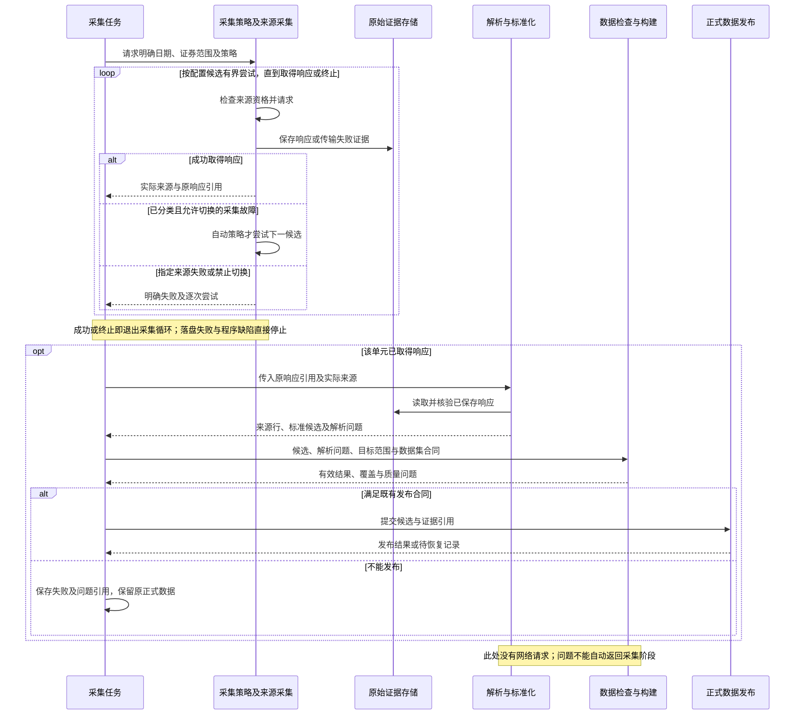

# 原始暂存、数据构建与重做

## 已确认设计与当前实现（2026-10-28）

任务生产数据集结果，数据对象与任务解耦；自动切源属于采集策略，解析及检查问题不反向驱动采集。实现以 [三口径日线设计](../../stock-data-design-qfq-history-rebuild.md) 中的对象关系和数据合同为准；该文件是本主题主要维护位置。

### 阶段协作时序：单向处理，没有质量补采循环



时序图展开一个采集单元。多证券任务的范围在执行前明确，各单元可以保存与处理自己的响应；不要求先把全市场全部下载完成才能解析，也不要求新建四个后台进程或工作队列。阶段分离是职责与输入输出的分离，不是机械增加串行等待。若某单元全响应无法解析，保留响应级问题；其他有效单元仍可处理，最终由原数据集门槛判断整个任务能否发布。

接口支持字段选择时，采集合同应请求接口公开的完整字段集合；接口不提供字段选择时，保存它实际返回的完整响应。字段映射只在解析与标准化阶段选择数据集所需字段，来源行保留全部实际返回列。接口未返回的字段不能靠本地映射补出。BaoStock日线验证路径的合同是：先在 socket `recv` 边界保存每次查询返回的有序原始字节，再保存完整SDK解码 `fields/rows`，之后Provider才提取标准候选字段；请求范围及响应哈希关联两种记录。重放必须精确匹配查询参数和来源版本，并只从归档的解码结果重建SDK结果，不允许缺档时联网补取。该路径仍属于 `validation_only`，不进入当前正式日线任务；捕获/回放合同和历史证据范围见[来源接口说明](../providers/README.md)。

名单任务预定义的多个互补来源会分别采集，解析后合并；不会因为普通ETF目录不足才动态追加另一来源。对同一采集包的切源，从新来源重新取得完整包，不把两家来源的失败分页拼在一起。传输阶段允许必要的会话、分页控制与SDK解码，不用OHLC、字段完整度或证券覆盖判断是否换源。

### 策略决策表

| 情况 | 指定来源策略 | 自动切源策略 | 后续处理 |
|---|---|---|---|
| 来源不满足请求前资格或参数 | 明确阻断，不绕过 | 不请求不合格候选；无可用来源则阻断 | 留下具体原因，不视为试采成功 |
| 连接失败、超时 | 按来源合同有限重试后失败 | 仅配置允许时尝试下一来源 | 保存失败尝试，不能声称来源业务不支持 |
| 指定的HTTP故障状态 | 有限重试或失败，不换来源 | 仅 `switch_on` 列明才切换 | 保留响应与状态；限速冷却仍有效 |
| HTTP成功但HTML、无效JSON、空业务数据 | 接收后结束采集策略 | 接收后结束采集策略 | 解析及检查产生问题，不自动切源 |
| 日期、单位、价格或覆盖异常 | 不改变已选来源 | 不返回采集循环 | 报告到实际来源、记录及字段，按原门槛决定发布 |
| 程序异常、无效配置或证据落盘失败 | 直接报错 | 不伪装成可切换网络故障 | 保存可保留的诊断，不能继续处理未落盘响应 |
| 完整原响应存在，转换失败 | 可复用响应重处理 | 不因 `resume` 自动选下一来源 | 修改规则仍须明确版本与验证 |
| 用户看过明细后明确要求重采 | 按指定来源执行 | 按明确选择的自动策略执行 | 这是新采集操作，保留此前结果与证据 |

一项任务可以返回“采集接收完成，但解析或质量未通过”。来源是否请求成功、数据是否有效、任务是否发布分别记录，不能折成一个成功标记。问题字段由总体设计单处维护，现有输入报告、检查结果和任务摘要通过引用关联；不额外维护前端状态或第二份明细报告。

### 恢复与实现边界

执行记录保持必要的冻结范围、实际来源、原响应引用和阶段位置。采集未完成时可按明确故障继续；原响应已完整保存时，优先处理原响应；发布中断只续接已准备的提交。数据结果一旦发布即可独立消费，不依赖任务进程或运行记录是否正在展示。

实施按现有 `collect-task` 入口收敛；不增加一套并行任务入口。配置版本冻结在任务定义中，规则变化要求新任务标识。离线验收不触碰正式数据目录。

## 多口径日线聚合实现（2026-10-28）

2026-10-30单位规则升级为v8：任务向标准化模块传入显式证券类型，报告记录实际命中的单位合同及按字段生成的精度标记，聚合直接承接这些标记。单位适用范围见[单位合同](../../stock-data-design-qfq-history-rebuild.md#22-来源单位合同2026-10-30)。旧原响应、已发布数据和运行定义不修改；单位规则变化按标准化与业务流程验证，资格按实际接口、配置和业务证据判断，不会因单位规则已实现而自动启用来源。当前v8仅完成隔离验收。

2026-10-29已用现有 `stock_daily` 入口完成2026-10-28沪深北三只股票的正式留存发布；真实响应、隔离重做/发布恢复、精确资格边界和查询回读均有证据。资格仅允许该9个精确请求的留存执行，在线及持续调度未启用。实际任务定义、状态和验收统一见[项目进度](../../PROJECT_PROGRESS.md#当前业务交付状态)，本节维护流程合同。

一个日线任务取得目标证券各适用口径：股票必需不复权、前复权、后复权三种；ETF和指数按已核验的来源能力与数据语义保存所有可用口径。候选仍按证券、日期、口径检查，处理阶段按证券和日期生成一条带证券类型、价格/点位语义、各口径值及状态的完整记录。

本节只说明任务影响。详细对象结构、聚合图、完整性和消费规则见[三口径日线设计](../../stock-data-design-qfq-history-rebuild.md)。缺失必需口径时该证券不计入完整记录，覆盖仍按证券记录而非请求数或三组行数计；问题明细包含实际来源与口径。解析和质量问题不自动切源，显式重采后也必须重新组装完整记录才能发布。

前台消费默认不复权，按证券类型解释价格或指数点位，可切换已存在且可用的组；不能为未验证的ETF/指数口径伪造数值。当前实现的实际状态及ETF/LOF/指数限制见设计文件“实施现状”。旧单口径物理分区和业务数据保留，不自动迁移。

## 当前入口与冻结范围

| 入口 | 结果及边界 |
|---|---|
| collect-input | 单输入的原始证据、来源行及候选；不自动发布 |
| collect-task | 证券名单或单日日线；live/retained须通过资格，replay须使用隔离根目录 |
| collect-due-inputs | 单次到期检查；execute才执行，不启动常驻服务 |
| update-trading-calendar | 指定日期的轻量日历更新，写既有日历及证据 |
| recover | 续接已准备且可验证的发布，不绕过质量或重抓来源 |

现有日线任务首次从不晚于目标日的正式名单展开范围，并保存定义；已有任务由 `_task_units` 读取原冻结单元，不因新上市证券改变续跑范围。规则或请求合同变化仍要求新任务；不能将当前YAML覆盖旧定义。动态范围all_stock/all_etf/all_index只表示展开能力，不授予对应资产生产资格。

当前股票任务引用 `stock_daily`，展开三口径，单口径顶层adjustment定义明确拒绝。正式留存定义的完整例子见[三股任务](../../data/task_workspace/_checks/tencent-v7-formal-three-stock-2026-10-28/formal-task-definition.json)；它是v7历史精确范围，不能当成当前授权命令直接运行。隔离回放须明确原响应和独立data-root；发布恢复只续接已准备提交。

## 原始数据与任务的边界

数据日期与执行日期分别记录。历史发布验收可以在之后执行：支持历史日期的接口按目标日查询，只返回当前目录的接口必须使用目标日留存的原响应，不能将今日目录改标为历史日期。自动调度按实际运行时间判断到期和日历，与指定历史日期的回放验收是两种执行方式；回放仍使用隔离运行根目录，不因此解除生产目录写入限制。

2026-10-11使用10月9日原响应完成当前版本的隔离发布验收：7267条证券，失败后的断点执行、全量重做及再次执行通过，三次规范文件哈希一致；原响应已转正、暂存移出，未调用实时来源。任务定义、规范文件、自动摘要及检查均保存在 [验收运行根目录](../../tmp/security-history-publication-20261011/verification.json)，另有 [独立回读检查](../../tmp/security-history-publication-20261011/independent-check.json)。该结果验证历史发布流程，不代表生产目录已经发布或新实时批次已经采集。

原始响应不可拆拼或修改。名单按来源提供的完整覆盖范围采集；日线每个业务任务处理一个交易日，来源可以返回包含该日的更大窗口。来源标准文件保留整个请求窗口，构建步骤只提取任务交易日，原始响应不裁剪。任务范围一旦确定，断点恢复保持该范围；新上市证券进入下一次新任务，不自动改变进行中的任务。

暂存位置为 `raw/_tmp/<数据日期>/<来源>/<接口>/`，当天结果为 `raw/<数据日期>/<来源>/<接口>/`。各请求用文件名区分，接口 `manifest.ndjson` 索引各请求清单。处理文件位于 `task_workspace/<日期>/<数据集>/sources/<来源>/<接口>/`，构建文件统一为 `prepared.parquet`、`coverage.json`、`summary.json`、`task.json`，不增加任务ID或全市场目录层。日期是数据所属日期；当前目录响应按原采集日在解析前落盘。完整窗口和采集时间保存在清单。独立候选留在暂存区，不自动转正，详见 [目录与日期规则](../storage/README.md)。

全量重做仅清空目标日期、本任务的活动暂存和构建文件引用，强制重新执行全部来源单元。新结果完整、检查及发布完成后替换该日期、范围的结果；失败时原已发布结果保留，不能拿旧正式记录补齐新采集的缺失。在线执行时绕过原响应缓存；离线验证始终回放明确指定的证据。清理前沿用既有归档保留响应证据，不改变其他日期，不在本次增加自动删除。

断点重做在同一数据日期、任务范围内根据哈希、字段合同、处理版本、单元检查和任务阶段判断：响应合格而后续失败的继续处理；请求失败、缺失或响应损坏的补采；合格处理结果直接复用。指定证券重做只重采该日期的指定证券，名单接口不支持单证券请求时拒绝该操作。新响应先进入该日期的暂存区，提取、合并并按业务主键去重后重新检查；合并的是派生记录和响应引用，不拼接修改原始响应字节。成功后替换受影响单元的当天引用，保留当天未重采部分及其他日期。

## 按配置构建历史证券任务

`collect-task` 的任务文件对 `security_master` 可只提供 `task_id`、`dataset`、`trade_date`，省略 `units`。入口读取业务根目录的既有交易日历，确认目标日为交易日，再由现有调度模块构建并保存实际执行定义；缺日历时拒绝，不把用户输入日期自动当作交易日。显式提供 `units` 的既有任务仍按原定义执行。

任务目标早于上海时区执行当天时，选择 `collection.yaml/security_master.historical`：BaoStock只负责沪深股票，上交所普通ETF、货币ETF及深交所ETF分别取指定日，合并检查四组。北交所历史采集暂缓，不称为含北交所的全市场名单。历史任务默认禁止以前次数据回退。当前日期任务与日常定时任务使用原 `source_inputs`，不将当前目录标为历史日期。

历史ETF资格绑定完整请求参数（含日期），仅放行已有三个 `date_snapshot` 契约；语义证据仍要求独立范围核验，`group_counts` 记录单接口数量，`publication_group_counts` 记录互补合并后的数量，发布清单 `as_of_date` 必须匹配请求日。配置、代码、测试、原响应及冷却检查不省略；1694条历史份额身份样本不自动成为完整上市目录资格。

示例任务内容：

```json
{"task_id":"security-master-hs-20261009","dataset":"security_master","trade_date":"2026-10-09"}
```

准备好目标日的日历和正式来源资格后，沿用 `collect-task --task-file <任务文件> --mode live --redo full`。该命令实际联网并写入配置的data，2026-10-13已用8只精确证券请求执行；全市场尚未执行。失败重做、raw暂存和转正、去重及发布继续复用现有流程。

## 三阶段进度

既有任务统一使用 `worker/progress.py` 的 `TaskProgress`，不新增调度服务或状态数据库。`summary.json.progress` 和元数据库任务状态保存原响应、解析映射、检查发布三阶段的 `total`、`completed`、`success`、`failed`、`skipped`、`reused`、`percent`、`success_percent`、`elapsed_seconds`，并保存本次执行总耗时和开始时间。

三个阶段统一按本次来源单元计数：日线为证券×口径的来源单元，名单为来源接口；完整证券覆盖另以冻结证券数计算，不把接口页数或返回行数当成证券覆盖率。采集和处理的百分比是已处理数量，成功率另计；失败全部处理完可以达到100%，不能据此判断任务成功。总量未知时百分比为null。两阶段可交错执行，不为展示改成三轮批处理。检查与发布按整批提交统计：两只股票三口径共六个单元，提交完成前为0/6，完整提交结束后为6/6；检查拒绝为失败、0/6，不因完成内部动作而增加百分比。检查、规范文件、原响应转正、元数据收尾只保存为动作状态及恢复依据，控制台显示最近动作。恢复重复动作不重复累加，旧版四步骤快照恢复时以原响应阶段的总量重新计算；历史已保存证据不批量改写。使用前次正式结果回退时，完成数量计为复用。

下方链接的 `progress-demo.txt` 是本次口径调整前的历史运行输出，其中4/4表示旧版内部动作计数，保留作证据，不代表当前显示规则。当前规则的可复现测试报告见 `tmp/pc-final.xml`。

断点执行计入有效单元复用，失败单元重新处理；全量重做从零计数，留存模式复用明确指定的原响应而不联网；指定证券重做的阶段进度以本次来源单元数为分母，完整记录覆盖仍以指定证券数为分母。已完成任务再次执行显示无需执行。更新以阶段和单元事件为准，普通通知节流为每秒一次，单元结束及提交关键点强制保存；耗时随事件刷新，不预测剩余时间，不新增后台计时进程。各阶段可能重叠，阶段耗时不相加作为总耗时。

CLI默认将进度写stderr，stdout返回完整JSON；`--no-progress`仅关闭显示，不关闭持久化。日线来源单元数与最终证券覆盖数分别报告，不把九次口径请求计作九只证券。下面仅示意当前命令形状；执行前须准备当前合同的任务JSON和逐口径原响应清单，旧单口径任务文件不能直接运行。

```powershell
# 隔离回放：使用明确的三口径原响应，不得写生产根目录。
& 'D:\Program Files\Python\python.exe' -m stock_data_manage.cli collect-task --task-file 'path-to-task.json' --mode replay --data-root tmp/task-replay --redo resume
```

正式live/retained仍通过来源资格后写配置中的data；本页不提供可绕过当前版本、日期或范围授权的命令。全量重做重新执行该任务范围，指定证券重做仅作用原冻结范围，发布中断只允许先resume。参数和状态由现有CLI与任务模块解析，不另建业务入口。

## 持久化记录

现有 DuckDB 增加业务任务记录，保存任务定义、阶段、单元结果、错误及提交信息。单元结果包括源输入、请求范围、原始清单及哈希、候选产物及哈希、质量结论。记录由代码自动维护，用户不操作来源版本或选择原始文件。

原始响应目录与派生产物均用真实字节哈希校验。存在文件不代表阶段完成。处理代码或配置变化时重新处理已保存的合格响应；业务内容错误、请求失败或响应损坏才重新采集。来源回退不放进 Provider。本轮只接入名单失败沿用上一份已发布名单，尚未增加日线自动跨来源回退。

`complete_today` 表示本任务全部来源单元及已配置的覆盖检查通过，不代表独立证明市场全覆盖。名单回退时该值为假，失败或不完整来源写在 `commit.fallback_units`。默认分别检查沪市股票、深市股票、北交所股票、沪市ETF、深市ETF五组；某组出现也不能证明该组全量。当前没有独立证券总数基准，因此不授予全市场在线生产资格。

### 名单覆盖与前次有效数据

同一市场/类型可由互补接口共同提供，例如上交所普通ETF和交易型货币ETF。检查每个来源单元成功且返回其声明范围，再将负责同一组的来源合并后对比前次名单，避免把另一接口负责的证券误判为漏采。任何声明单元失败仍会阻止完整发布；合并后消失的前次证券仍按既有规则拒绝。历史ETF适配及1694条隔离验收见 [证券来源说明](../providers/security-catalog.md#指定日期的etf输入)。历史ETF接入未改变正式调度来源选择；指纹改变后，三项现时目录来源已经重新复核并登记，历史ETF输入仍不进入默认生产调度。10月11日真实入口因日历缺记录阻断；下一交易日预测通过不表示已执行或发布，见 [当前核验](../../data/task_workspace/_checks/security-qualification-20261011/verification.json)。

覆盖规则位于 `config/datasets/security_master.yaml` 的 `dataset.publication`：`required_groups` 是市场与资产类别组合，`source_groups` 标明来源负责的组合，`max_previous_age_days` 默认1个自然日。任务可缩小已支持的组进行隔离回放；不同采集范围的旧名单不能作为回退来源。没有配置北交所ETF组。

先检查当天来源候选，不把旧名单混入检查。所有来源日期须与任务日期一致；缺失组、来源失败、分类冲突，以及同范围前次有效名单中的证券无解释地消失，都会阻止当天名单更新。证券遗漏不推断为退市，也不通过旧行悄悄填补；当前尚无独立退市证据接入，合法退市导致的遗漏同样需进一步核实。

允许回退时使用整份前次有效名单，不拼接不同日期的新旧行：前次数据、原始证据须通过哈希与覆盖检查，来源请求范围及所需组相同，实际数据日期不能晚于任务日期，且距任务日期不超过配置的自然日数。旧清单没有可核验日期或来源元数据时不用于回退。全量重做和 `allow_previous=false` 始终禁用回退；无合格旧名单时保留暂存、记录失败，不更新正式分区。自然日上限不会自动按交易日延长，节假日过期会明确阻断，后续调度接入时再确认交易日策略。

正常名单的正式清单记录实际日期、分组数量和来源证据哈希，保存于 `canonical/<日期>/security_master/`。回退时只在本次任务提交及摘要记录原正式清单引用、旧日期、年龄和原因，原发布文件保持不变，不生成新日期正式文件。新候选和响应留在工作区及各自日期的 `raw/_tmp`。自动展开日线范围通过元数据选择不晚于目标日的最新合格名单。

回退发布不表示本次任务全部完成。再次断点执行时重采失败或被覆盖检查拒绝的来源，其余合格当天单元复用；补齐后重新构建整份名单，再更新正式数据并转正raw。检查结论保存在任务工作区 `coverage.json` 及原有元数据库。回退后的新任务提交中断时，恢复只处理提交标记所属任务，不让旧已完成任务处理新提交。

## 发布与恢复

1. 采集并持久化原始响应，再解析映射；失败和空返回也留下证据。
2. 保存各单元的合格候选，即使整体覆盖度不够也不丢弃成功单元。
3. 构建结果、检查覆盖和业务唯一键。日线沿用 YAML 中的质量与发布阈值；目标范围替换与跨来源冲突处理明确区分。
4. 提交前保存候选发布文件、来源哈希及最终位置，固定本次提交内容。
5. 执行发布和 raw 转正的收尾步骤。它们不是一个文件系统事务；只在全部完成、引用核验后标记已发布。
6. 中断时按提交记录恢复，不再请求接口。恢复未完成时拒绝全量清空或改变任务定义。正式分区内存在 `task-commit.json` 时查询和其他任务写入均拒绝；进程已结束的锁可回收，仍在运行或无法证明已结束的锁保留。

中间阶段保留单元状态、基础合同及错误以支持重做；最终覆盖及有效性汇总在发布前生成。复用任务 `coverage.json`、DuckDB状态及正式清单，不增加覆盖管理层。统一摘要已实现，字段与读取方式见 [自动任务摘要](#自动任务摘要)。

证券主数据复用既有证券标识、来源合并和缺失不等于退市的规则；日线复用既有记录模型、质量检查、来源仲裁和业务键。源头目录更新不自动改写其他已发布数据。覆盖不足时保留工作区，正式数据不更新。

## 验收

- 正式业务通过实际 `collect-task` 或证券清单调度入口运行；原响应、中间数据、报告、任务状态及发布结果位于业务运行根目录，`provider_validation/` 只被读取。
- 不同数据日期使用不同raw位置；同日全量重做替换当天结果，断点及指定证券重做只更新受影响单元，重复运行无重复业务键。
- 今天补采历史日线仍按目标数据日期保存；当前目录接口按原响应采集日期保存，不能伪装历史名单。
- 采集失败、有效性失败、覆盖不足、后续构建失败后，重启并断点续接。
- 全量不复用旧候选或旧源响应；指定证券只请求选中证券。
- 重复采集不增加重复业务键；全量范围替换不夹带旧记录。
- raw 转正前后和发布步骤间故障注入，恢复后文件、哈希和元数据一致。
- 原始数据损坏、候选损坏、路径越界、相同范围并发执行、定义变更被正确拒绝或重新处理。
- 已有真实来源证据的证券快照和日线离线端到端回放；夹具验证和真实证据验证分别标识。

## 证券清单定时更新

本节保留运行合同及带日期的历史验证。历史资格记录和失败检查点不代表当前授权；正式历史名单已有发布，当前状态统一见项目进度。

### 配置和入口

复用现有调度、元数据、路由和任务流程，不增加任务管理服务。`config/collection.yaml` 的 `security_master` 指定来源：`SDA-BOARD-005` 获取沪深股票和ETF，`SECURITY-BSE-001` 获取北交所股票，`SECURITY-SSE-ETF-001` 补接上交所上市ETF目录。沪市ETF覆盖资格由官方目录负责，BaoStock仍返回其中可取得的记录；证券身份按原主键合并。字段仍由原数据集模板和归一化映射管理。

频率唯一配置在 `collection_profiles.security_master_daily`：默认上海时区、交易日08:00、每1天一次。`config/schedules.yaml` 的 `security_master_update` 引用该配置，不重复定义时间。禁用任务或采集配置均可停止触发。当前命名任务仅支持按天更新；证券范围由名单来源决定。

使用既有入口查看一次调度计划：

```powershell
python -m stock_data_manage.cli collect-due-inputs --dataset security_master
```

加入 `--execute` 执行这一次调度检查。默认从既有交易日历库读取当天状态；也可用 `--calendar-file` 传入保存的日期行，每行必须包含 `trade_date` 和布尔值 `is_trading_day`。无当天记录时明确阻断，不把未知日期当作休市。未到时间或已确认休市时不采集。

本入口只完成一次检查，不启动常驻进程。既有调度运行器可调用它；本阶段没有安装或启动后台服务。正式调度不接受回放模式、指定证券范围或验证输出目录；隔离回放继续使用 `collect-task`。现有日线定时生产资格尚未接通。

### 正常、失败和重试

1. 检查日期、采集配置和来源资格，生成 `security-master-YYYYMMDD` 任务，用户不选择来源文件。
2. 每个来源请求前再次检查资格。原响应先存入 `data/raw/_tmp/<数据日期>/<来源>/<接口>/`，再解析、映射和检查。
3. 检查当天五组证券和日期一致性，通过后构建名单、去重并发布，再完成raw转正。
4. 来源失败、资格失效或覆盖不足时记录问题；存在符合原回退规则的前次完整名单，才整份沿用，并保留实际日期及失败原因。没有合格旧名单时不发布。
5. 再次执行同一天的入口沿用同一任务：只补失败或不完整来源，合格当天单元复用；完整任务校验后直接返回。回退任务不会被误判为当天完成。
6. 发布中断时沿用原提交恢复流程，不重新采集。全量与指定证券重做仍使用既有任务操作，详见 [当前入口](#当前入口与冻结范围)。

以上描述当前任务逻辑；2026-10-11简化目录实现及已完成的旧业务迁移见 [存储说明](../storage/README.md)。正式开发后的来源复核和发布验收通过业务运行布局留存，不向 `provider_validation/` 新增产物。

### 自动任务摘要

中间阶段保存基础有效性和单元状态。任务自动写入 `data/task_workspace/<日期>/<数据集>/summary.json`，结果中的 `summary` 返回路径和哈希，并保存到既有元数据库；调度也返回该引用。页面读取摘要，无需扫描接口目录或另跑覆盖脚本。同一工作区表示最近执行；更早任务按元数据及审计追踪。

摘要关联证券范围、请求日期、已发布数据日期、原响应采集时间、各来源数量、最终检查、缺失单元、失败原因、回退及发布清单。未发布时 `data_date=null`；发布中断为 `committing`、`pending_recovery=true`；整份回退保留原实际日期，并显示本次检查失败。全重做失败时不会把前次发布结果误写为本次成功。

失败后断点重做更新同一摘要，只重新采集缺失或无效单元；发布提交中断则沿用既有恢复流程，不请求来源。日线覆盖率的分母是本任务冻结证券范围，不是整个正式分区。证券名单没有可靠独立市场分母时，摘要仅列分组数量、缺失和检查依据，`denominator`、`ratio` 为 null。回放的 `verification_mode=replay` 必须与真实业务发布区分。

来源新返回HTTP403或429时记录到既有来源健康状态，后续请求受禁用及冷却检查约束。回放和缺少资格本身不记作真实接口限流。

### 资格依据与当前限制

运行时读取既有 `MetadataStore` 的能力证据和来源健康状态，不把YAML声明当成资格。核准记录按来源、接口、能力版本、市场、资产类型、证券名单数据集和快照频率登记；请求范围含输入ID、完整非日期参数哈希和资格说明文件路径。证据必须在有效期内。

资格说明JSON链接四层证据及各自文件哈希：离线合同测试报告、正式Provider在线候选报告、语义与独立全市场覆盖核验、隔离端到端发布清单。核验配置、原响应字节、适配器能力合同、分组数量及唯一证券标识，不再读取或比较源码摘要。端到端可回放同一在线证据，须保留相同原始响应字节；SDK缓存或回放派生载荷单独检查完整性，不计为额外源响应。线上证据不得由测试夹具替代；测试中的模拟资格仅保存在临时数据库。

核准登记复用 `MetadataStore.save_probe_evidence`；本阶段不新增登记后台或管理页面。正式Provider在线对照、独立覆盖基准及合格端到端证据未齐全时保持阻断。证据到期、请求范围或配置合同变化时须复核；代码正确性按实际影响分层测试，不以源码文件摘要决定资格。

2026-10-10三项来源完成资格登记，五个责任组通过代码、范围、时效、真实载荷及隔离发布检查。用户明确允许正式写入data后，通过现有collect_task入口执行security-master-20261009，优先复用同版本响应。BaoStock10月9日6917条候选通过；北交所和上交所目录为10月10日，两个单元报日期不符。任务自动写入失败摘要及覆盖检查，没有合格前次名单可回退，没有发布或转正raw。须在同一个真实交易日完成首次发布验收，再进入日线阶段。详见 [历史索引](../../data/task_workspace/_checks/security-production-20261010/verification.json) 和迁移后的 [自动摘要](../../data/task_workspace/2026-10-09/security_master/summary.json)。

2026-10-11目录迁移后，修正来源资格检查解析相对路径时仍以报告父目录为基准的问题。三项来源按当前代码重新完成四层核验并登记，164项回归通过。正式 `collect-due-inputs --dataset security_master --execute --mode live` 使用真实当前时间执行一次，因日历缺少10月11日记录返回blocked，不发起业务采集或发布；没有用其他日期拼出全量证券。当前资格、迁移和自动调度结果见 [阶段索引](../../data/task_workspace/_checks/layout-production-20261011/verification.json)。

### 交易日历来源与当前状态

`update-trading-calendar` 是独立轻量任务，按指定日期调用 BaoStock `query_trade_dates`，只写入现有 `metadata.duckdb` 的交易日历表，并在 `task_workspace/trading_calendar/<日期>/baostock/query_trade_dates/refresh-<时分秒>/` 留下可读命名的 SDK 解码响应清单以便核对；不创建行情式候选目录、覆盖报告或 Canonical 发布分区。日历更新成功后返回日期、开市状态和证据路径。证券名单正式周期在本地当天未知时先执行同一更新逻辑；来源失败或返回日期/状态无效时阻断名单请求。手工计划检查不联网，也不另存调度JSON。

既有 `TradingCalendarUpdater.update_from_input_report` 接收正式输入 `ASTOCK-070` 的候选报告和原在线报告，校验原响应、SDK与适配器合同、配置、输出哈希以及来源时效后，写入既有日历库。旧归档目录和报告的读取仍核对来源、适配器能力合同及实际数据完整性，不重新请求来源来重建说明。

本次复用10月3日新浪真实响应，当前代码回放得到相同8,797个正向交易日期；按需要将10月9日至12月31日的60个日期写入 `data/metadata/metadata.duckdb`。其中未来日期是来源提供的计划日期，不是未来交易已经发生的证据。来源标记为 `sina`，优先级10；更高优先级的既有交易所记录保留。来源未返回的日期保持未知，不能据此生成休市记录。

历史上曾执行过一次经过留证核验的日历导入，见 [日历检查](../../data/task_workspace/_checks/security-activation/calendar-import.json)。当前日历更新任务按需刷新指定日期；尚未部署常驻后台进程。历史新浪导入规则仍要求来源证据不超过30天，不能据此覆盖 BaoStock 单日任务的运行行为。

### 结果位置

- 调度检查结果由 `collect-due-inputs` 直接返回；正式证券名单运行状态保存在既有任务摘要和元数据中，不重复写调度检查JSON。
- 任务结果与覆盖检查：`data/task_workspace/<数据日期>/security_master/`；正式名单在 `data/canonical/<数据日期>/security_master/`，原响应在 `data/raw/<数据日期>/<来源>/<接口>/`。
- 任务及资格元数据：`data/metadata/metadata.duckdb`。
- 本机离线回归与检查索引：`data/task_workspace/_checks/security-schedule/`；不作为真实在线资格证据。
- 实现前的接口可行性原响应及现存历史证据保留在 `provider_validation/`，正式开发只读引用；业务复核与资格验收新响应和报告归业务运行根目录或 `tmp/` 下的隔离测试根目录，参见 [存储说明](../storage/README.md)。


## 进度显示与断点保存

进度回调只更新内存计数和显示，不写任务数据库。每只证券完成后保存一次断点状态；完整summary.json在证券边界最多每5秒生成一次，单元失败、检查阶段、发布阶段和任务结束立即更新。摘要生成负责一次状态保存，调用方不重复写入。元数据保存仅查询既有definition_hash验证任务定义不可变，不为此反序列化整份旧状态。

发布前保存committing及完整提交计划，规范文件和raw转正后的关键状态分别持久化；最后的published状态、完整进度和摘要成功保存后才移除发布标记。已有故障恢复规则保持。

候选续跑检查冻结任务、配置、原响应和候选数据完整性，不比较代码指纹。已有单元的revalidation_report若用于证明派生结果一致，仍须满足同一原响应、相同请求和全部映射字段一致；不再因源码变化要求生成该报告。原始来源报告保留原版本，不被改写成新代码的在线调用；失败或缺失单元仍走现有重做流程。

2026-10-14本次性能修复验证见data/task_workspace/_checks/daily-progress-opt-20261013：110项不同用例通过，同一5573证券/393单元状态快照的三次检查点对比中，写入21次降为3次、18.72秒降为2.02秒；仅衡量状态与进度开销，不代表端到端采集同比提速。正式断点离线复核393只有效候选（含停止边界1只）且没有新增网络调用，1只旧空响应保留失败待重试；全量任务仍需覆盖验收后才能发布。

## 分钟与派生的独立合同

分钟组件有独立实现，不属于当前collect-task支持的数据集。下列规则保留为组件合同，不能据此声明已持续生产。

### 收盘快照与日线校准

包含开高低、当前价及量额的收盘快照可形成当日 provisional 日线，不能补历史日，也不能直接认证 final 或前复权完整历史。收盘缓冲、次日回看最近交易日和校准时间由 YAML 配置，不在说明中固定运行时刻。全市场快照默认盘后按天采集，允许已有配置按天或分钟指定间隔，不因分钟聚合设计而默认开启全市场盘中轮询。

### 分钟采集、热数据与盘后校准

- 盘中优先使用已验证的原生分钟能力；快照聚合只在明确启用、吞吐量合格的观察池内作为 provisional 路径，不作为全市场分钟默认方案。TDX等延迟来源的实际时效逐条记录，历史小样本不能代替当前资格。
- 单轮预算按批次数、有效并发和请求间隔估算：`ceil(symbol_count / max_symbols_per_request) / effective_concurrency × request_interval_seconds`。启动及观察池扩容均检查最大证券数、采集周期和 `cycle_deadline_seconds`，超预算拒绝，不静默降低时效。
- 累计快照的单分钟量额使用相邻边界差分；处理首根缺前值、跨日和午间重置、负差值、采样缺口、乱序、重复及迟到修订。采样不足标记 `incomplete_sampling`，保持 provisional，不能认证真实分钟高低价完整。
- 当天分钟通过 SQLite WAL Hot Store 持续写入与按业务键更新，来源可见且分钟闭合后即可查询，不等待 Parquet 导出或 WAL checkpoint。查询合并历史 Canonical 和当天 Hot，按键去重排序，返回质量、来源延迟和 `as_of`。
- 盘后将 Hot 与合格历史分钟标准化、合并、检查后发布 Parquet；只有交易时段、预期根数、时间、单位、重复和异常检查通过才能提升 final。预期根数按交易日历和时段配置计算，常规240根只是配置基准，不能把所有证券和日期永久写死为240。
- 5m优先由同一交易时段内完整、已确认的五根1m生成：开盘取第一根、收盘取最后一根、高低取极值、量额求和；原生5m用于校验或缺口补采，记录来源。午间及跨日不拼接分钟窗口。
- 盘中缺失集合在当前任务中管理，盘后按证券、交易日、间隔和复权口径统计完整性，不增加逐分钟管理层。Hot保留期、checkpoint及清理由配置与发布门禁决定，本次不启用自动删除或动态分桶。
