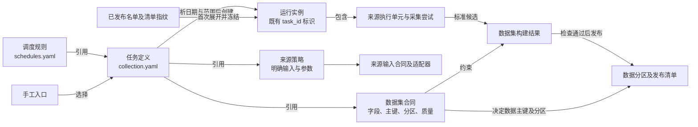
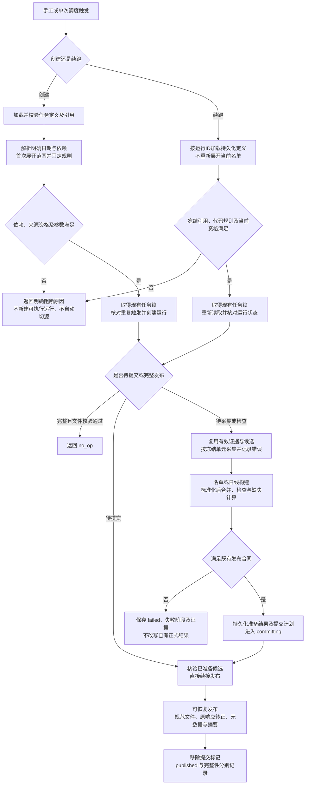
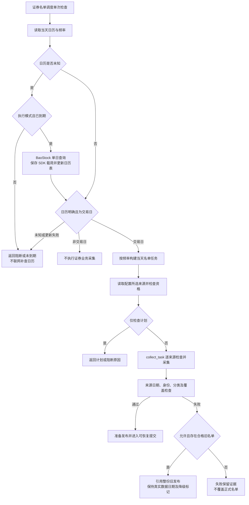
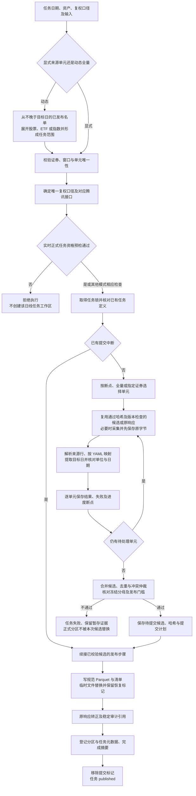
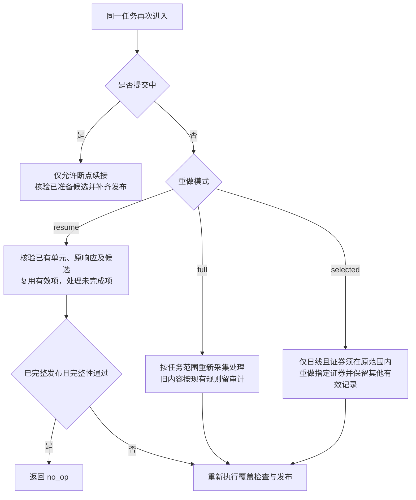
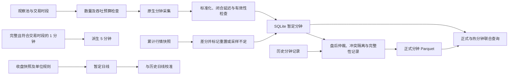

# 原始暂存、数据构建与重做

## 设计提案：任务定义与运行流程（2026-10-28，待确认）

本节是下一步重构合同，尚未实现或启用；下面2026-10-27的图继续描述当前代码。对象、配置示例、模块归属和迁移退出条件以[总体设计第4、5章](../../STOCK_ANALYSIS_V2_MARKET_DATA_CENTER_ARCHITECTURE_V1.md#4-对象职责与执行设计2026-10-28待确认)为主，此处只维护任务执行流程。

### 对象之间的关系



一个任务定义可产生多个日期或重做运行；它们可以更新同一业务分区，但不能并发覆盖。运行ID标记执行历史，数据主键标记业务记录，二者不相互替代。不因该关系新建对象注册中心或任务依赖平台。

### 创建与续跑走同一执行生命周期



图中的“固定规则”不允许恢复时跳过资格、冷却和证据有效期；网络请求前仍复查来源健康。计划预览只计算到期与静态合同，不采集、不创建运行；实际执行时若日历未知，只在既有已确认单日历补查策略范围内处理，不自动补建证券名单或其他任务。

当前任务锁覆盖完整执行，本批先保持互斥粒度。图中锁内须重读元数据，避免两个入口在预检期间生成重复运行。发布中断保持 `committing` 及待恢复标记，不能转换成普通采集失败后重新抓全量；准备候选损坏时明确拒绝恢复，不静默改用别的文件。

### 重做、失败与配置变化的具体行为

| 场景 | 拟议行为 | 明确禁止的隐式处理 |
|---|---|---|
| 到期触发与手工触发同一任务/日期/范围 | 默认复用相同运行；完整则核验后返回，未完则续跑 | 每次触发都建立重复采集 |
| 名单已更新但旧运行未完成 | 从运行中保存的名单引用及范围续跑 | 重算证券列表后扩大或缩小目标 |
| `resume` | 原运行ID，保留有效单元与证据；失败单元按明确类别重试 | 把来源空返回推断为停牌，或所有异常都重新联网 |
| `full` | 创建关联的新运行，重做已明确的目标；旧运行保留 | 清空旧任务状态后伪装同一次执行 |
| `selected` | 创建关联新运行；证券必须属于原范围，合并保留其他正式记录 | 子集成功就将原全量运行标记为完整，或改变其他复权分区 |
| 资格过期、来源冷却 | 阻断相应调用并解释具体范围；按已确认的恢复规则处理 | 把策略引用视为永久授权、启用未验证第二来源 |
| 处理规则/业务相关代码变化 | 明确阻断旧规则运行，重新核验后显式创建新运行 | 读取当前配置静默覆盖冻结规则，或自动运行归档旧代码 |
| 任务记录缺失或损坏 | 拒绝执行，保留文件供核验 | 自动挑选最近的摘要或其他工作区拼接运行 |

旧未完成运行在迁移时先保留，不自动创建新模型兼容分支。具体如何处理本机历史任务是实施前确认点，见总体设计第5章；这张图不授权转换旧状态、重采数据或启用新调度。

## 当前实现流程图（2026-10-27）

以下按 `d7dc13f` 的实际入口绘制，供维护者讨论优化。总体功能、生产验收边界和本机历史文件核查见[总体设计的当前实现评审](../../STOCK_ANALYSIS_V2_MARKET_DATA_CENTER_ARCHITECTURE_V1.md#当前实现与优化评审2026-10-27)。图示不启用调度，也不表示重新验收来源。后文有日期的历史范围仍按当时记录理解。

### 入口决定最终产物

| 入口 | 输入与用途 | 输出及终点 |
|---|---|---|
| `collect-input` | 一个输入合同及其参数，实时请求或显式清单回放 | 原始证据、来源行、标准化候选、自动输入报告；终点为 `candidate_complete`，不自动正式发布 |
| `collect-task` | 任务 JSON，目标日、数据集、来源单元或动态证券范围；支持 `live/retained/replay` | 名单或单日日线的持久化业务任务；检查通过后发布，失败保留断点和证据 |
| `collect-due-inputs` | 当前时间、频率及日历；默认只检查，`--execute` 才执行采集 | `inputs` 分支生成来源候选；`security_master` 分支进入正式名单任务；不启动常驻服务 |
| `update-trading-calendar` | 指定日，缺省为上海时区当天 | 查询明确开闭市状态、保留 SDK 载荷证据、更新既有日历表；不走名单或日线发布 |
| `recover` | 指定运行根目录和元数据 | 修复可验证的临时分区与元数据，并续接待提交任务；不能绕过源数据缺失或质量检查 |

### 证券名单与日历



此图的自动补查仅属于名单调度分支：执行模式、未提供显式日历、已到期且当天未知时才触发；直接 `collect-task` 自动生成名单单元仍要求已有明确交易日记录。计划模式不联网，但可能创建运行目录或打开既有元数据库，不能等同于文件系统完全零写入。

静态核查发现：当前实现某些无需补查日历的执行分支仍会访问 `update.source_manifest`，而 `update` 可能是 `None`，存在提前异常的风险。上图展示业务条件与正常链路，不保证这些分支已实际跑通；风险依据与后续复现范围记录于总体设计评审，本次未修改或运行该入口。

当天名单默认选三个输入；指定历史日则按 `security_master.historical` 选择五个输入。来源承担的“覆盖组”指市场和资产组合，例如沪市 ETF：普通 ETF 与货币 ETF 接口可以互补；仅有某组一条记录不能证明该组全量。任一来源缺失、日期不符或前次证券无解释消失都要检查，不能通过改写日期伪造历史名单。来源细节见[证券目录](../providers/security-catalog.md)。

### 单交易日日线采集、检查与发布



正式日线当前仅腾讯输入通过 `check_daily_input_qualification()` 选用；每单元请求前还会复查资格与冷却。`retained` 要求明确原响应清单和合格留存范围，底层严格回放，不能联网兜底；`replay` 必须使用隔离运行根目录。日线单元和复权规则见 `pipeline/inputs.py::collect_task`，质量与覆盖见 `pipeline/daily.py::prepare_daily_task_publication`。

动态范围在展开后进入持久化定义并检查定义哈希；但当前函数每次调用会先从名单再次展开，再与已保存定义比较。若期间名单发生变化，恢复可能因定义变化而拒绝，不能把“冻结范围”解释成恢复时完全不再读取名单。后续可讨论如何复用既有冻结定义，不在本轮改变语义。

默认日线发布门槛是缺失比例不超过 1% **且**缺失数量不超过 50，两者同时满足；通过门槛不等于零缺失。成功与完整需分别看 `status`、`complete_today`、缺失清单及发布清单。数量分母来自本次名单或显式任务范围，不独立证明市场全覆盖。未认证的成交量/成交额保持空值，空响应不直接判定停牌。

发布跨越规范文件、raw 与数据库，采用标记与可重复步骤恢复，不是一个覆盖所有文件和数据库的单事务。出现中断时，已有规范文件也可能带待恢复标记；任务只有最后登记与摘要完成后才移除该标记。不能仅凭文件出现宣布成功。

### 断点、重做与发布中断



发布恢复与断点采集不同：前者续接已经准备且哈希通过的提交，后者重新判断哪些单元需要处理。`recover` 的分区扫描修复与任务提交恢复共同使用现有存储，不另外建立恢复后台。恢复后仍须回读任务状态、清单和实际文件。

### 分钟、快照与盘后校准的独立链路



这组服务有实现和测试入口，但不是 `collect-task` 已支持的数据集。调用方负责提供行情和历史记录、配置相应存储并触发执行；目前时间表和 `PhaseOneScheduler` 的存在不构成常驻运行证明。正式多来源日线服务同样是独立路径：`DailyCollectionService.collect()` 按有效记录重新计算缺失集合并切下一来源，而当前持久化腾讯日线任务尚未接入这条自动回退链路。

## 目标和实施边界

接口响应先落入 `data/raw/_tmp`，来源解析、字段映射、检查与发布成功后，更新该来源、接口、数据日期及请求范围的当天原始结果；不同日期分别保留。任务支持全量重做、断点重做和指定证券重做。复用 `pipeline/inputs.py`、日线和证券主数据合并、现有元数据库、Parquet 发布及恢复模块，不增加服务、调度平台或 Provider 副本。

2026-10-09确认：`provider_validation/` 仅用于正式实现前确认接口可行性，进入业务开发后的产物不再进入该目录。已有证据只读回放，实现测试使用 `tmp/` 下独立运行根目录。2026-10-11已进一步简化按日目录，完成旧业务数据迁移及当前版本三项来源资格复核；正式入口因当天日历覆盖缺失记录阻断，没有发布生产名单。规则见 [存储说明](../storage/README.md)。

本次先接通证券主数据与指定交易日的日线流程；管理页面、后台定时运行、全市场在线启用不在本次范围。现有验证专用来源的声明不是生产资格。正式任务默认使用 `config/collection.yaml` 指定的 `data/`，默认模式为 `live`，在线来源资格检查仍在写入前阻断执行。离线回放必须显式使用 `--mode replay` 和隔离的 `--data-root`，不能发布到配置的生产目录。业务任务输出不能放入 `provider_validation/`。沪深股票、ETF 和北交所的完整来源覆盖需分别证明，来源缺失不得包装成全量完成。

`collect-task --mode retained` 是正式使用留存原响应的入口：各单元必须指定 `replay_manifest`，通过当前版本来源资格、范围、日期与哈希检查后，仍由原Provider、YAML映射和发布流程写入配置的 `data/`。底层严格回放，不允许缺失证据时联网补取，不直接搬运隔离目录的规范文件。证券名单沿用原资格检查；留存日线仅支持腾讯前复权已核验的证券及完整请求窗口，留存资格按证券、资产类别及参数精确绑定。在线首次采集的现行市场授权规则见[日线首次全量采集](../providers/README.md#日线首次全量采集与请求间隔)，不把样本返回当作全市场验证。`replay` 模式的隔离限制保持；独立 `collect-input` 不提供正式留存发布。此前四只留存日线的证据保存在data。当前8只newfqkline精确请求已获显式live/retained模式资格，正式在线发布5只股票、3只ETF；旧留存资格不自动获得在线权限。当前资格包及独立单位对照保存在data/task_workspace/_checks/daily-online-20261012/，不由样本推出全市场范围。

在线日线先检查全部请求资格，再创建任务；每单元执行前重复检查，403/429进入既有冷却记录。任务共用同一个RequestPacer，间隔不会在每只证券开始时重置。实时响应先进入raw/_tmp，检查和发布完成才转正；来源解析异常的断点可沿用已留存字节，缺失或业务无效单元再补采。正式CLI参数、真实请求数量、进度日志及独立回读见 [小范围在线验收](../../data/task_workspace/_checks/daily-online-20261012/formal-verification.json)。单位规则及精度主要维护于 [来源说明](../providers/README.md#单位核验与正式小范围运行2026-10-13)，本页不维护第二份倍率表。

## 原始数据与任务的边界

数据日期与执行日期分别记录。历史发布验收可以在之后执行：支持历史日期的接口按目标日查询，只返回当前目录的接口必须使用目标日留存的原响应，不能将今日目录改标为历史日期。自动调度按实际运行时间判断到期和日历，与指定历史日期的回放验收是两种执行方式；回放仍使用隔离运行根目录，不因此解除生产目录写入限制。

2026-10-11使用10月9日原响应完成当前版本的隔离发布验收：7267条证券，失败后的断点执行、全量重做及再次执行通过，三次规范文件哈希一致；原响应已转正、暂存移出，未调用实时来源。任务定义、规范文件、自动摘要及检查均保存在 [验收运行根目录](../../tmp/security-history-publication-20261011/verification.json)，另有 [独立回读检查](../../tmp/security-history-publication-20261011/independent-check.json)。该结果验证历史发布流程，不代表生产目录已经发布或新实时批次已经采集。

原始响应不可拆拼或修改。名单按来源提供的完整覆盖范围采集；日线每个业务任务处理一个交易日，来源可以返回包含该日的更大窗口。来源标准文件保留整个请求窗口，构建步骤只提取任务交易日，原始响应不裁剪。任务范围一旦确定，断点恢复保持该范围；新上市证券进入下一次新任务，不自动改变进行中的任务。

暂存位置为 `raw/_tmp/<数据日期>/<来源>/<接口>/`，当天结果为 `raw/<数据日期>/<来源>/<接口>/`。各请求用文件名区分，接口 `manifest.ndjson` 索引各请求清单。处理文件位于 `task_workspace/<日期>/<数据集>/sources/<来源>/<接口>/`，构建文件统一为 `prepared.parquet`、`coverage.json`、`summary.json`、`task.json`，不增加任务ID或全市场目录层。日期是数据所属日期；当前目录响应按原采集日在解析前落盘。完整窗口和采集时间保存在清单。独立候选留在暂存区，不自动转正，详见 [目录与日期规则](../storage/README.md)。

全量重做仅清空目标日期、本任务的活动暂存和构建文件引用，强制重新执行全部来源单元。新结果完整、检查及发布完成后替换该日期、范围的结果；失败时原已发布结果保留，不能拿旧正式记录补齐新采集的缺失。在线执行时绕过原响应缓存；离线验证始终回放明确指定的证据。清理前沿用既有归档保留响应证据，不改变其他日期，不在本次增加自动删除。

断点重做在同一数据日期、任务范围内根据哈希、字段合同、处理版本、单元检查和任务阶段判断：响应合格而后续失败的继续处理；请求失败、缺失或响应损坏的补采；合格处理结果直接复用。指定证券重做只重采该日期的指定证券，名单接口不支持单证券请求时拒绝该操作。新响应先进入该日期的暂存区，提取、合并并按业务主键去重后重新检查；合并的是派生记录和响应引用，不拼接修改原始响应字节。成功后替换受影响单元的当天引用，保留当天未重采部分及其他日期。

## 按配置构建历史证券任务

`collect-task` 的任务文件对 `security_master` 可只提供 `task_id`、`dataset`、`trade_date`，省略 `units`。入口读取业务根目录的既有交易日历，确认目标日为交易日，再由现有调度模块构建并保存实际执行定义；缺日历时拒绝，不把用户输入日期自动当作交易日。显式提供 `units` 的既有任务仍按原定义执行。

任务目标早于上海时区执行当天时，选择 `collection.yaml/security_master.historical`：BaoStock只负责沪深股票，上交所普通ETF、货币ETF及深交所ETF分别取指定日，合并检查四组。北交所历史采集暂缓，不称为含北交所的全市场名单。历史任务默认禁止以前次数据回退。当前日期任务与日常定时任务使用原 `source_inputs`，不将当前目录标为历史日期。

历史ETF资格绑定完整请求参数（含日期），仅放行已有三个 `date_snapshot` 契约；语义证据仍要求独立范围核验，`group_counts` 记录单接口数量，`publication_group_counts` 记录互补合并后的数量，发布清单 `as_of_date` 必须匹配请求日。配置、代码、测试、原响应及冷却检查不省略；1694条历史份额身份样本不自动成为完整上市目录资格。

示例任务内容：

```json
{"task_id":"security-master-hs-20261009","dataset":"security_master","trade_date":"2026-10-09"}
```

准备好目标日的日历和正式来源资格后，沿用 `collect-task --task-file <任务文件> --mode live --redo full`。该命令实际联网并写入配置的data，2026-10-13已用8只精确证券请求执行；全市场尚未执行。失败重做、raw暂存和转正、去重及发布继续复用现有流程。

## 三阶段进度

既有任务统一使用 `worker/progress.py` 的 `TaskProgress`，不新增调度服务或状态数据库。`summary.json.progress` 和元数据库任务状态保存原响应、解析映射、检查发布三阶段的 `total`、`completed`、`success`、`failed`、`skipped`、`reused`、`percent`、`success_percent`、`elapsed_seconds`，并保存本次执行总耗时和开始时间。

三个阶段统一按本次采集单元计数：日线为证券，名单为来源接口，不把接口页数或返回行数当成证券覆盖率。采集和处理的百分比是已处理数量，成功率另计；失败全部处理完可以达到100%，不能据此判断任务成功。总量未知时百分比为null。两阶段可交错执行，不为展示改成三轮批处理。检查与发布按整批提交统计：两只证券在提交完成前为0/2，完整提交结束后为2/2；检查拒绝为失败、0/2，不因完成内部动作而增加百分比。检查、规范文件、原响应转正、元数据收尾只保存为动作状态及恢复依据，控制台显示最近动作。恢复重复动作不重复累加，旧版四步骤快照恢复时以原响应阶段的总量重新计算；历史已保存证据不批量改写。使用前次正式结果回退时，完成数量计为复用。

下方链接的 `progress-demo.txt` 是本次口径调整前的历史运行输出，其中4/4表示旧版内部动作计数，保留作证据，不代表当前显示规则。当前规则的可复现测试报告见 `tmp/pc-final.xml`。

断点执行计入有效单元复用，失败单元重新处理；全量重做从零计数，留存模式复用明确指定的原响应而不联网；指定证券重做以本次指定证券数为分母。已完成任务再次执行显示无需执行。更新以阶段和单元事件为准，普通通知节流为每秒一次，单元结束及提交关键点强制保存；耗时随事件刷新，不预测剩余时间，不新增后台计时进程。各阶段可能重叠，阶段耗时不相加作为总耗时。

CLI默认显示进度到stderr，stdout仍是完整任务JSON；`--no-progress` 关闭显示，状态仍保存。已有任务命令示例：

```powershell
python -m stock_data_manage.cli collect-task --task-file data/task_workspace/_checks/daily-retained-final-20261011/etf-task.json --mode retained --progress
```

该命令对已完成ETF任务返回no-op。该留存命令属于此前四只样本任务。当前正式结果是10月9日5只股票、3只ETF；原响应在 `data/raw/2026-10-09/tencent/kline_daily/`，规范日线在 `data/canonical/2026-10-09/daily_bar/{stock,etf}/`。来源单位未认证时volume/amount保持为空。该段10月11日留存验收的全量与指定重做在tmp隔离验证。10月13日正式在线full与selected已运行，旧规范文件留在task_archive审计，最新结果以上文和最新阶段验收为准。实际状态和进度从 [独立回读检查](../../data/task_workspace/_checks/daily-retained-final-20261011/independent-check.json) 定位，显示样例见 [实际进度输出](../../data/task_workspace/_checks/daily-retained-final-20261011/progress-demo.txt)。北交所bj920001精确日线请求已正式发布；全市场资格及常驻调度仍未开启。

## 持久化记录

现有 DuckDB 增加业务任务记录，保存任务定义、阶段、单元结果、错误及提交信息。单元结果包括源输入、请求范围、原始清单及哈希、候选产物及哈希、质量结论。记录由代码自动维护，用户不操作来源版本或选择原始文件。

原始响应目录与派生产物均用真实字节哈希校验。存在文件不代表阶段完成。处理代码或配置变化时重新处理已保存的合格响应；业务内容错误、请求失败或响应损坏才重新采集。来源回退不放进 Provider。本轮只接入名单失败沿用上一份已发布名单，尚未增加日线自动跨来源回退。

`complete_today` 表示本任务全部来源单元及已配置的覆盖检查通过，不代表独立证明市场全覆盖。名单回退时该值为假，失败或不完整来源写在 `commit.fallback_units`。默认分别检查沪市股票、深市股票、北交所股票、沪市ETF、深市ETF五组；某组出现也不能证明该组全量。当前没有独立证券总数基准，因此不授予全市场在线生产资格。

### 名单覆盖与前次有效数据

同一市场/类型可由互补接口共同提供，例如上交所普通ETF和交易型货币ETF。检查每个来源单元成功且返回其声明范围，再将负责同一组的来源合并后对比前次名单，避免把另一接口负责的证券误判为漏采。任何声明单元失败仍会阻止完整发布；合并后消失的前次证券仍按既有规则拒绝。历史ETF适配及1694条隔离验收见 [证券来源说明](../providers/security-catalog.md#指定日期的etf输入)。历史ETF接入未改变正式调度来源选择；指纹改变后，三项现时目录来源已经重新复核并登记，历史ETF输入仍不进入默认生产调度。10月11日真实入口因日历缺记录阻断；下一交易日预测通过不表示已执行或发布，见 [当前核验](../../data/task_workspace/_checks/security-qualification-20261011/verification.json)。

覆盖规则位于 `config/datasets/security_master.yaml` 的 `dataset.publication`：`required_groups` 是市场与资产类别组合，`source_groups` 标明来源负责的组合，`max_previous_age_days` 默认1个自然日。任务可缩小已支持的组进行隔离回放；不同采集范围的旧名单不能作为回退来源。没有配置北交所ETF组。

先检查当天来源候选，不把旧名单混入检查。所有来源日期须与任务日期一致；缺失组、来源失败、分类冲突，以及同范围前次有效名单中的证券无解释地消失，都会阻止当天名单更新。证券遗漏不推断为退市，也不通过旧行悄悄填补；当前尚无独立退市证据接入，合法退市导致的遗漏同样需进一步核实。

允许回退时使用整份前次有效名单，不拼接不同日期的新旧行：前次数据、原始证据须通过哈希与覆盖检查，来源请求范围及所需组相同，实际数据日期不能晚于任务日期，且距任务日期不超过配置的自然日数。旧清单没有可核验日期或来源元数据时不用于回退。全量重做和 `allow_previous=false` 始终禁用回退；无合格旧名单时保留暂存、记录失败，不更新正式分区。自然日上限不会自动按交易日延长，节假日过期会明确阻断，后续调度接入时再确认交易日策略。

正常名单的正式清单记录实际日期、分组数量和来源证据哈希，保存于 `canonical/<日期>/security_master/`。回退时只在本次任务提交及摘要记录原正式清单引用、旧日期、年龄和原因，原发布文件保持不变，不生成新日期正式文件。新候选和响应留在工作区及各自日期的 `raw/_tmp`。自动展开日线范围通过元数据选择不晚于目标日的最新合格名单。

回退发布不表示本次任务全部完成。再次断点执行时重采失败或被覆盖检查拒绝的来源，其余合格当天单元复用；补齐后重新构建整份名单，再更新正式数据并转正raw。检查结论保存在任务工作区 `coverage.json` 及原有元数据库。回退后的新任务提交中断时，恢复只处理提交标记所属任务，不让旧已完成任务处理新提交。

## 发布与恢复

1. 采集并持久化原始响应，再解析映射；失败和空返回也留下证据。
2. 保存各单元的合格候选，即使整体覆盖度不够也不丢弃成功单元。
3. 构建结果、检查覆盖和业务唯一键。日线沿用 YAML 中的质量与发布阈值；目标范围替换与跨来源冲突处理明确区分。
4. 提交前保存候选发布文件、来源哈希及最终位置，固定本次提交内容。
5. 执行发布和 raw 转正的收尾步骤。它们不是一个文件系统事务；只在全部完成、引用核验后标记已发布。
6. 中断时按提交记录恢复，不再请求接口。恢复未完成时拒绝全量清空或改变任务定义。正式分区内存在 `task-commit.json` 时查询和其他任务写入均拒绝；进程已结束的锁可回收，仍在运行或无法证明已结束的锁保留。

中间阶段保留单元状态、基础合同及错误以支持重做；最终覆盖及有效性汇总在发布前生成。复用任务 `coverage.json`、DuckDB状态及正式清单，不增加覆盖管理层。统一摘要已实现，字段与读取方式见 [自动任务摘要](#自动任务摘要)。

证券主数据复用既有证券标识、来源合并和缺失不等于退市的规则；日线复用既有记录模型、质量检查、来源仲裁和业务键。源头目录更新不自动改写其他已发布数据。覆盖不足时保留工作区，正式数据不更新。

## 验收

- 正式业务通过实际 `collect-task` 或证券清单调度入口运行；原响应、中间数据、报告、任务状态及发布结果位于业务运行根目录，`provider_validation/` 只被读取。
- 不同数据日期使用不同raw位置；同日全量重做替换当天结果，断点及指定证券重做只更新受影响单元，重复运行无重复业务键。
- 今天补采历史日线仍按目标数据日期保存；当前目录接口按原响应采集日期保存，不能伪装历史名单。
- 采集失败、有效性失败、覆盖不足、后续构建失败后，重启并断点续接。
- 全量不复用旧候选或旧源响应；指定证券只请求选中证券。
- 重复采集不增加重复业务键；全量范围替换不夹带旧记录。
- raw 转正前后和发布步骤间故障注入，恢复后文件、哈希和元数据一致。
- 原始数据损坏、候选损坏、路径越界、相同范围并发执行、定义变更被正确拒绝或重新处理。
- 已有真实来源证据的证券快照和日线离线端到端回放；夹具验证和真实证据验证分别标识。

## 操作方式

原任务流程实现及当时的离线回归记录保留在 Git 提交 `3adc785` 中。上一轮错放的任务演示结果已按要求删除，不将历史沪深股票样本作为全量证券结果。原始来源探针证据保留，后续验证仍可从这些证据回放；来源在线资格、ETF 与北交所覆盖需要后续阶段独立完成。

命令仍在既有 `src/cli.py` 中。任务定义是本次执行参数，字段模板和来源映射仍来自YAML。正式执行可省略 `--data-root`，逐来源复核资格后采集、检查并发布；隔离回放不能绕过生产资格。三项证券来源此前登记资格，本次指纹变化需复核；首次正式任务因名单日期不同失败；日线在线资格尚未接通。

日线可以显式给单证券单元，也可以从已发布名单自动展开。例如：

```json
{
  "task_id": "stocks-20260930",
  "dataset": "daily_bar",
  "trade_date": "2026-09-30",
  "universe": "all_stock",
  "asset_type": "stock",
  "adjustment": "forward",
  "input_id": "ASTOCK-002-daily"
}
```

此定义在首次执行时读取已发布名单；断点及全量重做保持冻结的证券范围。`universe` 支持 `all_stock`、`all_etf` 和 `all_index`，并要求同一日线任务只包含一种 `asset_type`。日线任务的 `adjustment` 是规范口径（`none/forward/backward`），与来源配置 `config.adjust`（`none/qfq/hfq`）一一映射；任务省略口径时默认不复权，股票和ETF也可显式指定前复权或后复权。显式冲突会在请求前拒绝。腾讯不复权使用 `kline`，复权使用 `fqkline` 或 `newfqkline`；选择不复权时，入口自动选择 `kline`，显式配置其他接口会在请求前拒绝。指数只允许腾讯不复权序列；沪深两只指数的复权接口未返回调整序列，实测记录见[指数复权探测报告](../../tmp/security-daily-20261023/phase-13-index-adjustment/phase-13-index-adjustment.md)。该接口只返回最近1024条，窗口更早时会报告截断。下一次新任务重新展开范围。历史上市日期缺失时只能使用当前名单中的证券，不能宣称历史证券覆盖完整。`all_index` 只能展开已发布名单中的指数；当前指数名单来源尚未取得正式资格，因此该范围尚不能宣称可生产调度。离线实际执行需要各单元能精确匹配的 `replay_manifest`，上例只是自动展开的参数形状。

已有真实来源证据的离线参数示例见 [沪深股票名单回放](examples/security-master-replay.json) 和 [单股票日线回放](examples/daily-replay.json)。示例直接引用保留的原始来源探针，运行结果生成到下面指定的 `tmp/`，不回写探针目录。名单示例仅包含沪深股票，日线示例只包含 `sh600519` 的一个交易日，均不能代表全量证券。

2026-10-11已用10月9日发布名单中的沪深各一只股票、各一只ETF完成真实日线响应的隔离验收。原响应保存后，由既有任务入口解析、映射、检查并发布到同一隔离根目录的 `canonical/2026-10-09/daily_bar/stock/` 和 `daily_bar/etf/`。股票缺失回放证据时拒绝发布，断点执行只处理失败证券；ETF发布前模拟中断后从已保存候选恢复。两类任务全量、指定证券及重复执行通过；重做会更新采集时间和审计引用，因此以主键和业务字段比较结果，不要求Parquet文件字节一致。原响应价格与规范OHLC直接对照通过，成交量单位未认证时volume/amount保持空值。名单展开包含5573只股票和1694只ETF，但真实日线验收仅sh600519、sz000001、sh510300、sz159915四只，北交所及全市场日线未验证，在线日线资格未启用。任务定义、模拟故障、自动摘要快照和最终结果见 [日线验收](../../tmp/daily-master-20261011/verification.json) 与 [原响应及CLI检查](../../tmp/daily-master-20261011/independent-check.json)。

```powershell
# 离线示例：首次执行或断点重做（默认 resume），显式声明回放模式
python -m stock_data_manage.cli collect-task --task-file docs/pipeline/examples/daily-replay.json --mode replay --data-root tmp/collection-task-replay

# 全量重新执行本任务单元
python -m stock_data_manage.cli collect-task --task-file docs/pipeline/examples/daily-replay.json --mode replay --data-root tmp/collection-task-replay --redo full

# 只重新执行指定证券，其余正式记录保留
python -m stock_data_manage.cli collect-task --task-file docs/pipeline/examples/daily-replay.json --mode replay --data-root tmp/collection-task-replay --redo selected --symbol sh600519

# 发布中断后续接；无需再传源头请求
python -m stock_data_manage.cli recover --data-root tmp/collection-task-replay
```

正式记录按证券、日期、复权主键去重；全量重做只替换本任务证券范围及当前复权口径，其他口径各自保留。日线分区为 `canonical/<日期>/daily_bar/<资产类型>/adjustment=<none|forward|backward>/`，每种口径独立保存数据、清单、锁和恢复状态。读取接口指定口径时只返回该分区；不指定时聚合三个口径。满足YAML缺失门槛的部分发布保留缺失状态，再次断点执行只补缺失或异常单元；完整发布校验后返回。其他任务改写同一口径正式分区时要求新任务或明确重做。日期与数据集共用工作区，复用文件锁串行写入；待提交任务须先恢复，不能被其他任务覆盖。自动 `task.json` 保存执行参数和冻结单元，元数据按任务ID、日期和复权口径追踪。旧版混合口径目录不迁移、不自动读取；依约在清理旧数据目录后重新生成。

证券清单主流程已接通既有能力资格、日历和调度入口，见 [证券清单定时更新](#证券清单定时更新)。真实来源证据未齐全时仍明确阻断；已有请求和解析实现没有另建副本，也没有开启后台采集。日线在线资格尚未接通。

## 证券清单定时更新

### 配置和入口

复用现有调度、元数据、路由和任务流程，不增加任务管理服务。`config/collection.yaml` 的 `security_master` 指定来源：`SDA-BOARD-005` 获取沪深股票和ETF，`SECURITY-BSE-001` 获取北交所股票，`SECURITY-SSE-ETF-001` 补接上交所上市ETF目录。沪市ETF覆盖资格由官方目录负责，BaoStock仍返回其中可取得的记录；证券身份按原主键合并。字段仍由原数据集模板和归一化映射管理。

频率唯一配置在 `collection_profiles.security_master_daily`：默认上海时区、交易日08:00、每1天一次。`config/schedules.yaml` 的 `security_master_update` 引用该配置，不重复定义时间。禁用任务或采集配置均可停止触发。当前命名任务仅支持按天更新；证券范围由名单来源决定。

使用既有入口查看一次调度计划：

```powershell
python -m stock_data_manage.cli collect-due-inputs --dataset security_master
```

加入 `--execute` 执行这一次调度检查。默认从既有交易日历库读取当天状态；也可用 `--calendar-file` 传入保存的日期行，每行必须包含 `trade_date` 和布尔值 `is_trading_day`。无当天记录时明确阻断，不把未知日期当作休市。未到时间或已确认休市时不采集。

本入口只完成一次检查，不启动常驻进程。既有调度运行器可调用它；本阶段没有安装或启动后台服务。正式调度不接受回放模式、指定证券范围或验证输出目录；隔离回放继续使用 `collect-task`。现有日线定时生产资格尚未接通。

### 正常、失败和重试

1. 检查日期、采集配置和来源资格，生成 `security-master-YYYYMMDD` 任务，用户不选择来源文件。
2. 每个来源请求前再次检查资格。原响应先存入 `data/raw/_tmp/<数据日期>/<来源>/<接口>/`，再解析、映射和检查。
3. 检查当天五组证券和日期一致性，通过后构建名单、去重并发布，再完成raw转正。
4. 来源失败、资格失效或覆盖不足时记录问题；存在符合原回退规则的前次完整名单，才整份沿用，并保留实际日期及失败原因。没有合格旧名单时不发布。
5. 再次执行同一天的入口沿用同一任务：只补失败或不完整来源，合格当天单元复用；完整任务校验后直接返回。回退任务不会被误判为当天完成。
6. 发布中断时沿用原提交恢复流程，不重新采集。全量与指定证券重做仍使用既有任务操作，详见 [本页操作方式](#操作方式)。

以上描述当前任务逻辑；2026-10-11简化目录实现及已完成的旧业务迁移见 [存储说明](../storage/README.md)。正式开发后的来源复核和发布验收通过业务运行布局留存，不向 `provider_validation/` 新增产物。

### 自动任务摘要

中间阶段保存基础有效性和单元状态。任务自动写入 `data/task_workspace/<日期>/<数据集>/summary.json`，结果中的 `summary` 返回路径和哈希，并保存到既有元数据库；调度也返回该引用。页面读取摘要，无需扫描接口目录或另跑覆盖脚本。同一工作区表示最近执行；更早任务按元数据及审计追踪。

摘要关联证券范围、请求日期、已发布数据日期、原响应采集时间、各来源数量、最终检查、缺失单元、失败原因、回退及发布清单。未发布时 `data_date=null`；发布中断为 `committing`、`pending_recovery=true`；整份回退保留原实际日期，并显示本次检查失败。全重做失败时不会把前次发布结果误写为本次成功。

失败后断点重做更新同一摘要，只重新采集缺失或无效单元；发布提交中断则沿用既有恢复流程，不请求来源。日线覆盖率的分母是本任务冻结证券范围，不是整个正式分区。证券名单没有可靠独立市场分母时，摘要仅列分组数量、缺失和检查依据，`denominator`、`ratio` 为 null。回放的 `verification_mode=replay` 必须与真实业务发布区分。

来源新返回HTTP403或429时记录到既有来源健康状态，后续请求受禁用及冷却检查约束。回放和缺少资格本身不记作真实接口限流。

### 资格依据与当前限制

运行时读取既有 `MetadataStore` 的能力证据和来源健康状态，不把YAML声明当成资格。核准记录按来源、接口、能力版本、市场、资产类型、证券名单数据集和快照频率登记；请求范围含输入ID、完整非日期参数哈希和资格说明文件路径。证据必须在有效期内。

资格说明JSON链接四层证据及各自文件哈希：离线合同测试报告、正式Provider在线候选报告、语义与独立全市场覆盖核验、隔离端到端发布清单。核验代码与配置哈希、原响应字节、转换版本、分组数量及唯一证券标识。端到端可回放同一在线证据，须保留相同原始响应字节；SDK缓存或回放派生载荷单独检查完整性，不计为额外源响应。线上证据不得由测试夹具替代；测试中的模拟资格仅保存在临时数据库。

核准登记复用 `MetadataStore.save_probe_evidence`；本阶段不新增登记后台或管理页面。正式Provider在线对照、独立覆盖基准及合格端到端证据未齐全时保持阻断。证据有效期或代码、配置变化后须重新核验，不能沿用旧资格。

2026-10-10三项来源完成资格登记，五个责任组通过代码、范围、时效、真实载荷及隔离发布检查。用户明确允许正式写入data后，通过现有collect_task入口执行security-master-20261009，优先复用同版本响应。BaoStock10月9日6917条候选通过；北交所和上交所目录为10月10日，两个单元报日期不符。任务自动写入失败摘要及覆盖检查，没有合格前次名单可回退，没有发布或转正raw。须在同一个真实交易日完成首次发布验收，再进入日线阶段。详见 [历史索引](../../data/task_workspace/_checks/security-production-20261010/verification.json) 和迁移后的 [自动摘要](../../data/task_workspace/2026-10-09/security_master/summary.json)。

2026-10-11目录迁移后，修正来源资格检查解析相对路径时仍以报告父目录为基准的问题。三项来源按当前代码重新完成四层核验并登记，164项回归通过。正式 `collect-due-inputs --dataset security_master --execute --mode live` 使用真实当前时间执行一次，因日历缺少10月11日记录返回blocked，不发起业务采集或发布；没有用其他日期拼出全量证券。当前资格、迁移和自动调度结果见 [阶段索引](../../data/task_workspace/_checks/layout-production-20261011/verification.json)。

### 交易日历来源与当前状态

`update-trading-calendar` 是独立轻量任务，按指定日期调用 BaoStock `query_trade_dates`，只写入现有 `metadata.duckdb` 的交易日历表，并在 `task_workspace/trading_calendar/<日期>/baostock/query_trade_dates/refresh-<时分秒>/` 留下可读命名的 SDK 解码响应清单以便核对；不创建行情式候选目录、覆盖报告或 Canonical 发布分区。日历更新成功后返回日期、开市状态和证据路径。证券名单正式周期在本地当天未知时先执行同一更新逻辑；来源失败或返回日期/状态无效时阻断名单请求。手工计划检查不联网，也不另存调度JSON。

既有 `TradingCalendarUpdater.update_from_input_report` 接收正式输入 `ASTOCK-070` 的候选报告和原在线报告，校验原响应、SDK与适配器合同、当前转换代码/配置、输出哈希以及来源时效后，写入既有日历库。旧归档目录搬迁与报告字段差异仅在可验证原代码字节相同的情况下接受，不重新请求来源来重建说明。

本次复用10月3日新浪真实响应，当前代码回放得到相同8,797个正向交易日期；按需要将10月9日至12月31日的60个日期写入 `data/metadata/metadata.duckdb`。其中未来日期是来源提供的计划日期，不是未来交易已经发生的证据。来源标记为 `sina`，优先级10；更高优先级的既有交易所记录保留。来源未返回的日期保持未知，不能据此生成休市记录。

历史上曾执行过一次经过留证核验的日历导入，见 [日历检查](../../data/task_workspace/_checks/security-activation/calendar-import.json)。当前日历更新任务按需刷新指定日期；尚未部署常驻后台进程。历史新浪导入规则仍要求来源证据不超过30天，不能据此覆盖 BaoStock 单日任务的运行行为。

### 结果位置

- 调度检查结果由 `collect-due-inputs` 直接返回；正式证券名单运行状态保存在既有任务摘要和元数据中，不重复写调度检查JSON。
- 任务结果与覆盖检查：`data/task_workspace/<数据日期>/security_master/`；正式名单在 `data/canonical/<数据日期>/security_master/`，原响应在 `data/raw/<数据日期>/<来源>/<接口>/`。
- 任务及资格元数据：`data/metadata/metadata.duckdb`。
- 本机离线回归与检查索引：`data/task_workspace/_checks/security-schedule/`；不作为真实在线资格证据。
- 实现前的接口可行性原响应及现存历史证据保留在 `provider_validation/`，正式开发只读引用；业务复核与资格验收新响应和报告归业务运行根目录或 `tmp/` 下的隔离测试根目录，参见 [存储说明](../storage/README.md)。


## 分阶段校正

每阶段完成后汇报，由用户确认再继续，不自动执行后续阶段。

| 步骤 | 范围 | 当前状态 |
|---|---|---|
| 1 | 统一任务运行目录、删除上一轮错放产物、修正入口与文档、离线核验 | 按日唯一及正式输出边界已修正；旧数据未自动搬迁，实际发布待验收 |
| 2 | 修改现有来源与字段配置，补齐 ETF 与北交所名单能力 | 已完成 |
| 3 | 按市场、资产类别检查覆盖，明确前次有效数据的回退日期与原因 | 已完成 |
| 4 | 接通现有路由资格检查与证券主数据定时更新 | 2026-10-12五项历史来源通过限定10月9日资格，并正式发布7267条；常驻自动运行仍未接通 |
| 5 | 以发布名单验证股票与 ETF 日线，以及三种重做流程 | 四只真实样本、三种重做及发布恢复通过；全市场及在线资格待完成 |

上述步骤是历史实施记录，不能视为全部正式验收完成。按日raw路径、正式输出入口和统一任务摘要已实现；再以真实证券清单任务验收。日线验收在名单发布后继续按阶段确认，不用手工接口候选代替业务任务结果。

2026-10-12更新：正式证券名单已发布；元数据批量登记、默认UTF-8输出已在`f4db191`修复，55项回归通过。日线全量任务尚未运行。原生对照确认腾讯新地址可返回北交所样本日线，但该地址尚未接入、字段单位尚未认证，在线日线资格仍未接通；新代码不自动继承旧资格。后续按“确认接入范围→修改现有Provider与YAML→核验实际窗口及单位→取得资格→正式全量重做→覆盖与重做验收”推进。完整待办统一维护于 [项目进度](../../PROJECT_PROGRESS.md#待办事项)，本页不另建一份待办清单。

首次正式发布以真实10月9日原响应运行现有CLI，执行参数为`--redo full --mode retained`；全部五项重新解析与检查，原响应转正，发布7267条。北交所原响应实际采集日为10月9日；不将当前目录改标为该日。完整核验见 [正式发布报告](../../data/task_workspace/_checks/security-release-20261012/verification.json)。Windows控制台可用`python -X utf8 -m stock_data_manage.cli collect-task --task-file data/task_workspace/_checks/security-release-20261012/task.json --redo resume --mode retained`确认已完成任务，已发布时返回no-op。该命令是确认而非再次采集；全量重建使用`--redo full`。后台调度和全市场日线仍待后续阶段。

第一阶段相关离线测试 66 项通过，包含目录边界、三种重做、提交恢复和既有真实来源证据回放。原始来源清单与响应哈希核验通过；两份参数示例除任务ID外与原示例一致。删除上一轮错放的 57 个文件；本机检查记录位于 `data/task_workspace/_checks/directory-layout/{regression.xml,verification.json}`，不生成正式名单或日线，不作为在线资格证据。

证券名单来源的第二阶段说明见 [股票与ETF来源名单](../providers/security-catalog.md)。第二阶段生成各自日期的来源候选；第三阶段接入日期一致性、市场及资产类别检查和前次有效名单回退，不把不同日期的候选合计当作当日完整名单。第四阶段的资格与调度实现见 [证券清单定时更新](#证券清单定时更新)，代码接通与实际在线激活分别记录。

第三阶段相关回归154项通过，包括五组检查、缺失证券、超龄与不匹配范围拒绝、整份回退、旧日期补采、断点续采、恢复及既有CLI/来源/存储合同。真实归档回放核对沪深6,916条（股票5,224、ETF1,692）；9月30日沪深名单与10月7日北交所名单混合任务被拒绝，不改写已有隔离发布。夹具证明回退实际日期保留9月30日、请求日期10月1日，补齐后才改为10月1日。检查索引位于 `data/task_workspace/_checks/security-coverage/verification.json`，正式生产目录没有发布数据或开启调度。

第四阶段最终离线回归215项通过，包括资格四层证据、范围/版本/有效期/冷却、原响应字节匹配、CLI、每日频率、同日任务幂等、回退后仅补失败来源，以及既有真实归档和提交恢复。连续失败重试曾发现覆盖检查文件重复写入问题，已修复为先归档旧生成工作区再记录新结论，保留原证据。夹具资格仅在临时数据库中验证，不登记到生产元数据库。2026-10-09真实配置计划检查显示当天日历缺失，两项来源均缺正式资格；未请求接口、未生成生产名单，也未安装后台服务。检查索引为 `data/task_workspace/_checks/security-schedule/verification.json`，最终测试报告为同目录 `final-verified.xml`。按阶段约定停止，第五阶段尚未开始。


## 进度显示与断点保存

进度回调只更新内存计数和显示，不写任务数据库。每只证券完成后保存一次断点状态；完整summary.json在证券边界最多每5秒生成一次，单元失败、检查阶段、发布阶段和任务结束立即更新。摘要生成负责一次状态保存，调用方不重复写入。元数据保存仅查询既有definition_hash验证任务定义不可变，不为此反序列化整份旧状态。

发布前保存committing及完整提交计划，规范文件和raw转正后的关键状态分别持久化；最后的published状态、完整进度和摘要成功保存后才移除发布标记。已有故障恢复规则保持。

代码变化后旧候选不能直接绕过指纹检查。仅在离线回放同一原响应、全部映射字段与旧候选一致、复核报告及映射输出哈希有效、代码和配置指纹匹配时，单元的revalidation_report才允许继续使用旧候选。原始来源报告保留原版本，不被改写成新代码的在线调用；失败或缺失单元仍走现有重做流程。

2026-10-14本次性能修复验证见data/task_workspace/_checks/daily-progress-opt-20261013：110项不同用例通过，同一5573证券/393单元状态快照的三次检查点对比中，写入21次降为3次、18.72秒降为2.02秒；仅衡量状态与进度开销，不代表端到端采集同比提速。正式断点离线复核393只有效候选（含停止边界1只）且没有新增网络调用，1只旧空响应保留失败待重试；全量任务仍需覆盖验收后才能发布。
