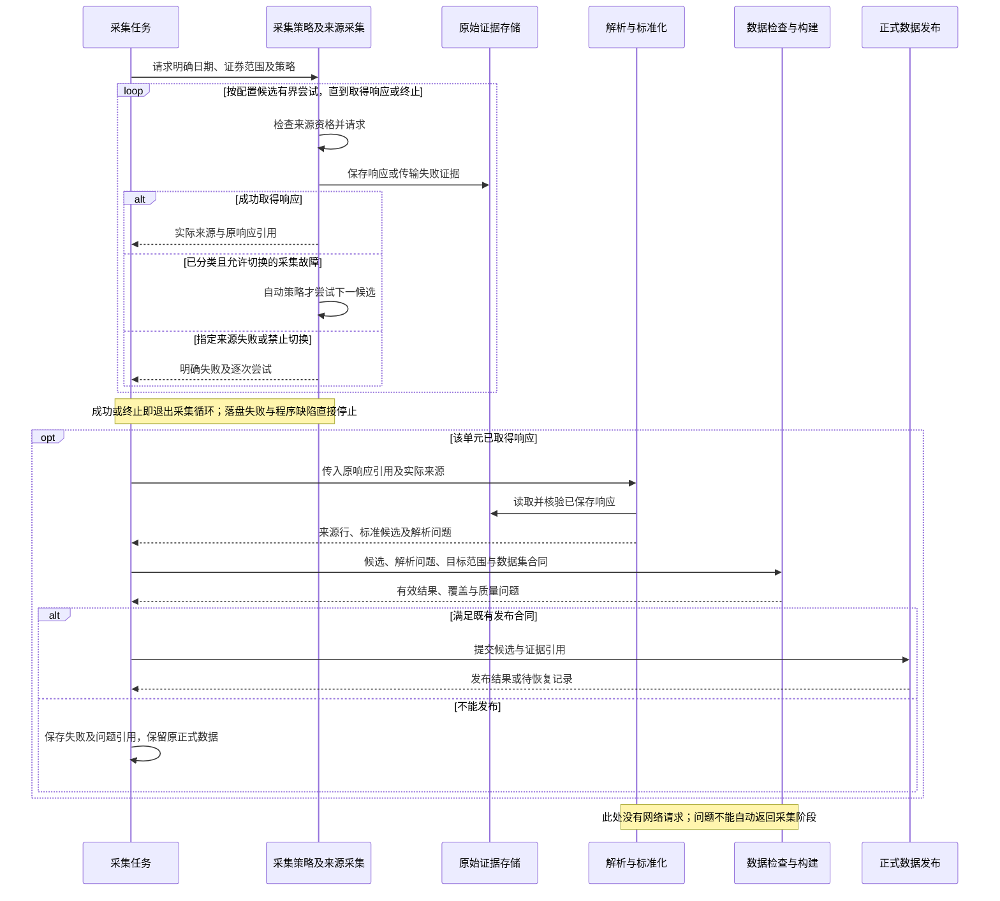
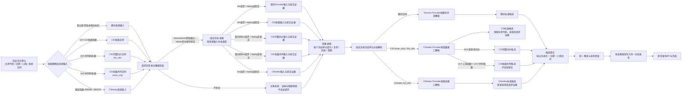
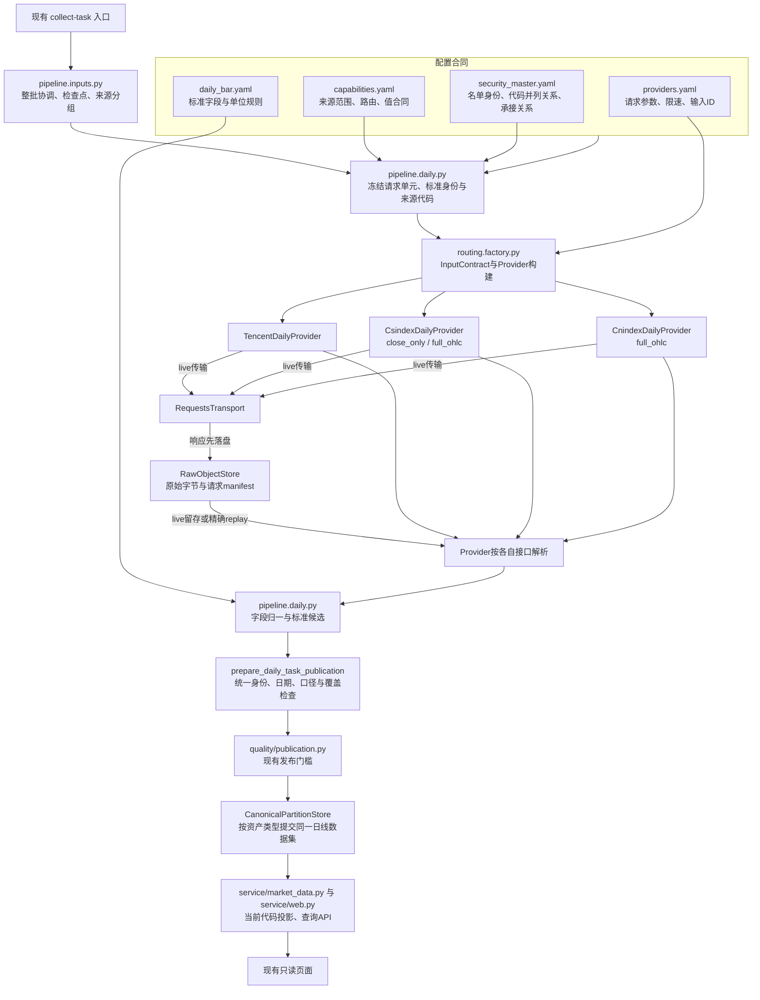
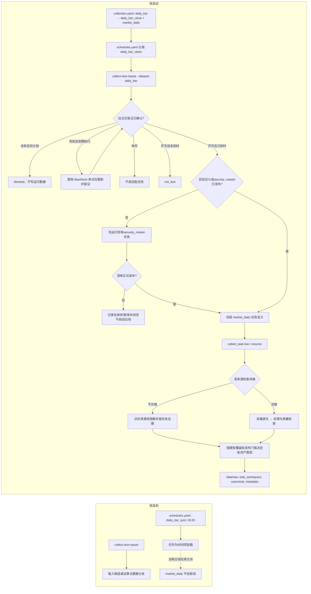
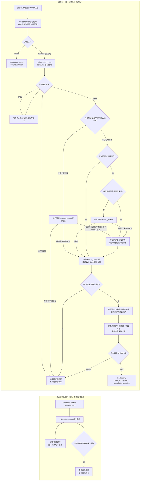
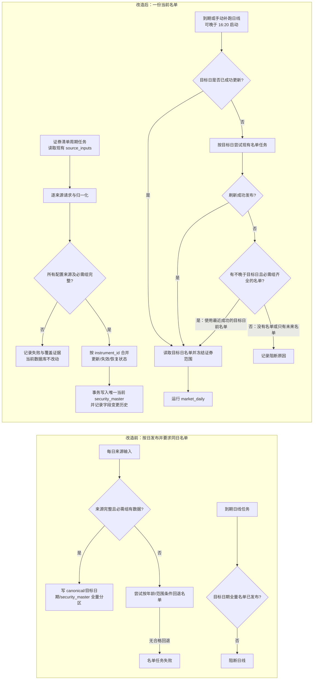

# 原始暂存、数据构建与重做

## 已确认的三股日线完整流程验收（2026-10-29）

用户2026-10-30确认以sh600519、sz000001、bj920001三只股票、2026-10-29一个交易日、none/forward/backward三口径验证现有流程。隔离根为`tmp/daily-flow-20261029/`，采集、候选、隔离发布、API和页面引用同批来源证据，现有正式data只读。业务入口继续使用`collect-input`、`collect-task`和只读运行台，不增加任务系统或人工暂停机制。

| 阶段 | 输入与交付 | 验收边界 |
|---|---|---|
| 采集 | 当前来源配置和9组精确请求，先检索可复用原响应，再留存本次实际请求结果 | 采集/原响应模块测试及真实小范围请求；HTTP成功不等于行情正确 |
| 解析处理 | 同批原响应、当前字段和单位合同，生成来源行、标准候选及问题明细 | 模块及采集→处理联调，目标日唯一、价格逐值对应；未认证量额为空，不猜单位 |
| 发布 | 三股完整候选、冻结任务与既有发布门槛，输出隔离Canonical、自动摘要和清单 | 3条聚合记录含9组；验证续跑、失败保护及流程；在线/留存资格仅在隔离库按实际证据登记 |
| 页面与完整链路 | 同一运行根的已发布记录，默认不复权及三口径切换 | 本地API及真实浏览器对照、完整任务入口贯通；另在新根按原响应零网络重放，比较业务字段而非整文件字节 |

每阶段收尾展示实际分母、结果、路径和未检查项并更新项目进度。前两阶段由现有输入入口自动衔接，但分别验收，不把一次调用成功视为两个阶段全部通过。完整原响应、正式报告、原配置和生产数据不改写；发现设计或数据语义缺口另行讨论。本次结果集中在[验收说明](../../tmp/daily-flow-20261029/README.md)，当前状态在项目进度维护。

### 本次验收的执行与复现入口

2026-10-31提示：以下保留v8首次验收的历史命令。北交所补证后当前单位规则为v9，旧运行定义和证据保持不变，不在旧根覆盖重跑；当前重放使用[北交所补证入口](../service/read-only-web.md#北交所量额补证与展示2026-10-31)指定新隔离根及任务标识。

`tests/daily_flow_acceptance.py`是本次固定样本的显式验收脚本，调用现有输入、任务、存储和查询接口；不是新增业务入口、调度规则或管理平台。`tests/daily_flow_browser.cjs`只操作现有页面并保存测试截图。日期、样本和隔离根是本次已确认范围，不把它们扩展为新的配置系统。

| 对象/文件 | 输入→输出与依赖 | 验收标准及本次结果 |
|---|---|---|
| 现有`pipeline/inputs.py`与腾讯Provider | `ASTOCK-002-daily`、三股/日期/口径→raw、来源行、标准候选；依赖原传输及映射合同 | 9组真实响应先留存再解析；未修改业务源码 |
| 现有归一化与质量模块 | 同批原响应和当前单位合同→9条标准候选 | 独立核对36个价格及18个量额值；北交所量额为空；未扩大认证范围 |
| 现有来源资格、任务与发布模块 | 原有四层证据和`live-task.json`→隔离元数据、冻结任务、3条/9组发布结果 | 只在隔离库授予精确范围资格；任务复用新鲜响应；续跑无操作 |
| 现有`service/web.py`及静态页面 | `run`根内发布结果→API和只读页面 | 三口径各3条、36个可见价格一致；量额通过API核验，页面未新增量额列 |
| 新增两个验收脚本 | 自动产物→独立检查、JUnit及浏览器证据 | 同环境新根重放业务字段一致、零联网；不替代业务实现或自动摘要 |

当前环境执行以下命令，每次调用先在同一解释器记录版本和依赖，缺包时停止、不自动安装。固定目录已有成功任务时按现有续跑合同复用，不清理原始证据；资格过期或原响应不匹配时不得为重跑而扩大授权。

```powershell
$flowPython = 'D:\Program Files\Python\python.exe'
& $flowPython -B -X utf8 tests/daily_flow_acceptance.py preflight
& $flowPython -B -X utf8 tests/daily_flow_acceptance.py module-tests
& $flowPython -B -X utf8 tests/daily_flow_acceptance.py collect
& $flowPython -B -X utf8 tests/daily_flow_acceptance.py processing-tests
& $flowPython -B -X utf8 tests/daily_flow_acceptance.py process
& $flowPython -B -X utf8 tests/daily_flow_acceptance.py pipeline-tests
& $flowPython -B -X utf8 tests/daily_flow_acceptance.py publish-proof
& $flowPython -B -X utf8 tests/daily_flow_acceptance.py qualify
& $flowPython -B -X utf8 tests/daily_flow_acceptance.py task-run
& $flowPython -B -X utf8 tests/daily_flow_acceptance.py web-tests
& $flowPython -B -X utf8 tests/daily_flow_acceptance.py web-checks
& $flowPython -B -X utf8 tests/daily_flow_acceptance.py reproduce
```

原始实时报告固定为首次9次真实采集；正式任务在`run`根执行live模式检查和发布，但复用这9份新鲜响应，新增HTTP为0。`proof`根先用原响应离线产出四层证据所需的流程验证；`reproduction`是本次实际从空目录零联网重建的第二份结果。上述根职责分别是预验证、可展示运行和独立复现，不存在平行业务实现。

现有业务命令也可直接重放同一冻结定义；下例对已完成的独立重放根作命令行续跑烟测，预期`published`且`no_op`，原执行及重放结果保留。显式数据根必须保持隔离：

```powershell
& $flowPython -B -X utf8 -m stock_data_manage.cli collect-task --task-file tmp/daily-flow-20261029/reproduction-task.json --config-root config --data-root tmp/daily-flow-20261029/reproduction --mode replay --no-progress
```

页面使用现有服务；先检查端口空闲，再在单独终端运行，保持此终端以供查看。若端口占用，选择空闲端口并将浏览器验收地址同步调整，不停止已有进程：

```powershell
& $flowPython -B -X utf8 -m stock_data_manage.service.web --config-root config --data-root tmp/daily-flow-20261029/run --port 18766
```

本次使用已安装的Node、Playwright和Chrome，没有下载浏览器或修改用户浏览器配置。路径属于当前机器环境记录，不能据此声称跨机器环境可复建：

```powershell
& 'C:\Users\sp181\.cache\codex-runtimes\codex-primary-runtime\dependencies\node\bin\node.exe' tests/daily_flow_browser.cjs 'C:\Users\sp181\.cache\codex-runtimes\codex-primary-runtime\dependencies\node\node_modules\playwright' 'C:\Program Files\Google\Chrome\Application\chrome.exe' 'http://127.0.0.1:18766'
& $flowPython -B -X utf8 tests/daily_flow_acceptance.py review
```

本次131次测试执行、去重127项通过；首次端口占用的浏览器失败与后续通过分别留存。5份既有生产文件字节未变。未测全市场、其他日期、持续调度和第二来源对账；旧问题与环境复现继续待办。详情与截图只在上述单份任务验收说明汇总，不新增长期报告体系。

## 已确认设计与当前实现（2026-10-28）

任务生产数据集结果，数据对象与任务解耦；自动切源属于采集策略，解析及检查问题不反向驱动采集。实现以 [三口径日线设计](../../stock-data-design-qfq-history-rebuild.md) 中的对象关系和数据合同为准；该文件是本主题主要维护位置。

### 阶段协作时序：单向处理，没有质量补采循环



时序图说明来源尝试的职责。日线批任务按整批阶段执行：同一天选定类型与证券范围为一批，采集阶段完成全部请求的原文保存或明确失败记录后，才进入处理；处理完成后统一进入发布。整批约束阶段边界；当前实现只在采集阶段按来源组并发，同一来源组仍逐个处理证券单元。下文记录当前来源组并发实现及验证边界。

### 日线批任务阶段合同（2026-10-31用户确认）

| 阶段 | 整批输入 | 输出和结束条件 |
|---|---|---|
| 准备 | 日期、类型集合、证券名单、来源/口径/映射与发布规则 | 冻结task.json；静态来源证据按范围核验，匹配全部请求。准备失败不发请求、不缩小分母 |
| 采集 | 冻结请求计划、来源分组和已确认复用原文 | 每请求原文及成功/失败/阻断/复用单元清单；取得原文立即持久化，不执行业务解析；全部单元有结果后才结束 |
| 处理 | 整批原文引用及采集问题、冻结字段规则 | 按来源接口解析成统一标准候选，再跨来源合并、按类型聚合并检查覆盖；HTTP为0，解析问题不反向补采 |
| 发布 | 全批处理结束后的类型分区结果 | 各类型独立按原门槛提交，保留单分区原子替换和恢复；部分失败不能标成整批成功 |

执行入口仍为collect-task。日线定义使用asset_types集合；单资产也是同一批执行器的范围子集。来源请求仍可包含none/forward/backward三个口径；发布合同统一要求none有效，forward/backward按真实返回值保存，缺少时保留未核验空值。阶段自动推进，开发验收分别展示输入输出，不增加人工运行暂停点。

新日线批检查点使用`daily-batch-v2`：准备阶段按证券单元解析来源输入，冻结`input_id/provider/endpoint/value_contract`与请求参数；采集、处理和按类型发布仍是整批阶段，不恢复为逐证券串联发布。v1检查点继续按原冻结定义读取/续跑。`daily_fixed`默认由腾讯提供完整四价；指数另有四种精确路由：11个上海中证指数使用CSI收盘序列（`close_only`）；当前49个深圳名单代码登记了CSI并列行情代码，其中35个走`full_ohlc`、14个走`close_only`；个别关系依据为用户确认采用的来源线索，关系来源按项记录，不把全部49项都表述为交易所确认。国证`sz399299`和`sz980070`使用CNI完整四价。收盘序列只要求目标日有效收盘值，开高低及未核实量额留空，不伪造四价。原49项隔离批重放仍是历史结果：36项完整四价、13项收盘序列，49项全部生成候选并发布到同一隔离指数分区；本次新增`sz399962→sh000962`后配置为14个收盘序列代码，但整批新范围尚未重跑。CSI量额、CNI量额单位尚未核实，标准值为空；来源原行仍保留。其他未明确映射的证券仍按冻结的腾讯默认合同处理，不因名称相似自动配对。CSI/CNI当前仍只做隔离回放，正式在线资格未通过时不执行真实联网任务。代码关系配置不改变名单记录身份，也不单独证明旧代码仍在当前编制名单中。数据/路由配置位置见[能力路由](../../config/capabilities.yaml)、[来源输入合同](../../config/providers.yaml)、[代码关系](../../config/datasets/security_master.yaml)与[日线标准化规则](../../config/normalization/daily_bar.yaml)，实际资格状态及验证边界见[项目进度](../../PROJECT_PROGRESS.md)。

### 多来源日线批处理：并发采集、分别解析、统一聚合（2026-11-01已实现；验证范围见下）

#### 任务实际如何流转

| 阶段 | 当前实际执行 | 业务效果与边界 |
|---|---|---|
| 冻结与资格 | 新任务按目标日期读取名单并应用`security_master.yaml`中的人工生命周期规则，然后冻结证券、日期、`input_id/provider/endpoint/value_contract`和请求参数；待采来源按`input_id`分组完成资格核验 | 有效的停牌规则把证券单列并从当日日线分母移出；截至日以后的退市/未上市代码从目标名单排除，原因留在任务摘要；状态未知的代码仍计入分母。已冻结旧任务不会随配置变更而静默改范围 |
| 网络采集 | `_collect_daily_batch`按冻结来源输入分组并发调度；每个组内仍按证券单元顺序调用`capture_daily_unit` | 腾讯、CSI和CNI作为不同来源输入走各自请求；跨来源组可以重叠等待，同组证券仍顺序请求。共用主机的请求仍受主机限速，不承诺同一时刻都发出 |
| 请求限速与原文 | 协调器先创建来源组要用的原文/归档父目录；传输层再将`requests.Session`请求钩子分派到各自线程的捕获上下文。原文及manifest逐请求、逐证券单元保存；共享`RequestPacer`按主机限速，批协调器独占更新单元状态、进度和检查点 | 两个Provider的响应不串档；Windows下不让工作线程竞争创建共享目录；同一物理主机不会因为不同来源组各建限速器而放大请求速率 |
| 采集屏障与解析 | 协调器等待所有来源组成功、复用、失败或阻断后，才进入处理；处理阶段按冻结单元选择对应Provider | 腾讯、CSI、CNI分别按各自接口解析；解析不和采集交错，也没有额外并发解析线程 |
| 合并与发布 | 各Provider产生的标准候选在`prepare_daily_task_publication`汇合，统一做身份、日期、口径和覆盖检查，再按证券类型走现有发布 | 同一任务只生成一份聚合日线结果；来源证据按记录保留`source_provider`及对应原响应引用，不建“腾讯发布/CSI发布/CNI发布”三条数据路线 |

当前来源输入都是单组内顺序请求：腾讯日线间隔`0.3秒`；CSI与CNI日线间隔`3秒`，配置均为`effective_concurrency=1`（见`config/providers.yaml`中的`ASTOCK-002-daily`、三个`CSI-INDEX-DAILY-*`合同和`CNI-INDEX-DAILY-001`）。不同来源组可并发调度；CSI收盘、CSI四价与CSI配对收盘合同共用CSIndex主机请求限速，不会绕过来源或主机限制。新增来源是否允许正式在线请求，仍由资格检查决定。

本批来源组由冻结的`input_id`决定：腾讯日线、CSI直接收盘、CSI并列码完整四价、CSI并列码收盘序列、CNI完整四价。它们不是“一个证券一条流水线”。资格和健康状态由协调器在请求前检查；工作线程每完成一个请求都会等待协调器写入结果后再继续，因此403/429等状态更新会在该来源下一次请求前生效。来源内局部网络失败记在对应单元，其他已授权单元仍可继续；协调器异常则停止派发后续请求并等待在途工作结束。所有来源组结束后，处理循环仍按冻结单元顺序调用Provider解析，没有并发解析线程。

#### 目标架构（隔离回放可执行；新来源正式在线资格仍未开放）



上图的三家来源不是三条发布路线。分叉发生在请求和解析阶段：每份原始响应由匹配的Provider解释，标准候选再进入`prepare_daily_task_publication`，统一按业务身份、日期、口径和覆盖检查，最后按资产类型发布。当前每个冻结单元只选择一个来源；官方并列代码只用于请求，输出仍归到名单中的逻辑代码，真实请求代码、来源和原文引用保留在任务及raw证据中。当前设计不对多个来源的同一业务键做字段拼接或自动择优。原先13个CSI并列指数已有目标日收盘值但缺少开高低，按`full_ohlc`检查时无法生成候选；用户确认后将这13项改为`close_only`，因此它们以收盘序列进入同一发布检查，不再因缺少开高低阻断。

#### 实现架构：组件职责与依赖关系



这张架构图说明新增来源复用了哪些现有部件：配置决定冻结单元和字段合同；`routing.factory.py`按来源输入构建不同Provider；`pipeline.inputs.py`保留现有批次屏障和恢复；各Provider独立解析；`pipeline.daily.py`把各自标准候选统一交给已有发布和存储。没有新增第二套任务管理器或独立发布后端。当前CNI及CSI完整四价路由的实现/解析可做隔离重放，但它们的生产资格检查合同尚未扩展；图中的live路径表示目标数据流，不代表此刻允许联网。

#### 并发、检查点与失败行为

| 设计点 | 目标合同 |
|---|---|
| 调度粒度 | 工作单元仍是冻结的日线请求单元；调度器按来源合同分组并并发运行，不把一个证券的采集、解析、发布串成小流水线 |
| 并发上限 | 每个冻结`input_id`组由一个工作线程顺序处理；来源组之间可并发。当前日线捕获按主机并发1、配置间隔限速；共享物理主机的来源组复用同一个`RequestPacer`策略 |
| 结果写入 | 请求工作线程只返回单元结果及原文引用；由批任务协调器统一更新单元索引、进度和检查点，避免多个线程竞争改写同一批次状态 |
| 局部失败 | 单元网络失败记录在本单元并继续其他独立单元；某来源组不合格或失败不触发另一来源自动替代。全部单元到达终态后才进入处理，覆盖门槛决定能否发布 |
| 系统错误 | 原文持久化或共享任务状态损坏属于批次级错误，应停止推进并保留已有证据，不得伪装为来源失败后继续发布 |
| 恢复 | 已成功且原文完整的单元复用；失败/未完成单元按原冻结范围续跑。已捕获的来源不因另一来源失败而重新请求 |

#### 实现验证与未覆盖项

| 验收点 | 本次证据 | 结论边界 |
|---|---|---|
| 不同来源组请求可重叠、响应归档不串档 | `tests/test_provider_contract_adapters.py::test_captured_requests_keep_live_concurrent_responses_in_their_own_contexts`；`tests/test_daily_collection_e2e.py::test_daily_batch_runs_tencent_and_csindex_capture_groups_before_shared_processing` | 离线模拟腾讯/CSI并发调度；没有访问实时来源 |
| CSI与CNI分别解析后并入同一日线发布 | `tests/test_daily_external_index_sources.py::test_csindex_and_cnindex_candidates_aggregate_into_one_index_publication`；2026-10-29真实原文小批回放4条记录 | 4条固定样本写入同一指数分区，来源分别为`csindex`和`cnindex`；49项结果见下一行 |
| 47个CSI配对代码和2个CNI代码的真实原文批回放 | [49项最终隔离结果](../../tmp/csi-cni-index-20261029-expanded-isolated/run-closeonly/expanded-scope-result.json)及[运行说明](../../tmp/csi-cni-index-20261029-expanded-isolated/run-closeonly/README.md) | 原响应49/49重放成功、网络0次；36项完整四价、13项收盘序列；候选49/49，发布49条到同一隔离指数分区，缺失0。此前错误合同造成的失败证据保留在[首次失败结果](../../tmp/csi-cni-index-20261029-expanded-isolated/run/expanded-scope-result.json) |
| 既有请求恢复、限速与整批采集屏障回归 | 本次定向6项覆盖请求重试/恢复、共享限速策略并发固定、捕获归属、整批采集后才解析；日线批次及端到端扩大测试共59项通过 | 扩大测试排除了`test_daily_web_defaults_validation_and_corrupt_partition`；它不是本次并发改动的Web消费路径验收 |
| 真实在线腾讯、CSI与CNI并发采集 | CSI完整四价和CNI仍为`implemented_validation_only`；其正式资格检查合同尚未扩展 | 本次不发实时新来源请求；并发调度和隔离回放可用不等于新来源已获正式在线资格 |

所以本阶段实现的是“现有批任务中的按来源输入调度、来源专属解析、统一候选聚合”。CSI/CNI原始响应的隔离重放证明代码路径与数据汇合合同可执行；它不替代实时语义认证或在线资格。正式在线采集仍会在请求前被现有资格规则拦截。

冻结定义只写一次；既有请求级清单和单元manifest保存本条结果，任务元数据和summary只保存定义引用、阶段计数及产物引用。单元清单是恢复结果依据，摘要供显示。恢复按冻结计划核对产物一次，正常逐条执行不重写整份定义或已有报告。原文在采集阶段取得稳定归档引用，活动raw仍仅在完整分区发布后转正。已有原文仅按明确范围、时效和完整性复用，原始采集时间不改写。

旧日线检查点只读保留，不由新执行器隐式接管；用新任务与隔离根复用原文验证。历史查看保留，生产执行收敛为一条批路径。完整scope及规则变化必须新任务。现有原文、旧报告和正式data不迁移或覆盖。

配置中的`market_daily`声明股票、ETF、指数三种类型，`universe: all`从目标日之前最近的已发布证券名单中选择这三类，沿用上市/退市日期及未上市过滤；最终名单与请求在首次执行冻结。`stock_daily`继续表达同一批执行器的股票范围子集。离线请求须逐口径提供`replay_manifests`，live任务不得用离线原文覆盖请求；可在任务定义的`evidence_roots`列出既有原文目录，执行器一次扫描，只有精确请求、有效期及字节完整性符合原缓存合同才复用。没有匹配原文才联网，限速与来源协议不变。

```json
{"task_id":"market-daily-20261029-batch","task":"market_daily","trade_date":"2026-10-29"}
```

以上任务文件仍从`collect-task --task-file <文件> --mode live --data-root <隔离运行根>`进入；隔离根必须已有已发布名单及匹配的来源资格。它不会自动启用调度、补造日历或缩小未认证范围。准备失败不发请求；来源资格按授权证据分组校验一次，物理请求前检查到期与冷却。原文获取成功不等于行情处理成功，解析失败留在处理阶段，不自动返向补采。续跑先核对冻结定义、原文和已处理产物；完整性损坏明确阻断，不能拿旧发布结果伪装通过。`--redo full/selected`是显式重做，保留旧尝试，不改变冻结证券及规则；输入范围变更使用新任务。

现有归档命令已适配批记录：只有完整发布、原文/候选/报告/规范分区校验通过才移动工作区，更新运行索引中的位置；冻结定义与原始报告字节不改写。已归档任务可只读续跑确认，重做使用新任务。旧单输入collector测试入口只服务证券名单，日线测试直接驱动独立采集/处理操作和真实响应格式，不保留第二条生产路径。

接口支持字段选择时，采集合同应请求接口公开的完整字段集合；接口不提供字段选择时，保存它实际返回的完整响应。字段映射只在解析与标准化阶段选择数据集所需字段，来源行保留全部实际返回列。接口未返回的字段不能靠本地映射补出。BaoStock日线验证路径的合同是：先在 socket `recv` 边界保存每次查询返回的有序原始字节，再保存完整SDK解码 `fields/rows`，之后Provider才提取标准候选字段；请求范围及响应哈希关联两种记录。重放必须精确匹配查询参数和来源版本，并只从归档的解码结果重建SDK结果，不允许缺档时联网补取。该路径仍属于 `validation_only`，不进入当前正式日线任务；捕获/回放合同和历史证据范围见[来源接口说明](../providers/README.md)。

名单任务预定义的多个互补来源会分别采集，解析后合并；不会因为普通ETF目录不足才动态追加另一来源。对同一采集包的切源，从新来源重新取得完整包，不把两家来源的失败分页拼在一起。传输阶段允许必要的会话、分页控制与SDK解码，不用OHLC、字段完整度或证券覆盖判断是否换源。

### 策略决策表

| 情况 | 指定来源策略 | 自动切源策略 | 后续处理 |
|---|---|---|---|
| 来源不满足请求前资格或参数 | 明确阻断，不绕过 | 不请求不合格候选；无可用来源则阻断 | 留下具体原因，不视为试采成功 |
| 连接失败、超时 | 按来源合同有限重试后失败 | 仅配置允许时尝试下一来源 | 保存失败尝试，不能声称来源业务不支持 |
| 指定的HTTP故障状态 | 有限重试或失败，不换来源 | 仅 `switch_on` 列明才切换 | 保留响应与状态；限速冷却仍有效 |
| HTTP成功但HTML、无效JSON、空业务数据 | 接收后结束采集策略 | 接收后结束采集策略 | 解析及检查产生问题，不自动切源 |
| 日期、单位、价格或覆盖异常 | 不改变已选来源 | 不返回采集循环 | 报告到实际来源、记录及字段，按原门槛决定发布 |
| 程序异常、无效配置或证据落盘失败 | 直接报错 | 不伪装成可切换网络故障 | 保存可保留的诊断，不能继续处理未落盘响应 |
| 完整原响应存在，转换失败 | 可复用响应重处理 | 不因 `resume` 自动选下一来源 | 修改规则仍须明确版本与验证 |
| 用户看过明细后明确要求重采 | 按指定来源执行 | 按明确选择的自动策略执行 | 这是新采集操作，保留此前结果与证据 |

一项任务可以返回“采集接收完成，但解析或质量未通过”。来源是否请求成功、数据是否有效、任务是否发布分别记录，不能折成一个成功标记。问题字段由总体设计单处维护，现有输入报告、检查结果和任务摘要通过引用关联；不额外维护前端状态或第二份明细报告。

### 恢复与实现边界

执行记录保持必要的冻结范围、实际来源、原响应引用和阶段位置。采集未完成时可按明确故障继续；原响应已完整保存时，优先处理原响应；发布中断只续接已准备的提交。数据结果一旦发布即可独立消费，不依赖任务进程或运行记录是否正在展示。

实施按现有 `collect-task` 入口收敛；不增加一套并行任务入口。配置版本冻结在任务定义中，规则变化要求新任务标识。离线验收不触碰正式数据目录。

## 多口径日线聚合实现（2026-10-28）

2026-10-30单位规则升级为v8：任务向标准化模块传入显式证券类型，报告记录实际命中的单位合同及按字段生成的精度标记，聚合直接承接这些标记。单位适用范围见[单位合同](../../stock-data-design-qfq-history-rebuild.md#22-来源单位合同2026-10-30)。旧原响应、已发布数据和运行定义不修改；单位规则变化按标准化与业务流程验证，资格按实际接口、配置和业务证据判断，不会因单位规则已实现而自动启用来源。当前v8仅完成隔离验收。

2026-10-29已用现有 `stock_daily` 入口完成2026-10-28沪深北三只股票的正式留存发布；真实响应、隔离重做/发布恢复、精确资格边界和查询回读均有证据。资格仅允许该9个精确请求的留存执行，在线及持续调度未启用。实际任务定义、状态和验收统一见[项目进度](../../PROJECT_PROGRESS.md#当前业务交付状态)，本节维护流程合同。

一个日线任务以目标证券的不复权日线作为必需数据。前复权、后复权由来源能提供时照常解析并保存；来源没有返回对应序列时记为“未核验”，不复制不复权价格，也不因此拒绝发布。候选仍按证券、日期、口径检查，处理阶段按证券和日期生成一条带证券类型、价格/点位语义、各口径值及状态的记录；缺少必需的不复权记录仍计入缺失并执行发布门槛。

本节只说明任务影响。详细对象结构、聚合图、完整性和消费规则见[三口径日线设计](../../stock-data-design-qfq-history-rebuild.md)。缺失必需口径时该证券不计入完整记录，覆盖仍按证券记录而非请求数或三组行数计；问题明细包含实际来源与口径。解析和质量问题不自动切源，显式重采后也必须重新组装完整记录才能发布。

前台消费默认不复权，按证券类型解释价格或指数点位，可切换已存在且可用的组；不能为未验证的ETF/指数口径伪造数值。当前实现的实际状态及ETF/LOF/指数限制见设计文件“实施现状”。旧单口径物理分区和业务数据保留，不自动迁移。

## 当前入口与冻结范围

| 入口 | 结果及边界 |
|---|---|
| collect-input | 单输入的原始证据、来源行及候选；不自动发布 |
| collect-task | 证券名单或单日日线；命名配置任务按冻结定义调用显式来源单元，`daily_fixed` live任务不预查逐证券资格；通用动态/独立输入仍按资格合同处理；replay须使用隔离根目录 |
| collect-due-inputs | 单次到期检查；`execute`才执行，不启动常驻服务 |
| run-scheduler | 常驻轮询`security_master_update`和`daily_bar_sync`，从现有YAML读取时间并调用`collect-due-inputs`对应的同一业务任务 |
| update-trading-calendar | 指定日期的轻量日历更新，写既有日历及证据 |
| recover | 续接已准备且可验证的发布，不绕过质量或重抓来源 |

### 日线收盘任务单次分派（2026-11-02，已实现）

原问题是配置中的 `daily_bar_sync` 只有独立的 `16:20` 时间，`collect-due-inputs` 没有把它转换为日线业务任务；现有 `market_daily` 批任务因此不会从该调度入口启动。现已在现有配置和执行器之间接通分派，没有增加行情来源：日历补查仍调用既有 BaoStock 交易日历更新能力，行情来源仍由 `market_daily` 和现有日线路由配置决定。



配置关系为 `collection.yaml.daily_bar.collection_profile=daily_bar_close`、`collection.yaml.daily_bar.task=market_daily`，而 `schedules.yaml.daily_bar_sync` 只引用该 profile，避免重复维护 `16:20`。入口示例：

日频周期的到期判断是“当日当前时间已达到或超过配置时刻”，不是要求命令恰好在16:20启动；例如当天21:31仍会返回该日的到期任务。每天使用稳定任务ID，未完成运行按`resume`续接，已发布任务重复触发则沿用现有无操作恢复行为。此规则由`collection_slot`计算，单测覆盖16:35晚于配置时刻的情况。

```powershell
& 'D:\Program Files\Python\python.exe' -m stock_data_manage.cli collect-due-inputs --dataset daily_bar
& 'D:\Program Files\Python\python.exe' -m stock_data_manage.cli collect-due-inputs --dataset daily_bar --execute --mode live
```

第一条只返回单次计划；第二条会运行真实来源请求，并写入配置的正式 `data/` 根目录。缺少当日日历时先调用既有单日更新并保存日历证据；证券清单没有更新到目标日时，会调用既有证券清单任务。刷新成功则使用新清单；刷新失败但最后一份完整清单仍可用于目标日时，继续用原状态和原清单执行日线，不把证券标记为无效；只有没有可用正式清单时才阻断。需要隔离运行时必须明确传入独立 `--data-root`，并遵守任务入口对正式目录的保护。

已执行的定向检查覆盖配置解析、收盘时刻计算、任务定义、计划/执行分派及未知日历阻断。它验证调度路径，不代表本次执行了行情采集或发布。之前的隔离批运行记录显示 ETF 达到发布条件，部分股票与指数仍被来源资格或数据质量门槛阻断；本次没有更改这些门槛。`ASTOCK-002` 与 `CSI-INDEX-DAILY-001` 之外的日线来源仍须按已配置的合同和证据取得资格，`validation_only` 来源不会因调度开启而变为生产可用。

截至2026-11-02，本节只启用单次CLI调度入口，尚未创建常驻调度进程；管理台仍不能启动或跟踪这类长任务。常驻调度当前状态见下方2026-11-04记录。

### 每日正式日线任务与常驻调度（2026-11-04）

用户目标是每天自动更新有效证券的日线并完成正式发布。此前只有单次分派入口，操作系统没有持续运行的调度进程；即使手动启动日线周期，来源请求前仍会因逐证券资格记录缺失或过期而停在采集前。此次在现有`schedules.yaml`、`collection.yaml`和`PhaseOneScheduler`上增加常驻轮询入口，并让命名配置任务使用其已声明的`daily_fixed`来源；没有新增Provider、名单目录或任务状态库。



配置数据和对用户行为的影响如下：

| 对象 | 输入及职责 | 产物/行为 |
|---|---|---|
| `config/schedules.yaml`与`config/collection.yaml` | 08:00证券清单、16:20日线配置；常驻进程每30秒读取，时间不复制到操作系统计划任务 | 到点启动对应的现有业务入口；进程登录晚于时刻时，仍执行当日已到期任务 |
| `config/capabilities.yaml`的`daily_fixed` | 腾讯沪深北股票/ETF日线及明确列出的CSI/CNI指数输入 | 只调用配置内固定输入；不自动换源、不扩代码范围，也不通过资格记录为其他动态路由授权 |
| 来源健康和逐单元质量 | Provider冷却状态、实际响应原文、目标日值、字段合同及当前发布门槛 | 来源失效仍形成任务失败证据；响应不合格或覆盖不足时不伪装成功、不越过发布门槛 |
| 证券清单与正式发布 | 使用最后一次成功发布、日期不晚于目标日且七组完整的清单；目标日尚未刷新时尝试原清单任务 | 刷新成功用新清单；刷新失败仍用原清单及其有效状态，只有无可用清单时阻断。同一日期已有失败任务摘要时直接复用失败结果，避免在日线启动前立即重复同一来源请求。正式日线按资产类型写到目标交易日分区，工作区与元数据保留恢复记录 |

这里取消的是命名`daily_fixed`任务请求前按每只证券查询可过期资格记录的阻断；保留固定路由配置校验、Provider健康/冷却、原始响应留证、逐单元日期/字段/值检查、覆盖及正式发布门槛。`collect-input`和未命名的通用/动态任务仍按原资格合同运行；该业务任务的成功也不会授予通用路由资格。当前不补跑未执行的过往日期；操作员可按现有手动指定日期入口启动明确的历史任务，任务日期和范围照旧冻结。

`run-scheduler`由操作员从项目根目录手动启动，是每30秒读取YAML周期的前台Python轮询进程；当前不注册Windows登录/启动触发器。命令为`& 'D:\Program Files\Python\python.exe' -B -X utf8 -m stock_data_manage.cli run-scheduler --config-root config --poll-interval-seconds 30`。该进程同步运行单个到期业务任务，业务处理异常会记录并继续轮询；关闭命令窗口或进程退出后，需操作员再次手动运行。项目内没有进程看门狗或自动重启。任务运行时，前台通过stderr显示原响应采集、解析映射、检查发布三阶段计数；进度回调按现有节流更新，等待单个来源响应期间没有逐秒计时刷新。2026-11-05已从本机Windows任务计划程序移除`StockDataManage-Daily-Collector`登录任务；移除记录见[项目进度](../../PROJECT_PROGRESS.md#2026-11-05-移除本机-windows-登录启动任务手动启停)。该入口当前只分派证券清单与日线两类业务任务；既有分钟和校准时间项不在本次范围内。进程以当前用户会话运行，可使用该会话配置的现有网络代理。云平台部署时应由平台进程管理器运行同一Python入口；目前没有配置云平台部署。

现有日线任务首次从不晚于目标日的正式名单展开范围，并保存定义；已有任务由 `_task_units` 读取原冻结单元，不因新上市证券改变续跑范围。规则或请求合同变化仍要求新任务；不能将当前YAML覆盖旧定义。动态范围all_stock/all_etf/all_index只表示展开能力，不授予对应资产生产资格。

当前股票任务引用 `stock_daily`，默认仍展开三个来源请求；只有不复权目标日记录是完整性必需条件，单口径顶层adjustment定义仍明确拒绝。正式留存定义的完整例子见[三股任务](../../data/task_workspace/_checks/tencent-v7-formal-three-stock-2026-10-28/formal-task-definition.json)；它是v7历史精确范围，不能当成当前授权命令直接运行。隔离回放须明确原响应和独立data-root；发布恢复只续接已准备提交。

## 原始数据与任务的边界

数据日期与执行日期分别记录。历史证券清单任务使用 `collection.yaml.security_master.historical` 中支持目标日期的来源；其必需组与正式证券主数据一致，覆盖沪深股票、北交所股票、沪深ETF及沪深指数七组。BaoStock历史候选输入负责沪深股票和指数，北交所及ETF继续由已配置的目标日来源补足；任何必需组缺失时不发布，也不将当前目录改标成历史名单。历史发布验收可以在之后执行：支持历史日期的接口按目标日查询，只返回当前目录的接口必须使用目标日留存的原响应。自动调度按实际运行时间判断到期和日历，与指定历史日期的回放验收是两种执行方式；回放仍使用隔离运行根目录，不因此解除生产目录写入限制。

2026-10-11使用10月9日原响应完成当前版本的隔离发布验收：7267条证券，失败后的断点执行、全量重做及再次执行通过，三次规范文件哈希一致；原响应已转正、暂存移出，未调用实时来源。任务定义、规范文件、自动摘要及检查均保存在 [验收运行根目录](../../tmp/security-history-publication-20261011/verification.json)，另有 [独立回读检查](../../tmp/security-history-publication-20261011/independent-check.json)。该结果验证历史发布流程，不代表生产目录已经发布或新实时批次已经采集。

原始响应不可拆拼或修改。名单按来源提供的完整覆盖范围采集；日线每个业务任务处理一个交易日，来源可以返回包含该日的更大窗口。来源标准文件保留整个请求窗口，构建步骤只提取任务交易日，原始响应不裁剪。任务范围一旦确定，断点恢复保持该范围；新上市证券进入下一次新任务，不自动改变进行中的任务。

暂存位置为 `raw/_tmp/<数据日期>/<来源>/<接口>/`，当天结果为 `raw/<数据日期>/<来源>/<接口>/`。各请求用文件名区分，接口 `manifest.ndjson` 索引各请求清单。处理文件位于 `task_workspace/<日期>/<数据集>/sources/<来源>/<接口>/`，构建文件统一为 `prepared.parquet`、`coverage.json`、`summary.json`、`task.json`，不增加任务ID或全市场目录层。日期是数据所属日期；当前目录响应按原采集日在解析前落盘。完整窗口和采集时间保存在清单。独立候选留在暂存区，不自动转正，详见 [目录与日期规则](../storage/README.md)。

全量重做仅清空目标日期、本任务的活动暂存和构建文件引用，强制重新执行全部来源单元。新结果完整、检查及发布完成后替换该日期、范围的结果；失败时原已发布结果保留，不能拿旧正式记录补齐新采集的缺失。在线执行时绕过原响应缓存；离线验证始终回放明确指定的证据。清理前沿用既有归档保留响应证据，不改变其他日期，不在本次增加自动删除。

断点重做在同一数据日期、任务范围内根据哈希、字段合同、处理版本、单元检查和任务阶段判断：响应合格而后续失败的继续处理；请求失败、缺失或响应损坏的补采；合格处理结果直接复用。指定证券重做只重采该日期的指定证券，名单接口不支持单证券请求时拒绝该操作。新响应先进入该日期的暂存区，提取、合并并按业务主键去重后重新检查；合并的是派生记录和响应引用，不拼接修改原始响应字节。成功后替换受影响单元的当天引用，保留当天未重采部分及其他日期。

## 按配置构建历史证券任务

`collect-task` 的任务文件对 `security_master` 可只提供 `task_id`、`dataset`、`trade_date`，省略 `units`。入口读取业务根目录的既有交易日历，确认目标日为交易日，再由现有调度模块构建并保存实际执行定义；缺日历时拒绝，不把用户输入日期自动当作交易日。显式提供 `units` 的既有任务仍按原定义执行。

任务目标早于上海时区执行当天时，选择 `collection.yaml/security_master.historical`：BaoStock只负责沪深股票，上交所普通ETF、货币ETF及深交所ETF分别取指定日，合并检查四组。北交所历史采集暂缓，不称为含北交所的全市场名单。历史任务默认禁止以前次数据回退。当前日期任务与日常定时任务使用原 `source_inputs`，不将当前目录标为历史日期。

历史ETF资格绑定完整请求参数（含日期），仅放行已有三个 `date_snapshot` 契约；语义证据仍要求独立范围核验，`group_counts` 记录单接口数量，`publication_group_counts` 记录互补合并后的数量，发布清单 `as_of_date` 必须匹配请求日。配置、代码、测试、原响应及冷却检查不省略；1694条历史份额身份样本不自动成为完整上市目录资格。

示例任务内容：

```json
{"task_id":"security-master-hs-20261009","dataset":"security_master","trade_date":"2026-10-09"}
```

准备好目标日的日历和正式来源资格后，沿用 `collect-task --task-file <任务文件> --mode live --redo full`。该命令实际联网并写入配置的data，2026-10-13已用8只精确证券请求执行；全市场尚未执行。失败重做、raw暂存和转正、去重及发布继续复用现有流程。

## 三阶段进度

既有任务统一使用 `worker/progress.py` 的 `TaskProgress`，不新增调度服务或状态数据库。`summary.json.progress` 和元数据库任务状态保存原响应、解析映射、检查发布三阶段的 `total`、`completed`、`success`、`failed`、`skipped`、`reused`、`percent`、`success_percent`、`elapsed_seconds`，并保存本次执行总耗时和开始时间。

三个阶段统一按本次来源单元计数：日线为证券×口径的来源单元，名单为来源接口；完整证券覆盖另以冻结证券数计算，不把接口页数或返回行数当成证券覆盖率。采集和处理的百分比是已处理数量，成功率另计；失败全部处理完可以达到100%，不能据此判断任务成功。总量未知时百分比为null。两阶段可交错执行，不为展示改成三轮批处理。检查与发布按整批提交统计：两只股票三口径共六个单元，提交完成前为0/6，完整提交结束后为6/6；检查拒绝为失败、0/6，不因完成内部动作而增加百分比。检查、规范文件、原响应转正、元数据收尾只保存为动作状态及恢复依据，控制台显示最近动作。恢复重复动作不重复累加，旧版四步骤快照恢复时以原响应阶段的总量重新计算；历史已保存证据不批量改写。使用前次正式结果回退时，完成数量计为复用。

下方链接的 `progress-demo.txt` 是本次口径调整前的历史运行输出，其中4/4表示旧版内部动作计数，保留作证据，不代表当前显示规则。当前规则的可复现测试报告见 `tmp/pc-final.xml`。

断点执行计入有效单元复用，失败单元重新处理；全量重做从零计数，留存模式复用明确指定的原响应而不联网；指定证券重做的阶段进度以本次来源单元数为分母，完整记录覆盖仍以指定证券数为分母。已完成任务再次执行显示无需执行。更新以阶段和单元事件为准，普通通知节流为每秒一次，单元结束及提交关键点强制保存；耗时随事件刷新，不预测剩余时间，不新增后台计时进程。各阶段可能重叠，阶段耗时不相加作为总耗时。

CLI默认将进度写stderr，stdout返回完整JSON；`--no-progress`仅关闭显示，不关闭持久化。日线来源单元数与最终证券覆盖数分别报告，不把九次口径请求计作九只证券。下面仅示意当前命令形状；执行前须准备当前合同的任务JSON和逐口径原响应清单，旧单口径任务文件不能直接运行。

```powershell
# 隔离回放：使用明确的三口径原响应，不得写生产根目录。
& 'D:\Program Files\Python\python.exe' -m stock_data_manage.cli collect-task --task-file 'path-to-task.json' --mode replay --data-root tmp/task-replay --redo resume
```

正式live/retained仍通过来源资格后写配置中的data；本页不提供可绕过当前版本、日期或范围授权的命令。全量重做重新执行该任务范围，指定证券重做仅作用原冻结范围，发布中断只允许先resume。参数和状态由现有CLI与任务模块解析，不另建业务入口。

## 持久化记录

任务 DuckDB 保存任务定义、阶段、单元结果、错误及提交信息；一次名单提交的 `prepared-security-master.json` 保存在任务工作区，作为中断恢复时固定的候选输入，不会被日线或Web目录读取，也不作为按日Canonical发布。当前证券主清单由现有 `SecurityMasterStore` 保存于 `canonical/security_master/current/security_master.duckdb`，旁边的 `manifest.json` 记录最新成功更新日期、来源响应引用和数据库哈希。清单的字段变化写入该库的 `security_master_history`，代码别名写入 `security_symbol_history`。消费者各自明确：任务和恢复读取任务状态及固定候选；日线准备与运行台证券名称查询读取当前证券主清单。

原始响应与派生产物仍校验真实字节哈希。`complete_today` 表示本次全部配置来源单元和覆盖检查通过，不表示独立证明全市场覆盖。当前必需组是沪深北股票、沪深ETF、沪深指数七组；这些组有数据只证明本次来源并集覆盖了配置组，不证明各组完整。来源不完整时保留失败证据，不写当前库、不更改有效状态；成功后才按完整来源并集更新记录。

### 每日名单更新与当前有效状态

证券清单仍以 `instrument_id` 合并不同来源，ETF可由互补接口提供，指数仍以同一清单中的 `asset_type=index` 表示。没有指数专属清单目录，也没有每日一份规范全量名单分区。已存在的 `canonical/<日期>/security_master/` 保留为历史文件，不再作为新任务发布目标；当前数据库缺失时，读取器可用最近一份已发布分区引导首次更新。

完整性条件来自 `config/datasets/security_master.yaml`：全部配置来源单元成功、必需市场/类型组有记录且无分类冲突，才允许更新当前清单。某来源失败、空组或资格不足时，只更新本次任务状态和 `coverage.json`，当前 `security_master` 数据库与manifest保持原样。由此，没抓到名单不会让现有有效证券被标记为无效。来源并集完整成功后，旧清单中本次未出现且属于本次覆盖组的有效证券标为 `status=delisted`（当前无效），不推算 `delist_date`；以后在完整并集中重新出现时恢复有效。

日线任务在目标日尚无成功更新的名单时，会先调用既有证券清单任务。更新失败后，只有 `as_of_date` 不晚于目标日、且必需组齐全的当前或保留历史名单可以继续供日线使用；如果当前清单日期晚于目标日且没有可用的目标日前历史名单，不把未来证券名单用于过去的日线任务。成功生成日线任务定义时，把所用证券范围冻结在该任务的 `task.json`，续跑不会因名单后来更新而改变范围。



本方案复用现有 `SecurityMasterStore`，未引入来源、Provider或任务管理层。每次成功更新改写同一个 DuckDB 当前表，变更历史只记字段差异而不复制每日全量快照。若当前名单日期晚于历史任务目标日，只能使用保留的目标日前名单；没有时任务会因无可用名单停止，不会把未来名单套到过去日期。字段变更历史不是可按任意过去日期还原的完整名单快照。`security_master.source_inputs` 是任务显式选定的来源单元，由来源请求结果、七组覆盖及发布合同决定任务是否发布；动态路由资格表不在这些来源请求前重复拦截，也不因名单发布而授予其他任务路由资格。

## 发布与恢复

1. 采集并持久化原始响应，再解析映射；失败和空返回也留下证据。
2. 保存各单元的合格候选，即使整体覆盖度不够也不丢弃成功单元。
3. 构建结果、检查覆盖和业务唯一键。日线沿用 YAML 中的质量与发布阈值；目标范围替换与跨来源冲突处理明确区分。
4. 提交前保存候选发布文件、来源哈希及最终位置，固定本次提交内容。
5. 执行发布和 raw 转正的收尾步骤。它们不是一个文件系统事务；只在全部完成、引用核验后标记已发布。
6. 中断时按提交记录恢复，不再请求接口。恢复未完成时拒绝全量清空或改变任务定义。正式分区内存在 `task-commit.json` 时查询和其他任务写入均拒绝；进程已结束的锁可回收，仍在运行或无法证明已结束的锁保留。

中间阶段保留单元状态、基础合同及错误以支持重做；最终覆盖及有效性汇总在发布前生成。复用任务 `coverage.json`、DuckDB状态及正式清单，不增加覆盖管理层。统一摘要已实现，字段与读取方式见 [自动任务摘要](#自动任务摘要)。

证券主数据复用既有证券标识、来源合并和日线记录模型。当天来源全集成功且必需分组有数据时，旧名单中未出现的证券标记为 `delisted`（不推断 `delist_date`），再出现时按当前来源恢复有效。日线展开时过滤此状态。源头目录更新不自动改写其他已发布数据；来源失败或必需组缺失时保留工作区，正式数据不更新。

## 验收

- 正式业务通过实际 `collect-task` 或证券清单调度入口运行；原响应、中间数据、报告、任务状态及发布结果位于业务运行根目录，`provider_validation/` 只被读取。
- 不同数据日期使用不同raw位置；同日全量重做替换当天结果，断点及指定证券重做只更新受影响单元，重复运行无重复业务键。
- 今天补采历史日线仍按目标数据日期保存；当前目录接口按原响应采集日期保存，不能伪装历史名单。
- 采集失败、有效性失败、覆盖不足、后续构建失败后，重启并断点续接。
- 全量不复用旧候选或旧源响应；指定证券只请求选中证券。
- 重复采集不增加重复业务键；全量范围替换不夹带旧记录。
- raw 转正前后和发布步骤间故障注入，恢复后文件、哈希和元数据一致。
- 原始数据损坏、候选损坏、路径越界、相同范围并发执行、定义变更被正确拒绝或重新处理。
- 已有真实来源证据的证券快照和日线离线端到端回放；夹具验证和真实证据验证分别标识。

## 证券清单定时更新

本节保留运行合同及带日期的历史验证。历史资格记录和失败检查点不代表当前授权；正式历史名单已有发布，当前状态统一见项目进度。

### 配置和入口

复用现有调度、元数据、路由和任务流程，不增加任务管理服务。`config/collection.yaml` 的 `security_master.source_inputs` 指定一份清单的来源并集：`SDA-BOARD-005` 获取沪深股票和深市ETF，`SECURITY-BSE-001` 获取北交所股票，`SECURITY-SSE-ETF-001` 补接上交所上市ETF目录，现有 `SECURITY-BS-UNIVERSE-001` 提供BaoStock证券全集中的股票与指数记录。没有引入新Provider；现有三个现时目录来源没有指数覆盖，所以用户确认将已存在的BaoStock证券全集输入加入当前清单。证券身份按 `instrument_id` 合并，字段仍由原数据集模板和归一化映射管理。这些来源因配置在清单任务内而作为固定来源单元执行；资格记录仅用于动态来源路由，不决定这些明确配置的来源是否请求，也不授予它们用于其他任务的动态路由资格。

频率唯一配置在 `collection_profiles.security_master_daily`：默认上海时区、交易日08:00、每1天一次。`config/schedules.yaml` 的 `security_master_update` 引用该配置，不重复定义时间。禁用任务或采集配置均可停止触发。当前命名任务仅支持按天更新；证券范围由名单来源决定。

使用既有入口查看一次调度计划：

```powershell
python -m stock_data_manage.cli collect-due-inputs --dataset security_master
```

加入 `--execute` 执行这一次调度检查。默认从既有交易日历库读取当天状态；也可用 `--calendar-file` 传入保存的日期行，每行必须包含 `trade_date` 和布尔值 `is_trading_day`。无当天记录时明确阻断，不把未知日期当作休市。未到时间或已确认休市时不采集。

本入口只完成一次检查，不启动常驻进程。既有调度运行器可调用它；本阶段没有安装或启动后台服务。正式调度不接受回放模式、指定证券范围或验证输出目录；隔离回放继续使用 `collect-task`。日线到期执行会先检查目标日是否已有七组齐全的正式证券名单；若没有，使用同一入口先跑一次证券清单任务，只有发布成功才继续行情批任务。21:31或手工补跑仍属于当天到期任务，不要求恰好在16:20启动。清单来源请求或覆盖发布失败会停在对应阶段并把名单任务状态放入日线调度报告。

### 正常、失败和重试

1. 检查日期、采集配置和交易日历，按 `security_master.source_inputs` 生成 `security-master-YYYYMMDD` 任务，用户不选择来源文件。
2. 每个显式来源单元按自身请求合同获取数据。原响应先存入 `data/raw/_tmp/<数据日期>/<来源>/<接口>/`，再解析、映射和检查；HTTP 403/429等真实响应仍记录到既有来源健康状态。
3. 检查当天七组和日期一致性；全部配置来源完成后合并成一份名单。前次有效证券本次未出现时标记为 `delisted`，不推断退市日期；以后再次出现时恢复有效，再发布并完成raw转正。
4. 来源单元失败、必需组为空或分类冲突时记录具体问题，不发布部分来源结果；整份旧名单回退只处理来源或覆盖失败，不因单只证券消失而触发。
5. 再次执行同一天的入口沿用同一任务：只补失败或不完整来源，合格当天单元复用；完整任务校验后直接返回。回退任务不会被误判为当天完成。
6. 发布中断时沿用原提交恢复流程，不重新采集。全量与指定证券重做仍使用既有任务操作，详见 [当前入口](#当前入口与冻结范围)。

以上描述当前任务逻辑；2026-10-11简化目录实现及已完成的旧业务迁移见 [存储说明](../storage/README.md)。正式开发后的来源复核和发布验收通过业务运行布局留存，不向 `provider_validation/` 新增产物。

### 自动任务摘要

中间阶段保存基础有效性和单元状态。任务自动写入 `data/task_workspace/<日期>/<数据集>/summary.json`，结果中的 `summary` 返回路径和哈希，并保存到既有元数据库；调度也返回该引用。页面读取摘要，无需扫描接口目录或另跑覆盖脚本。同一工作区表示最近执行；更早任务按元数据及审计追踪。

摘要关联证券范围、请求日期、已发布数据日期、原响应采集时间、各来源数量、最终检查、缺失单元、失败原因、回退及发布清单。未发布时 `data_date=null`；发布中断为 `committing`、`pending_recovery=true`；整份回退保留原实际日期，并显示本次检查失败。全重做失败时不会把前次发布结果误写为本次成功。

失败后断点重做更新同一摘要，只重新采集缺失或无效单元；发布提交中断则沿用既有恢复流程，不请求来源。日线覆盖率的分母是本任务冻结证券范围，不是整个正式分区。证券名单没有可靠独立市场分母时，摘要仅列分组数量、缺失和检查依据，`denominator`、`ratio` 为 null。回放的 `verification_mode=replay` 必须与真实业务发布区分。

来源新返回HTTP403或429时记录到既有来源健康状态，后续请求受禁用及冷却检查约束。回放和缺少资格本身不记作真实接口限流。

### 动态路由资格依据与当前限制

本节资格记录用于动态来源路由授权；`security_master.source_inputs` 是该任务的显式来源合同，按上文的来源完成与清单发布检查执行，不由本节资格记录预检。

运行时读取既有 `MetadataStore` 的能力证据和来源健康状态，不把YAML声明当成资格。核准记录按来源、接口、能力版本、市场、资产类型、证券名单数据集和快照频率登记；请求范围含输入ID、完整非日期参数哈希和资格说明文件路径。证据必须在有效期内。

资格说明JSON链接四层证据及各自文件哈希：离线合同测试报告、正式Provider在线候选报告、语义与独立全市场覆盖核验、隔离端到端发布清单。核验配置、原响应字节、适配器能力合同、分组数量及唯一证券标识，不再读取或比较源码摘要。端到端可回放同一在线证据，须保留相同原始响应字节；SDK缓存或回放派生载荷单独检查完整性，不计为额外源响应。线上证据不得由测试夹具替代；测试中的模拟资格仅保存在临时数据库。

核准登记复用 `MetadataStore.save_probe_evidence`；本阶段不新增登记后台或管理页面。上述资格记录只控制动态来源选择和日线来源授权；证券清单的显式 `source_inputs` 不通过该表预检，直接执行后仍须满足本任务的来源完整性、七组覆盖及发布检查。动态路由仍按证据范围、时效和来源健康状态决定是否选用；代码正确性按实际影响分层测试，不以源码文件摘要决定资格。

2026-10-10三项来源完成资格登记，五个责任组通过代码、范围、时效、真实载荷及隔离发布检查。用户明确允许正式写入data后，通过现有collect_task入口执行security-master-20261009，优先复用同版本响应。BaoStock10月9日6917条候选通过；北交所和上交所目录为10月10日，两个单元报日期不符。任务自动写入失败摘要及覆盖检查，没有合格前次名单可回退，没有发布或转正raw。须在同一个真实交易日完成首次发布验收，再进入日线阶段。详见 [历史索引](../../data/task_workspace/_checks/security-production-20261010/verification.json) 和迁移后的 [自动摘要](../../data/task_workspace/2026-10-09/security_master/summary.json)。

2026-10-11目录迁移后，修正来源资格检查解析相对路径时仍以报告父目录为基准的问题。三项来源按当前代码重新完成四层核验并登记，164项回归通过。正式 `collect-due-inputs --dataset security_master --execute --mode live` 使用真实当前时间执行一次，因日历缺少10月11日记录返回blocked，不发起业务采集或发布；没有用其他日期拼出全量证券。当前资格、迁移和自动调度结果见 [阶段索引](../../data/task_workspace/_checks/layout-production-20261011/verification.json)。

### 交易日历来源与当前状态

`update-trading-calendar` 是独立轻量任务，按指定日期调用 BaoStock `query_trade_dates`，只写入现有 `metadata.duckdb` 的交易日历表，并在 `task_workspace/trading_calendar/<日期>/baostock/query_trade_dates/refresh-<时分秒>/` 留下可读命名的 SDK 解码响应清单以便核对；不创建行情式候选目录、覆盖报告或 Canonical 发布分区。日历更新成功后返回日期、开市状态和证据路径。证券名单正式周期在本地当天未知时先执行同一更新逻辑；来源失败或返回日期/状态无效时阻断名单请求。手工计划检查不联网，也不另存调度JSON。

既有 `TradingCalendarUpdater.update_from_input_report` 接收正式输入 `ASTOCK-070` 的候选报告和原在线报告，校验原响应、SDK与适配器合同、配置、输出哈希以及来源时效后，写入既有日历库。旧归档目录和报告的读取仍核对来源、适配器能力合同及实际数据完整性，不重新请求来源来重建说明。

本次复用10月3日新浪真实响应，当前代码回放得到相同8,797个正向交易日期；按需要将10月9日至12月31日的60个日期写入 `data/metadata/metadata.duckdb`。其中未来日期是来源提供的计划日期，不是未来交易已经发生的证据。来源标记为 `sina`，优先级10；更高优先级的既有交易所记录保留。来源未返回的日期保持未知，不能据此生成休市记录。

历史上曾执行过一次经过留证核验的日历导入，见 [日历检查](../../data/task_workspace/_checks/security-activation/calendar-import.json)。当前日历更新任务按需刷新指定日期；尚未部署常驻后台进程。历史新浪导入规则仍要求来源证据不超过30天，不能据此覆盖 BaoStock 单日任务的运行行为。

### 结果位置

- 调度检查结果由 `collect-due-inputs` 直接返回；正式证券名单运行状态保存在既有任务摘要和元数据中，不重复写调度检查JSON。
- 任务结果与覆盖检查：`data/task_workspace/<数据日期>/security_master/`；正式名单在 `data/canonical/<数据日期>/security_master/`，原响应在 `data/raw/<数据日期>/<来源>/<接口>/`。
- 任务及资格元数据：`data/metadata/metadata.duckdb`。
- 本机离线回归与检查索引：`data/task_workspace/_checks/security-schedule/`；不作为真实在线资格证据。
- 实现前的接口可行性原响应及现存历史证据保留在 `provider_validation/`，正式开发只读引用；业务复核与资格验收新响应和报告归业务运行根目录或 `tmp/` 下的隔离测试根目录，参见 [存储说明](../storage/README.md)。


## 进度显示与断点保存

进度回调只更新内存计数和显示，不写任务数据库。每只证券完成后保存一次断点状态；完整summary.json在证券边界最多每5秒生成一次，单元失败、检查阶段、发布阶段和任务结束立即更新。摘要生成负责一次状态保存，调用方不重复写入。元数据保存仅查询既有definition_hash验证任务定义不可变，不为此反序列化整份旧状态。

发布前保存committing及完整提交计划，规范文件和raw转正后的关键状态分别持久化；最后的published状态、完整进度和摘要成功保存后才移除发布标记。已有故障恢复规则保持。

候选续跑检查冻结任务、配置、原响应和候选数据完整性，不比较代码指纹。已有单元的revalidation_report若用于证明派生结果一致，仍须满足同一原响应、相同请求和全部映射字段一致；不再因源码变化要求生成该报告。原始来源报告保留原版本，不被改写成新代码的在线调用；失败或缺失单元仍走现有重做流程。

2026-10-14本次性能修复验证见data/task_workspace/_checks/daily-progress-opt-20261013：110项不同用例通过，同一5573证券/393单元状态快照的三次检查点对比中，写入21次降为3次、18.72秒降为2.02秒；仅衡量状态与进度开销，不代表端到端采集同比提速。正式断点离线复核393只有效候选（含停止边界1只）且没有新增网络调用，1只旧空响应保留失败待重试；全量任务仍需覆盖验收后才能发布。

## 分钟与派生的独立合同

分钟组件有独立实现，不属于当前collect-task支持的数据集。下列规则保留为组件合同，不能据此声明已持续生产。

### 收盘快照与日线校准

包含开高低、当前价及量额的收盘快照可形成当日 provisional 日线，不能补历史日，也不能直接认证 final 或前复权完整历史。收盘缓冲、次日回看最近交易日和校准时间由 YAML 配置，不在说明中固定运行时刻。全市场快照默认盘后按天采集，允许已有配置按天或分钟指定间隔，不因分钟聚合设计而默认开启全市场盘中轮询。

### 分钟采集、热数据与盘后校准

- 盘中优先使用已验证的原生分钟能力；快照聚合只在明确启用、吞吐量合格的观察池内作为 provisional 路径，不作为全市场分钟默认方案。TDX等延迟来源的实际时效逐条记录，历史小样本不能代替当前资格。
- 单轮预算按批次数、有效并发和请求间隔估算：`ceil(symbol_count / max_symbols_per_request) / effective_concurrency × request_interval_seconds`。启动及观察池扩容均检查最大证券数、采集周期和 `cycle_deadline_seconds`，超预算拒绝，不静默降低时效。
- 累计快照的单分钟量额使用相邻边界差分；处理首根缺前值、跨日和午间重置、负差值、采样缺口、乱序、重复及迟到修订。采样不足标记 `incomplete_sampling`，保持 provisional，不能认证真实分钟高低价完整。
- 当天分钟通过 SQLite WAL Hot Store 持续写入与按业务键更新，来源可见且分钟闭合后即可查询，不等待 Parquet 导出或 WAL checkpoint。查询合并历史 Canonical 和当天 Hot，按键去重排序，返回质量、来源延迟和 `as_of`。
- 盘后将 Hot 与合格历史分钟标准化、合并、检查后发布 Parquet；只有交易时段、预期根数、时间、单位、重复和异常检查通过才能提升 final。预期根数按交易日历和时段配置计算，常规240根只是配置基准，不能把所有证券和日期永久写死为240。
- 5m优先由同一交易时段内完整、已确认的五根1m生成：开盘取第一根、收盘取最后一根、高低取极值、量额求和；原生5m用于校验或缺口补采，记录来源。午间及跨日不拼接分钟窗口。
- 盘中缺失集合在当前任务中管理，盘后按证券、交易日、间隔和复权口径统计完整性，不增加逐分钟管理层。Hot保留期、checkpoint及清理由配置与发布门禁决定，本次不启用自动删除或动态分桶。
