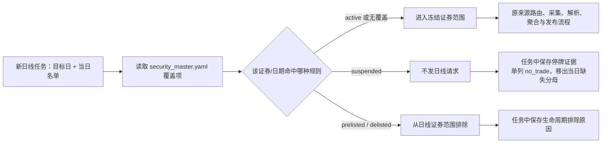

# 股票与 ETF 来源名单

当前正式历史名单和未完成范围以[项目进度](../../PROJECT_PROGRESS.md#当前业务交付状态)为准。本页的10月7日至11日资格和数量是历史证据，不是当前授权；源头日期、分类和参数合同继续适用，运行前须以当前代码复核。

证券名单继续使用现有来源采集、YAML字段映射及留证流程。当前目录保留原实现；用户证券核验脚本的全部来源调用补到现有BaoStock和交易所Provider，历史任务可选择经类型核验的沪深股票、北交所上市日期候选及沪深历史ETF，不新增任务管理层。

## 编号承接与采集代码（2026-11-01确认；首个关系已接入）

目标是让后续任务按有效证券及其可用代码采集，不研究或维护指数编制方法变化的原因。编号承接只需明确旧代码、新代码、来源/市场、使用生效区间及证明承接关系的依据；编制方案变化本身不证明是不同证券，也不要求建立编制方法版本系统。

关系只在现有`config/datasets/security_master.yaml`维护，不另建关系服务。已确认的首项是`XSHE`指数`399427→980070`，生效日`2024-04-23`；依据及目标日接口响应分别链接到原始manifest。名单合并后保留稳定身份`XSHE:399427`、把当前`symbol`更新为`980070`。日线新任务在生效日及之后请求`sz980070`，同时将稳定身份、当前请求代码和关系证据冻结在该证券的任务单元中；生效日前的历史任务仍使用旧代码。以后若再次改码，只追加有直接证据的下一条边；系统按目标日沿已生效关系走到最后一个代码，并保留逐段证据。重复前驱/后继和生效路径中的循环会报错，不能静默挑选。查询页展示当前代码，`/api/daily`同时返回旧码、新码、生效日和证据路径；旧码和新码都可用于查询。

该关系证明代码承接，不证明腾讯接口支持新代码。现有日线来源策略仍负责选择Provider及资格门禁；本次没有改成中证（CSIndex）来源，也没有新增国证（CNI）Provider、发起在线请求或开放资格。`980070`的CNI接口原始响应是代码承接证据，不等于腾讯采集资格。在线请求仍须由对应Provider的现有资格规则放行；当前实现的离线回归只验证代码选择、冻结身份及页面投影。

等价并行行情代码只选一个已验证的采集代码，不要求双采；若按节点理解，节点记录的是本项目采集代码选用历史，切换日不自动解释为旧证券退市日。仅当证据明确承接关系时更新；同名、六位数字相同、行情末日或单次名单消失均不能单独证明关系。代码比较必须包含市场/来源与证券类型，例如`sz000960`锡业股份与历史`sh000960`中证龙头指数不是同一对象。

当日新任务按已确认有效范围及选用代码生成请求，冻结身份与来源代码；续跑保持冻结定义。真正的历史补采仍按目标日期和来源历史查询合同选择代码，不静默重写历史数据。停牌与退市分别判断，未知状态不自动删除。当前`sz399960`与`931802`的承接关系仍待直接证据，不能因方法不同认定两者一定独立，也不能因同名自动连接。

`sz399960→931802`仍无直接承接证据，不写入关系配置、不自动合并。上述首项接入不代表关系已覆盖所有历史代码，也不代表`980070`已经通过腾讯或其他Provider的在线资格验证；完整来源能力与实际运行仍按项目进度表分别验收。股票复权核验和管理台浏览器交互验收仍按进度表跟踪。

## 指数历史有效期与`399980`并列代码（2026-11-02，按用户确认接入）

用户确认将第三方目录有历史终止/数据结束记录、且本项目最后行情日相符的三项记为失效：`sz399946`的最后行情日为`2016-06-03`；`sz399961`和`sz399963`的最后行情日为`2019-01-25`（第三方目录终止日列为`2019-01-28`）。配置中的`delist_date`取最后实际行情日，作为含当日的有效截止日；只有名单快照日期晚于该日才输出`status=delisted`，日线任务不再把它们列入之后日期的请求范围。证据分别见[状态核验记录](../../tmp/batch-remediation-20261029/status-policy-simulation-20261029.json)、[CSI目标日响应](../../tmp/batch-remediation-20261029/interface-review/raw/csi-daily-sh000946/manifest.ndjson)、[第三方399946历史目录](https://www.ricequant.com/doc/rqdata/python/indices-mod)及[第三方指数目录](https://emt.18.cn/api/quant-help/data/indices.html)。第三方日期不是交易所终止公告；此处按用户授权作为项目有效期，来源等级保持明确。

`sz399980`仍保留名单身份`XSHE:399980`，新增并列行情请求码`sh000980`，合同为`full_ohlc`，不改为代码承接。中证原响应在目标日包含同名指数及完整四价，见[000980原始响应](../../tmp/batch-remediation-20261029/interface-review/raw/csi-daily-sh000980/manifest.ndjson)；代码配对线索来自[第三方转载的编制方案](https://doc.xuehai.net/b9ba26d479cf79e15d9993a67.html)，用户确认先按该线索记录。该关系目前是项目内接受的配对线索，不宣称已取得官方一手配对文件；CSI正式在线资格仍由现有资格门禁控制。

`sh000999`在RiceQuant目录中标注`2018-07-11`终止；项目留存Tencent行情最后一天是`2018-07-10`，因此将项目有效截止日记为`2018-07-10`。EastMoney目录仍没有填写终止日，故这是按用户确认的第三方历史目录规则设置的项目取数有效期，不是交易所正式终止公告；中证2026-10-29目标日响应为空也只作交叉核对。[RiceQuant目录](https://rqopen.ricequant.com/doc/rqdata/cli/manual)、[EastMoney目录](https://emt.18.cn/api/quant-help/data/indices.html)、[Tencent历史响应](../../tmp/market-batch-20261029/task_archive/_raw_evidence/market-daily-20261029-batch/sh000999__none/attempt-1/manifest.ndjson)、[CSI目标日响应](../../tmp/batch-remediation-20261029/interface-review/raw/csi-daily-sh000999/manifest.ndjson)。

`sz399332`是旧深证创新价格指数代码：国证2014年编制方案明确代码`399332`；第三方目录将其标为“深证创新(旧)”，项目留存Tencent日线最后日期为`2016-11-29`。深交所于`2016-12-01`发布了另一个代码`399016`的深证创新系列。国证/深交所材料没有明确声明`399016`承接`399332`，因此不把两个代码合并，也不使用`399016`替代`399332`；当前联网看到的`SZSEIN`行情按国证factsheet对应`399016`，不是`399332`的代码证明。EastMoney目录仍列`399332`且没有终止日，和第三方“旧代码”目录/本项目最后行情存在冲突。为本项目日线范围，按用户授权将有效截止日记为最后留存行情日`2016-11-29`，状态含义是“本项目不再把该旧代码作为当前有效采集对象”，不宣称交易所正式退市。[2014年编制方案](https://www.cnindex.com.cn/docs/gz_399332.pdf)、[深交所399016发布公告](https://www.szse.cn/disclosure/notice/general/t20161201_501858.html)、[399016国证factsheet](https://www.cnindex.com.cn/html2pdf/preview/jj_399016.pdf)、[EastMoney目录](https://emt.18.cn/api/quant-help/data/indices.html)、[第三方旧代码目录](https://www.mytest.demo.joinquant.com/data/dict/indexData)、[项目Tencent历史响应](../../tmp/market-batch-20261029/task_archive/_raw_evidence/market-daily-20261029-batch/sz399332__none/attempt-1/manifest.ndjson)、[CNI目标日空响应](../../tmp/batch-remediation-20261029/interface-review/raw/cni-daily-399332/manifest.ndjson)。

`sz399960`仍按第三方目录及用户确认的规则配置有效截至`2016-06-03`；RiceQuant有该历史日期，EastMoney无终止日，且项目Tencent/CSI目标日均无有效行。这些代码的截止日期是项目采集有效期，不是交易所正式退市结论。人工配置只影响新建任务；历史冻结任务和`data/canonical`不会被改写，需使用新任务范围重放后才会反映新状态。

## 人工证券状态与有效期（2026-11-02，按已确认范围实现）

人工干预放在现有`config/datasets/security_master.yaml`的`symbol_lifecycle_overrides`（证券生命周期覆盖）中；没有新建状态服务或管理台页面。这样能先处理当前已确认的停牌/生命周期事实，同时沿用既有证券主数据与日线批任务；代价是操作仍需编辑并审查YAML，不能从页面点选。

| 配置字段 | 意义与边界 | 新任务行为 |
|---|---|---|
| `list_date` / `delist_date` | 有效期起止日，均含当日；`delist_date`是项目按证据认定的最后有效日，不必然等于交易所终止公告日 | 目标日早于上市日或晚于有效截止日时，不生成该证券的日线请求；在任务摘要与发布质量问题中记录排除代码和依据 |
| `status` + `effective_from` / `effective_to` | 仅接受`active`或`suspended`，区间含首尾；允许同一证券另有一项有效期配置，但状态区间必须落在有效期内且互不重叠 | 目标日状态为`suspended`时，不发日线请求，单列停牌证据并从当日缺失分母排除；`active`区间显式覆盖为有效状态 |
| `evidence_refs` | 每条人工配置都要求引用来源或审查记录 | 证据路径与人工状态一起冻结，后续可以查到为什么跳过请求 |

当前配置例子是`002717`：2026-10-13起设为停牌、暂不填结束日；巨潮资讯10月13日公告称从当日起停牌，10月17日公告披露深交所拟终止上市的事先告知。事先告知不等于最终终止决定；截至2026-11-02本次检索未找到最终决定公告。[10月13日停牌公告](https://static.cninfo.com.cn/finalpage/2026-10-13/1225602315.PDF)、[10月17日事先告知书](https://static.cninfo.com.cn/finalpage/2026-10-17/1225609701.PDF)。对2026-10-29新任务，`sz002717`会被列入`confirmed_suspended`并从当日日线分母排除；这不会更改旧冻结任务，也不会推断退市。

覆盖在现有日线批任务“名单解析之后、任务冻结之前”应用：它改变本次新任务的证券名单，不改变来源Provider、代码并列映射、字段合同或发布阈值。成功发布后页面仍只读已发布结果；管理台编辑功能尚未实现。配置及日线任务处理实现见[`security_master.yaml`](../../config/datasets/security_master.yaml)、[`inputs.py`](../../src/pipeline/inputs.py)与[`daily.py`](../../src/pipeline/daily.py)。

另新增`sz399962→sh000962`的明确CSI并列行情代码：已有目标日响应包含有效收盘`4044.15`，开高低及量额不进入标准值；新合同将它放进现有CSI`close_only`收盘序列组，稳定身份仍是名单代码`XSHE:399962`。留存原文见[CSI sh000962 manifest](../../tmp/batch-remediation-20261029/interface-review/raw/csi-daily-sh000962/manifest.ndjson)，旧Tencent对照见[全范围重放结果](../../tmp/market-daily-20261029-index-replay-20261102/index-replay-result.json)。是否整批恢复由下面的新隔离重放结果说明，不用单证券重放替代整批结论。

## 用户脚本能力对应表

依据 `D:/Project/PythonProgram/a_share_universe_check.py`（SHA-256：`006325c86c114aafe3c89d6f2010745dd23d55fc4b35dca9e6378dd785eea236`），逐调用13项均有可执行输入及YAML映射。运行配置见 [providers.yaml](../../config/providers.yaml)，`script_source_keys`用于关联脚本调用；已有ETF方法直接复用。

| 脚本调用 | 正式输入ID | 原生调用与参数 | 用途 |
| --- | --- | --- | --- |
| bs_calendar | CALENDAR-BS-001；SECURITY-BS-UNIVERSE-001内部也调用 | query_trade_dates(start_date=end_date=目标日) | 当日交易日判断 |
| bs_all_stock | SECURITY-BS-UNIVERSE-001 | query_all_stock(day=目标日) | 直接历史行，须类型核验 |
| bs_stock_basic | SECURITY-BS-UNIVERSE-001 | query_stock_basic() | type=1及上市/终止区间核验 |
| ak_sh_main_current | SECURITY-SSE-MAIN-HISTORY-001 | stock_info_sh_name_code(symbol=主板A股) | 上市日期候选与交叉核对 |
| ak_sh_star_current | SECURITY-SSE-STAR-HISTORY-001 | stock_info_sh_name_code(symbol=科创板) | 上市日期候选与交叉核对 |
| ak_sz_current | SECURITY-SZSE-STOCK-HISTORY-001 | stock_info_sz_name_code(symbol=A股列表) | 上市日期候选与交叉核对 |
| ak_bj_current | SECURITY-BSE-LIST-HISTORY-001 | stock_info_bj_name_code() | 北交所上市日期候选；与旧行情目录区分 |
| ak_sh_delisted | SECURITY-SSE-DELIST-HISTORY-001 | stock_info_sh_delist(symbol=全部) | 暂停上市区间候选，不能把暂停日当终止日 |
| ak_sz_delisted | SECURITY-SZSE-DELIST-HISTORY-001 | stock_info_sz_delist(symbol=终止上市公司) | 上市≤目标日＜终止上市 |
| ak_sh_etf_history | SECURITY-SSE-ETF-HISTORY-001 | fund_etf_scale_sse(date=YYYYMMDD) | 原有历史ETF身份输入 |
| ak_sz_etf_history | SECURITY-SZSE-ETF-HISTORY-001 | fund_scale_daily_szse(start_date=end_date=YYYYMMDD,symbol=ETF) | 原有历史ETF身份输入 |
| ak_sh_market_stats | MARKET-SSE-STATS-001 | stock_sse_deal_daily(date=YYYYMMDD) | 原始分类统计与对账参考 |
| ak_sz_market_stats | MARKET-SZSE-STATS-001 | stock_szse_summary(date=YYYYMMDD) | 原始分类统计与对账参考 |

原生SDK请求、请求头、代理环境、超时、分页和解析保留。此前公共包装为本批证券脚本迁移输入误注入额外SDK重试，现已关闭；其他输入的既有重试配置不变。公共限流按重定向每跳释放名额并保存原响应，再交由requests原生机制继续跳转，避免同主机重定向互相等待。北交所SDK带解析表内存缓存，调用其原函数体，避免无原响应的缓存结果；初始页及逐页请求均留证，并核对页号、页数及总记录数。BaoStock维持一次登录、交易日历→全证券→基础资料→退出的顺序，留存SDK公开的完整ResultSet，不宣称已捕获TCP线缆字节。

这些输入是候选采集能力，不等同完整历史证券总表。`date_basis`说明直接历史行或区间推算依据；`trade_date`是候选归属日，原响应采集时间及真实请求另在manifest中。北交所当前上市目录不能恢复之后已退市的历史成员或历史代码，沪市暂停日也不能推断实际退市日。沿用项目已接受的302和689代码范围，避免照搬脚本前缀限制导致既有证券丢失；状态无法确认保持unknown。

历史任务默认五项输入由 [collection.yaml](../../config/collection.yaml)定义；沪深参考名单、退市事件、市场统计为独立可采集输入，不因新增配置自动混入发布名单。市场统计模板保留分类名称与原始列JSON，不把不同类别、单位强行换算为统一覆盖分母。候选任务自动保存`universe_review.json`，包括来源引用、推算依据、排除证据及沪深差异；参考源未采集标为not_evaluated，不报告“零缺失”。

实现核验与逐来源状态保存在 [迁移检查目录](../../tmp/universe-capability-migration-20261011/)。本次新增输入均保持implemented_validation_only及pending_validation；未授予实际生产路由资格、未启动常驻调度、未覆盖正式数据。完整资格仍需原响应、语义、独立范围和端到端证据匹配当前代码与配置，不能把候选日期推算当作直接历史快照证明。

实际核验：新增9项输入已用真实返回完成候选处理（最终修正使用已留原响应离线复验）；北交所原生在线请求两次达到180秒验收限时，未据此认定来源不可用。其已留存18页原响应经原生SDK离线回放得到349条，19次逻辑调用包含初始页；10月8日候选348条与用户脚本逐代码一致。沪深参考目录只比脚本多保留项目既有范围302132、689009；退出事件原表159/208条，目标日筛选结果各0条，区分有效空候选和空原响应。沪深市场统计原表8/14行，保留原列及单位。

五来源真实原响应隔离验收合并7267条：沪股2320、深股2904、北股349、沪ETF944、深ETF750。模拟北交所单元失败时拒绝发布，修复后断点恢复只执行该单元，四项已完成输入不重取；原始响应按既有暂存转正规则处理、规范数据无重复。见 [完整链路验收](../../tmp/universe-capability-migration-20261011/e2e-verification.json)、[用户脚本逐代码对照](../../tmp/universe-capability-migration-20261011/original-table-comparison.json)及 [北交所原字节回放](../../tmp/universe-capability-migration-20261011/bse-original-byte-replay.json)。这些是隔离实现验收，北交所新代码的在线传输及完整历史范围资格仍未通过，不是正式业务发布。

2026-10-11重定向修复后追加在线核验：北交所19次原生分页调用均出现同主机307→200，共留存38跳原响应；18页返回349条，证券代码集合与用户脚本已保存原表一致，额外SDK重试关闭，耗时129.29秒（仍执行每主机3秒限流）。上述旧在线阻断已解决，本次目标日2026-10-09仍是依据当前目录上市日期筛选的候选，不能宣称取得历史快照或已授予生产资格。见 [在线对照](../../tmp/bse-redirect-verification.json) 和 [原字节回放核验](../../tmp/bse-redirect-replay.json)。

## 历史能力与验证范围（2026-10-11）

2026-10-09 既有 Provider 在线核验得到沪市股票2,320只、深市股票2,904只、深市ETF750只、沪市ETF943只、北交所股票349只，共7,266条。沪深股票、深市ETF及北交所股票与当次交易所目录逐代码匹配；沪市ETF目录944条，比BaoStock多 `512390`（中国低波ETF平安）。原SDK载荷没有该代码，差异不由本地映射或过滤产生。

原核对把这个目录差异解释为漏采，结论需修正。[基金管理人2026-09-30公告](https://paper.cnstock.com/html/2026-09/30/content_2274033.htm)明确该基金最后运作日为9月8日、9月9日进入清算；公告没有给出实际终止上市生效日。不能仅凭943与944的差异认定漏采，也不能把清算基金当正常交易ETF补入。当前按下文确认的上市目录口径保留该证券，交易状态为unknown。历史 [逐代码核对](../../provider_validation/results/security-activation-20261009/coverage-review.json) 和 [核对代码](../../provider_validation/results/security-activation-20261009/coverage-review-code.txt)保留原样，其“漏采”解释由本段更正。

2026-10-10用户确认ETF按上市目录全量保留；尚未确认实际退市且仍在目录中的清算基金保留，无法确认交易状态时为 `unknown`。上交所官方ETF目录已补接，不能将 `unknown` 理解为正常交易或保证有日线返回。历史“清算基金是否保留”的待确认项由本规则取代。

当前全量目标由 `security_master` 配置限定为沪市A股、深市A股、北交所股票、沪市ETF、深市ETF五组，含主板、创业板及科创板。B股、LOF、债券和港股等不在当前目标中。来源名单保留暂停交易证券，北交所状态为未知。配置要求五组存在、此前证券无异常消失，不等于全市场100%覆盖证明。

### 指数证券分类与接入状态

BaoStock `query_stock_basic()` 的 `type=1` 归为股票，`type=2` 归为指数；`SECURITY-BS-UNIVERSE-001` 会将这两类与指定日 `query_all_stock()` 记录关联。ETF 仍由现有ETF来源补入，不从指数记录推断ETF。该输入仍标记为 `implemented_validation_only`，没有取得可用于正式路由的完整资格，因此当前正式证券主数据仍只发布上面的五组，指数候选不会被误报为已纳入生产清单。证券主数据结构允许指数，索引组可作为附加组验收；在BaoStock来源完成正式资格前，指数组不设为必需组。

腾讯指数日线能力已对 `sh000001`、`sz399001` 实测：不复权 `day` 返回目标日记录；`fqkline/get` 前复权与后复权请求对两只指数均只返回普通 `day`，没有 `qfqday` / `hfqday`。相同参数的 `sh600519` 股票对照返回了两种复权序列。故腾讯指数任务默认不复权，股票、ETF保留原复权方式。该窄范围探测不等于已登记指数日线生产资格；完整请求、原始响应及哈希见[指数复权探测报告](../../tmp/security-daily-20261023/phase-13-index-adjustment/phase-13-index-adjustment.md)。

三项现时名单来源在2026-10-11历史ETF接入后再次完成当前版本的真实采集、独立目录对照和隔离发布，重新登记五个责任组资格。首次正式任务已执行并自动记录失败：目标名单日10月9日，北交所及上交所当前目录采集日10月10日，日期不一致；没有完整旧名单可回退，未发布。源头可行性证据仅只读引用，新的探针在tmp隔离，正式任务及资格登记在data。

以下为本轮实际取数范围；资格按责任组及非日期参数登记，不能扩大到其他数据集或参数范围。

| 来源输入 | 能力 | 本次实际范围 | 执行状态 |
|---|---|---|---|
| `SDA-BOARD-005`，`config.include_etf=true` | 沪深股票与ETF名单 | 请求10月9日，6917条候选：沪股2320、深股2904、沪ETF943、深ETF750 | 已实现；当前版本沪股、深股、深ETF三责任组资格通过；沪ETF补齐由上交所承担 |
| `SECURITY-BSE-001` | 北交所官方当前证券目录，完整翻页 | 10月11日采集，18页349条，与独立上市公司目录逐代码一致 | 已实现；当前版本BSE/stock资格通过 |
| `SECURITY-SSE-ETF-001` | 上交所官方上市ETF目录，含仍在目录的清算基金 | 10月11日1125条基金原行，944条ETF，与官方ETF专类查询逐代码一致 | 已实现；当前版本XSHG/etf资格通过 |

这些是各自日期的名单，不是已发布的当日全量证券。资格有效期按配置为7天，仍受代码、配置、范围和冷却检查约束。上交所ETF基准使用相同后台的独立F100查询及官方分类树；前端基金JS包含1476个更宽范围代码，只作交叉核对，不作ETF分母或独立上游可用性证明。深市ETF分母重新从留存的10月9日官方原始Excel读取，未修改历史材料。[定时更新与资格检查](../pipeline/collection-tasks.md#证券清单定时更新) 已接通现有任务入口，10月11日正式入口因既有日历未覆盖当天而记录blocked，未发布；常驻进程未启动，同一真实交易日的首次完整发布仍待验收。检查索引见 [当前资格与运行](../../data/task_workspace/_checks/security-qualification-20261011/verification.json)。

## 请求与分类

### 指定日期的ETF输入

复用现有 `SseMarketProvider` 和 `ExchangeDailyProvider`，不增加平行Provider或任务管理层。参数及限制定义在 [providers.yaml](../../config/providers.yaml)，字段映射在 [security_snapshot.yaml](../../config/normalization/security_snapshot.yaml)，来源承担的市场/类型在 [security_master.yaml](../../config/datasets/security_master.yaml)。以下三项已加入 `collection.yaml/security_master.historical` 历史任务选源；当日定时任务仍使用当前目录。配置接通不自动授予生产路由资格，真实证据、有效期、冷却、日期和完整范围仍须通过检查。

| 输入ID | 原始接口及日期 | 10月9日留存响应 | 映射 |
|---|---|---:|---|
| `SECURITY-SSE-ETF-HISTORY-001` | 上交所普通ETF份额，`STAT_DATE` | 920条 | `SEC_CODE`→代码，`SEC_NAME`→名称，`STAT_DATE`→数据日期 |
| `SECURITY-SSE-MONEY-ETF-HISTORY-001` | 上交所交易型货币ETF份额，`STAT_DATE` | 24条 | 与普通ETF相同，分接口保存、合并检查 |
| `SECURITY-SZSE-ETF-HISTORY-001` | 深交所日频基金规模，`日期` | 750条 | `基金代码`→代码，`基金简称`→名称，`日期`→数据日期 |

身份输入统一为ETF、状态unknown、上市日为空。实际响应日期必须等于请求日；只证明该统计日份额报告中的ETF身份，不能把份额记录等同于独立完整历史上市目录。北交所历史目录尚未解决，因而不能凭这三项宣称10月9日全市场证券已经发布。

普通ETF和深交所使用原AKShare函数，保持请求参数、头、默认Session/代理、重定向和零重试；超时分别为原SDK不指定、15秒。货币ETF保持已成功GET/JSONP探针参数、Chrome88和原页面Referer、25秒超时。既有 `ASTOCK-030` 的份额接口及传输不变。深交所随机参数只在离线重放时恢复留存请求值，真实采集仍由SDK产生；不修改全局随机数。

原响应在解析前留存。上交所检查统计日、总数、唯一代码及份额；深交所同时读取原XLSX，核对所有非空行和SDK转换结果，拒绝SDK删行、错误日期、异常代码及无效份额。互补来源先合并再与前次名单比较，每个声明的来源单元仍必须成功；重复证券按既有发布规则去重。来源失败时保持_tmp，断点重做只重采失败单元；全量重做按既有规则归档清理暂存再重采。

隔离验收使用 [任务参数](../../tmp/etf-history-integration-20261011/task.json)，合并沪市944条、深市750条，合计1694条；全量重做和再次断点执行验证一致、无重复、零网络调用。成果和哈希见 [验收索引](../../tmp/etf-history-integration-20261011/verification.json)。均在tmp下，不写正式data或新增provider_validation材料。

历史ETF接入改变了Provider、工厂、流程及YAML指纹，当次未重登记资格。后续已按当时版本重新复核三项现时目录来源，见上述当前资格索引；历史ETF输入的实际生产资格尚未授予。当前历史选源和日期资格检查已接通，运行前仍需当前版本的真实证据复核，不将隔离回放当作资格登记。

沪深输入保留原 BaoStock 登录/退出、`query_all_stock(day)`、`query_stock_industry(date)` 两次查询及SDK留证边界；没有替换传输方式。参数仍由 [providers.yaml](../../config/providers.yaml) 定义：`trade_date` 来自请求并需要已知交易日，`symbols` 是本地筛选，`include_etf` 来自配置，默认 `false`，保持原股票调用方式。全量股票与ETF名单显式配置 `include_etf: true`。

股票名单补正了旧规则遗漏的 `302132`。ETF 根据来源记录中的交易代码类别选择，沪市使用51/52/53/55/56/58开头的交易代码，深市使用158/159；名称不要求包含“ETF”。指数、LOF和联接基金不会因名字含ETF而混入。源头股票和ETF之外的507条记录保留原响应，并另保存排除行及原因，不能把它们当作已经验证的ETF。

分类核对中的例子有交易所依据：[中航成飞302132公告](https://disc.static.szse.cn/download/disc/disk03/finalpage/2025-03-19/dd95a920-8b43-4643-9405-93047fcddf93.PDF)、[上交所511600货币ETF公告](https://www.sse.com.cn/disclosure/announcement/general/jjzssgg/c/c_20260213_10809590.shtml)、[深交所159003货币ETF说明](https://investor.szse.cn/knowledge/fund/other/t20141209_538861.html)。原行业分类接口的既有范围与对照合同保持，不借这次名单修正改变其他接口。

北交所沿用原验证脚本的代理设置（`STOCK_DATA_HTTP_PROXY`，原本地代理默认值）、`trust_env=false`、同一Session及Cookie、User-Agent、Referer、GET页面、POST分页参数、20/30秒超时、禁止自动重定向、重定向后刷新页面并重试一次，以及页间等待。原逻辑来自 [验证脚本](../../provider_validation/tests/verify_security_board_coverage.py)。不在Provider内做来源回退。

分页增加总数、页号、行数、结束页、唯一证券及返回格式检查。现有基础留证模块增加可选请求体哈希匹配，仅该目录输入启用；缓存和回放同时区分不同POST页参数，保存脱敏后的表单参数，不只按相同地址选响应。其他接口的默认匹配方式保持。

## 字段和日期

上交所ETF输入保留原基金目录GET、Session、代理、`trust_env=false`、User-Agent、基金列表Referer、30秒超时和禁止自动重定向，无隐式重试或来源回退。请求仍查询 `CATEGORY=F000` 的基金目录，使用已有官方分类树中的ETF（F100）子类，含F150交易型货币基金；排除LOF、其他货币基金和REITs。未知ETF分类、重复证券、空返回或声明总数不符直接失败。原响应及全部基金行保留，排除行另列原因。

来源字段 `FUND_CODE/FUND_ABBR/LISTING_DATE` 映射为 `stock_code/stock_name/list_date`，交易所 `XSHG`、资产类型 `etf`、状态 `unknown`。`trade_date` 请求参数只绑定 `END_DATE` 上市日上限，不是历史名单能力；标准名单日期及raw日期按原响应上海时区采集日保存。回放保持原日期，业务任务继续拒绝与目标日不一致的目录。

[来源字段模板](../../config/datasets/security_snapshot.yaml) 与 [字段映射](../../config/normalization/security_snapshot.yaml) 共用 `stock_code`、`stock_name`、`exchange`、`status`、`trade_date`、`source`，补充 `asset_type`。旧股票候选没有该字段时仍按已有股票默认处理。最终名单仍使用 [security_master.yaml](../../config/datasets/security_master.yaml)。

北交所字段对应 `hqzqdm`、`hqzqjc`，资产类型为 `stock`，交易所为 `BSE`。接口没有提供可靠的停牌状态，因此保存 `status=unknown`，不把存在报价当作正在交易；该状态不阻止已经在名单中的证券进入后续范围。

北交所没有历史名单日期参数，拒绝单证券和历史区间查询。标准字段 `trade_date` 表示原响应在上海时区的采集日；源头行情日期 `hqjsrq` 原样保留，并在报告中另列 `quote_dates`。此前目录采集日为10月7日、行情日期为9月30日；10月8日回放仍保留10月7日。最新10月9日目录与行情日期均为10月9日；不用回放日期或行情日期改写名单日期，跨采集日分页不能拼为同一快照。沪深最新核验明确请求 `trade_date=2026-10-09`，原响应记录与来源候选均保留该日。

## 文件位置及核验

- 原始接口探针：[北交所原响应清单](../../provider_validation/results/raw/security-catalog-bse-20261007/manifest.ndjson)。此处只有来源验证证据；原始响应在解析前留存。
- 分类调查与原脚本结果：[分类核对](../../provider_validation/results/security-catalog-20261007/classification-review.json)、[北交所原脚本结果](../../provider_validation/results/security-catalog-20261007/bse-original-result.json)。
- 正式原响应：先进入 `data/raw/_tmp/<数据日期>/<来源>/<接口>/`，完整任务成功后转入 `data/raw/<数据日期>/<来源>/<接口>/`，请求范围由manifest文件区分，见 [存储说明](../storage/README.md)。
- 来源候选：`data/task_workspace/<数据日期>/<数据集>/sources/<来源>/<接口>/`，含来源行、映射JSON、Parquet和质量记录；证券任务的数据集为security_master。
- 检查索引和回归报告：`data/task_workspace/_checks/security-catalog/`；运行产物不提交Git。

先前运行仅回放已留证的原响应。10月9日在线Provider候选和官方目录核验仍写在 `provider_validation/results/security-activation-20261009/`，属于已留存历史材料，不能作为正式业务任务完成证据。正式业务已进入开发，继续把联调及资格复核输出放在验证区偏离了本次确认的目录边界；后续此类响应、派生结果及核验报告归业务根目录或隔离实现测试根目录，已有证据只读引用。本阶段没有搬迁或删除历史文件。股票和ETF的SDK载荷可回放，BaoStock不暴露TCP原始帧；北交所HTTP字节与请求体哈希可逐页核验。

原脚本与正式适配器对照请求地址、方法、非秘密请求头、POST请求体哈希、状态、响应哈希和全部证券代码/名称。Cookie在归档中脱敏，无法从离线证据恢复实际值；另外以原生Session及适配器夹具验证Cookie传递、代理、超时和刷新重试。离线通过不等于正式适配器已完成持续在线运行验证。

相关离线回归127项通过，另2项名单日期边界检查通过。独立核对来源响应、请求体与派生Parquet哈希，以及YAML和代码版本；本机索引为 `data/task_workspace/_checks/security-catalog/verification.json`。

前次目录接入及摘要验收见 [历史检查索引](../../data/task_workspace/_checks/summary-etf-20261010/verification.json)：同为10月9日的三份原响应隔离发布7267条，当次尚未登记生产资格。当轮三项资格已登记；后续历史ETF接入改变指纹后，当前版本已经再次复核并登记，真实探针及隔离发布在tmp，正式失败任务原响应按实际日期保留在data/raw/_tmp，迁移后的自动摘要在 [任务摘要](../../data/task_workspace/2026-10-09/security_master/summary.json)。该历史检查点没有新增验证区产物或正式发布；后续7267条正式发布见项目进度。测试和日期限制统一记录在 [当前进度](../../PROJECT_PROGRESS.md)。
