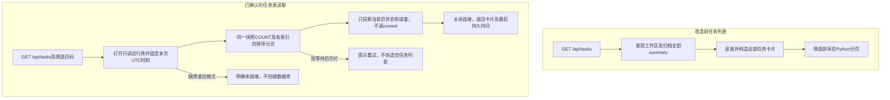
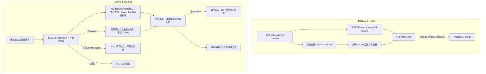
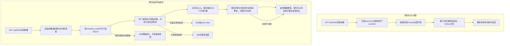
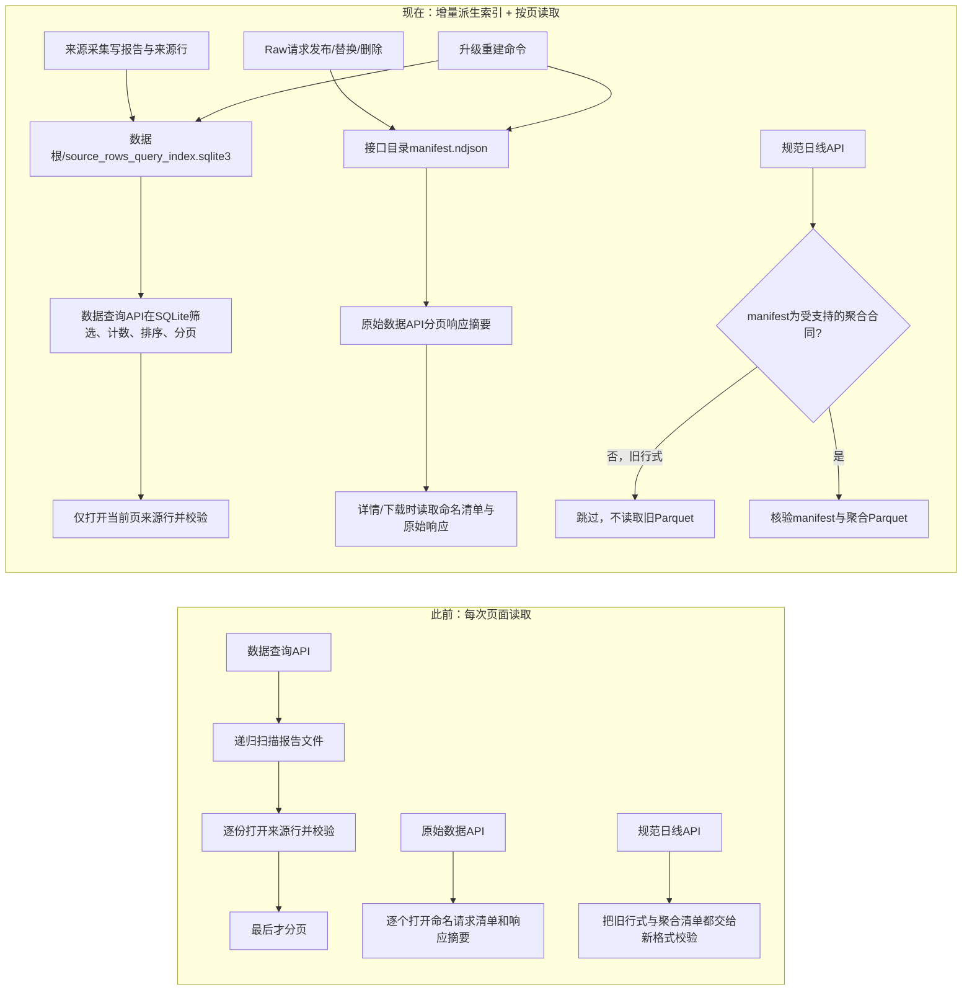

# 只读运行台

## 正式日K表查询与覆盖展示

任务页只展示执行进度、当时结果、失败与恢复；数据页查询当前正式业务表，不以任务成功数、工作区summary或冻结任务名单推导实际行情覆盖。正式日K只有数据库一份，不在查询失败时回退扫描旧Parquet。表结构、发布事务、精度与覆盖依据以[入表合同](../storage/README.md#正式日k入表与覆盖统计)为主，本节维护消费合同与验收。

实施边界：单日采集写入与直接资格消费者、`GET /api/daily`、`GET /api/tasks`、`GET /api/publications`和`GET /api/overview`已在对应隔离范围验收，实际数据、版本与结果见[阶段进度](../../PROJECT_PROGRESS.md)。覆盖查询、任务详情/单元及任务提交的表消费尚未完成，不能把上述路由当作整个管理台通过。

### 任务列表与发布列表接线边界

`collection_task`是已受理运行的事实源；waiting任务可能还没有summary，不能因目录中未发现摘要就漏掉它。列表按SQL列中的状态、数据集、任务编号筛选，以`updated_at DESC, task_id`稳定排序，在同一短只读快照中取得总数和当前页。仅解析当前页状态字段，不连接`collection_task_context`、不读取冻结覆盖授权或全历史摘要。详情和单元查询的逐任务定位、状态筛选成本须单独验收，不能由列表通过替代。

只读连接不初始化或修改业务表；SQLite在现有WAL模式库上读取时可能创建该库的空`-wal`及`-shm`协调文件。只读验收仍要求原有业务文件完全不变，不能以忽略所有日志文件代替检查，也不能用`immutable=1`忽略活动WAL中的已提交数据。

| 对象/具体模块 | 当前问题与本阶段输入输出 | 验收边界 |
|---|---|---|
| `storage.metadata`任务查询、`DashboardReader.tasks` | 全历史summary发现后分页→从唯一任务表先筛选/分页，再形成最多100张卡片；waiting也可见 | 10000条运行下检查页内解析数、实际SQL计划、首次/复用耗时；查询不访问context或任务文件，不改变任务状态 |
| 状态及时间 | 原摘要生成时间参与疑似中断判断→SQL状态/updated_at决定已持久化进度的年龄，返回明确updated_at_utc | 原generated_at_utc只保留原生成时间，等待时可缺省；collecting/checking/committing超原阈值才标疑似中断，waiting不因久等标中断。不把记录时间称作心跳或据此接管运行 |
| 任务页显示 | 等待状态目前可能显示英文，过滤器遗漏waiting | 增加“等待执行”标签及筛选，说明来自持久化任务记录；不新增任务启动、停止或调度行为 |
| 发布摘要的上游登记 | 日K已有同库分区摘要；原证券清单发布缺partition_status登记 | 现沿既有生产/恢复链登记唯一当前清单；不从空索引推断无旧清单，不扫描历史回填，不迁移生产数据 |
| 发布原文展开 | 2026-11-10用户确认统一只返回摘要和追溯入口，原文按需查看 | 移除include_evidence展开能力；日K数据和原始响应均继续保留，不能以列表改造为由删除证据或改变来源资格；具体接线见下节 |



任务记录不读取当前分区来改写执行结果：A采集失败后B补齐了数据，A仍保持当时失败；当前数据由发布列表和数据查询体现。已持久化受理和开始执行是两件事；无运行心跳事实时不生成“执行者活跃”等新结论。本节是实施范围，不代表本轮功能或性能已通过，实际结果在PROJECT_PROGRESS记载。

### 发布摘要与总览的接线合同

发布列表回答当前正式日期/资产分区有什么数据，总览并列展示任务执行与已登记数据。它们的事实来源是SQLite中的`partition_status`及`collection_task`，不再由历史manifest、任务summary或本次任务写入数量拼接。2026-11-05股票旧清单5569行、16423个原文引用的只读样本见[记录](../../tmp/sqlite-runtime-implementation/dashboard-table-queries/baseline-48432e5c/publication-expansion-observation.json)；摘要接口不为生成列表展开这些引用。原文、任务证据和旧文件保留，来源及资格规则不变。

| 具体模块/对象 | 改造前→目标输入输出 | 约束、失败与验收 |
|---|---|---|
| `storage.metadata`发布查询与`DashboardReader.publications` | 扫所有manifest/任务摘要→SQL按dataset/asset_type/partition_key筛选，COUNT与分页同一短快照；按partition_key降序、dataset/asset_type/adjustment升序稳定排序 | 页内最多100条摘要，不读行情、任务上下文、原文引用或manifest；COUNT/深页OFFSET仍有索引工作量。范围明确为registered_publications，旧文件未登记不自动回填，不把空登记称为没有历史文件 |
| `partition_status.last_task_id`及`storage.daily` | 任务关联原靠历史summary路径匹配→摘要只保存最近一次实际更新任务ID | 日K有有效写入或no_trade变更才与摘要同事务更新；零写入、失败或被后续归属保护时保持原值。它不是全分区的全部来源清单；发布回执与逐证券当前归属仍在原业务表 |
| `pipeline.inputs._finish_task_commit`与Master登记 | current清单成功却无SQL登记→复用现有表保存唯一当前清单摘要与最近发布任务 | 不复制逐证券success状态到partition_item，不新增每日证券快照。完成登记替换的是旧Master摘要索引行，证券库、字段历史、原始证据与旧文件不删除；跨资源顺序见存储合同 |
| 更新中的Master | 原靠文件扫描跳过marker→SQL摘要updating或Master任务committing时明确报告更新/待恢复，暂不展示Master为已完成分区 | 其他日K/任务摘要正常返回，不将中断期间的旧头误称为当前可读清单。首次发布尚无摘要时不制造0行正式记录；任务恢复沿原入口 |
| `DashboardReader.overview` | 全历史任务文件/manifest计数排序→一次SQLite快照读取任务计数、最近6个任务、最近6个已登记分区及Master状态 | 关闭连接后才组装卡片及调用既有raw_options；最新原始日期仍来自raw根一级日期目录，区别于正式发布日期；普通目录不逐个解析路径，链接/重解析项保留原根目录约束；不新增索引或读取响应内容 |
| 现有发布页面 | 请求include_evidence=false后仍读取旧manifest字段→只呈现当前摘要、登记时间、最近更新任务及原文日期筛选入口 | 去除evidence、source_count、size_bytes、publication_metadata、tasks全量关联及include_evidence参数；不伪造日K文件hash。Master文件hash可空展示，但不再作为日K页面主列；原文数量未统计时不显示为0 |

返回当前行数、可空预期数及其依据/原因、状态、no_trade、口径状态计数、修订号与登记时间。日K独立证券/日期依据未建立时，expected_count及coverage_percent继续为null；不得从任务证券数补分母。其他数据集原登记预期仅说明发布检查口径，不代表全市场覆盖验证。最近更新任务入口与“按数据日期查看原文”入口明确区分，原文日期入口可能没有结果，不代表本分区原文数量为0。



两个对外路由分别列入验收：功能覆盖真实离线生产到API、资产/日期/数据集筛选、分页/空结果及错误；总览检验同一读快照内的任务与数据结果，不能把任务成功与行情存在互相推导。代表规模为10000条任务与3资产×1000个合成业务日摘要；先说明造数不代表真实行情发布，记录首次单样本、5次复用p95、最后一页、实际SQL计划、页内对象数和文件读取范围。沿既定预算首次≤2秒、复用p95≤1秒、深页≤1秒；不将单次首次称冷p95。只重复修复实际影响的检查，不进行真实Provider重探或全市场重采。

| 本阶段受影响路由 | 对应检查入口 | 业务与工作量边界 |
|---|---|---|
| GET `/api/publications` | `test_publication_table_queries.py`及既有Web摘要节点；真实Master边界节点在`test_collection_tasks.py` | 筛选/分页/空结果、未知覆盖分母、真实冲突值、拒绝原文展开；3000个合成日期/资产摘要，页内≤100，实际SQL计划和最后一页 |
| GET `/api/overview` | 同一新测试文件的快照/性能节点及既有Web总览节点 | 并发写入前后任务与分区均来自同一快照，分别最近6条；10000任务、3000摘要及1000原文日期目录，首次与5次复用分别测量 |
| GET `/api/tasks`（共用只读上下文改变） | 既有`test_dashboard_table_queries.py`的6个节点 | 10000条任务及页内大state、等待态/实际受理、精确300秒及错误/不初始化合同；不因此重跑无关来源或全套测试 |
| GET `/api/raw/options`（总览共用目录枚举） | `test_web_service.py`的原文日期边界节点；复用`test_publication_table_queries.py`规模样本 | 合法目录排序、非法名称/同名文件、空根与链接边界；1000日期目录直接测一次并记录共享枚举成本和路径解析次数，不递归读取清单或正文 |

### 日K查询接线的实施与验收边界

本阶段先切换`GET /api/daily`，不把覆盖查询、发布列表、任务列表或页面任务提交连带标为完成。`service.market_data.query_daily`的输入改为明确的运行库路径；调用者从现有存储配置传入`metadata_path`，不从行情目录猜库路径。数据库筛选、计数、可用口径集合和当前页须来自同一个短读快照；关闭连接后再做展示及名称补充，不跨SQLite与证券清单DuckDB持有锁等待。

六项行情数值按入表合同返回规范十进制字符串，空值保留为null；例如精确数值`11.00000000`入表规范化后返回`"11"`，页面小数位继续由现有展示配置决定。可用、未核验、不适用及close_only的业务状态随记录返回，不能把缺值填成0。

| 对象/输入 | 改造前 | 本阶段目标及可核验边界 |
|---|---|---|
| 日期、证券、资产、复权口径、页码 | 遍历旧正式manifest，读入匹配分区全部行情后在Python分页 | SQL先筛选、稳定按日期/身份排序，再分页；只构造页内最多100个行情对象。COUNT及深页OFFSET可能扫描匹配索引，分别测量，不称为常量成本 |
| 配置中的代码承接关系 | 全量行情逐条判定后筛选 | 按市场、资产、生效日展开有限身份/日期条件后交给SQL；旧代码、新代码、无前缀同号及跨生效日均测试，不能分页后再过滤 |
| 可用复权口径 | 遍历全部匹配行情时累积 | 保持匹配结果整体的口径集合，不悄然缩为当前页；仅做SQL存在性/聚合查询，不为此反序列化所有行情 |
| 证券名称 | 每次读取并构造整份清单 | 只返回当前页所需的名称行。保留既有整份清单文件完整性与总行数校验，明确记录其读取字节；名称缺失、更新中或损坏独立报告，不令已提交价格假空 |
| 缺库、旧格式或缺表 | 文件路径可能被当作空目录而返回空结果 | 明确未就绪；GET不建库、不建表、不迁移、不回退旧行情文件。实际锁忙与完整性错误区分处理 |



定向接口验收必须经过真实ASGI请求并断言业务数据、分页总数、空结果与错误阶段；直接调用路由只用于诊断或耗时拆分，不能替代HTTP合同。性能样本以7862证券×100日×3口径为目标，区分造数方式与实际正式发布链验证；记录首次/复用、匹配索引及排序工作量、当前页对象数、名称校验字节，并另说明1000日增长检查实际覆盖多少数据。该表与流程是实施合同，尚不代表测试通过；结果在阶段进度记载。

| 路由 | 入表后的目标输入输出/资源 | 功能与工作量验收 |
|---|---|---|
| GET `/api/daily` | 保留证券、日期、资产、口径、分页与精确字符串返回；从daily_bar/daily_quote索引查询当前页及总数 | 覆盖三口径与空值/close_only、沪深北身份承接、日期边界/空结果/非法参数；SQL过滤与稳定排序分页，只构造页内最多100条，不打开行情文件或全历史任务 |
| GET `/api/publications` | 从partition_status读取当前逻辑日期/资产分区及摘要；不把某运行输出行数当当前分区 | 筛选/页总数/同日两证券覆盖后全分区计数；无独立范围时应有数与覆盖率为null并带原因；日期是业务日期，不以文件mtime作业务发布时间 |
| GET `/api/overview` | 任务计数读任务表；最近正式数据读摘要，两个结果分开 | 不扫描历史task/summary/manifest，不把失败任务变更成成功；返回各自最后确认时间 |
| GET `/api/daily/coverage`（拟新增领域查询） | 显式日期范围、资产/可选证券范围、口径、摘要/缺失明细和分页；从当前表及独立业务依据计算 | 返回已有/应有/缺失/排除/不可判定及依据；未请求明细不产生全量证券日期行；无日历/历史范围时明确不可判定，不以任务范围充当全市场 |
| GET `/api/tasks` | 从collection_task筛选/计数/分页，等待态也显示；更新时间取持久化记录，最多100张卡片 | 本阶段检验10000条任务、真实入队后查询、状态/数据集/编号筛选、稳定分页和错误合同；只读任务状态，不连接大上下文，不扫描summary |
| GET `/api/tasks/{task_id}`、`/api/tasks/{task_id}/units` | 原任务/执行证据合同；发布结果以回执追溯、当前数据入口另列；逐任务表定位尚待接线 | 后续B补齐数据后A的失败历史不变；任务行数区分本次写入与当前分区总行数；已被后续任务替代不是本次新采成功。列表切表不代表详情和单元完成 |
| POST `/api/tasks/run`、`/api/tasks/{task_id}/resume` | 活动范围仍查唯一任务记录，正式重叠与当前归属从业务表查 | 待执行/运行重叠拒绝、覆盖提示过时复检、旧resume不回写B；返回持久受理记录而非线程已启动即成功 |

`/api/daily/coverage`属于数据覆盖能力，不新增管理服务或独立任务入口。日K数据、发布摘要、覆盖查询在一个短只读事务中取得所需SQLite行后关闭连接再组装响应，不能流式输出时继续持有读事务。独立清单/日期证据在事务外取得并明确修订；不得嵌套跨库等待。名称只为页内身份补充，暂不可用时单独报告，不返回假空价格。新接口必须补入逐路由验收清单，不能继续沿用旧“18个API全覆盖”分母。

性能验收使用存储合同规定的7862证券/100交易日/10000历史运行，另检查1000日期增长；分别记录冷启动及复用耗时。基础列表最多处理请求范围日期/资产摘要；证券行情按日期/身份索引查询，记录COUNT、排序和深页OFFSET的实际扫描成本，不能把返回100行当读取100行。摘要和行数据在同次读快照中一致。时间预算提案冷p95≤2秒、复用p95≤1秒，受理p95≤5秒；同时发布一日7862证券时验证队列提交/任务读取，不以持续busy或503计作业务通过。全市场历史缺失明细受独立范围证明限制，未知时准确报告而不编造100%覆盖。来源行与原文接口继续使用各自存储，本轮不借入表重写它们。

## 区间提交、等待和覆盖交互（2026-11-08确认，待实现）

任务提交与冲突规则以[任务流程合同](../pipeline/collection-tasks.md#单日与区间任务的提交冲突和发布合同2026-11-08确认待实现)为主，本节只说明用户交互。当前工作区页面仍只提交单日，没有区间、等待占用检查、覆盖勾选或调度启停接口；现有后台线程拒绝忙碌不等于实现了FIFO等待。

目标页面应明确显示：选择的日期区间、证券范围及K线周期；活动重叠时列出具体日期/证券/占用任务并拒绝；正式数据重叠时列出范围并要求勾选“覆盖执行”；提交时重新核对并返回变化，不把页面旧提示当作对新增重叠的授权。非重叠运行按提交顺序等待，显示前序任务；不按自动/手动重新排优先级。区间运行按日期展示已发布、失败、未完成及对应数据入口，不以阶段进度100%或任务已发布掩盖缺失。

“停止调度”只停止后续自动触发，不暗中取消已提交运行或删除数据。用户已明确正式行情只有当前一份、不做旧行情快照；旧运行只显示当时运行记录及当前数据入口，覆盖后说明当前分区已更新，不提供旧行情版本切换。本轮不实现按状态/时间清理，也不新建清理模块。上述行为待正式实现，未改变下文现有接口和本机写保护合同。

## 管理台并发访问逐接口检查（2026-11-08提案，未实施）

本次静态追踪当前工作树`web.py`的19个路由：静态首页1个、HTTP API 18个。2026-11-09用户已认可方案，允许必要版本替换，不迁移旧数据，只用隔离测试数据验证。表中分别列实际依赖与确认目标，不代表已运行接口/并发验收。运行库替换、读写模式、新库初始化/环境前提及锁顺序以[存储合同](../storage/README.md#并发访问与资源边界)为准；[28类场景及验收分母](../pipeline/collection-tasks.md#并发访问场景清单及执行流程2026-11-08提案未实施)在任务文档维护，不复制业务规则。

| 现有API（逐路由） | 当前实际读取/写入 | 推荐并发边界与用户可见行为 |
|---|---|---|
| GET `/api/overview` | 本阶段接线：SQLite任务与发布摘要；raw根一级日期目录 | 一个短读快照取任务计数/最近6条与发布最近6条，关闭连接后补原文日期；不递归读取历史摘要；本阶段实际验收见PROJECT_PROGRESS |
| GET `/api/tasks` | SQLite collection_task筛选/计数/分页 | 已完成隔离验收；只读取当前页运行，不读取全历史JSON或冻结上下文 |
| GET `/api/tasks/{task_id}` | summary、冻结定义和运行单元汇总 | 状态以运行库为准，定义/证据仍引用已有文件；显示最后确认更新时间及可能中断，不凭页面超时接管任务 |
| GET `/api/tasks/{task_id}/units` | 当前运行单元manifest及报告 | 按页读取对应单元/批定位；批写未完成显示处理中，不当成数据缺失或任务失败 |
| GET `/api/task-options` | collection/schedules/providers/capabilities等YAML | 配置读取，不获取任务执行锁，不因GET联网探测来源；当前没有调度启停API，不将该路由当成已能修改调度 |
| POST `/api/tasks/run` | 本机写保护、本地日历（同运行SQLite）、任务构建、线程启动 | 本地准备后短受理事务：明确活动冲突、正式重叠及覆盖授权；成功回执前运行已持久化可查询。目标是等待，不是在页面线程直接抢整任务执行锁 |
| POST `/api/tasks/{task_id}/resume` | 冻结task及工作区位置，然后启动线程 | 校验冻结定义和实际待恢复范围，再登记受理/等待；不能跳过当前占用和新增数据确认，不重做已完成日期 |
| GET `/api/daily` | 本阶段读取：SQLite日K业务表、页内稳定身份的清单名称和展示YAML | 已完成只读接线、定向功能和代表规模性能检查；不保留正式行情文件回退，名称不可用单独标明 |
| GET `/api/publications` | 本阶段接线：SQLite已登记逻辑分区摘要 | 摘要表过滤分页，当前清单更新中暂不显示旧摘要；最近更新任务与原文按需追溯，不扫描目录或展开引用；本阶段实际验收见PROJECT_PROGRESS |
| GET `/api/data/options` | SQLite来源索引中的报告描述及数据集YAML | 查询小型分组/选项集合，不加载全部来源行；索引缺失明确未就绪，GET不重建 |
| GET `/api/data` | SQLite选择器、页内来源行/候选文件、证券清单补名称 | 与增量写并行读已提交内容；关闭游标/读事务后再组装响应。索引重建切换短暂忙碌单独说明；名称读取与来源行读取分开 |
| GET `/api/raw/options` | raw/workspace/archive接口manifest索引 | 读已完成接口摘要，避免扫描每个正文；索引正在替换读取完整一份或提示刷新 |
| GET `/api/raw/sources` | 选定日期下接口manifest索引 | 限定日期目录，不拿运行库写连接，不遍历所有历史响应 |
| GET `/api/raw` | 已筛选日期/来源的请求manifest和接口索引 | 分页读取已持久化响应；接口索引更新不丢事件，不将半写入NDJSON当有效空结果 |
| GET `/api/raw/{evidence_id}` | 证据manifest事件和限量正文预览 | 按固定事件及预期正文校验；定位变化明确刷新，不把同一路径下另一个事件当原事件 |
| GET `/api/raw/{evidence_id}/download` | 精确响应正文，下载前哈希核验 | 确定稳定原文及打开正文后下载，不持数据库事务；文件占用导致归档不能移动时归档明确忙碌，禁止强移 |
| GET `/api/settings/daily-publication` | daily_bar数据集YAML | 短配置读取，与原子保存并存，不能把中间文件当规则 |
| PUT `/api/settings/daily-publication` | 当前值比较、原子保存YAML | 保留冲突提示和本机保护，不改已冻结运行；不用任务运行库重复维护一套阈值 |

静态首页及静态资源不访问业务数据库，不与采集排队。页面关闭/慢网络不会延长API已经完成的数据库事务；数据库连接不交给Streaming/FileResponse延后释放。页面可能并发发出多个请求，每个请求/工作线程独立使用连接，不跨线程共享SQLite连接。

性能预算草案：以7862证券、100交易日目标、10000条历史运行、分页上限100为代表性范围，状态/配置小查询首次2秒、复用1秒；本地范围提交/续跑5秒（不含来源网络）；原文预览保持已有256KiB上限，下载响应大小与实际正文一致，单独测首字节与全量传输，不用固定2秒要求所有大下载。日K/来源筛选/发布列表按选择日期、分区和页大小限定工作量，完整耗时与行组/报告/manifest扫描预算须在对应查询合同确认并实测，不能把小状态预算机械套给100日期全量数据。日K与任务列表已有对应规模的隔离结果；发布/总览本阶段目标数据量、首次/复用及深页标准见上方接线合同，实际执行与限制统一记录在PROJECT_PROGRESS，不把首次单样本称为冷p95。

错误合同区分：实际活动范围冲突为409并列出范围；覆盖未授权/提示已变化返回需确认内容；数据库忙/资源切换超限拟为503及Retry-After；非法参数为400/422；真实数据完整性失败明确报错；缺库/索引/协调权限报告未就绪或只读限制。不能把以上情况静默返回items=[]、缺失价格或启动成功。此处接口变化尚未实现，也未改变本机同源及可写目录保护。

## 展示字段合同与整改实现（2026-10-30，已确认并验收）

用户已确认整改名称、类型分列、有效小数、来源字段解释和发布信息传递，并要求先做好最终展示字段的设计。本节是展示合同的主要维护位置，不另增长期设计文档。用户已明确接受一份展示配置、两种视图及13个默认业务列，现已实现并按下方范围验收。配置与实现状态分别记录在项目进度。

### 整改前的问题与职责边界

| 位置 | 管理什么 | 当前缺口 |
|---|---|---|
| `config/datasets/daily_bar.yaml` | 聚合/候选字段类型、主键、必需性、适用口径、发布门槛；有数据集中文名称 | 未定义页面列顺序、列宽、数字呈现、详情字段及字段中文名 |
| `config/normalization/daily_bar.yaml` | 来源数组位置到标准字段、按已核验范围配置的单位换算 | 不负责UI列布局；不能为补中文标题猜测未知来源字段 |
| `src/service/web.py::data_records` | 来源行读取、字段映射辅助标题及动态字段联合 | 标题字典写在代码，未知字段直接作为列；名称/类型上下文缺失会导致筛选漏数 |
| `src/service/market_data.py::query_daily` | 已发布聚合按口径投影 | 数值保持精确字符串，但未返回已保存的精度标记；名称及量额解释不全 |
| `src/service/static/app.js` | 手写列顺序、标题、类型/口径中文、值的直接插入 | 存储精度直接作为显示精度；类型与代码合列；来源技术字段直接铺表 |

真实缺口见[只读核查](../../tmp/daily-display-review-20261030/README.md)：2026-10-29三股/9组，来源查询名称和类型9/9为空，股票过滤0条、名称查询0条、代码查询3条；发布36个价格和18个量额值匹配当前合同。原始字段7/9/10没有已核验业务定义，不能补写猜测名称。

### 配置边界与对象关系

现由**一份**[config/presentation.yaml](../../config/presentation.yaml)供现有Web服务加载，保存当前视图的字段中文说明、列引用与顺序、格式和详情字段。展示配置不维护查询索引；查询API使用由既有来源报告和Raw请求清单派生的只读索引，索引维护规则见下文。不新增配置服务、注册表、视图管理器或通用表达式引擎；先实现日线两种视图，不为所有数据集预建模板。

独立文件的必要性：当前任务冻结`datasets/daily_bar.yaml`和`normalization/daily_bar.yaml`，来源核验也检查这些生产合同。把列顺序塞进其中会让纯展示修改影响生产合同及续跑。展示文件不参与采集、单位换算、来源资格或候选复用；不为它引入另一种指纹或管理关卡。

| 层级/对象 | 输入→输出 | 主要职责及消费者 |
|---|---|---|
| 来源映射 | 原响应→带来源字段的记录及标准候选 | 现有Provider/归一化执行；`field_mapping`仍只维护于normalization YAML，不复制进展示文件 |
| 发布记录 | 标准候选→`DailyRecord/QuoteGroup`及已有flags | 保留业务值、口径、来源、未认证量额状态与舍入信息；业务查询独立消费，不反查运行报告猜测原因 |
| 查询投影 | 发布记录/名单/已冻结来源任务→业务字段、字段状态、单位、辅助名称 | 现有查询服务负责取值、关联和类型解释；原值保持字符串/空值，展示配置不决定业务单位倍率 |
| 展示列 | 明确查询字段＋展示YAML→API列说明→网页单元格 | 配置决定列名、次序、格式与详情归属；API校验引用，前端使用固定格式器，不执行YAML脚本 |

业务日线与来源核查保留两个清晰视图：前者读已发布标准值；后者读来源原值。来源核查可投影已知字段为稳定的中文列，但详情保留全部原始键和值；不能换算后仍声称来源原值。技术字段和未知字段默认放详情。

### 业务日线字段清单

下表是拟议默认列及映射，不是给Parquet新增这些平铺列。`values.*`为现有日线API的所选口径投影；名称和名称日期由同一运行根的已发布名单补充。单位与状态属于查询数据合同，展示文件只引用。

| 默认顺序 | 字段标识 | 中文列 | 数据来源 | 展示合同 |
|---|---|---|---|---|
| 1 | symbol | 证券代码 | `instrument_id`的市场化查询投影 | 原样字符串，不丢前导0 |
| 2 | security_name | 证券名称 | 运行根已发布证券名单 | 缺少时明确“未关联名称”；详情说明名单日期，不伪装历史名称 |
| 3 | asset_type | 证券类型 | 发布`asset_type` | 股票/ETF/LOF/指数，单独成列 |
| 4 | trade_date | 交易日期 | 发布日期 | 完整YYYY-MM-DD，不拆行 |
| 5 | adjustment | 复权口径 | 所选已存口径 | 不复权/前复权/后复权；不在页面重算 |
| 6—9 | open/high/low/close | 开盘/最高/最低/收盘 | `values.open/high/low/close` | 至少2位、去无意义尾零、保留有效额外小数；元/点取已有类型单位 |
| 10 | volume | 成交量 | `values.volume`及字段单位/状态 | 股票按已确认股数，基金按已确认份数；单位未核验不显示原值冒充标准量；0与空分开 |
| 11 | amount | 成交额 | `values.amount`及字段单位/状态 | 人民币元；展示来源舍入限制，不暗示恢复原始精度 |
| 12 | provider | 数据来源 | 所选组来源 | 显示可追溯来源标识；列标题由展示配置维护 |
| 13 | status | 数据状态 | 所选组状态及量额说明 | 价格可用与可选量额未核验分别解释 |

来源核查默认列为：来源日期、证券代码、证券名称、证券类型、请求口径、来源、开盘/最高/最低/收盘、成交量、成交额。价格与量额仍取原值，量额逐行标明确认过的来源单位或“单位未核验”；不能对混合证券统一猜为手/万元。`source_api/source_bar_key/symbol`等解析上下文在详情中文解释，字段6/7/9/10标“来源字段N（含义未核验）”。来源字段定位仍按报告对应的normalization版本，缺少对应定义时不套用新规则猜测。

### 最小配置示意与校验合同

列定义以[实际展示配置](../../config/presentation.yaml)为唯一维护位置；本文不再复制整份配置。例：`fields.open`声明中文列名及数字格式，`views.daily.values.open`引用`values.open`，`views.daily.columns`决定顺序。来源列只引用标准语义标识，源头数组位置继续由normalization映射。

身份、日期与状态来自固定API元信息，数值路径必须完整声明。允许字段、已知路径和固定格式枚举均已校验：重复/未知列、未知格式、非法路径或小数参数明确报配置错误，不悄悄猜值。只支持已声明对象的简单取值，不支持任意脚本、单位公式、条件表达式或数据库查询。JSON数值继续精确字符串传输，格式器不得先转浮点后四舍五入。

例：`11.30000000→11.30`，`10.15000000→10.15`；历史ETF源价`4.369`、`3.029`仍保留3位，来源核查中的`10.150`原样保留。模板不声称基金或指数已取得正式生产资格；其他类型只做展示合同的合成测试和现有原值反例验证，真实生产能力另验收。

### 名称、字段状态和当前整改执行边界

- 名称复用同一运行根内的证券主清单，关联时给出最近成功更新日期；新流程读取 `canonical/security_master/current/security_master.duckdb`，当前库尚未建立时才读既有日期分区。发布列表对证券名单只展示这一份当前发布，旧日期文件保留作历史证据。隔离样本仍只读自己的运行根（如显式带入的2026-10-09名单），不让API跨根读取正式目录。缺名单明确未关联；历史名称回溯不在本轮。
- 来源查询的证券类型可以复用已冻结任务的资产类型，名称复用现有名单；只补查询元信息，不能改来源字段原值。实际来源记录中有明确类型时保留并检查冲突，不按代码前缀猜类型。
- 查询直接返回已发布的flags是已确认整改内的常规修复。新发布的量额空值原因复用现有`QuoteGroup.flags`保存`unit_unverified:volume/amount`，只承接归一化已经确认的结果，再由API说明；不新增Schema字段或状态管理层。历史无标记的空值只能称“未提供”，不能按证券代码追认原因；不重写旧分区。
- 来源单位名称现在由原normalization单位合同的`source_units`声明：本次沪深股票为`lot`与`ten_thousand_CNY`，已有科创板day为`share`，已有ETF前复权为`lot_fund_units`。单位码对应的倍率须与既有换算一致，否则报错，不在展示配置维护换算表。历史报告未记录来源单位时仍显示未核验；北交所继续未核验。补充这一生产合同说明后，旧资格证据仍按现行配置复核，本次未改写旧证据、未登记生产资格或启用调度；以后单改presentation文件不改变生产合同。
- 本轮不认证北交所量额单位、不新增网络请求、不启用调度、不写正式data。需要新发布来验证字段说明时，在新的隔离根零联网重放原9份响应，保留原运行证据。

### 分层验收

| 层级 | 范围/标准 | 证据要求 |
|---|---|---|
| 模块 | YAML允许字段/路径/格式校验；精确数字格式；名称/类型/flags投影；未知单位与0/空区分 | 同一解释器记录环境；新增用例覆盖实际缺口，不复写实现 |
| 上下游 | 三股9组来源查询，按股票返回9条、按贵州茅台3条；日线三口径各3条；13个业务列中文且顺序来自配置 | 同批原响应、发布及API逐项对应；改列顺序不影响值、来源资格和已完成任务 |
| 完整链路 | 新隔离根原响应零联网重放、发布flags→API→浏览器；带入显式名单快照 | 业务数值保持一致、生产文件不变、旧运行保留 |
| 页面 | 宽窗1440与窄窗1024，必要横向滚动；日期不拆行，代码/名称/类型分列；单位状态和精度解释可见 | 真实浏览器逐列对照、截图实际打开；不能只断言字符串等于API就称可读性通过 |

以上配置边界、默认列与单位状态承接已获用户确认并完成。Excel导出没有现成实现，本轮未新增导出器；未来若需要可以复用展示合同，但须独立明确布局及验收。

## 规范日线消费（2026-10-28）

日线查询由 `/api/daily` 读取[专项设计](../../stock-data-design-qfq-history-rebuild.md)定义的一条聚合记录，默认投影不复权组，可切换前/后复权。服务按 `asset_type` 与 `value_kind` 区分证券价格和指数点位并返回单位；不请求上游、不在页面计算复权。

当前没有可用值时页面显示“不适用”“缺失”或“未核验”及其原因，不会用其他口径或旧单口径文件替代。2026-10-29已对2026-10-28沪深北三只股票的正式聚合数据完成9组本地API投影回读，逐值与原始响应和Parquet一致，量额为空；范围及证据统一见[项目进度](../../PROJECT_PROGRESS.md#当前业务交付状态)。该验收不代表线上部署健康或浏览器视觉验收。

2026-10-31按[已确认的日线发布合同](../../stock-data-design-qfq-history-rebuild.md)接入ETF、指数必需不复权组的隔离发布；页面在当前页存在未核验口径时明确列出其名称，保留空值，不改称不适用。7只证券13组真实来源样本的原响应对照、API及零联网重放已通过，浏览器覆盖股票/ETF/指数与1440/1024两种宽度共6个场景；这是样本验收，19009组批量运行及其结束后的完整核对仍在进行，范围与证据见项目进度。

## 是什么

只读运行台是现有任务文件、原始响应证据和 Canonical 发布结果的本机 Web 视图。它供任务运行观察、来源排障和发布核验使用，不是新的调度器、任务队列、运行日志或数据存储。

页面包含总览、任务、规范日线、数据查询、原始数据和发布结果六部分：

- 总览汇总最近任务、疑似中断状态、最近发布和最新原始数据日期；
- 任务页读取任务摘要，展示三阶段进度、缺失数量和分页后的来源执行单元；
- 规范日线页按证券、资产类型、日期和复权展示已发布标准记录；
- 数据查询页核查来源原值，日线默认列由展示配置与已确认来源映射投影，完整原始键和值仍保留在详情；
- 原始数据页按数据日期、Provider 和 Endpoint 查询 manifest，预览或下载精确原始响应字节；
- 发布结果页只读 Canonical manifest 摘要，展示行数、覆盖率、冲突、隔离和内容哈希；点击单个分区时，按日期、数据集和资产类型读取该分区摘要及原始响应引用数，不展开全部响应。需要检查具体响应时，从关联任务进入执行单元分页；没有关联任务时，可在原始数据页按日期和来源查询。API 默认仍完整返回证据，运行台页面显式请求摘要，避免一次性加载数千条响应。

任务单元和发布详情可直接跳转到关联来源响应。同一请求清单中的多次响应分别展示，传输失败保留为独立记录。BaoStock 等 SDK 来源展示其留存的解码载荷，并注明这不是底层网络传输字节；没有独立原始载荷的派生产物不冒充来源响应。总览每 15 秒重新读取一次，其他页面使用“刷新数据”更新。

## 按证券和日期查询数据

选择“数据查询”，例如填写“日线 / 留空证券 / 2026-10-09 至 2026-10-09”，即可查询该日期范围内所有已留存证券；证券条件是可选过滤器。也可以输入“贵州茅台”或 `sh600519` 缩小到单只证券。起止日期均包含在范围内。六位代码可匹配不同市场的同号证券；需要精确指定市场时使用 `sh000001`、`sz000001` 或 `XSHG:000001` 等形式。结果仍按页展示。

数据类型选项来自实际已有来源行文件，而不是配置中声明的全部接口。当前数据的真实抽查范围为腾讯日线，以及 BaoStock、北交所、沪深交易所证券来源名单；其他类型只有在保存对应来源行后才会出现，未因通用页面存在而宣称已完成来源验收。

数据查询直接复用来源报告引用的 `.source-rows.json`（历史报告也可能引用 `.parsed.source-rows.json`），显示前核验文件 SHA-256 和报告行数。不读取 `.normalized.json` 作为原始值，不做价格或单位转换。来源行是现有 Provider 提取、可能附加解析上下文的记录，不是完整原始响应字节；记录详情保留来源行文件哈希、行号及关联响应入口，可继续查看或下载精确留存响应。

规范日线视图则读取 Canonical 聚合分区并先核验 manifest；每行对应一个证券与交易日，页面默认不复权。下拉选择只投影同一行中的口径组，并同时展示该组状态、缺失原因及来源。API 只返回是否关联来源证据，不泄露运行目录中的绝对路径；原响应仍可从对应任务的受管证据入口查看。未核验或不适用组保留状态，不显示另一口径的价格冒充结果；历史单口径分区不参与此查询。

- 日线按来源记录的交易日期筛选，即使响应中包含超出请求窗口的历史行，也按逐行日期过滤；不使用目录日期或抓取时间替代交易日期。
- 字段展示优先采用与报告 `normalization_version` 一致的现有 YAML 字段说明，仅作为列名辅助，不执行归一化转换。历史腾讯日线 v1/v2 的原生字段 `0` 是日期；即使旧规则已不在当前 YAML 中，仍可按这个保留的原生位置查询，不套用新版价格或单位规则。
- 证券来源名单缺少逐行日期、但有明确 `trade_date` 请求时，使用“请求快照日期”作为查询依据并在详情标明；它不证明逐条记录的独立历史状态。其他无法确定业务日期的行在日期筛选时排除，页面显示排除数量。
- 证券名称和资产类型可以借助已发布证券名单补充查询元信息，来源记录自身的字段不被覆盖；辅助名称不代表历史名称回溯。带市场标识的证券代码不因裸代码相同而合并。
- 不同请求或来源返回的记录分别保留，页面不进行质量仲裁，不选择“正确价格”，也不把展示结果发布到 Canonical。同份报告证据的重复工作区副本在查询中去重。

来源报告不再由页面请求递归扫描。`pipeline/inputs.py` 与 `pipeline/daily.py` 在报告和来源行落盘后，将报告摘要与证券代码、名称、日期、资产类型、来源行号写入数据根下可重建的 `source_rows_query_index.sqlite3`。SQLite按报告与来源行分表，以整数报告ID关联，避免每条选择器重复保存长路径；证券代码和业务日期有查询索引。它只保存查询定位/筛选信息，不复制行情原值或承载业务状态。API在SQLite中筛选、计数、排序和分页，只打开当前页对应的来源行，再核对SHA-256和报告行数。若精确日线范围的索引记录缺少资产类型，才读取现有冻结任务定义补足上下文；已有类型信息的证券/日期查询不会遍历任务目录。索引更新失败只记警告，不阻止来源采集或Canonical发布；当前页完整性错误明确进入 `issues`，总数不会因此触发全量来源行读取。

原始响应列表读取Raw目录已有的 `manifest.ndjson` 请求索引。每条索引记录带请求清单名、原文SHA-256和脱敏后的响应摘要；详情或下载时才打开命名请求清单并校验原始响应字节。列表只检查当前页响应体文件是否存在，不逐条打开全部响应清单或响应体。Raw写入、替换和删除沿现有请求级清单路径更新索引；历史数据使用一次性命令重建。

升级现有数据根时，在项目根目录、与运行Web服务相同的配置和数据根下执行一次：

```powershell
stock-data-web --config-root config --rebuild-query-index
```

若服务使用了显式隔离数据根，将 `--data-root <同一数据根>` 加到命令上。该命令从现存来源报告、来源行和命名Raw请求清单重建SQLite来源查询索引及Raw目录清单索引并打印处理数量；它不请求Provider、不改Canonical分区、不删除原始证据。来源SQLite索引重建成功后会删除已被替代的逐运行文本查询索引；这些文件是派生索引，不是来源证据。之后新采集和Raw发布沿现有工作流增量更新索引。没有来源索引时API不退回全目录扫描，因此首次升级要先执行此命令。2026-11-05已在当前正式数据根完成迁移：22,915份报告、13,503,448条来源行选择器，SQLite文件约2.12 GB；原7个逐运行文本索引已清理，来源响应和Canonical数据未改动。

实际读取路径如下；失败的来源行索引更新不影响生产，手动重建是已有数据的修复入口：



### 受影响API的功能与性能验收边界

来源/Raw各行保留其原阶段范围，不代表本轮重跑；日K读取及任务/发布摘要的当前验收以表查询章节与PROJECT_PROGRESS为准。

| 路由 | 业务返回与错误合同 | 性能数据量、冷/热预算及工作量边界 | 对应测试/证据范围 |
|---|---|---|---|
| `/api/data/options` | 只列出确有来源报告的类型、来源和日期；空数据返回空列表 | 自动化样本23,852份报告；冷读≤5秒，复用≤2.5秒；正式数据根22,915份报告，只读摘要索引，不打开来源行文件 | `test_source_query_indexes_bound_page_reads_at_current_report_scale` |
| `/api/data` | 日期/代码/名称/来源/类型/复权筛选，稳定分页；空结果与日期错误有明确响应；所选原值与来源行逐项对应 | 自动化样本23,852条选择器；冷读≤5秒、复用≤2.5秒；页面大小1时只打开所选来源行文件。正式数据根13,503,448条选择器，精确最新日范围只处理该日期的18,086条，再读取当前页并核验SHA和行数 | 同上；`test_record_query_filters_business_date_name_and_keeps_source_values`；`test_record_query_snapshot_date_is_explicit_and_integrity_failure_visible` |
| `/api/raw/options`、`/api/raw/sources` | 返回日期、来源及接口层级；未知日期返回404 | 只枚举所选层级的目录；不打开请求清单或响应体 | `test_http_read_only_routes_headers_filters_and_frozen_parameters`、Raw日期/来源用例 |
| `/api/raw` | 日期/来源/接口/文本筛选，分页总数和响应摘要；非法组合返回400；当前页准确报告响应体是否存在 | 17,592条响应索引；冷读≤5秒、缓存复用≤1.5秒；只打开对应Endpoint索引，列表不打开命名请求清单；仅对当前页做响应体存在检查 | `test_raw_listing_uses_cached_manifest_index_at_production_scale`；`test_raw_query_index_rebuild_is_idempotent_and_excludes_catalog`；`test_raw_detail_redacts_secrets_previews_and_downloads_exact_bytes` |
| `/api/daily` | SQLite正式行情；参数/代码承接/口径、空值与精确数值、分页及明确错误 | 7862证券×100合成日期三口径，另单证券1000日；页内最多100父/300子；实际首次及复用、索引/深页成本见PROJECT_PROGRESS | `tests/test_daily_table_query.py`及`tests/test_daily_table_query_performance.py`；旧文件样本不作当前实现证明 |

上述时间预算是隔离自动化验收阈值，不是生产机实测时延承诺。SQLite改造前，正式数据根最新日线页的路由处理函数耗时16.131秒；改造后在22,915份报告、13,503,448条选择器的当前数据根，`/api/data/options`为0.380秒，最新日（2026-11-04）首页返回18,086条总数和25条当前页、耗时1.390秒；从首页证券代码继续按证券+日期筛选耗时0.148秒、返回1条。该首页含6条历史来源索引问题提示，原因是旧报告引用的来源行文件不存在，不影响其余行的分页显示；本次没有改写或删除这些来源报告。自动化样本23,852份报告/选择器下，性能用例还断言证券+日期及默认日期查询不扫描冻结任务定义，且每次只打开当前页来源行。Raw生产列表17,591条记录、最新页既有实测0.462秒；`/api/daily`在1个支持分区加1个旧行式分区时为0.033秒。性能计时直接调用FastAPI注册的路由处理函数，不含ASGI序列化和HTTP往返；HTTP级合同用例保留，但本轮未重跑浏览器/HTTP传输验收。

## 为什么

本节保留切表前的文件展示方案动机及原消费关系。当前日K、任务与发布摘要的职责和实施状态以上方表消费合同及PROJECT_PROGRESS为准，不能把下列“SQLite仅为查询索引”沿用为当前运行库定义。

任务进度已经由 `task_workspace/<日期>/<数据集>/summary.json` 持久化，原始请求与响应已经由 `raw/<日期>/<来源>/<接口>/` 留证，发布结果已经由 `canonical/` 的 manifest 记录。运行台直接读取这些现有产物，避免再维护一份可能漂移的前端状态。

运行台查询不在任务执行期间读取 DuckDB，避免页面与采集任务争用元数据库连接。SQLite只保存可重建的查询索引，不替代任务摘要、Provider 健康、探针资格或业务数据；这些对象仍由各自既有产物维护。

## 怎么运行

安装 Web 可选依赖：

```powershell
python -m pip install -e ".[web]"
```

从项目根目录启动：

```powershell
stock-data-web
```

默认地址为 `http://127.0.0.1:8765`。可以显式指定配置、隔离运行根目录或端口：

```powershell
stock-data-web --config-root config --data-root tmp/example-runtime --port 8766
```

Docker/Compose 部署及无需重建镜像的代码更新方式见[容器部署说明](container-deployment.md)。

默认只允许绑定本机地址。绑定非本机地址必须增加 `--allow-network`；该参数只表示明确允许监听网络，不提供用户认证、HTTPS 或访问控制。部署云服务器前仍须使用反向代理配置 HTTPS 和认证，并限制原始响应下载权限。

## 状态解释

运行台展示的是最后一次持久化状态，不检查操作系统进程是否存活：

- `collecting`、`checking`、`committing` 且五分钟内更新：按对应执行阶段展示；
- 上述状态超过五分钟没有更新：展示为“疑似中断”；
- `failed`：任务记录了失败；
- `published`：任务完成发布。

“疑似中断”是界面判断，不回写任务状态。任务状态、数据所属日期、实际采集时间和页面读取时间彼此独立。

## 原始证据与安全边界

- API 只接受由受管 manifest 相对路径生成的证据令牌，不接受任意文件路径；
- 原始列表只扫描正式 `raw/<日期>/`；任务详情还可读取 `raw/_tmp/` 的暂存响应和 `task_archive/_raw_evidence/` 中已关联的历史证据；这些位置都必须位于配置的运行根目录内；
- manifest 限定为受管原始证据目录中的 `manifest*.ndjson`，响应 body 限定为对应 manifest 同目录的 `bodies/`，路径解析后仍须满足边界；
- Authorization、Cookie、Token、API Key、凭据和代理配置在返回页面前脱敏；
- JSON 和文本只预览有限字节，二进制内容不强制解码；
- 下载返回保存的精确响应 body，不把预览重新编码成“原始数据”；
- 下载前重新计算 SHA-256，与清单不匹配时拒绝下载；
- 页面没有 POST、PUT、PATCH 或 DELETE 业务接口，不修改任务、原始响应或发布数据；
- 页面使用现有 manifest 和 summary，不生成持久化前端索引。

## 当前取舍

来源行筛选和分页使用可从现有报告重建的SQLite派生索引，Raw列表使用现有接口目录摘要索引，任务状态继续读取既有summary。任务列表仍需发现并解析任务摘要，因此任务列表性能是另一条尚未纳入本次优化的读取路径；本次未增加任务状态数据库或服务层。

页面没有任务启停、重做、配置修改、数据删除、Provider 健康、登录或多用户权限。云端部署、鉴权和反向代理属于后续明确确认的范围。

## 验证标准

- 陈旧的执行态任务不会显示成确定存活的“运行中”；
- 执行单元列表分页，且不返回内部绝对文件路径；
- 原始请求的敏感字段在 API 返回前已经脱敏；
- 原始下载字节与留存 body 一致；
- 路径令牌只能访问正式原始证据及其受管归档，不能读取其他运行文件；
- 页面调用前后，隔离运行根目录内的文件内容不发生变化；
- 所有业务 API 都是 GET，只读页面没有写操作入口。
- 数据查询按证券和业务日期筛选，区间两端包含；价格和量额字符串与来源行一致；旧映射版本、同号不同市场、缺业务日期及坏文件均有对应回归覆盖。

本机文件中的来源或发布引用为绝对路径时，迁移运行目录或云服务器必须保留引用可解析性；页面不会重写历史证据中的路径。当前不把安装包构建或本机页面测试视为云端部署验收。

## 本次展示验收与复现（2026-10-30）

该节保留v8首次展示验收；2026-10-31补北交所单位后当前运行台已读取下节v9新根，旧目录及证据未重写。

真实样本仅为2026-10-29的sh600519、sz000001、bj920001三股/9组；名单显式复用2026-10-09快照7267条，不声称已更新目标日名单。当前地址[18766](http://127.0.0.1:18766)读取`tmp/presentation-20261029/run`，原`tmp/daily-flow-20261029`证据保持。

本轮模块/上下游用例去重116项通过，完整重放原9份响应零联网，3条/9组的36个价格与18个量额值保持一致；浏览器1440、1024各三口径与来源视图共8场景通过。ETF/LOF/指数仅为渲染合成验证，未授予来源或生产资格。结果与截图集中在[单份验收记录](../../tmp/presentation-20261029/README.md)。

在项目根目录复现，解释器和依赖由脚本逐次记录，不自动安装。已存在的隔离任务按原合同续跑，不覆盖旧业务运行：

```powershell
& 'D:\Program Files\Python\python.exe' -B -X utf8 tests/presentation_acceptance.py
# 单独终端启动；若当前运行台已启动，无需重复绑定同一端口
& 'D:\Program Files\Python\python.exe' -B -X utf8 -m stock_data_manage.service.web --config-root config --data-root tmp/presentation-20261029/run --port 18766
# 使用本机已安装运行时与浏览器，不下载新浏览器
& 'C:\Users\sp181\.cache\codex-runtimes\codex-primary-runtime\dependencies\node\bin\node.exe' tests/daily_flow_browser.cjs 'C:\Users\sp181\.cache\codex-runtimes\codex-primary-runtime\dependencies\node\node_modules\playwright' 'C:\Program Files\Google\Chrome\Application\chrome.exe' 'http://127.0.0.1:18766'
```

## 北交所量额补证与展示（2026-10-31）

依据用户截图和“11829为手（100股）”明确确认，纬达光电2026-10-29三序列分别与原响应核对，当前规范量额为1182900股、11671400元；金额源值1167.14万元，与截图1167.1万元在其显示精度内吻合。当前接口/页面不再标该样本量额单位未核验，而显示股/元及来源舍入至100股/100元。来源视图仍显示11829.00手、1167.14万元，不覆盖原值。

归一化版本v9只补现有单位规则，页面与采集逻辑不变。规则范围为腾讯newfqkline、stock、BSE92段、day/qfqday/hfqday，实际量额核验仅1股1日3序列，不代表全市场或生产资格。截图价格只用于前复权对照。原图、用户单位确认和三份原响应引用见[补证](../../tmp/bse-unit-review-20261031/verification.json)，测试及截图见[验收说明](../../tmp/bse-unit-review-20261031/README.md)。

当前18766读取`tmp/bse-unit-review-20261031/acceptance/run`，旧根及生产文件不改写。规则升级后用显式新任务和新根重放，不在旧目录覆盖历史结果：

```powershell
& 'D:\Program Files\Python\python.exe' -B -X utf8 tests/presentation_acceptance.py --root tmp/bse-unit-review-20261031/acceptance --task-id three-stock-bse-units-20261029
# 在未启动的独立终端运行；当前18766已服务时无需重复启动
& 'D:\Program Files\Python\python.exe' -B -X utf8 -m stock_data_manage.service.web --config-root config --data-root tmp/bse-unit-review-20261031/acceptance/run --port 18766
& 'C:\Users\sp181\.cache\codex-runtimes\codex-primary-runtime\dependencies\node\bin\node.exe' tests/daily_flow_browser.cjs 'C:\Users\sp181\.cache\codex-runtimes\codex-primary-runtime\dependencies\node\node_modules\playwright' 'C:\Program Files\Google\Chrome\Application\chrome.exe' 'http://127.0.0.1:18766' 'D:\Project\PythonProgram\stock_data_manage\tmp\bse-unit-review-20261031\acceptance'
```
