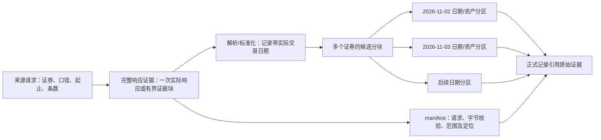

# 运行数据目录与归档

## 区间任务的存储粒度（2026-11-08设计边界，待实现）

任务提交、FIFO、活动范围与覆盖确认以[任务合同](../pipeline/collection-tasks.md#单日与区间任务的提交冲突和发布合同2026-11-08确认待实现)为唯一维护位置；本节只维护数据粒度、位置与引用。当前正式任务仍为单日，区间任务尚未实现。本节不会改写下文带日期的历史文件实例，也不授权清理或迁移生产文件。

### 原响应、派生数据与正式分区采用不同粒度

| 内容 | 当前事实 | 区间任务的设计边界与消费者 |
|---|---|---|
| 原始响应 | 腾讯通常按证券、口径、请求窗口取得响应；来源另有批量/分页接口，不能一概称为每证券一文件。单日响应也可能附带历史 | 保存实际请求的完整原字节；跨100日的一个响应不拆成100份伪原文。采集、恢复、原文详情与下载按请求定位；原文容器是否合并尚待选型 |
| 日期目录 | 独立历史输入`_input_data_date`已支持请求目标日或窗口结束日定位；正式日线当前传单日trade_date | 可沿现有窗口结束日定位原文目录，可读名称与manifest必须保留完整起止、证券、口径、接口和实际请求参数；采集时间另记。目录日期不是响应每行的交易日期 |
| 来源行、标准候选 | 11月5日旧任务逐单元JSON/Parquet；新候选已每批合并，单元状态/报告/来源行仍为独立文件 | 解析与标准化后的记录带真实trade_date，可按日期、资产、来源有界分块；逐证券可追溯不要求逐证券逐层永久生成文件。批大小、来源行长期查询范围和封装格式未确定 |
| 正式日K | `canonical/<交易日>/daily_bar/<资产类型>/{data.parquet,manifest.json}`，业务键为instrument_id+trade_date，记录内保留口径组 | 继续按日期/资产分区，一个分区含多个证券；区间任务产生多个日期结果，任务不拥有另一套正式行情副本 |
| 运行工作区 | 单日task.json冻结定义，候选/检查/提交按类型保存 | 区间运行要清楚表达完整日期范围及可读运行身份，防止多个任务相互覆盖工作文件；具体工作区命名及迁移在实现阶段明确，不用含糊的一天目录代表所有日期 |
| 运行与查询记录 | metadata、summary、逐单元记录、SQLite派生索引各有现有消费者 | 记录目标范围、等待/执行状态、逐日期覆盖、候选与原文定位；查询索引可重建，不成为第二份业务事实。物理合并不能丢失逐单元恢复位置 |

例如一个证券三口径100个目标交易日，可以产生三个窗口响应及若干候选分块，最终汇入100个交易日期的资产分区；不需要为每个日期复制三份完整100日原响应，也不为每证券每天新建正式文件。这是粒度示意，不保证任何来源均支持一个请求覆盖100日，实际窗口由已知来源合同拆分。



### 重叠、重做与共享文件

业务范围不重叠仍可能写同一文件：两个同日股票任务分别采不同证券，最终都更新同一日期股票Parquet。提交时须在既有日期/资产锁内读取最新分区，只合并本次授权身份范围，保留其他证券。任务自己的目标分母和覆盖结果不能直接充当整个正式分区的分母；现有`publish_daily`合并记录与接收本任务统计的行为需要在正式改造中复核，不能只给日期加锁便认为统计一定正确。

一个批文件包含多证券时，选定重做不能删除仍被其他记录引用的整个文件；新候选与定位更新要明确归属，旧批只有满足引用与保留合同才可收尾。同一原响应被多个日期或运行引用时，删除/归档某任务工作区不得破坏其他运行和正式数据的证据链。

原文清单、缓存及可读名称必须表达同一实际请求身份。当前腾讯短文件名只包含输入、证券、口径和起止，未来条数或api可变后需要一并核对，避免不同请求占用同一活动清单名；这不引入源码指纹、内容哈希唯一目录或新来源注册机制。

### 物理优化及本轮不做的清理

1. 原始响应可以保持逐请求物理文件，也可由现有raw模块有界封存并保留精确响应边界与可还原字节。是否封包以全链文件数和读写/恢复成本决定，不因扩展名方便就选择；文件格式与块大小尚未确定。
2. 来源行、候选、正常单元状态和异常明细应评估批量保存，避免每请求层层永久副本；可复用现有列式候选、运行元数据和派生索引，不新建管理器或重复状态库。故障中断后不能把尚未持久化的尾批标完成。
3. 用户已明确本轮不做各状态产物保留期限，不实现基于状态/时间的到期删除或自动清理；后续如需清理能力，单独确定范围与引用安全规则。本轮不新建清理模块。现有`raw_retention_days`声明不因本次设计自动生效，当前归档限制也不在此轮借机扩展。
4. 归档移动不等于减少总空间；当前活动raw与稳定审计副本的重复体量要纳入成本。减少副本须先列明实际引用迁移与独有证据，不能直接删除现有原响应。
5. 用户已明确不保存旧行情快照。正式行情只维护一份当前分区，覆盖成功后查询返回当前值；不增加版本目录、旧行情查询入口或每运行全量副本。运行历史可记录当时目标、状态、计数及证据引用，但不是旧行情数据快照。既有原始来源证据及处理中候选仍按各自用途保留，本轮不删除；这也意味着过程文件仍可能累积，不能声称存储增长问题已经全部解决。

本节确认的边界是：原文完整且按实际请求定位，派生数据可批量按日期处理，正式结果保持按日期/资产合并且只有当前一份；不做旧行情快照和状态保留期限。本轮不批准原文封包格式、既有历史数据删除或另建清理模块。仍应从获取和写入端减少不必要副本及小文件，不能把尚未设计的未来清理当作本轮过量产物的解决方案。

### 小文件优化的首轮实施提案（未实施）

先处理已观察到的派生小文件，不先发明原文封包格式：实际响应暂保留逐请求字节及现有完整性检查；来源行、单元报告和处理状态改为可定位的批产物，复用现有候选分块与SQLite查询索引。它解决75,132文件目录中逐单元层层写文件的问题；不承诺原文物理文件数因此变成批次数。

| 产物及消费者 | 拟议落点/读取方式 | 中断与取舍 |
|---|---|---|
| 来源行：来源查询、排障及重建索引 | 在原`sources/<来源>/<接口>/`内按可读批序号保存Parquet；保留原字段表示、单元键及实际trade_date；每单元定位到批文件及行范围 | 不每单元再复制一份source_rows JSON；不能只留目标日而把实际返回的其他来源行伪装成不存在。原文仍是精确响应的依据 |
| 单元报告及处理状态：恢复、错误详情、任务单元查询 | 同来源/接口下按批保存JSON机器记录，包含每单元请求窗口、原文引用、解析/检查结论及候选位置；根task/summary继续承担既有冻结定义和汇总职责 | 不叠加一份逐单元report、manifest和批状态三套重复事实。具体字段替换清单要与`_task_unit_valid`等恢复读取方一起交接；不为保留旧测试建立永久双写路径 |
| 标准候选：构建/发布 | 沿现有`candidates/<资产>/<输入>/candidate-batch-attempt-<次数>-<序号>.parquet`扩展为多日期行及单元行范围 | 当前批写只取每单元第1行，须修正；重做写新候选并更新定位，不删除仍被其他单元引用的旧批文件，本轮不做清理 |
| 查询索引：分页与筛选 | 复用`storage/read_index.py`，从批报告/来源行建立选择器，分页读取所需行组 | 可重建，不作为恢复事实；不允许每次查询先展开全任务所有批，再内存分页 |

批文件采用可读的`source-rows-attempt-001-batch-000001.parquet`与`units-attempt-001-batch-000001.json`名称；序号是本运行内的持久批序号，不依赖协作会话。来源行字段至少为unit_key、source_row_index、真实trade_date及fields_json（保留原字段类型和值）；单元报告记录来源行范围、原文引用、候选文件及行范围、请求参数、状态和错误。证券/口径与真实日期仍可追溯，不把来源行误当作正式日K。

写入顺序为来源行/候选批落盘并校验 → 原子保存包含各文件引用的单元批记录 → 更新已有运行汇总。只有引用齐全的单元批才是恢复完成依据；中断遗留的未登记文件不算成功，也不自动删除。索引从已完成批重建，索引写入失败不能把原文或候选事实抹掉。

首轮批大小优先沿用当前50个处理单元这一现有上界，区间按窗口容量同时约束单元行数；参数与字节/行数预算需随具体写入方案说明。当前队列空闲1秒即刷候选会产生较小批，提案改为批满或正常收尾落盘；尚未落盘尾批不能标处理完成，中断后最多重放该尾批的派生处理，已保存原文不必重新请求。正常状态展示可继续使用现有摘要节流，不以逐证券文件数换取页面进度。

验收同时覆盖单日/多日、正常收尾/中断、选定单元重做、共享批定位及索引重建。用相同原文、相同目标和字段合同对比业务值、文件数、字节、索引行数及读取工作量；文件数量应随来源批数与请求数分别解释，不能声称所有层都只有一份或只靠改扩展名解决。该提案待与任务阶段一起确认，不迁移/删除已有工作区，不增加保留期限或原文容器。

下文历史实现与实例记录截至 **2026-11-03**；上节单独说明2026-11-08确认的设计边界及尚未实现部分。示例取自数据日期 `2026-10-09` 的历史证券名单及其 BaoStock 来源文件；本机业务文件不随文档复制。历史文件保持原路径；新生成的原始响应和 SDK 证据文件使用可读名称，完整 SHA-256 仍记录在清单中。

阅读入口：[文件名与校验值](#文件名与校验值)、[原响应实例](#原响应实例)、[来源工作文件](#来源工作文件)、[任务文件](#任务文件)、[正式数据与数据库](#正式数据与数据库)、[重复内容与待实施方向](#重复内容与待实施方向)。运行命令、重做和进度规则见 [任务流程](../pipeline/collection-tasks.md)，本文解释实际落盘文件。

## 并发访问与资源边界（2026-11-08推荐方案，待用户确认，未实施）

### 检查范围与实际例子

本轮针对管理台查询、任务提交/等待和采集/发布同时发生时的资源访问，不修改生产数据、不执行数据库迁移。静态检查当前工作树110个Python源文件，定位36处存储构造/底层connect调用，并逐路由追踪Web的18个API及静态首页；构造调用数包含Parquet存储对象，不等于36个数据库连接。清单见[访问调查](../../tmp/design-implementation-review-20261108/task-capability/concurrency-access-inventory.json)。当前代码含用户未提交变更，结论针对本次读取的工作树，不仅是HEAD；动态插件、自行编写的外部脚本及未来功能不在“已检查”分母内。

真实例子：`data/task_workspace/2026-11-05/daily_bar/market-daily-20261105/summary.json`本次读取为published/finished、row_count=7842；页面任务状态主要读取此类文件。`data/canonical/2026-11-05/daily_bar/stock/manifest.json`记录5569/5573；页面日线还会读取当前证券清单补名称，其清单位于`data/canonical/security_master/current/`，本次manifest日期2026-11-02、7862条。这些是已留存产物的事实，不证明此刻有任务正在运行或全市场已完整。构造连接和发布窗口的冲突属于静态推演，本轮未实际制造数据库争用。

### 资源与消费者：读页面并不等于不碰共享资源

| 资源及当前位置 | 实际读取方 | 实际写入方/窗口 | 当前风险及目标边界 |
|---|---|---|---|
| 运行库`metadata/metadata.duckdb`：MetadataStore的9类表，以及同文件的trading_calendar | 执行器、路由资格/健康、调度、CLI恢复/来源复核；Web手动启动读日历 | 任务准备、进度、健康、发布登记、日历导入/刷新、来源资格登记；部分调用把连接跨网络请求持有 | 本机多进程普通读写连接互斥，查询构造也会建表。推荐替换此一个运行库为SQLite，详见下节；不另建排队库 |
| 当前证券清单`canonical/security_master/current/security_master.duckdb`及manifest | Web日线/来源查询补名称、任务准备冻结证券 | 完整清单候选检查后的一次事务及manifest收尾 | 这是另一个DuckDB文件，单改运行库不能解决。保留其现有数据结构；读入口显式只读且不建表；同一清单分区的读写短段协调，禁止持清单连接联网 |
| 正式日K`canonical/<日期>/daily_bar/<资产>/` | `/api/daily`、发布详情、覆盖预检及下游业务 | 通过检查后的日期/资产合并与data/manifest替换 | 两次os.replace不是跨文件原子事务；读到更新窗口时不能误报损坏或假空。读写共用短分区协调，查询读完所需分区再释放；标记未收尾时明确更新中 |
| 来源行SQLite索引`source_rows_query_index.sqlite3` | `/api/data/options`、`/api/data` | 批候选处理后增量索引；显式全量重建 | 已使用WAL/只读查询，但busy_timeout=30秒不等于页面预算；长读阻碍checkpoint；重建直接替换活动库会与打开的连接/增量写冲突。按下文维护规则处理 |
| 工作区task/summary/批记录与候选 | 任务列表/详情/单元分页、恢复及查询索引 | 同一运行的执行者按检查点持久化 | 不受数据库文件锁直接保护；必须原子保存完整文件。目标以运行库为任务状态权威，summary为派生摘要，冻结task及实际证据仍各有职责；列表按运行库分页，避免随历史增长扫描全部summary |
| 原响应正文、请求manifest及接口manifest索引 | 原文列表/预览/下载、重放及发布溯源 | 抓取先落原文、发布转正、归档及索引刷新 | 正文按实际响应稳定保存，页面不得把半写入请求标完成；接口索引的读改写需同目录短协调，避免并发刷新丢条目。原文下载不持数据库事务 |
| `config/*.yaml`与数据集发布阈值 | 任务选项、调度、准备、页面设置 | 已有发布设置保存；目标调度开关保存 | 原子文件替换加读取时原值核对；调度停用和本周期提交在同一短提交协调边界排序。已受理运行的冻结规则不变 |
| `task_workspace/_locks/collection.lock`及分区/提交标记 | 执行权取得、恢复、读取正式结果 | 运行或维护取得/释放执行权；发布写提交标记 | 整任务执行权只限制执行者，不让提交和页面查询排同一长队。仍需短数据库事务和短资源协调，不能把一把全局锁扩成所有读写的锁 |
| 分钟热库`hot/minute_hot.db` | 现有MinuteQueryService | HotMinuteStore增量写入 | 已使用SQLite WAL，未见Web分钟HTTP路由，不把类存在算已上线。保持独立库和短事务；本轮不扩展分钟业务或将其并入日K执行队列 |
| 隔离测试/来源验证根 | 离线检查、受控探针 | 指定隔离目录中的脚本 | 不与正式运行共用状态库。显式指向正式路径的CLI仍必须服从正式协调，不能以命令名或replay模式绕过 |

### 方案比较与推荐

| 选择 | 能力与成本 | 本轮判断 |
|---|---|---|
| 保留DuckDB，所有访问改短连接并加同文件协调 | 不迁移运行库；必须使日历、资格/健康、任务、恢复、CLI的每条访问都遵守打开→完整操作→关闭→释放。读取也会排队，频繁打开与漏接调用都是长期成本 | 可行备选，不是仅移动connect的一行修复；如果拒绝迁移再按此形成实施合同 |
| 用SQLite替换现有运行库，任务/日历共用一个库 | 适合本机多进程短事务状态读写；WAL允许读写共存、写事务仍串行。需迁移已有9类元数据表及日历，明确时间/JSON/布尔值、事务及索引合同；不搬正式行情 | 推荐目标。修改现有MetadataStore/TradingCalendarStore职责内实现，不新增任务服务、另一个排队库或双写后端 |
| worker独占DuckDB，其他入口经提交/查询通道访问 | 可保留长连接；需新增通道、运行回执、通道故障恢复，以及CLI/页面与常驻进程的依赖 | 当前成本高于本机目标，暂不推荐 |
| PostgreSQL等独立服务器 | 支持更广的并发/多机部署；引入服务运维及数据迁移 | 当前任务串行、本机操作，不是必要前提；本轮不引入 |

依据：[DuckDB嵌入式并发边界](https://duckdb.org/docs/1.5/connect/concurrency)、[SQLite WAL读写并发与长读限制](https://www.sqlite.org/wal.html)、[SQLite同一时刻一个写事务](https://www.sqlite.org/lang_transaction.html)。更换引擎不能替代范围检查、事务或执行权；WAL也不是任意写并行和不会busy的保证。

SQLite方案仅在同机本地文件系统使用，不把运行库放入网络共享让多机器直接读写。连接按请求/工作线程独立借用或短期创建；不跨线程共享同一个连接，不把网络采集、全市场解析、Parquet写入、文件哈希或下载放在数据库事务中。读接口显式只读，不承担建表、升级或自动重建；建表/迁移是明确初始化写操作，结构不满足则准确报错。任务状态、等待顺序、占用范围和发布登记以这一个运行库为准；task保存冻结定义，原文/候选保存实际证据，summary和查询索引为可重建视图，不增加第二份权威队列。

环境实测：本次指定解释器Python 3.13.0rc3内置SQLite 3.45.3。SQLite官方已披露多连接WAL写入/checkpoint竞争的低概率WAL-reset缺陷，修复在3.51.3及后续或明确回补版本（3.44.6、3.50.7）；当前版本不满足新方案的启用前提。此处不是宣称现有索引已损坏，也不自动安装/更换环境。实施前须提出具备修复且项目依赖齐全的环境方案，经用户确认处理；若不接受该前提，不能静默在当前环境启用新增并发写路径。[官方说明](https://www.sqlite.org/wal.html#walreset)

### 连接、事务、执行权和发布分开

1. 任务受理：准备目标及冻结输入在事务外完成；冻结task完整落盘后，短写事务内复核活动交集、覆盖授权范围及当前分区登记，再写入等待、定义引用和提交顺序。检查和登记必须一起成功。文件已存但受理事务失败只是未受理产物，不算排队、不占用范围，也不在GET中自动补登记；本轮不清理这些文件。准备需要日历/清单刷新时沿现有规则处理，不在短事务里联网；未形成可冻结目标不能返回“已受理”。
2. 取得执行权：沿现有执行锁协调多个执行者，非阻塞检查执行权；取得后在短事务内选择最早等待运行并登记实际执行者。运行ID不能再只用业务日期，否则同日不同证券的两个合法任务会撞工作区；采用表达目标起止、提交时间及同名序号的可读运行名，逻辑任务名仍引用配置。续跑保留原运行身份及首次受理记录，重新受理的排队顺序按本次入队分配，不凭很早的首次提交时间插队。不能持数据库事务等待整任务锁；提交路径不要求取得整任务执行锁。
3. 执行：抓取、解析和候选写入不持运行库事务；只在资格/健康读取、批检查点和结果登记时短访问。运行结束前仍持整任务执行权，因此其他任务可受理等待但不会插入执行。
4. 发布：先短事务记committing并保存既有恢复证据，结束事务；再在日期/资产分区协调内完成数据和manifest；最后短事务登记成功并收尾。数据库和文件不是同一事务，中断按现有提交证据核对，不能因文件已替换就给任务假成功。
5. 页面查询：任务状态按分页读运行库；来源行读既有SQLite索引；正式行情按选择日期/资产读Parquet。清单只在补名称/冻结证券的短窗口读，禁止将价格查询失败和名称暂不可读混为一谈；名称不可读时显式标明更新中/不可用，不伪造旧名称或空价格。
6. 清单与日K：共用各自分区读写协调覆盖“检查标记→读取manifest→核验并读取内容”；避免先检查后遭替换。采集、临时候选构建在分区锁外，锁只保护正式切换/一次完整读取。清单暂保留DuckDB，短段不与运行库事务嵌套。只读部署需要可用的协调目录；不能获得协调权限时显示受影响资源不可用，不静默无锁打开正在写的库。
7. 锁顺序：先取得长执行权（仅执行/维护需要），各运行库事务和文件分区锁分段完成，不相互嵌套等待；若一次操作涉及多个分区，逐分区完成并释放，不持多日期锁等待。调度开关与自动受理共用短提交协调，先确认开关的最终值再受理；慢网络/准备在协调外，受理前重检。清单读取、文件校验和数据库长扫描不得藏进短事务。

管理台在发布窗口遇到协调等待超限或未收尾标记，明确返回“正在更新，可稍后刷新”（拟议503及Retry-After）；真正内容/结构校验失败继续报完整性错误，不能统称锁错误。普通区间允许不同日期分别变为当前数据，不承诺整次多日期查询的历史快照；每个分区的data/manifest必须来自同一次完整读取。历史复权统一切换仍属另一个未实现专项。

### 维护、故障和迁移的边界

| 操作 | 拟议规则与失败后的去向 |
|---|---|
| 来源索引全量重建 | 与采集增量写/归档共用整任务维护执行权，不允许边重建边丢增量。先构建临时索引，查询继续读完整旧索引；切换时短暂停止新连接并等现有查询关闭，正确处理WAL/checkpoint后替换；失败保留原索引，明确重建失败。GET不触发全量重建 |
| raw接口索引刷新/重建 | 源请求manifest和正文是证据，接口索引可重建；同目录短协调保护读改写/替换。运行中GET不扫描全树补齐。索引缺失返回未就绪，不返回假零结果 |
| 原文查看/下载碰到转正或归档 | 优先使用已有稳定审计原文引用；下载取得稳定正文后不持数据库连接。活动manifest路径/序号改变时核对事件身份及预期正文哈希，返回定位已变化而不是下载另一响应。归档不得破坏在用证据引用；文件占用时明确忙碌，不盲目重试/强移 |
| 恢复和归档 | 都是写操作，先取得与任务共用的执行权；恢复优先处理未收尾提交，再接下一运行。进程心跳旧不等于已退出，只有确认原执行者不再持有执行权才接管。不顺便开启按期限清理 |
| 进程中断/磁盘满/数据库忙 | 未提交事务回滚；已保存原文/候选保持，运行报告具体失败阶段。文件已切换但登记未收尾仍为committing，恢复核实后继续；不可只改failed释放范围。数据库busy不重抓来源，未知错误不当空结果 |
| 运行库迁移 | 在全部生产写入暂停、数据库连接关闭的明确窗口完成；复制9类元数据表及日历，核对键/行数/时间/冻结定义/活动任务/发布引用，再切换配置和所有调用方。旧库留作迁移证据，正式路径只用新库，不永久双写或运行时自动退回旧库；失败在启用新库前停止切换。生产迁移/环境变更须另确认 |
| 只读部署、重复worker、多浏览器与隔离根 | 页面只读不等于可绕过协调；不创建缺失表/索引。多个worker只有一个取得执行权；多浏览器能并发读/提交但事务决定受理顺序。隔离根各有运行库/执行权；本轮不支持多机器共享本地数据库文件 |

该推荐会替换现有运行库的存储实现，是新增待确认范围；没有自动实施。保留唯一当前行情、FIFO、日期与证券交集互斥、显式覆盖及不做期限清理的已确认业务规则均不改变。详细并发场景及流程由[任务合同](../pipeline/collection-tasks.md#并发访问场景清单及执行流程2026-11-08提案未实施)维护，页面逐接口读取边界由[运行台说明](../service/read-only-web.md#管理台并发访问逐接口检查2026-11-08提案未实施)维护。

## 日线聚合存储实现（2026-10-28）

2026-10-30单位规则v8只改变新候选的单位合同匹配与换算，未迁移或重写旧正式分区。新候选报告中的 `applied_unit_contract` 记录匹配条件、倍率和证据；`unit_precision_flags` 按实际非空字段生成并进入聚合记录。旧报告的 `verified_unit_scopes` 是历史格式，不再作为新任务的匹配依据；详细规则由[单位合同](../../stock-data-design-qfq-history-rebuild.md#22-来源单位合同2026-10-30)维护。

新规范日线按证券与交易日期保存一条聚合记录，内含证券类型、价格或指数点数语义，以及不复权、前复权、后复权组的数值、状态和证据引用。候选与来源清单仍按证券、日期、口径留存；最终 Parquet 物理分区不再按口径拆开。字段和完整性以[专项设计](../../stock-data-design-qfq-history-rebuild.md)为准，不在本文维护第二套 schema。

规范路径为 `canonical/<日期>/daily_bar/<资产类型>/{data.parquet,manifest.json}`。文件中 `quotes.none/forward/backward` 是固定嵌套组；新发布使用`daily-aggregate-v2`与`adjustment=aggregate`。每个口径记录明确保存`value_contract=full_ohlc/close_only`；旧`daily-aggregate-v1`分区按原字段校验并继续读取，缺少合同字段时按旧完整四价语义读取，不重写旧文件。恢复复用现有任务提交标记和原子发布流程。旧 `adjustment=...` 分区与业务数据保持原位，不自动合并、不迁移，也不作为新查询的回退路径。

2026-10-29已在 `data/canonical/2026-10-28/daily_bar/stock/` 正式发布3条v7三口径样本，9份活动原响应请求清单位于 `data/raw/2026-10-28/tencent/kline_daily/`。精确资格的直接证据依赖位于data，隔离重做与故障验收仍在tmp；具体范围、哈希和回读结论由[项目进度](../../PROJECT_PROGRESS.md#当前业务交付状态)维护。重做可以更新被重做证券的审计引用，业务值与源响应哈希需独立检查，不能以Parquet字节不变替代业务验收。

## 目录约定

新日线批记录使用`daily-batch-v2`：`task_workspace/<日期>/daily_bar/<任务名>/task.json`只保存一次冻结定义，其中按来源输入ID记录合同版本；每个单元冻结选用的`input_id/provider/endpoint/value_contract`、请求代码、稳定身份和代码承接依据。逐单元manifest保存采集/处理状态和稳定原文/候选引用；metadata.collection_task与summary保存轻量阶段、计数、定义引用及分区提交信息，不内嵌全部单元报告。v1检查点按其原合同读取和续跑，不在恢复时套用新版路由。工作区使用`prepared.<类型>.parquet`、`coverage.<类型>.json`和`commit.<类型>.json`承接多类型构建及恢复，正式分区布局不变。摘要和页面是派生视图，恢复以冻结计划及单元产物完整性为依据。稳定原文位于`task_archive/_raw_evidence/<任务名>/<证券及口径>/attempt-<次数>/manifest.ndjson`，在采集阶段建立，活动raw仍在对应类型发布成功后转正。旧格式只读留存，新批使用新任务标识和隔离根，不自动迁移旧检查点。现有归档命令校验完整发布及产物后移动工作区，更新运行索引路径；原文、冻结定义与原始报告字节保留。

2026-10-11按用户确认的结构修改现有代码并迁移旧业务目录。正式运行根目录为 `data/`；离线回放、故障注入及实现验收使用 `tmp/` 下独立运行根目录，内部结构相同。`provider_validation/` 中的历史验证证据保留原位，不新增业务产物。

```text
data/
├── raw/
│   ├── _tmp/<数据日期>/<来源>/<接口>/   # 日期已确定、流程未完成
│   └── <数据日期>/<来源>/<接口>/        # 完整流程成功后的原响应
│       ├── bodies/<数据日期>_<输入标识>_<证券/日期/口径>_<采集时刻>.bin
│       ├── manifest.<可读请求标识>.ndjson # 一个请求范围的响应与字节引用
│       └── manifest.ndjson             # 本接口请求清单索引
├── task_workspace/
│   ├── <数据日期>/<数据集>/
│   │   ├── sources/<来源>/<接口>/       # 解析、映射、候选及报告
│   │   ├── task.json                   # 执行参数及冻结范围
│   │   ├── prepared.parquet            # 本次待发布数据
│   │   ├── prepared-security-master.json # 名单提交的固定候选与恢复输入
│   │   ├── coverage.json               # 名单最终覆盖检查
│   │   └── summary.json                # 状态、实际日期、检查及原响应引用
│   ├── trading_calendar/<日期>/<来源>/<接口>/refresh-<时分秒>/ # 轻量日历响应
│   ├── _checks/                        # 业务复核与验收记录
│   └── _locks/                         # 既有文件锁
├── canonical/
│   ├── security_master/current/
│   │   ├── security_master.duckdb       # 唯一当前清单及字段变更历史
│   │   └── manifest.json                # 最近一次完整更新的证据引用与数据库哈希
│   └── <数据日期>/daily_bar/<资产类型>/
│       └── {data.parquet,manifest.json} # 一证券一日一条，三组嵌套
├── task_archive/
│   ├── _raw_evidence/<清单哈希>/        # 发布引用的不可变原响应
│   ├── _raw_audit/<来源_日期_接口_范围>/ # 被替换或损坏的原响应证据
│   ├── _workspace_audit/<日期_数据集>/  # 被替换的构建结果与报告
│   └── <数据日期>/<数据集>/            # 显式归档的已发布工作区
└── metadata/metadata.duckdb             # 任务、单元、提交、分区及引用索引
```

不增加任务ID、范围哈希或 `full_market` 目录层。`security_master` 表示证券主数据，`security_snapshot` 表示来源证券快照；`bse`、`sse` 分别是北交所、上交所数据来源。定义和中文说明位于 `config/providers.yaml`、`config/collection.yaml`、`config/datasets/` 与 `config/normalization/`。

同接口可能请求不同证券、窗口、粒度或复权。新请求文件名使用输入标识及可读参数区分，例如 `manifest.ASTOCK-002-daily_symbol-sh600519_start-date-2026-10-01_end-date-2026-10-23_adjustment-qfq.ndjson`；较长的单值参数会缩短显示，列表参数显示条数和首尾项，完整值仍保存在 manifest。新正文文件名包含数据日期、输入标识、证券/日期/复权口径及采集时刻，来源和接口由父目录标明。名称不嵌入摘要。此前生成的带参数指纹文件名保留原样。接口层 `manifest.ndjson` 是索引，响应事件位于其指向的各请求清单。

新规范日线存储路径为 `<日期>/daily_bar/<资产类型>/`，业务键是证券与交易日期；查询从同一条记录投影所选口径。来源参数 `qfq/hfq` 在候选映射为 `forward/backward`。历史 `adjustment=...` 文件和旧混合目录不自动迁移，也不参与新聚合查询；不存在聚合结果时不回退旧单口径文件。分钟热数据 `data/hot/minute_hot.db` 保持原结构。

证券清单是唯一的当前态资产，保存于 `canonical/security_master/current/security_master.duckdb`；每次完整来源刷新事务更新该库，并将字段变化写入 `security_master_history`，邻近 `manifest.json` 指向最新成功更新及其来源证据。来源失败时不写数据库或 manifest，所以旧证券状态继续有效。日线任务只读取 `as_of_date` 不晚于目标日且必需组齐全的清单，并把证券范围冻结进任务定义。任务工作区中的 `prepared-security-master.json` 只供已检查候选在提交中断后恢复；它不是正式按日清单，日线和Web均不读取。已有 `canonical/<日期>/security_master/{data.parquet,manifest.json}` 保留为历史文件；新成功更新不再创建每日全量名单分区。字段变更历史不保存每日全量快照，因此它不能按任意历史日期还原完整名单；若当前清单晚于历史目标日，只有保留的目标日前名单可供补跑，没有时任务停止并说明缺少名单，不会使用未来清单。

## 文件名与校验值

| 标识 | 实际例子 | 含义 |
|---|---|---|
| 文件内容校验值 | `751c5d0399f8558e99d517a9c06a6d2ac2d3e613afb342a0f2dbb4e1032b47bc` | 文件字节的完整 SHA-256，写入 manifest 用于完整性校验；新生成的原始文件名不含摘要 |
| 请求标识 | `ASTOCK-002-daily_symbol-sh600519_adjustment-qfq` | 输入标识及可读请求参数，用于区分请求范围；不含摘要 |
| 范围标识 | `scope-ba08f4d3f1725a05` | 绑定参数的确定性 JSON 摘要前16位，用于执行记录，不是响应内容摘要 |

请求清单命名实现见 [storage/raw.py](../../src/storage/raw.py) 的 `request_manifest_name`；新 HTTP 响应正文命名见同文件的 `response_body_path`，SDK 及派生响应正文命名见 `_archived_body_path`，均在 `write_bytes` 保存。摘要实现见 [storage/integrity.py](../../src/storage/integrity.py)，仅作为完整性元数据，不放入新文件名。下方 `manifest.all-3f363376e304.ndjson` 是历史示例，保留其原名。

校验值根据内容计算，不是根据文件名计算：仅改名不改变它，改内容后须重新核验。已有哈希命名的历史文件保持原名；新生成的 HTTP 响应、SDK 函数快照及其他原始正文文件均使用日期、来源、接口、请求范围或用途、采集时刻等可读信息命名，完整 SHA-256 仅保存在 manifest 中。校验只能发现内容变化，不能证明价格、证券身份、日期或市场覆盖正确。

`.json` 是完整 JSON 文档或数组；`.ndjson` 每行一条 JSON，不能整体当一个 JSON 文档读取；`.parquet` 是有字段类型的列式表，不能当文本查看；`.bin` 是按字节保存，不代表特定业务格式。本例数据 `.bin` 为 JSON，SDK 快照为源码文本，其他接口可能是 HTML 等内容，须结合清单的类型与编码判断。

## 原响应实例

实际目录：[BaoStock 原响应](../../data/raw/2026-10-09/baostock/typed_security_universe/)。`typed_security_universe` 是 Provider 的输入接口标识，组合三个原生 SDK 查询，不是 BaoStock 的单个原生方法名。

```text
raw/2026-10-09/baostock/typed_security_universe/
├── manifest.ndjson
├── manifest.all-3f363376e304.ndjson
└── bodies/
    ├── 1816d517…bin   query_trade_dates 返回
    ├── 751c5d03…bin   query_all_stock 返回
    ├── 109d5b31…bin   query_stock_basic 返回
    ├── 14c6b32f…bin   query_trade_dates 源码快照
    ├── a76d7e5a…bin   query_all_stock 源码快照
    ├── dbc03109…bin   query_stock_basic 源码快照
    ├── c8fc45a6…bin   login 源码快照
    └── 3fcfcedd…bin   logout 源码快照
```

省略号只用于展示，这些是既有历史文件，实际文件名仍是完整64位摘要。它们不会因新命名规则而迁移或改名。这八份文件不是八份证券清单，只有三份为查询结果，另五份为经脱敏的 SDK 函数源码证据，其名字与路径记录于来源工作目录的 `raw_refs.json`。不能把整个 `bodies/` 都称为网络原始响应。

| 实际查询 | 返回条数 | 范围 |
|---|---:|---|
| `query_trade_dates(start_date="2026-10-09", end_date="2026-10-09")` | 1 | 请求日交易日记录 |
| `query_all_stock(day="2026-10-09")` | 7,424 | 请求日证券列表，含指数等非股票记录 |
| `query_stock_basic()` | 8,992 | 无日期参数的基础分类、上市/退市信息；不是直接查询10月9日基础快照 |

BaoStock SDK 不暴露 TCP 报文字节，此处保存 SDK 解码字段及记录的归档表示。`original_transport_bytes_available=false` 明确这个限制：可核验保存的字节，不能声称是原始 TCP 报文。HTTP 来源则捕获响应体原字节。

数据文件 `751c5d03…bin` 的实际结构如下，仅展示第一条记录，其余7,423条省略：

```json
{
  "fields": ["code", "tradeStatus", "code_name"],
  "rows": [
    {"code": "sh.000001", "tradeStatus": "1", "code_name": "上证综合指数"}
  ]
}
```

`fields` 是来源字段名，`rows` 是记录数组；`code` 是 BaoStock 代码，`tradeStatus` 是来源交易状态，`code_name` 是来源名称。第一条为指数，不能直接纳入股票名单。实际分类与历史日期依据统一见 [证券来源说明](../providers/security-catalog.md)。

接口 `manifest.ndjson` 的实际记录：

```json
{
  "event": "request_manifest",
  "request_manifest": "manifest.all-3f363376e304.ndjson",
  "sha256": "0d797abab77db0618c0262b2a0291fe37912be7d46eea04eb43bdbea6fb7a728"
}
```

它是请求清单索引，`sha256` 是清单文件摘要，不是响应体摘要。[请求清单](../../data/raw/2026-10-09/baostock/typed_security_universe/manifest.all-3f363376e304.ndjson) 内的一条实际事件节选为：

```json
{
  "event": "source_payload",
  "method": "query_all_stock",
  "request_parameters": {"day": "2026-10-09"},
  "mode": "replay",
  "fetched_at_utc": "2026-10-11T16:55:17.756268+00:00",
  "body_storage": "bodies/751c5d0399f8558e99d517a9c06a6d2ac2d3e613afb342a0f2dbb4e1032b47bc.bin",
  "body_sha256": "751c5d0399f8558e99d517a9c06a6d2ac2d3e613afb342a0f2dbb4e1032b47bc",
  "payload_bytes": 523887,
  "original_transport_bytes_available": false
}
```

| 字段 | 解读 |
|---|---|
| `event`、`method` | 记录类型和 SDK 调用方法；清单还有会话、派生、文件存储、日期分区事件 |
| `request_parameters` | 真正请求参数，不能用目录日期代替 |
| `mode` | 本次从已有字节回放，未再次联网；其他记录也可能为 `live`、`cached` |
| `fetched_at_utc` | 本例是本次回放时间，不是数据日期或最初联网时间 |
| `source_ref` | 完整事件中有原清单、行号和联网时间；本例原响应于 `2026-10-11T15:37:52.144446+00:00` 获取 |
| `body_storage` | 相对该请求清单目录的文件位置，不是文件内容 |
| `body_sha256`、`payload_bytes` | 保存内容的摘要、字节数，用于完整性检查 |
| `provider`、`endpoint`、`scope`、`input_scope`、`code_version` | 完整事件还记录来源、查询范围、输入契约和代码依据 |

HTTP 事件使用 `http_response`，另外记录 `url`、`status_code`、脱敏请求/响应头、`content_type`、`encoding`、`body_bytes`；HTTP 200 只说明收到响应，不说明业务合格。失败和空返回也留存，不能算成功空数据集。

raw 在解析前写入，恢复、解析和最终提交读取。全流程成功后对应请求移出 `_tmp`；失败保留暂存证据。暂存中还可能有 `_managed_task.<请求标识>.json`，表示正式任务管理的文件归属，防止覆盖无管理记录的文件，不存行情；请求移出暂存时清除。当前活动 raw 日/来源/接口/范围唯一，审计副本另存，不能仅按扩展名批量删除。

## 来源工作文件

实际目录：[BaoStock 来源工作文件](../../data/task_workspace/2026-10-09/security_master/sources/baostock/typed_security_universe/)。本例十份文件共用前缀 `all-3f363376e304`。下面的示例是实际内容节选，摘要缩写仅用于阅读。

| 后缀 | 内容示例及解读 | 生成与读取用途 |
|---|---|---|
| `.started.json` | `status="fetching"`、`task_id="fd16a2a04f7d"`、`scope={"trade_date":"2026-10-09"}`、`created_at` | 来源执行开始时保存；这个ID是输入执行ID，不是整个名单任务ID；不是完成标记 |
| `.source-rows.json` | `[{"code":"sh.000001","code_name":"上证综合指数","tradeStatus":"1"}]`，实际7,424条 | 提取来源行，供字段核对及诊断；已与 raw 重复保存 |
| `.parsed-rows.json` | 筛选解析后的5,224条股票，见下方行示例 | Provider 解析后保存候选，随后进行字段映射 |
| `.excluded-rows.json` | `code="sh.000001"`、`type="2"`、`reason="non-stock type or outside stock range"`，实际5,631条 | 从多个查询中排除的记录及原因，不能用7,424减5,631计算候选数 |
| `.normalized.json` | 解析行加标准来源字段 `source="baostock"`，实际5,224条 | YAML 映射后的标准候选数组，供回放对照和诊断 |
| `.normalized.parquet` | 同批5,224条标准候选，有日期等字段类型 | 后续任务合并实际读取的来源表；与 JSON 是同批数据的两种表示 |
| `.report.json` | `input_id`、`parameters`、`status="candidate_complete"`、`row_count=5224`、输出引用及版本 | 完整来源报告，恢复、摘要、发布读取；本例约2.76 MB，不是简短任务状态 |
| `.quality.json` | `status="candidate_complete"`、`row_count=5224`、`coverage_denominator=5224`、`failure_class=null`、`error=null` | 来源阶段检查结论；分母是来源候选，不是独立全市场数量 |
| `.raw_refs.json` | `raw_manifest={"path":"…manifest.all-3f363376e304.ndjson","sha256":"0d797a…"}`、`source_response_hashes`、`sdk_dependency` | 原响应引用与SDK包版本；不再生成SDK源码快照，引用本身不复制响应字节 |
| `.manifest.json` | `scope`、`scope_key`、`raw_manifest`、`output`、`report`、`quality_report`、`status` | 来源处理汇总清单，区别于 raw 清单和正式数据清单 |

旧输入也可能使用 `.parsed.source-rows.json`、`.parsed.excluded-rows.json`、`.quality_report.json` 等后缀；以其报告路径为准，不代表新增业务阶段。`source-rows`、`parsed-rows`、`excluded-rows` 并非每个接口都有。日线常见八种为 started、source-rows、normalized JSON/Parquet、report、quality、raw_refs、manifest，当前逐证券生成，尚未合并为来源汇总表。

解析文件首行实际内容：

```json
{
  "asset_type": "stock",
  "date_basis": "direct_historical_type_checked",
  "delist_date": null,
  "exchange": "XSHG",
  "list_date": "1999-11-10",
  "script_sources": "bs_stock_basic;bs_all_stock",
  "status": "unknown",
  "stock_code": "600000",
  "stock_name": "浦发银行",
  "trade_date": "2026-10-09"
}
```

`stock_code`、`stock_name` 是解析后代码及名称；`exchange` 是市场，`asset_type` 是资产类型。`trade_date` 是候选所属日；`list_date`、`delist_date` 是上市/退市依据。`date_basis`、`script_sources` 是历史日期及分类证据来源。`status="unknown"` 表示交易状态未确认，不能由名称或记录存在推断为可交易。标准候选增加 `source="baostock"`；Parquet 按 YAML 类型保存。

引用对象的实际例子，节选自来源 `.manifest.json` 的 Parquet 描述符：

```json
{
  "path": "sources/baostock/typed_security_universe/all-3f363376e304.normalized.parquet",
  "row_count": 5224,
  "byte_length": 109071,
  "sha256": "b8aba9edeeba656ceda38dd3db59f5fa21000a1082890986d6ca23b39c6529be"
}
```

这些路径相对 `task_workspace/2026-10-09/security_master/`，不是相对 `sources/.../` 内的 JSON。`row_count` 是行数，`byte_length` 是字节数，`sha256` 是被引用文件的内容摘要。完整描述符另含来源响应摘要、代码/规则版本、字段类型。原响应摘要不能拿来校验派生 Parquet。

来源报告中的 `eligible_for_production_routing=false`、`publication_permitted=false` 是当时的候选阶段字段，不能据此断言整个任务未发布，也不能替代当前来源资格。报告保持历史快照：整个任务状态看根目录 summary，最终数据看 canonical 清单，来源资格看当前证据和元数据。

## 任务文件

位置为 `task_workspace/<数据日期>/<数据集>/`。当前工作区没有日线 `stock/etf` 层；同日任务串行复用，最外层文件表示最近执行，数据库按任务ID保留状态。不能把最新摘要当作全部任务的状态。

| 文件 | 内容示例与字段解读 | 生成、读取和保留 |
|---|---|---|
| `task.json` | `task_id`、`dataset`、`trade_date`、`units`；单元包含 `input_id`、`context`，日线另有证券代码 | 自动保存参数和冻结范围；恢复不得偷偷换名单或参数 |
| `prepared.parquet` | 来源合并后的待发布规范表，本例7,267条 | 检查/提交生成，发布读取；当前成功后仍保留，不自动清理 |
| `coverage.json` | `requested_date="2026-10-09"`、`passed=true`、`group_counts`、`missing_units`、`missing_groups`、`source_failures` | 名单最终覆盖检查；日线检查通常在摘要及正式清单中，不等同来源 quality |
| `summary.json` | 日期、状态、raw/processing/publication 进度、来源单元、最终检查及正式位置 | 自动更新；通常按5秒间隔在单元完成时保存，失败/阶段切换立即保存；可在数据库占用时只读查看 |
| `universe_review.json` | `target_date="2026-10-09"`、`historical_universe_verified_complete=false`、来源比较及逐证券依据 | 特定历史名单来源的复核文件，不是所有任务必备 |

本例 coverage 的五组数量为沪市股票2,320、深市股票2,904、北交所股票349、沪市ETF944、深市ETF750。`passed=true` 表示配置检查通过，`independent_full_market_coverage_verified=false` 表示未取得独立市场名录的全量证明，二者不冲突。

已发布名单 [summary.json](../../data/task_workspace/2026-10-09/security_master/summary.json) 的实际字段节选：

```json
{
  "task_id": "security-master-history-20261009",
  "status": "published",
  "requested_date": "2026-10-09",
  "data_date": "2026-10-09",
  "complete_today": true,
  "publication": {"published": true, "row_count": 7267}
}
```

`requested_date` 是目标日，`data_date` 是正式数据所属日，`complete_today` 表示本任务单元及配置检查完成，不是“今天采集”或独立市场全覆盖。`publication` 另含正式清单路径及摘要、原响应稳定引用；`progress` 是三阶段数量和耗时；`source_units` 是来源/证券执行结果，`missing_units` 是未完成或被拒绝单元。恢复使用数据库断点，不只依赖周期性 summary。

## 正式数据与数据库

以下清单实例是本机历史名单与旧布局的留档示例，不代表新的聚合日线布局。当前规范日线位于 `canonical/<日期>/daily_bar/<资产类型>/`，其 manifest 记录整条聚合记录范围、来源和完整性。名单 [正式清单](../../data/canonical/2026-10-09/security_master/manifest.json) 的实际节选：

```json
{
  "dataset": "security_master",
  "asset_type": "security",
  "partition_key": "2026-10-09",
  "row_count": 7267,
  "expected_count": 7267,
  "content_hash": "a8e4f84ed9427b7ec6f2efde3f33f6fac9df030280ca53880fbe27f7779844e5",
  "size_bytes": 185520,
  "schema_version": "v1"
}
```

`content_hash`、`size_bytes` 核验旁边的 data.parquet；`row_count`、`expected_count` 是实际行数和检查分母；`raw_refs` 关联发布依据的原响应；`publication_metadata` 保存来源、日期、覆盖结论。写入、查询、恢复读取正式清单。提交期间可能有 `task-commit.json`，表示发布收尾待恢复，正常收尾后删除，不是新业务数据。

正式名单首行实际字段为 `instrument_id="BSE:920000"`、`symbol="920000"`、`exchange="BSE"`、`asset_type="stock"`、`name="安徽凤凰"`、`list_date="2020-12-23"`、`delist_date=null`、`status="unknown"`。名单日期由分区和清单表示，规范名单不再使用来源候选的 trade_date 字段；日线记录另有证券、交易日、复权、OHLC等。标准字段与单位仍由 `config/datasets/`、`config/normalization/` 定义，本文不改变数据含义。

`metadata.duckdb` 还保存来源资格、发布索引、日历等模块记录，不只有任务状态；运行时的 `.wal` 是数据库写入日志。当前任务表由 [metadata.py](../../src/storage/metadata.py) 的 `save_collection_task` 写入：

| `collection_task` 列 | 当前含义 |
|---|---|
| `task_id` | 整个任务标识，主键 |
| `definition_hash` | 固定参数和范围的摘要，防止同ID换定义 |
| `dataset`、`status` | 类别及 collecting/checking/committing/failed/published 状态 |
| `state_json` | 完整任务 JSON：定义、所有单元、完整来源报告、进度和提交信息；不是轻量逐证券表 |
| `updated_at` | 最后持久化时间 |

例如 `state_json.units.sh600519.status="candidate_complete"` 是证券候选完成的断点，`artifact`、`raw_manifest` 是文件位置，各自哈希用于核验，`report` 当前还包含完整报告；这里不直接保存 OHLC 表，实际价格记录在来源/正式 Parquet 中。

每完成一只证券，当前仍重新脱敏、序列化整个 state_json；之前只减少了重复保存次数，没有改成逐证券单行更新。显示回调只更新内存；摘要周期性保存并保存数据库状态，其余已完成单元只保存数据库状态一次。任务断点用于恢复，引用用于定位，校验值用于发现内容变化；这些用途不要求每项另建独立 JSON。

## 重复内容与待实施方向

以下方向尚未实施，本文不授权自动清理，不改变现有代码、字段或路由资格：原始证据文件的可读命名已实现，历史哈希命名文件保留原位。轻量调度计划直接返回给调用方，不另存UUID命名的调度副本。

| 当前事实 | 讨论中的精简方向 |
|---|---|
| raw、source-rows、parsed-rows 重复保存记录 | 从 raw 转换到来源汇总表，不长期保留每层 JSON |
| 标准候选同时保存 JSON 和逐证券 Parquet | 保留来源汇总 Parquet，不逐证券生成八份工作文件 |
| report、quality、raw_refs、工作 manifest 重复部分内容 | 合并到原响应清单、轻量断点、任务摘要 |
| 本例报告含10,448条逐证券依据，约2.76 MB，随后再嵌入数据库 | 只保存必要依据及异常原因，不反复写完整报告 |
| prepared 发布后保留，发布还复制 raw 到 `_raw_evidence/` | 讨论临时产物清理及减少重复副本；先核验现有稳定引用的迁移 |
| 股票、ETF复用日期/数据集工作区 | 讨论按已有资产类型分开，避免最外层摘要相互覆盖 |

旧文件的独有数据、现有引用、承接位置和删除清单需先列明，再在确认范围内迁移核验。业务原响应、独有来源证据和正式数据不能当作无用文件直接删除。仍须保证断点/指定证券重做、失败不替换正式数据、日期范围唯一及原字节核验。

本文只补充现状说明和示例。文件职责总入口仍为 [CODE_STRUCTURE.md](../../CODE_STRUCTURE.md)，不另建重复说明。

本次说明核验：7个 JSON 示例逐字段对照本机原文件、8个 `.bin` 重新计算 SHA-256、来源 Parquet 5,224行及正式名单7,267行独立回读、26处文件/目录/章节链接检查均通过。未连接正在运行的生产数据库、未重新请求来源、未修改或删除业务文件。上述数量是本例核验范围，不是全市场日线验收结果。

## 日期含义

- 历史日线使用任务目标交易日，今天补采昨天仍保存于昨天。多日窗口保留完整原字节，任务只提取目标日，不拆成伪造原响应。
- 历史名单接口使用明确请求日；北交所、上交所当前目录使用原响应在上海时区的采集日。缓存、回放保留最初日期，不能用今天目录构建过去名单。
- 当前目录响应在解析前就进入实际采集日目录。各页跨日、日期不符或解析失败时，证据留在各自日期暂存区，任务记录失败，不转正或发布。任务日期是构建目标，摘要明确链接失败来源的实际位置和捕获时间。
- 沿用前次名单只记录旧日期、年龄及原因，不改写旧清单，不生成新日期正式名单或原响应。

## 正常、失败和重做

1. 通过来源资格检查后，精确响应先进入对应日期 `raw/_tmp`；失败及空返回也保留。
2. 解析、YAML映射和基础校验进入来源目录；任务和单元状态保存于既有元数据库。
3. 构建候选，检查覆盖、有效性与唯一键。名单保存 `coverage.json`；日线按既有YAML门槛检查，结果汇总于摘要和正式清单，不另造重复报告。
4. 发布日期分区，校验来源哈希并将成功请求移出 `_tmp`，完成收尾后标记已发布。
5. 断点重做复用有效单元，只补缺失、异常或检查拒绝的单元；合格响应之后失败则继续处理。指定证券重做只更新日线所选证券。合并的是派生记录，原字节不拼接。
6. 全量重做清空目标日期、本任务请求范围的活动暂存及构建结果，再从源头采集；清理前保留审计。失败不替换已发布数据，其他日期和请求范围不受影响。

同日期、数据集只有一个活动构建工作区，构建文件表示最近执行。任务ID仍用于元数据追踪。复用文件锁串行写入，有未完成提交时先恢复，其他任务不能覆盖其待发布文件。是否完成依据单元记录和哈希，不靠扫描残留文件。

活动raw每天每个请求范围只维护一份；审计和发布引用保留不可变证据。不同内容的重做仍增加审计占用，自动清理及期限未实现。来源报告中的暂存引用是采集当时的位置；发布后的稳定引用以摘要、正式清单和元数据为准，不改写已核验报告。

发布中断按提交记录恢复，不再请求接口。归档只允许已发布且摘要、候选、原响应和正式数据均核验的工作区，移动后更新元数据与摘要引用，拒绝覆盖已有归档。旧候选归档入口保留对既有三层路径的校验，但不再生成旧布局业务工作区。操作命令见 [任务流程](../pipeline/collection-tasks.md)。

## 验证区与当前边界

`provider_validation/` 只保存正式实现前的来源探针、原返回和派生证据。业务开发的新代码在 `src/`，测试在 `tests/`，说明在 `docs/`；响应、复核及端到端结果使用 `data/` 或隔离 `tmp/`，已有证据只读引用。

独立 `collect-input` 只生成候选，不自动转正。离线回放须指定独立 `--data-root`，禁止发布至生产根目录；显式 `--output-root` 保留既有隔离候选方式，禁止输出到验证区或生产路径。

已通过资格、日期和范围检查的留存原响应可由正式 `collect-task --mode retained` 重新解析及发布到data；它与隔离 `replay` 明确区分，不通过复制规范文件绕过检查。资格证据、原响应及四层核验材料保存在 `task_workspace/_checks/`，正式活动raw和发布审计仍使用上面的统一布局。三阶段进度位于既有任务摘要与元数据，不再增加进度目录或数据库，详见 [任务进度](../pipeline/collection-tasks.md#三阶段进度)。

### 历史目录迁移记录（2026-10-11）

以下描述的是当时的迁移与验收，不是当前采集进度或来源资格；当前文件解释与已发布名单示例见上文。

旧业务目录的152个文件已逐字节保存在 `data/task_archive/_workspace_audit/layout-migration-20261011/`。三份真实候选及其原响应迁入按日期的活动目录，四份历史回放只留归档；元数据引用同步更新。BaoStock原响应所属日为10月9日，北交所和上交所当前目录所属日为10月10日。当时失败任务继续失败，raw仍在各自日期的 `_tmp`，没有通过该次迁移生成正式证券名单。

迁移清单同时记录旧路径、审计位置和当前位置，原JSON、原响应及原哈希可追溯；新位置的派生描述符重新核验，历史代码指纹不修改。历史SDK源码快照保留原位，不再作为当前运行资格或复用依据。见 [迁移结果](../../data/task_workspace/_checks/layout-production-20261011/migration-result.json) 和 [迁移核验](../../data/task_workspace/_checks/layout-production-20261011/migration-verification.json)。新的来源复核在隔离 `tmp/` 执行，资格和正式入口检查见 [阶段索引](../../data/task_workspace/_checks/layout-production-20261011/verification.json)。日线在线资格、常驻调度及管理页面仍未完成。

本轮276个不同测试用例的最终结果通过。聚合回归206项中曾有1项失败，发现同日不同任务的旧覆盖报告阻止失败保存；修复为先归档构建文件、更新旧摘要引用后，相关15项定向复验通过。运行布局67项、原响应缺失和恢复等7项补充检查通过。10月9日真实归档在隔离新布局发布7267条，包含五组证券和ETF；历史日线目标日提取也通过。原响应哈希、转正后暂存无文件及文档链接另行复查，结果见 [本轮核验索引](../../tmp/directory-layout-20261011/verification.json)。这些回放成果不代表生产发布或在线资格。

旧正式任务 `security-master-20261009` 因两个当前目录采集日为10月10日失败，当时迁移生成的摘要记录失败；该日期工作区后来已由新的已发布任务使用，当前摘要不能再当作旧失败任务证据。原摘要在上述迁移审计副本中逐字节保存。[历史检查索引](../../data/task_workspace/_checks/security-production-20261010/verification.json) 保持原样，其旧路径通过迁移清单追踪。此前隔离7267条名单见 [接入检查](../../data/task_workspace/_checks/summary-etf-20261010/verification.json)，按日raw验收见 [历史检查](../../data/task_workspace/_checks/daily-raw-20261010/verification.json)。
