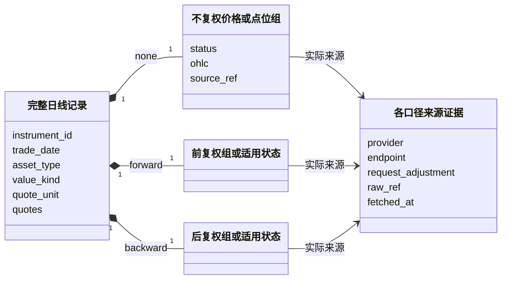
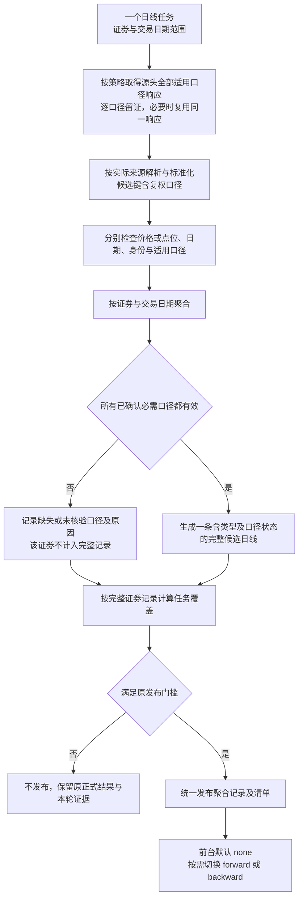

# 三口径日线数据合同

> 2026-10-28经用户确认并已进入实现：源头分别取得股票不复权、前复权、后复权数据，在处理阶段聚合成同一证券、同一交易日的一条完整记录并统一发布；页面默认不复权，可切换口径。当前实现状态及尚未验证范围见本文“实施现状”。
>
> 本文维护三口径记录结构、完整性及消费；历史重建由[独立设计](docs/pipeline/daily-history-rebuild.md)维护。总体设计与任务流程引用本文，不复制字段规则。文件路径保留，历史证据、旧数据和Git历史不迁移或改写。

## 实施现状（2026-10-30）

股票日线按YAML冻结目标与三口径来源策略，原响应保存后解析，候选按口径检查，再以证券和交易日聚合成一条完整记录，通过同一可恢复发布路径落盘。只读查询默认不复权，可切换同一记录内已保存的其他组。

2026-10-29已完成2026-10-28的沪市 `sh600519`、深市 `sz000001`、北交所 `bj920001` 小范围正式留存发布：当前v7的9份在线来源证据、零联网重放、独立价格/日期核验、隔离全量/指定重做和发布恢复通过；正式发布3条完整记录，9组查询投影与原响应一致。当时资格只覆盖这9个精确请求的留存执行，不允许在线采集或市场范围推广；该历史正式数据的成交量和成交额为空。2026-10-30单位规则已升级为v8，见下方单位合同；旧资格因代码/配置指纹变化需复核，持续调度仍关闭，旧发布文件不重写。实际入口、任务定义、发布文件和验证证据统一见[项目进度](PROJECT_PROGRESS.md#当前业务交付状态)。

ETF已有单只来源采集和解析证据，但没有本合同下的ETF聚合发布验收；LOF、指数的适用口径、字段语义和正式范围仍待核验。指数点位结构已有离线验证，不能据此授予来源资格。旧单口径分区及其他正式数据保留原样，不读取为新聚合记录，也没有自动迁移或历史重建。全市场、其他日期与连续交易日生产尚未完成；本次小范围正式发布不替代这些验收。

## 1. 按证券类型定义完整数据结果

1. 股票日线必须包含 `none`（不复权）、`forward`（前复权）、`backward`（后复权）三组源头价格。ETF、指数及未来已支持基金范围按实际来源和已核验的适用口径保存：能够取得的口径都保留，不使用本地复权因子推算。
2. 一条最终日线记录以 `instrument_id + trade_date` 唯一；复权口径成为记录内的固定子结构，不再作为这条最终记录的业务主键或独立发布分区维度。
3. 来源候选仍以 `instrument_id + trade_date + adjustment` 识别；解析、检查后再聚合，不把三次源头采集当成三条最终日线，也不拼接为一组混合OHLC。
4. 日常任务仍按“一个交易日 + 冻结目标证券集合”组织；三口径是一个数据交付目标，不要求用户分别管理三个业务任务。
5. 页面默认读取记录内不复权子结构，切换时投影对应子结构，不重新请求来源、不现场计算复权、不切换另一份业务数据集。
6. 任一按类型和已核验合同确定的必需口径缺失或数值校验失败，该证券日线不能作为完整记录发布；保留候选、原响应和按口径定位的问题。分区能否部分发布仍按原缺失数量与比例门槛判断，不把三口径缺失计成三个证券。
7. 前复权历史变化或来源修订需要重建时，重新取得确认范围的全部适用口径（股票为三种），生成完整聚合记录，全部候选准备后统一切换，不只替换一个口径文件。
8. 用 `asset_type` 区分 `stock/etf/lof/index`，用 `value_kind` 区分交易价格 `price` 与指数点数 `index_points`，数值单位显式记录。指数OHLC表示点位，不当成人民币价格；ETF与股票共用价格结构，无需另建重复的ETF价格列。不能按类型猜复权支持，不复制原始点位冒充复权结果。

## 2. 一条完整日线记录的逻辑结构

以下逻辑结构已落实为固定 Parquet 嵌套结构；业务键为 `instrument_id + trade_date`，来源候选继续独立按口径识别。

```yaml
instrument_id: 'XSHG:600519'
trade_date: '2026-10-28'
asset_type: stock
value_kind: price
quote_unit: CNY
quotes:
  none:
    status: available
    open: 100.0
    high: 103.0
    low: 99.0
    close: 102.0
    volume: null
    amount: null
    source_ref: '不复权请求及原响应引用'
  forward:
    status: available
    open: 90.0
    high: 92.7
    low: 89.1
    close: 91.8
    volume: null
    amount: null
    source_ref: '前复权请求及原响应引用'
  backward:
    status: available
    open: 150.0
    high: 154.5
    low: 148.5
    close: 153.0
    volume: null
    amount: null
    source_ref: '后复权请求及原响应引用'
```

数值仅为结构示例，不是实测证券价格，也不是允许按比例推算的公式。每组OHLC整条取自其实际来源记录；不能跨来源拼同一组开收高低。三组各自保留实际来源、接口、请求口径、抓取时间、来源行位置、单位规则、解析版本和原响应引用；`source_ref`只是示例简写，不把三组强行归给一个全局来源标签。

成交量/额及其他字段按各自来源语义和既有认证规则处理，未认证仍可为空；“完整”要求该证券已确认适用的必需价格/点位组有效（股票为三组），不等于所有可选字段都非空。不默认三种口径成交量/额相同，不将三组数量相加。涨跌幅、前收等若展示，必须来自所选口径的明确字段或另行核准规则，不能混用另一口径。

来源配置必须明确所选来源能否提供每种口径；三组实际来源是否要求一致由任务合同明确，不能仅因证券和日期相同就认定口径或历史基准一致。若来源合同需要分别请求则按口径请求；若一次返回三组则复用该原响应，不能为了凑三份文件重复请求。采集时间、业务日期和前复权历史比较基准分别记录，不宣称三次网络请求具备来源端事务一致性。

### 2.1 证券类型、口径适用性与空值

`asset_type`决定数值的业务解释，口径是否适用则由证券范围、来源合同与核验证据共同确定，不能仅凭股票/ETF/指数枚举推断。记录内每个固定口径槽位保留状态，只有 `available` 才包含可消费的数值；空槽位的数值为空，不复制其他组。

| 口径组状态 | 含义 | 发布与消费 |
|---|---|---|
| `available` | 已取得并通过该口径的必需数值检查 | 按该口径显示，来源可追溯 |
| `not_applicable` | 根据明确业务定义及证据确认不适用，附原因和规则引用 | 不要求凑值；页面禁用该选项并解释，不替代其他口径 |
| `missing` | 已确认本范围需要该口径，但来源未返回或记录无效 | 整条不计入完整记录，说明缺失原因，不能按“不支持”忽略 |
| `unverified` | 尚无足够证据确定适用性或支持范围 | 不宣称“不适用”或全口径完整；正式资格和发布范围须先明确 |

股票必需三组。ETF如果来源可提供三组就全部采集保存；不能仅为简化流程只保存不复权。指数以 `value_kind=index_points`、`quote_unit=point`保存实际点位；其他口径有真实能力与语义证据时同样保留，否则明确不适用或未核验。某个接口不支持前复权，不等于整个证券类型不适用前复权；这种情况下记录请求/来源限制，而非写成已确认不适用。

不复权组是本次默认消费的必需组，不能发布一条没有默认可展示值的“完整日线”。同一组的 `status` 与数值、来源引用须一致，不能标记可用却没有必需OHLC，也不能标记不适用却填入复制价格。

以上状态属于数据完整性与消费合同，不引入新任务状态机。任务开始前冻结本次已核准的必需口径和证据引用；不得采集后根据缺了什么反向缩减必需集合。尚未核验的ETF/指数范围不能因 `none` 有值就宣称全口径完成，需先确认本次正式资格范围。面向诊断可以展示候选与未核验项，不能伪装正式完整数据。

### 2.2 来源单位合同（2026-10-30）

单位换算由现有 `config/normalization/daily_bar.yaml` 的 `unit_contracts` 单处声明，替换逐证券、逐日期的 `verified_unit_scopes`。合同同时匹配Provider、Endpoint、来源接口、市场、显式证券类型、代码段和实际返回序列与请求口径；日期不再充当单位规则的白名单。代码段只界定已确认的规则适用范围，不用价格、数量级或证券名称猜测倍率；来源采集及价格解析不改变。

| 单位合同 | 配置适用范围 | 实际序列与口径 | 股/份数量倍率 | 人民币元金额倍率 |
|---|---|---|---:|---:|
| 普通股票 | 腾讯newfqkline，stock，沪市60段、深市00/30段 | day/none、qfqday/forward、hfqday/backward | 100 | 10000 |
| 科创板股票 | 腾讯newfqkline，stock，沪市688段 | day/none | 1 | 10000 |
| 沪深ETF | 腾讯newfqkline，etf，沪市51段、深市159段 | qfqday/forward | 100 | 10000 |

普通股票合同的样本依据包括2026-10-09三只股票及2026-10-28沪深两只股票的三口径对照；科创板来自688981的实际day来源行，ETF来自510300、159915、511880的qfqday来源行。证券组是基于代表样本配置的单位合同，不能称为全市场、全代码段逐证券验证或生产资格。历史原响应、字节哈希与逐项差值见[单位复核](data/task_workspace/_checks/unit-review-20261030/unit-comparison.json)。未经独立对照的返回序列不继承倍率；科创板旧请求虽带qfq却实际返回day，因此不能据此授予qfqday/hfqday单位合同。

任务向标准化模块传入证券类型；手工来源输入未提供类型时单位不匹配，保持可选量额为空。北交所、LOF、指数、其他代码段、接口或序列亦为空。无匹配不猜测，多重匹配或无效配置明确报错。数量与金额分别应用倍率、记录舍入标记；原响应和来源行保持原值。候选报告保存实际匹配的合同、证据路径及精度标记，聚合记录直接承接实际已换算字段的标记，不再在构建模块维护第二套日期匹配。

在现有标准化模块中统一配置校验、合同匹配和换算，在现有输入流程提供上下文及报告，在现有日线构建中传递精度标记；不新增管理层或平行入口。规范化版本升为v8，采集适配器保持v7；代码与配置指纹变化使旧资格失效，新任务须重新复核。旧原始证据和已发布业务文件不重写。

验收覆盖跨证券/跨日期复用、股票与ETF及实际序列隔离、未覆盖范围留空、重叠/错误倍率拒绝、来源原值与换算值可追溯、聚合精度标记和真实响应隔离回放。隔离端到端不授予新的生产资格；本次不补采、不重写生产数据，也不启用调度。

### 2.3 数据对象关联



图中三组是固定槽位，状态决定是否承载数值；股票三槽必须有效，其他类型按已核验合同检查。它们不是三个独立业务任务、三个正式数据集或必须新增的三个Python类。来源证据可共享同一原响应，但口径定位必须明确。

## 3. 日常采集、聚合与消费（已实现离线股票闭环）



采集仍只因配置允许的传输故障切源；缺一种口径、无效JSON、业务空值或价格异常不会让解析阶段反向触发请求。问题定位包含 `adjustment`，例如“某证券某日后复权close解析失败”，并关联该组原响应和来源行。用户可以明确要求重新采集缺失口径；处理阶段重新组装并检查完整记录后才能发布，不能将半条记录直接补写正式文件。

覆盖分母是冻结目标证券数，分子是全部已确认必需口径都有效的证券日记录数（股票为三组），不是请求数或三组行数之和。有效但不完整的口径候选可留在工作区重用，不把其中一组复制到另一组，也不将 `null` 冒充完整价格。沿用原1%且50只门槛时，整条缺失按一个证券计，允许的部分发布只包含完整记录；缺失证券及原因保留在报告中。

### 3.1 前台消费合同

业务日线列表/图表按证券和日期取得聚合记录，默认 `none`；选择 `forward/backward` 只改变相应价格组投影（仅状态可用时允许选择）。日期、证券身份和查询范围保持不变，页面先按证券类型解释价格或点位，标题/提示明确当前口径及单位；禁止把三组OHLC拼成一条曲线。旧原始来源行查询仍是证据视图，不冒充新的规范日线消费接口。

不支持某口径的资产或尚未完成三组的记录不得静默显示另一口径，应展示明确状态和原因。是否在页面显示不完整候选属于诊断视图，不能与正式日线混列。只读运行台现已增加规范日线视图；它仅读取正式聚合分区，不能展示旧单口径分区。

### 3.2 采集策略与来源合同

任务引用 `config/capabilities.yaml` 的 `daily_fixed`，按市场与口径冻结请求。当前股票三口径均使用newfqkline，none/qfq/hfq分别读取day/qfqday/hfqday；详细API、640条窗口、原请求及适用性见[来源说明](docs/providers/README.md#证券名单能力更新)。kline保留为显式来源接口，不作为该策略的隐式回退。来源选用与资格不由本数据对象决定。

## 历史重建与后续管理能力

历史事件发现、换版确认和跨日期统一切换见[历史重建设计](docs/pipeline/daily-history-rebuild.md)。管理台配置表单仍属于后续目标：原规划要求类型/范围校验、原子写回YAML，运行中任务继续使用冻结规则；当前只读运行台没有这些写操作。该目标保留，不因拆文档而视为已实现。

## 11. 分钟数据边界

分钟数据不复用本流程。分钟数据继续采用盘中实时存储和盘后校准流程。本轮不定义分钟前复权历史重建。

## 12. 当前实施差距与验收标准

股票三口径任务、来源候选到聚合对象的转换、完整记录检查、统一发布/恢复和查询投影已完成实现并通过离线验收。新规范日线以 `instrument_id + trade_date` 为键，物理文件按日期与资产类型保存嵌套三组；旧 `BarRecord` 与既有 `adjustment=...` 分区仅保留原有用途和历史数据，不被新聚合路径自动读取。

仍待完成的是 ETF、LOF、指数各来源的复权适用性与字段语义核验，更新代码后的日线 Provider 四层资格验证，以及人工历史重建和多日期候选统一切换。新聚合文件缺失或无效时不会退回旧单口径文件。旧分区与生产数据保持原位，迁移和删除另行确认。

验收至少覆盖：

- 同一证券和日期最终只有一条记录，全部适用组数值分别与源头原响应一致，主键不含复权口径。
- 各口径候选输入有明确口径和来源引用；一响应含多组时无需重复取数，不在本地计算前/后复权。
- 任一必需口径缺失、身份/日期错配或数值无效，不能以完整记录发布；覆盖按证券记录计数。
- 成交量/额单位未认证仍空，三组不求和、不跨组替代，不降低现有发布门槛。
- 解析/质量失败不自动重新采集；显式重采后仍通过聚合完整性检查。
- 前台默认不复权，切换只投影已发布记录中的价格组；不混口径、不请求上游、不现场复权。
- 历史变化的候选覆盖全部必需口径与全部授权日期，失败不影响旧发布，统一切换后无新旧历史混合。
- ETF/指数按真实适用性保存全部已有口径；`not_applicable/missing/unverified`可区分，价格与点位类型及单位不混用，未验证复权不被伪造；分钟保持原合同。

原响应、候选、问题和历史审计默认不因重建自动清理。2026-10-28三只股票已有v7正式留存发布；v8单位合同完成留存响应隔离验收。范围和来源资格限制以本文实施现状及项目进度为准，不外推为全市场或连续生产。
