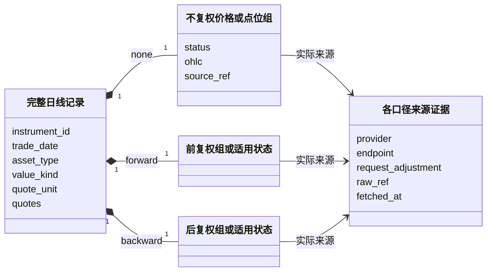
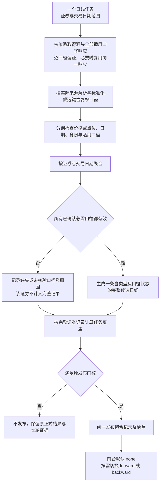

# 三口径日线聚合与历史重建设计

> 2026-10-28经用户确认并已进入实现：源头分别取得股票不复权、前复权、后复权数据，在处理阶段聚合成同一证券、同一交易日的一条完整记录并统一发布；页面默认不复权，可切换口径。当前实现状态及尚未验证范围见本文“实施现状”。
>
> 本文是三口径记录结构、完整性、消费及历史重建的主要维护位置。总体设计与任务流程引用本文，不复制字段规则。文件路径保留，历史证据、旧数据和Git历史不迁移或改写。

## 实施现状（2026-10-28）

已实现股票日线的一日隔离闭环：任务策略来自 YAML，按三种口径留存源响应；解析在响应落盘后进行；候选按口径进入任务处理；聚合键是证券和交易日；完整记录经同一发布恢复路径落盘；只读页面默认不复权并从同一记录切换口径。验收使用可复现的本地 HTTP 响应，不是腾讯在线能力验收或真实业务发布。ETF、LOF、指数目前只有不复权来源要求，其余口径明确为未核验，故不能发布为“完整”记录；指数点位结构已通过离线 round-trip，但还没有对应来源资格。旧单口径分区和生产数据保留原样，不会自动读取为新聚合记录；变更代码后既有日线来源资格需重新核验。调度声明保持关闭，用户也尚未授权真实采集。

本阶段检查范围为配置驱动、任务范围冻结、三响应聚合、失败保留明细、不完整记录拒发、整份旧发布保留、断点恢复、查询投影及旧单口径入口阻断。风险与待办是ETF/LOF/指数逐来源语义核验、重新做来源合同与在线资格的四层验证，再按单独确认启用生产任务及调度。

## 1. 按证券类型定义完整数据结果

1. 股票日线必须包含 `none`（不复权）、`forward`（前复权）、`backward`（后复权）三组源头价格。ETF、指数及未来已支持基金范围按实际来源和已核验的适用口径保存：能够取得的口径都保留，不使用本地复权因子推算。
2. 一条最终日线记录以 `instrument_id + trade_date` 唯一；复权口径成为记录内的固定子结构，不再作为这条最终记录的业务主键或独立发布分区维度。
3. 来源候选仍以 `instrument_id + trade_date + adjustment` 识别；解析、检查后再聚合，不把三次源头采集当成三条最终日线，也不拼接为一组混合OHLC。
4. 日常任务仍按“一个交易日 + 冻结目标证券集合”组织；三口径是一个数据交付目标，不要求用户分别管理三个业务任务。
5. 页面默认读取记录内不复权子结构，切换时投影对应子结构，不重新请求来源、不现场计算复权、不切换另一份业务数据集。
6. 任一按类型和已核验合同确定的必需口径缺失或数值校验失败，该证券日线不能作为完整记录发布；保留候选、原响应和按口径定位的问题。分区能否部分发布仍按原缺失数量与比例门槛判断，不把三口径缺失计成三个证券。
7. 前复权历史变化或来源修订需要重建时，重新取得确认范围的全部适用口径（股票为三种），生成完整聚合记录，全部候选准备后统一切换，不只替换一个口径文件。
8. 用 `asset_type` 区分 `stock/etf/lof/index`，用 `value_kind` 区分交易价格 `price` 与指数点数 `index_points`，数值单位显式记录。指数OHLC表示点位，不当成人民币价格；ETF与股票共用价格结构，无需另建重复的ETF价格列。不能按类型猜复权支持，不复制原始点位冒充复权结果。

## 2. 一条完整日线记录的逻辑结构

以下逻辑结构已落实为固定 Parquet 嵌套结构；业务键为 `instrument_id + trade_date`，来源候选继续独立按口径识别。

```yaml
instrument_id: 'XSHG:600519'
trade_date: '2026-10-28'
asset_type: stock
value_kind: price
quote_unit: CNY
quotes:
  none:
    status: available
    open: 100.0
    high: 103.0
    low: 99.0
    close: 102.0
    volume: null
    amount: null
    source_ref: '不复权请求及原响应引用'
  forward:
    status: available
    open: 90.0
    high: 92.7
    low: 89.1
    close: 91.8
    volume: null
    amount: null
    source_ref: '前复权请求及原响应引用'
  backward:
    status: available
    open: 150.0
    high: 154.5
    low: 148.5
    close: 153.0
    volume: null
    amount: null
    source_ref: '后复权请求及原响应引用'
```

数值仅为结构示例，不是实测证券价格，也不是允许按比例推算的公式。每组OHLC整条取自其实际来源记录；不能跨来源拼同一组开收高低。三组各自保留实际来源、接口、请求口径、抓取时间、来源行位置、单位规则、解析版本和原响应引用；`source_ref`只是示例简写，不把三组强行归给一个全局来源标签。

成交量/额及其他字段按各自来源语义和既有认证规则处理，未认证仍可为空；“完整”要求该证券已确认适用的必需价格/点位组有效（股票为三组），不等于所有可选字段都非空。不默认三种口径成交量/额相同，不将三组数量相加。涨跌幅、前收等若展示，必须来自所选口径的明确字段或另行核准规则，不能混用另一口径。

来源配置必须明确所选来源能否提供每种口径；三组实际来源是否要求一致由任务合同明确，不能仅因证券和日期相同就认定口径或历史基准一致。若来源合同需要分别请求则按口径请求；若一次返回三组则复用该原响应，不能为了凑三份文件重复请求。采集时间、业务日期和前复权历史比较基准分别记录，不宣称三次网络请求具备来源端事务一致性。

### 2.1 证券类型、口径适用性与空值

`asset_type`决定数值的业务解释，口径是否适用则由证券范围、来源合同与核验证据共同确定，不能仅凭股票/ETF/指数枚举推断。记录内每个固定口径槽位保留状态，只有 `available` 才包含可消费的数值；空槽位的数值为空，不复制其他组。

| 口径组状态 | 含义 | 发布与消费 |
|---|---|---|
| `available` | 已取得并通过该口径的必需数值检查 | 按该口径显示，来源可追溯 |
| `not_applicable` | 根据明确业务定义及证据确认不适用，附原因和规则引用 | 不要求凑值；页面禁用该选项并解释，不替代其他口径 |
| `missing` | 已确认本范围需要该口径，但来源未返回或记录无效 | 整条不计入完整记录，说明缺失原因，不能按“不支持”忽略 |
| `unverified` | 尚无足够证据确定适用性或支持范围 | 不宣称“不适用”或全口径完整；正式资格和发布范围须先明确 |

股票必需三组。ETF如果来源可提供三组就全部采集保存；不能仅为简化流程只保存不复权。指数以 `value_kind=index_points`、`quote_unit=point`保存实际点位；其他口径有真实能力与语义证据时同样保留，否则明确不适用或未核验。某个接口不支持前复权，不等于整个证券类型不适用前复权；这种情况下记录请求/来源限制，而非写成已确认不适用。

不复权组是本次默认消费的必需组，不能发布一条没有默认可展示值的“完整日线”。同一组的 `status` 与数值、来源引用须一致，不能标记可用却没有必需OHLC，也不能标记不适用却填入复制价格。

以上状态属于数据完整性与消费合同，不引入新任务状态机。任务开始前冻结本次已核准的必需口径和证据引用；不得采集后根据缺了什么反向缩减必需集合。尚未核验的ETF/指数范围不能因 `none` 有值就宣称全口径完成，需先确认本次正式资格范围。面向诊断可以展示候选与未核验项，不能伪装正式完整数据。

### 2.2 数据对象关联



图中三组是固定槽位，状态决定是否承载数值；股票三槽必须有效，其他类型按已核验合同检查。它们不是三个独立业务任务、三个正式数据集或必须新增的三个Python类。来源证据可共享同一原响应，但口径定位必须明确。

## 3. 日常采集、聚合与消费（已实现离线股票闭环）



采集仍只因配置允许的传输故障切源；缺一种口径、无效JSON、业务空值或价格异常不会让解析阶段反向触发请求。问题定位包含 `adjustment`，例如“某证券某日后复权close解析失败”，并关联该组原响应和来源行。用户可以明确要求重新采集缺失口径；处理阶段重新组装并检查完整记录后才能发布，不能将半条记录直接补写正式文件。

覆盖分母是冻结目标证券数，分子是全部已确认必需口径都有效的证券日记录数（股票为三组），不是请求数或三组行数之和。有效但不完整的口径候选可留在工作区重用，不把其中一组复制到另一组，也不将 `null` 冒充完整价格。沿用原1%且50只门槛时，整条缺失按一个证券计，允许的部分发布只包含完整记录；缺失证券及原因保留在报告中。

### 3.1 前台消费合同

业务日线列表/图表按证券和日期取得聚合记录，默认 `none`；选择 `forward/backward` 只改变相应价格组投影（仅状态可用时允许选择）。日期、证券身份和查询范围保持不变，页面先按证券类型解释价格或点位，标题/提示明确当前口径及单位；禁止把三组OHLC拼成一条曲线。旧原始来源行查询仍是证据视图，不冒充新的规范日线消费接口。

不支持某口径的资产或尚未完成三组的记录不得静默显示另一口径，应展示明确状态和原因。是否在页面显示不完整候选属于诊断视图，不能与正式日线混列。只读运行台现已增加规范日线视图；它仅读取正式聚合分区，不能展示旧单口径分区。

## 4. 分红事件批量发现

### 4.1 主要发现源

第一版使用东方财富全市场“分红实施”数据作为主要发现源：

```text
接口：https://datacenter-web.eastmoney.com/api/data/v1/get
数据集：RPT_SHAREBONUS_DET
```

按 `EX_DIVIDEND_DATE` 查询除权除息事件，一次批量获取全市场结果，不逐只查询证券。

关键字段以实时探针为准，至少需要：

```text
SECURITY_CODE          证券代码
EX_DIVIDEND_DATE       除权除息日
EQUITY_RECORD_DATE     股权登记日
PRETAX_BONUS_RMB       税前现金分红
BONUS_RATIO            送股比例
IT_RATIO               转增比例
ASSIGN_PROGRESS        方案进度
NOTICE_DATE            最新公告日期
```

东方财富分红事件能力必须与东方财富行情能力分开配置、分开探针和分开启停。行情能力不可用时，不自动禁用分红事件能力。

### 4.2 补偿查询

不能只查询当天。每次任务查询最近若干自然日的除权事件，默认窗口由配置管理：

```yaml
  dividend_event:
  provider: eastmoney
  lookback_calendar_days: 5
```

接口失败后，下一次任务依靠补偿窗口重新取得遗漏事件。

事件按以下业务键去重：

```text
证券身份 + 除权除息日
```

巨潮或交易所公告后续可作为校验证据，不作为第一版运行的强依赖。

## 5. 历史变化确认与三口径一致性

发现除权事件，不等于目标前复权来源已经更新历史。重建前必须比较同一来源的新旧历史数据。

```text
发现证券发生除权事件
    ↓
从计划用于重建的前复权来源获取一段重叠历史
    ↓
与当前正式数据中的相同日期比较
    ↓
历史价格没有变化：尚未观察到换版证据，按明确的复核任务稍后检查
历史价格已经变化：可以进入人工重建清单
```

比较必须满足：

- 来源、接口和复权方式相同；
- 请求参数和日期范围规则相同；
- 至少比较除权日前的一个稳定交易日；
- 首次发现变化后再次请求确认，两次新结果一致才允许重建；
- 主要比较开盘、最高、最低和收盘价格，不以成交量、成交额作为历史版本变化的主要判断依据。

分红事件接口负责缩小检查范围，历史重叠比较负责确认实际前复权来源已经换版。

## 6. 人工三口径历史重建

第一版不自动修改历史。管理台展示需要处理的证券，由人工选择“重建完整日线历史”；事件发现与来源重叠比较仍用于确认是否需要重建。

任务输入包括：

```text
证券
开始日期
结束日期
三口径来源策略及适用范围
历史覆盖开关
```

默认重建范围是该来源能够取得的最早有效日期到当前最新交易日。

历史覆盖由数据集配置控制：

```yaml
history_rebuild:
  enabled: false
  require_manual_approval: true
```

开关关闭时拒绝创建历史重建任务。开关打开后，只允许人工显式提交指定证券和日期范围，不影响普通每日任务。

## 7. 历史重建流程

```text
人工批准证券、日期范围与来源策略
    ↓
取得确认范围全部适用口径源头响应并留证（股票为三组）
    ↓
分别解析、标准化和检查，不因质量问题自动切源
    ↓
按证券和日期聚合全部必需组，缺组则阻断完整历史候选
    ↓
读取受影响日期的当前正式分区
    ↓
仅替换授权证券范围的完整聚合记录，其他证券保留
    ↓
生成全部受影响日期候选分区与清单
    ↓
核验适用口径覆盖、来源版本、其他记录未变及证据引用
    ↓
全部通过后统一切换正式版本
```

不得边获取边逐日覆盖，也不能只更新前复权组就宣称三口径历史已经统一重建。未发生变化的价格也要通过新候选核验；保留原始来源与当前候选对照，不凭事件假设后复权或不复权值必然不变。该合同不要求本地计算任何复权价，来源不支持完整窗口时报告限制并由用户决定后续。

## 8. 统一切换

历史重建可能影响数百或数千个日期分区。为了避免一半日期是旧版本、一半日期是新版本，采用“候选版本 + 当前版本指针”：

```text
正式版本 100
    ↓
在版本 101 中准备全部受影响日期分区
    ↓
全部完成并校验通过
    ↓
原子切换当前版本指针
    ↓
版本 101 对业务统一可见
```

示意目录：

```text
datasets/
└── daily_bar/
    ├── versions/
    │   ├── version_100/
    │   └── version_101/
    └── current.json
```

正式物理布局可以在实现阶段优化，但必须保证业务查询不会看到部分切换结果。

## 9. 当天数据处理

除权日发现目标来源历史已经换版，但历史重建尚未完成时：

- 该证券不把含新前复权基准的当天聚合记录拼入旧历史版本；
- 普通日线任务将该证券保留在缺失清单；
- 全市场其他证券继续按发布门槛判断是否发布；
- 历史重建任务包含除权日当天的三口径完整数据，统一切换后补回该证券；不能为了默认展示不复权就将股票另外两组缺失的记录称为“完整记录”。

## 10. 管理台配置

管理台不直接展示 YAML 文本，而是提供受控表单。提交时只做简单有效性检查，成功后原子写回 YAML。

```text
表单修改
    ↓
检查类型、范围和必填项
    ↓
写临时文件
    ↓
复读 YAML
    ↓
原子替换正式配置
```

保存成功后立即成为当前配置；已经启动的任务继续使用启动时冻结的配置，新任务读取最新配置。不保留配置修改历史。

## 11. 分钟数据边界

分钟数据不复用本流程。分钟数据继续采用盘中实时存储和盘后校准流程。本轮不定义分钟前复权历史重建。

## 12. 当前实施差距与验收标准

股票三口径任务、来源候选到聚合对象的转换、完整记录检查、统一发布/恢复和查询投影已完成实现并通过离线验收。新规范日线以 `instrument_id + trade_date` 为键，物理文件按日期与资产类型保存嵌套三组；旧 `BarRecord` 与既有 `adjustment=...` 分区仅保留原有用途和历史数据，不被新聚合路径自动读取。

仍待完成的是 ETF、LOF、指数各来源的复权适用性与字段语义核验，更新代码后的日线 Provider 四层资格验证，以及人工历史重建和多日期候选统一切换。新聚合文件缺失或无效时不会退回旧单口径文件。旧分区与生产数据保持原位，迁移和删除另行确认。

验收至少覆盖：

- 同一证券和日期最终只有一条记录，全部适用组数值分别与源头原响应一致，主键不含复权口径。
- 各口径候选输入有明确口径和来源引用；一响应含多组时无需重复取数，不在本地计算前/后复权。
- 任一必需口径缺失、身份/日期错配或数值无效，不能以完整记录发布；覆盖按证券记录计数。
- 成交量/额单位未认证仍空，三组不求和、不跨组替代，不降低现有发布门槛。
- 解析/质量失败不自动重新采集；显式重采后仍通过聚合完整性检查。
- 前台默认不复权，切换只投影已发布记录中的价格组；不混口径、不请求上游、不现场复权。
- 历史变化的候选覆盖全部必需口径与全部授权日期，失败不影响旧发布，统一切换后无新旧历史混合。
- ETF/指数按真实适用性保存全部已有口径；`not_applicable/missing/unverified`可区分，价格与点位类型及单位不混用，未验证复权不被伪造；分钟保持原合同。

原响应、候选、问题和历史审计默认不因重建自动清理。当前闭环仅以本地合成响应作离线验收，不代表实时来源资格或真实业务发布。
