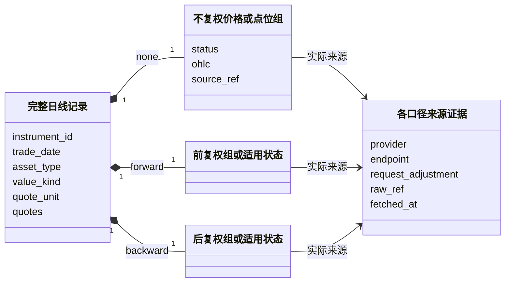
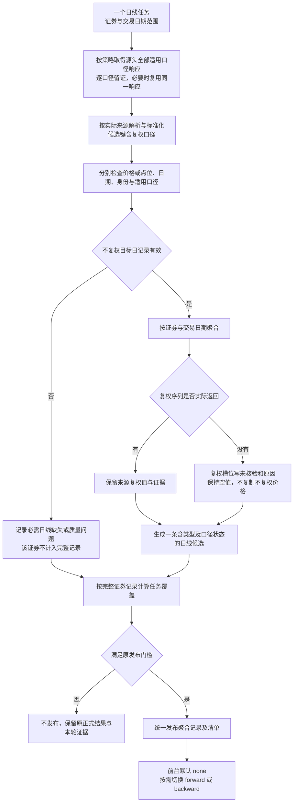

# 三口径日线数据合同

> 2026-11-01现行合同：以证券不复权日线作为必需数据；前复权、后复权有真实来源值时保留，没有时显式记为未核验，不复制不复权值，也不因此拦截证券日线发布。页面默认不复权，可切换已发布且可用的口径。历史运行与当前实现状态见本文“实施现状”。
>
> 本文维护三口径记录结构、完整性及消费；历史重建由[独立设计](docs/pipeline/daily-history-rebuild.md)维护。总体设计与任务流程引用本文，不复制字段规则。文件路径保留，历史证据、旧数据和Git历史不迁移或改写。

## 实施现状（2026-11-01）

日线按YAML冻结目标与来源策略，原响应保存后解析，候选按证券、日期和口径检查，再以证券和交易日聚合成一条记录，通过同一可恢复发布路径落盘。不复权是所有证券日线的必需组；前/后复权是可选组，有真实响应值时保留，未返回时记为未核验并留空。只读查询默认不复权，可切换同一记录内已保存且可用的其他组。

2026-10-29已完成2026-10-28的沪市 `sh600519`、深市 `sz000001`、北交所 `bj920001` 小范围正式留存发布：当前v7的9份在线来源证据、零联网重放、独立价格/日期核验、隔离全量/指定重做和发布恢复通过；正式发布3条完整记录，9组查询投影与原响应一致。当时资格只覆盖这9个精确请求的留存执行，不允许在线采集或市场范围推广；该历史正式数据的成交量和成交额为空。2026-10-30单位规则升级为v8，2026-10-31补齐北交所代表样本单位后升为v9，见下方单位合同；单位语义与当前配置仍须按适用范围验证，不以源码指纹判定资格，持续调度仍关闭，旧发布文件不重写。实际入口、任务定义、发布文件和验证证据统一见[项目进度](PROJECT_PROGRESS.md#当前业务交付状态)。

ETF已有单只来源采集和解析证据，但没有本合同下的ETF聚合发布验收；LOF、指数的适用口径、字段语义和正式范围仍待核验。指数点位结构已有离线验证，不能据此授予来源资格。旧单口径分区及其他正式数据保留原样，不读取为新聚合记录，也没有自动迁移或历史重建。全市场、其他日期与连续交易日生产尚未完成；本次小范围正式发布不替代这些验收。

## 1. 按证券类型定义完整数据结果

1. 股票、ETF、LOF和指数日线都必须有有效的 `none`（不复权）组。`forward`（前复权）和 `backward`（后复权）有源头价格就保留；源头没有返回时写为 `unverified` 并保留空值，不把缺口推断为“未分红”、不复制 `none`，也不因缺少这两组拒绝发布。
2. 一条最终日线记录以 `instrument_id + trade_date` 唯一；复权口径成为记录内的固定子结构，不再作为这条最终记录的业务主键或独立发布分区维度。
3. 来源候选仍以 `instrument_id + trade_date + adjustment` 识别；解析、检查后再聚合，不把三次源头采集当成三条最终日线，也不拼接为一组混合OHLC。
4. 日常任务仍按“一个交易日 + 冻结目标证券集合”组织；三口径是一个数据交付目标，不要求用户分别管理三个业务任务。
5. 页面默认读取记录内不复权子结构，切换时投影对应子结构，不重新请求来源、不现场计算复权、不切换另一份业务数据集。
6. 必需的不复权组缺失或价格/点位校验失败，该证券不计为完整日线；保留候选、原响应和按口径定位的问题。可选复权组缺失只使该口径保持未核验，不减少完整证券数。分区部分发布仍按原缺失数量与比例门槛判断，不把口径请求数当成证券数。
7. 前复权历史变化或来源修订需要重建时，重新取得确认范围的必需不复权组及实际需要重建的可选口径；有值的组分别验证后再聚合，不以其他口径代替。
8. 用 `asset_type` 区分 `stock/etf/lof/index`，用 `value_kind` 区分交易价格 `price` 与指数点数 `index_points`，数值单位显式记录。指数OHLC表示点位，不当成人民币价格；ETF与股票共用价格结构，无需另建重复的ETF价格列。不能按类型猜复权支持，不复制原始点位冒充复权结果。

## 2. 一条完整日线记录的逻辑结构

以下逻辑结构已落实为固定 Parquet 嵌套结构；业务键为 `instrument_id + trade_date`，来源候选继续独立按口径识别。

```yaml
instrument_id: 'XSHG:600519'
trade_date: '2026-10-28'
asset_type: stock
value_kind: price
quote_unit: CNY
quotes:
  none:
    status: available
    open: 100.0
    high: 103.0
    low: 99.0
    close: 102.0
    volume: null
    amount: null
    source_ref: '不复权请求及原响应引用'
  forward:
    status: available
    open: 90.0
    high: 92.7
    low: 89.1
    close: 91.8
    volume: null
    amount: null
    source_ref: '前复权请求及原响应引用'
  backward:
    status: available
    open: 150.0
    high: 154.5
    low: 148.5
    close: 153.0
    volume: null
    amount: null
    source_ref: '后复权请求及原响应引用'
```

数值仅为结构示例，不是实测证券价格，也不是允许按比例推算的公式。每组OHLC整条取自其实际来源记录；不能跨来源拼同一组开收高低。三组各自保留实际来源、接口、请求口径、抓取时间、来源行位置、单位规则、解析版本和原响应引用；`source_ref`只是示例简写，不把三组强行归给一个全局来源标签。

成交量/额及其他字段按各自来源语义和既有认证规则处理，未认证仍可为空；“完整”要求不复权价格/点位组有效，不等于所有可选字段或复权口径都有值。不默认不同口径的成交量/额相同，不将口径数量相加。涨跌幅、前收等若展示，必须来自所选口径的明确字段或另行核准规则，不能混用另一口径。

来源配置必须明确所选来源能否提供每种口径；三组实际来源是否要求一致由任务合同明确，不能仅因证券和日期相同就认定口径或历史基准一致。若来源合同需要分别请求则按口径请求；若一次返回三组则复用该原响应，不能为了凑三份文件重复请求。采集时间、业务日期和前复权历史比较基准分别记录，不宣称三次网络请求具备来源端事务一致性。

### 2.1 证券类型、口径适用性与空值

`asset_type`决定数值的业务解释，口径是否适用则由证券范围、来源合同与核验证据共同确定，不能仅凭股票/ETF/指数枚举推断。记录内每个固定口径槽位保留状态，只有 `available` 才包含可消费的数值；空槽位的数值为空，不复制其他组。

| 口径组状态 | 含义 | 发布与消费 |
|---|---|---|
| `available` | 已取得并通过该口径的必需数值检查 | 按该口径显示，来源可追溯 |
| `not_applicable` | 根据明确业务定义及证据确认不适用，附原因和规则引用 | 不要求凑值；页面禁用该选项并解释，不替代其他口径 |
| `missing` | 已确认本范围需要该口径，但来源未返回或记录无效 | 整条不计入完整记录，说明缺失原因，不能按“不支持”忽略 |
| `unverified` | 尚无足够证据确定适用性或支持范围 | 不宣称“不适用”或全口径完整；正式资格和发布范围须先明确 |

所有证券类型都以不复权组作为日线完整性的最低合同；复权组有可验证的来源数据时保存，没有时保留 `unverified`。不把来源未返回等同于业务上的“不适用”或“没有发生分红”。指数以 `value_kind=index_points`、`quote_unit=point`保存实际点位；特殊来源的收盘序列规则仍按其单独合同处理。某个接口不支持前复权，不等于整个证券类型不适用前复权；记录实际来源限制和空值状态即可。

不复权组是本次默认消费的必需组，不能发布一条没有默认可展示值的“完整日线”。同一组的 `status` 与数值、来源引用须一致，不能标记可用却没有必需OHLC，也不能标记不适用却填入复制价格。

以上状态属于数据完整性与消费合同，不引入新任务状态机。任务开始前冻结必需不复权口径及来源/日期范围；复权组的缺失不反向改变必需范围，也不被解释成未分红。2026-11-01用户确认股票不应被强制要求具备三种口径；合同据此统一为不复权必需、复权可选。发布成功只表示必需日线达到质量门槛，不表示前后复权数据已验证。来源资格、量额单位及独立市场覆盖仍分别核验，不能因允许可选口径为空而自动取得认证。

例如，`none=available`、`forward=unverified`、`backward=unverified`仍是一条可发布的完整日线；查询前/后复权时返回未核验状态和空值。只有 `none` 缺失、日期错误或必需价格校验失败，才会让该证券计入发布缺失数。

### 2.2 来源单位合同（2026-10-30）

单位换算由现有 `config/normalization/daily_bar.yaml` 的 `unit_contracts` 单处声明，替换逐证券、逐日期的 `verified_unit_scopes`。合同同时匹配Provider、Endpoint、来源接口、市场、显式证券类型、代码段和实际返回序列与请求口径；日期不再充当单位规则的白名单。代码段只界定已确认的规则适用范围，不用价格、数量级或证券名称猜测倍率；来源采集及价格解析不改变。

| 单位合同 | 配置适用范围 | 实际序列与口径 | 股/份数量倍率 | 人民币元金额倍率 |
|---|---|---|---:|---:|
| 普通股票 | 腾讯newfqkline，stock，沪市60段、深市00/30段 | day/none、qfqday/forward、hfqday/backward | 100 | 10000 |
| 科创板股票 | 腾讯newfqkline，stock，沪市688段 | day/none | 1 | 10000 |
| 沪深ETF | 腾讯newfqkline，etf，沪市51段、深市159段 | qfqday/forward | 100 | 10000 |
| 北交所股票（2026-10-31补证） | 腾讯newfqkline，stock，BSE92段 | day/none、qfqday/forward、hfqday/backward | 100 | 10000 |

普通股票合同的样本依据包括2026-10-09三只股票及2026-10-28沪深两只股票的三口径对照；科创板来自688981的实际day来源行，ETF来自510300、159915、511880的qfqday来源行。证券组是基于代表样本配置的单位合同，不能称为全市场、全代码段逐证券验证或生产资格。历史原响应、字节哈希与逐项差值见[单位复核](data/task_workspace/_checks/unit-review-20261030/unit-comparison.json)。未经独立对照的返回序列不继承倍率；科创板旧请求虽带qfq却实际返回day，因此不能据此授予qfqday/hfqday单位合同。

北交所依据是用户提供的纬达光电920001、2026-10-29前复权截图及“量为手（100股）”明确确认，逐一对照同股同日day/qfqday/hfqday三份原响应：量均11829.00手、额均1167.14万元，标准化为1182900股和11671400元。截图额仅显示1167.1万，差400元在其显示精度内吻合；不能用截图声称精确到元。截图直接对照前复权OHLC，另两组只独立比量额，不将前复权价格用于后复权认证。完整原字节、转录及单位确认、三组原响应引用见[北交所补证](tmp/bse-unit-review-20261031/verification.json)。实际范围是1股1日3序列；代码段是代表样本支持的单位合同适用范围，不代表逐证券验证或生产资格，未知代码段和资产类型不继承。

任务向标准化模块传入证券类型；手工来源输入未提供类型时单位不匹配，保持可选量额为空。未覆盖的北交所代码段、LOF、指数、其他接口或序列亦为空。无匹配不猜测，多重匹配或无效配置明确报错。数量与金额分别应用倍率、记录舍入标记；原响应和来源行保持原值。候选报告保存实际匹配的合同、证据路径及精度标记，聚合记录直接承接实际已换算字段的标记，不再在构建模块维护第二套日期匹配。

在现有标准化模块中统一配置校验、合同匹配和换算，在现有输入流程提供上下文及报告，在现有日线构建中传递精度标记；不新增管理层或平行入口。规范化版本2026-10-30升为v8、2026-10-31补齐北交所单位升为v9，采集适配器仍为v7；单位语义变化需要对应标准化、聚合与消费验证；来源资格按实际接口、参数、配置和证据判断，不以源码字节变化判定。旧原始证据和已发布业务文件不重写，新规则使用新隔离运行，不覆盖旧验收记录。

验收覆盖跨证券/跨日期复用、股票与ETF及实际序列隔离、未覆盖范围留空、重叠/错误倍率拒绝、来源原值与换算值可追溯、聚合精度标记和真实响应隔离回放。隔离端到端不授予新的生产资格；本次不补采、不重写生产数据，也不启用调度。

### 2.3 数据对象关联



图中三组是固定槽位，状态决定是否承载数值；只有 `none` 是日线完整性的必需值，两个复权槽位允许未核验空值。它们不是三个独立业务任务、三个正式数据集或必须新增的三个Python类。来源证据可共享同一原响应，但口径定位必须明确。

## 3. 日常采集、聚合与消费（已实现离线股票闭环）

2026-10-31用户确认按同日证券类型集合组织日线批任务。整批采集结束后处理全部已保存响应，再按类型构建并进入统一发布阶段；各类型分母和门槛独立，整批状态报告分区失败，不增加跨类型原子事务。股票、ETF与指数共用现有记录结构，适用口径与单位规则不变。2026-11-01用户进一步确认来源组并发方案，现已在采集阶段按冻结`input_id`并发运行，不同来源仍分别请求、分别解析，再进入同一个标准候选集合及发布入口。实现范围和证据见本节3.3与[任务流程](docs/pipeline/collection-tasks.md#按来源并发采集2026-11-01已实现验证范围见下)。



采集仍只因配置允许的传输故障切源；缺一种口径、无效JSON、业务空值或价格异常不会让解析阶段反向触发请求。问题定位包含 `adjustment`，例如“某证券某日后复权close解析失败”，并关联该组原响应和来源行。用户可以明确要求重新采集缺失口径；处理阶段重新组装并检查完整记录后才能发布，不能将半条记录直接补写正式文件。

覆盖分母是冻结目标证券数，分子是不复权目标日记录有效的证券数，不是请求数或口径行数之和。缺少复权口径的证券仍可计为完整记录，但对应槽位必须保持未核验空值；任何口径都不互相复制。沿用原1%且50只门槛时，不复权记录缺失按一个证券计，允许的部分发布只包含达到最低合同的记录；缺失证券及原因保留在报告中。

### 3.1 前台消费合同

业务日线列表/图表按证券和日期取得聚合记录，默认 `none`；选择 `forward/backward` 只改变相应价格组投影（仅状态可用时允许选择）。日期、证券身份和查询范围保持不变，页面先按证券类型解释价格或点位，标题/提示明确当前口径及单位；禁止把三组OHLC拼成一条曲线。旧原始来源行查询仍是证据视图，不冒充新的规范日线消费接口。

不支持某口径的资产或尚未完成三组的记录不得静默显示另一口径，应展示明确状态和原因。是否在页面显示不完整候选属于诊断视图，不能与正式日线混列。只读运行台现已增加规范日线视图；它仅读取正式聚合分区，不能展示旧单口径分区。

### 3.2 采集策略与来源合同

任务引用 `config/capabilities.yaml` 的 `daily_fixed`，按市场与口径冻结请求。当前股票仍可分别请求newfqkline的day/qfqday/hfqday；但日线发布只要求day对应的不复权目标记录通过验证。qfqday/hfqday返回时照常保留；缺失时形成未核验空槽，不拦截不复权日线发布。详细API、640条窗口、原请求及来源限制见[来源说明](docs/providers/README.md#证券名单能力更新)。kline保留为显式来源接口，不作为该策略的隐式回退。来源选用与资格不由本数据对象决定。

### 3.3 新来源并行采集并汇入共同发布（已实现，验证范围有限）

用户确认腾讯和中证的网络请求在同一采集阶段运行。业务目标是让不同来源的请求等待重叠，同时保持一个标准日线候选集合和一个共同发布入口；来源仍分别请求、分别按接口解析，不是腾讯发布一份、中证再发布一份，也不让来源之间互相回退。本节中的图是当前实现架构，下面单独列出未获证明的在线能力。

```mermaid
flowchart LR
    TASK[collect-task<br/>冻结本次证券、日期、口径和来源合同] --> COORD[pipeline.inputs<br/>批任务协调与采集屏障]
    COORD --> GROUP[按冻结input_id/provider/endpoint分组<br/>资格在发请求前核验]
    GROUP --> DISPATCH[现有批任务协调器<br/>按来源组并发派发]
    DISPATCH -->|并发工作线程| TREQ[TencentDailyProvider<br/>腾讯来源组内顺序请求]
    DISPATCH -->|并发工作线程| CREQ[CsindexDailyProvider<br/>中证来源组内顺序请求]
    TREQ --> TRANS[providers.transport<br/>线程隔离的请求捕获<br/>按主机共享限速]
    CREQ --> TRANS
    TRANS --> RAW[storage.raw / RawObjectStore<br/>逐请求保存各自原始响应及清单]
    RAW --> BARRIER[批采集屏障<br/>确认全部冻结单元已有终态]
    BARRIER --> PARSE[批任务按冻结单元顺序分派解析]
    PARSE -->|腾讯单元| TP[腾讯接口解析]
    PARSE -->|中证单元| CP[中证接口解析]
    TP --> TC[腾讯标准候选]
    CP --> CC[中证标准候选]
    TC --> BUILD[pipeline.daily<br/>prepare_daily_task_publication]
    CC --> BUILD
    BUILD --> MODEL[DailyRecord / QuoteGroup<br/>证券与日期聚合，来源可追溯]
    MODEL --> PUBLISH[按股票、ETF、指数分区统一检查和发布]
    PUBLISH --> STORE[Canonical存储]
    STORE --> QUERY[market_data查询API与页面]
```



| 组件 | 现有职责 | 本设计里的职责变化 |
|---|---|---|
| `src/pipeline/inputs.py::_collect_daily_batch` | 冻结日线单元并拥有任务检查点、处理与发布阶段 | 保留入口和批任务所有者；采集时按冻结`input_id`各启动一个工作线程，组内顺序抓取；协调器预建共享原文目录、检查请求资格/冷却状态、串行记录结果并等待采集屏障 |
| `src/pipeline/daily.py` | `capture_daily_unit`保存单元原文；`process_daily_unit`调用对应Provider；`prepare_daily_task_publication`聚合标准候选 | 继续承担单元捕获、解析、公共业务聚合；不新增来源专属发布模块 |
| `src/providers/tencent/`、`src/providers/csindex/` | 各自封装来源请求和接口解析 | 仍只处理本来源协议；产出统一候选，不互相调用、不负责合并 |
| `src/providers/transport.py`与`src/storage/raw.py` | 传输限速与原文留证 | `requests.Session`钩子将调用派发到所属线程的捕获上下文；所有来源共用批任务的主机限速器；响应仍按单元分别留存。不能让不同来源组各自新建同主机限速器 |
| `DailyRecord` / `QuoteGroup` | 保存证券日线聚合值及每个口径的来源证据 | 继续作为唯一发布业务对象；`source_provider`、`endpoint`、`raw_object_path`和`fetch_time`承载溯源，不另加重复来源字段 |
| 存储与查询 | 按类型发布Canonical并由查询API和页面读取 | 保持单一发布和查询路径；不按来源拆数据集或页面 |

`_collect_daily_batch`仍保留整批阶段顺序：所有来源组捕获终态落盘后，才开始`process_daily_unit`解析；解析循环按冻结单元顺序调用对应Provider，不启动并发解析线程；处理完再由`prepare_daily_task_publication`统一聚合，最后按证券类型发布。并发只发生在采集阶段的不同`input_id`组之间。批协调器通过事件队列接收线程结果并串行写检查点；请求钩子使用线程上下文区分捕获归属，避免响应写入其他组的manifest。`RequestPacer`按主机共享，当前两个来源的有效并发均为1，因此同一组内仍逐个请求。

本次没有提高单个来源的请求速率：腾讯日线当前配置为0.3秒间隔、单并发，中证为3秒间隔、单并发。两个来源组可以同时请求；每组中的证券仍顺序处理。若来源合同未授权或资格失效，该组单元在请求前阻断，其他合格组可完成采集；随后共同覆盖门槛决定证券类型能否发布。中证当前仍标记为`implemented_validation_only`，正式资格完成前在线请求仍会被拦截。

**本次已验证（离线）**：`tests/test_provider_contract_adapters.py::test_captured_requests_keep_live_concurrent_responses_in_their_own_contexts`覆盖并发调用与响应归属；另一个限速器回归验证请求等待时共享策略不会被替换。`tests/test_daily_collection_e2e.py::test_daily_batch_runs_tencent_and_csindex_capture_groups_before_shared_processing`用腾讯和中证留存响应验证两个来源组同时进入采集、全部完成后才解析、最终汇入同一指数分区并保留各自来源。第一次扩大测试发现两个工作线程会竞争创建Windows临时原文父目录；批协调器现已在派发线程前创建这些父目录，混合来源用例及59项日线批次/端到端测试复跑通过。扩大范围未执行一个此前在本机TestClient处卡住的Web校验用例。详细结果见[任务流程验收表](docs/pipeline/collection-tasks.md#实现验证与未覆盖项)。

**尚未验证**：本次没有发起实时中证请求，也没有让中证取得正式资格；离线回放证明的是并发调度、原文隔离和共同发布路径，不是两个真实Provider的在线可用性证明。真实中证资格、实时请求参数/返回语义以及在线混合来源整批发布仍待既有Provider验证流程完成。并发改造沿用此前确认的CSI精确路由、`close_only`语义及发布门槛，没有扩大它们；正式`data/`未修改。

## 历史重建与后续管理能力

历史事件发现、换版确认和跨日期统一切换见[历史重建设计](docs/pipeline/daily-history-rebuild.md)。管理台配置表单仍属于后续目标：原规划要求类型/范围校验、原子写回YAML，运行中任务继续使用冻结规则；当前只读运行台没有这些写操作。该目标保留，不因拆文档而视为已实现。

## 11. 分钟数据边界

分钟数据不复用本流程。分钟数据继续采用盘中实时存储和盘后校准流程。本轮不定义分钟前复权历史重建。

## 12. 当前实施差距与验收标准

股票三种来源口径的采集尝试、候选到聚合对象的转换、必需不复权记录检查、可选复权状态保存、统一发布/恢复和查询投影已实现并通过离线验收。新规范日线以 `instrument_id + trade_date` 为键，物理文件按日期与资产类型保存嵌套三组；旧 `BarRecord` 与既有 `adjustment=...` 分区仅保留原有用途和历史数据，不被新聚合路径自动读取。

仍待完成的是 ETF、LOF、指数各来源的复权适用性与字段语义核验，更新代码后的日线 Provider 四层资格验证，以及人工历史重建和多日期候选统一切换。新聚合文件缺失或无效时不会退回旧单口径文件。旧分区与生产数据保持原位，迁移和删除另行确认。

验收至少覆盖：

- 同一证券和日期最终只有一条记录，全部适用组数值分别与源头原响应一致，主键不含复权口径。
- 各口径候选输入有明确口径和来源引用；一响应含多组时无需重复取数，不在本地计算前/后复权。
- 不复权必需口径缺失、身份/日期错配或数值无效，不能以完整记录发布；前/后复权缺失保留为未核验空值；覆盖按证券记录计数。
- 成交量/额单位未认证仍空，三组不求和、不跨组替代，不降低现有发布门槛。
- 解析/质量失败不自动重新采集；显式重采后仍通过聚合完整性检查。
- 前台默认不复权，切换只投影已发布记录中的价格组；不混口径、不请求上游、不现场复权。
- 历史变化的候选覆盖全部必需口径与全部授权日期，失败不影响旧发布，统一切换后无新旧历史混合。
- ETF/指数按真实适用性保存全部已有口径；`not_applicable/missing/unverified`可区分，价格与点位类型及单位不混用，未验证复权不被伪造；分钟保持原合同。

原响应、候选、问题和历史审计默认不因重建自动清理。2026-10-28三只股票已有v7正式留存发布；v8单位合同完成留存响应隔离验收。范围和来源资格限制以本文实施现状及项目进度为准，不外推为全市场或连续生产。
